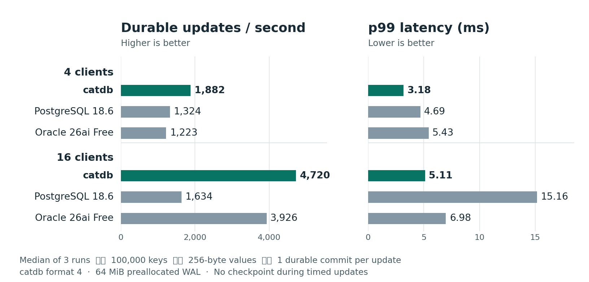

# catdb


catdb is an embedded transactional key-value database written in Rust. It stores ordered byte keys and byte values, so applications can look up one key or read a range from a consistent snapshot. Multiple threads can update the same database, and successful commits are acknowledged after the log is synchronized.

New databases use a preallocated write-ahead log that checkpoints and grows automatically. Existing databases keep their storage policy on upgrade. [Capacity management and explicit migration](docs/service.md#default-wal-and-upgrades) · [Sustained writes across checkpoints and growth](docs/benchmarks/managed-wal-2026-11-08/README.md)

Use catdb directly from Rust, C, or C#. To share a database across processes, run the optional authenticated TCP service on its own or in Docker. **Experimental:** APIs and file formats may change. Use disposable data when evaluating catdb. [MIT license](LICENSE)

## Quick start

With Rust 1.89 or newer, run the embedded example:

```sh
git clone https://github.com/dhq-boiler/catdb.git
cd catdb
cargo run --locked --release --example basic
```

The example creates `example.ndb` in the current directory, commits `hello → world`, and reads the value back. Creation requires a new file path. To use catdb in your own Rust project, add the dependency below and follow the [example source](examples/basic.rs). The Rust library name is `newdbms`.

```toml
[dependencies]
newdbms = { package = "catdb", git = "https://github.com/dhq-boiler/catdb.git" }
```

To try the service instead, run these commands from the cloned repository with Python 3 and Docker Compose installed:

```sh
python scripts/create-catdb-token.py
# On a Linux host, allow the container group to read the token:
# sudo chgrp 10001 .secrets/catdb-token && chmod 640 .secrets/catdb-token
docker compose up --build -d
```

Connect to `127.0.0.1:7400` with the generated token. For individual logins and per-database permissions, see [TLS service accounts](docs/accounts.md). `docker compose down` retains the data volume. [Service configuration and client protocol](docs/service.md)

## Benchmark results

### Durable single-key updates

With four clients, catdb completed **1,882 updates/s**, 42% more than PostgreSQL 18.6, the faster of the two peers at that concurrency. With sixteen clients, it reached **4,720 updates/s**, 20% more than Oracle 26ai Free. catdb also had the lowest p99 latency in all three runs at both client counts.



Each service ran on the same host with 100,000 keys and 256-byte values. Each trial timed 8,000 single-key updates including the request, durable commit and response. catdb used a manually sized 64 MiB format-4 WAL; no checkpoint occurred during these timed cases. [All trials, spread and reproduction](docs/benchmarks/durable-redo-2026-11-08/README.md)

### Sustained writes with the product defaults

A separate catdb workload included automatic checkpoints and growth. With 2 KiB values, four clients sustained **1,728 updates/s** (p99 **3.98 ms**) and sixteen sustained **4,022 updates/s** (p99 **15.76 ms**). Across six runs, the workload crossed 18 growth epochs and 30 compaction epochs. [Maintenance latency and restart checks](docs/benchmarks/managed-wal-2026-11-08/README.md)

<details>
<summary>Earlier comparisons and embedded results</summary>

- [November 8 · Append-WAL service, including key lookups and 100-row ranges](docs/benchmarks/grouped-writes-2026-11-08/README.md)
- [November 7 · Multi-product service comparison and embedded SQLite results](docs/benchmarks/peer-refresh-2026-11-07/README.md)
- [All benchmark studies](docs/benchmarks/)

</details>
