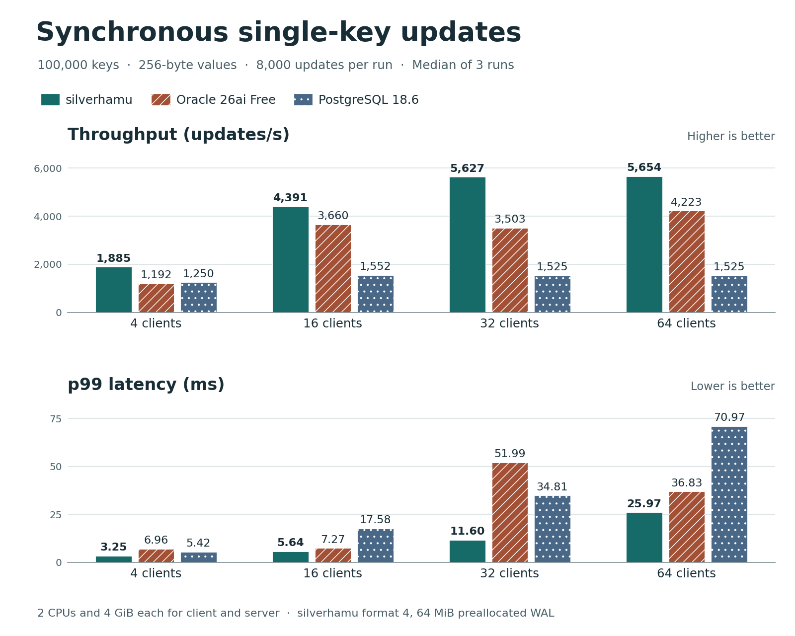

# SilverHamu


Formerly **catdb**. SilverHamu combines the silver bullet ambition with Hamu, a coined name derived from hamster. See [migration and compatibility](docs/rebranding.md) for renamed commands and SDKs, unpublished package names, and identifiers retained for existing databases.


## Feature matrix

| Capability | silverhamu | Windows Owner | Scope in this checkout |
|---|:---:|:---:|---|
| Open a local database without a server | Yes | Yes | One owning process per file. Rust, C and C# can embed the storage engine. |
| Transactions and crash recovery | Yes | Yes | Snapshot reads, conflict detection, commit and rollback use the same native engine. |
| SQL tables, indexes and constraints | Yes | Yes | The .NET 10 SQL layer supports primary and foreign keys, checks and composite indexes. SQL tables are limited to 4,096 rows each. |
| [SQL types for IDs, amounts and time](docs/sql.md#sql-types) | Yes | Yes | Built-in types include UUID, exact decimal, date, time, local date-time, instant and duration. Named types keep values such as customer IDs and order IDs distinct in comparisons and assignments. |
| Add amounts of the same currency | Yes | Yes | Enable addition with `ALTER TYPE JpyAmount ENABLE OPERATOR +`. Adding two `JpyAmount` columns returns a `JpyAmount` and checks its range and constraints. Mixing currency types raises an error. |
| Joins, views and aggregates | Yes | Yes | Inner and outer joins support up to eight inputs and 4,096 intermediate rows per join step. |
| [SQL syntax listed below](#sql-syntax-matrix) | Yes | Yes (SQL database) | Both use the shared SQL engine and support every listed form within the limits shown. |
| [Query execution plans](docs/sql.md#query-plans-and-statistics) | Yes | Yes | `EXPLAIN SELECT` shows the plan. `EXPLAIN ANALYZE SELECT` reports actual rows, loops and elapsed time. Owner also supports both commands on folder tables. |
| Cost-based query optimizer | Yes | Yes (SQL database) | Compares table and index access costs. For eligible inner joins it also chooses join order and hash or nested-loop execution. `ANALYZE` supplies table and column statistics. |
| Serve authenticated network clients | Yes | No | The Rust service supports shared tokens and TLS accounts. Server-side SQL requires a separately configured SQL host. |
| [Query granted views with a view-only token](docs/sql.md#role-writes) | Yes | Yes (client) | The SQL service limits reads to granted views and denies direct key reads and scans. Once a revocation commits, the next read on the same connection is denied. |
| Back up and restore a standalone database | Yes | Yes | Offline backup preserves the physical file. Embedded online backup captures a committed generation. Account-enrolled services require a coordinated backup. |
| SQL editor and result grid | No | Yes | The standalone SQL CLI is also available for scripts. |
| [Replication and automatic failover](docs/replication.md) | Yes (token service) | No | Three or five voters replicate commits and elect a leader. [Online membership changes](docs/replication.md#change-membership-online) can add nodes or remove the current leader. Joining and returning nodes catch up from snapshots and the remaining log. |
| [Planned leader transfer](docs/replication.md#transfer-leadership-before-maintenance) | Yes (token service) | No | Select a caught-up voter and confirm that it can reach a majority without the departing leader before stopping that server. |

[Try embedded SQL](dotnet/README.md#embedded-sql-and-cli) · [SQL and service compatibility](docs/sql.md) · [Back up and restore](docs/backup.md)

### SQL syntax matrix

These labels cover common SQL forms in the shared `SilverHamu.Sql` engine used by silverhamu and Windows Owner. Each label applies to the form shown. In Owner, a folder opened through `.catlink` supports read-only queries, query plans and session-local table statistics.

<details>
<summary>Queries, expressions and joins</summary>

| Syntax | Status | Scope |
|---|:---:|---|
| `SELECT *`, `SELECT t.*`, `SELECT col AS alias` | ✓ Supported | Up to 64 result columns. |
| `SELECT DISTINCT` | ✓ Supported | Removes duplicate projected rows before pagination. |
| `WHERE` with comparisons, `AND`, `OR`, parentheses | ✓ Supported | Compare columns and literals. |
| `IS NULL`, `IS NOT NULL` | ✓ Supported | Example: `SELECT * FROM Book_3 WHERE PublishDate IS NOT NULL`. |
| `LIKE` | ✓ Supported | Text patterns with `%` and `_`. |
| `BETWEEN`, `IN (value, ...)`, unary `NOT` | ✓ Supported | Inclusive bounds, value lists and SQL three-valued logic. |
| `WHERE col IN (SELECT col FROM t ...)` | ✓ Supported | One-column query used as a predicate, including in compound conditions. |
| Correlated subqueries, scalar subqueries, `EXISTS`, `FROM (SELECT ...)` | ✓ Supported | Use outer columns in nested SELECTs. A scalar query returns NULL for zero rows and raises an error for multiple rows. Derived tables require an alias. |
| `INNER JOIN`, `LEFT`, `RIGHT` and `FULL OUTER JOIN` with `ON a.id = b.id` | ✓ Supported | Up to eight inputs. A NULL join key does not match. |
| Compound join conditions, e.g. `ON a.id = b.id AND a.region = b.region` | ✓ Supported | Match all key pairs. Additional conditions such as `AND b.active = TRUE` or `AND a.price < b.price` filter matches before outer-join padding. |
| Joins without an equality key, e.g. `ON a.price < b.price` | ✓ Supported | Scalar predicates can compare ranges or combine conditions with OR. Without an equality key, a nested loop evaluates the condition before outer-join padding. |
| `CROSS JOIN`, `NATURAL JOIN`, `JOIN ... USING` | ✓ Supported | Natural joins match all shared names. USING accepts one or more columns and exposes each shared column once in `SELECT *`. |
| `GROUP BY` | ✓ Supported | One or more grouping columns. |
| Grouping by an expression, e.g. `GROUP BY price * qty` | ✓ Supported | Rows with equal results of the grouping expression form one group. |
| `HAVING` | ✓ Supported | Filters groups after aggregation and before window functions. |
| `COUNT(*)` | ✓ Supported | Counts rows after filtering. |
| `COUNT(col)`, `COUNT(DISTINCT col)` | ✓ Supported | Ignores NULL. DISTINCT counts each distinct non-NULL value once. |
| `COUNT(*) FILTER (WHERE ...)` | ✓ Supported | Only rows for which the predicate is true contribute to that aggregate. Other aggregates in the same query can use different filters. |
| `SUM(col)`, `AVG(col)` | ✓ Supported | Numeric columns. |
| `MIN(col)`, `MAX(col)` | ✓ Supported | Both ignore NULL and return NULL for an empty group. |
| `ORDER BY col ASC/DESC` | ✓ Supported | Multiple sort columns. |
| `ORDER BY col NULLS FIRST` or `NULLS LAST` | ✓ Supported | Set NULL placement independently of ASC or DESC for each sort column, including in window ordering. |
| `OFFSET n ROWS FETCH NEXT n ROWS ONLY` | ✓ Supported | Supports FIRST or NEXT, ROW or ROWS, and a fetch count from 0 to 4,096. |
| `UNION`, `UNION ALL`, `INTERSECT`, `EXCEPT` | ✓ Supported | Operands need the same number of columns with compatible types. ORDER BY and pagination apply to the combined result. |
| `WITH`, `WITH RECURSIVE` | ✓ Supported | Recursive queries use an anchor and a UNION [ALL] recursive term, with at most 4,096 rows. |
| Window functions (`OVER`) | ✓ Supported | Ranking, navigation and aggregate functions with PARTITION BY, ORDER BY and explicit frames. [Functions and examples](docs/sql.md#window-functions) |
| `RANGE` or `GROUPS` window frames | ✓ Supported | GROUPS offsets count peer groups in sort order. A RANGE distance is a nonnegative numeric literal and requires one numeric ORDER BY column. |
| `CASE`, `CAST`, arithmetic such as `SELECT price * qty` | ✓ Supported | Simple and searched CASE, casts to silverhamu column types, and numeric operators with precedence. |
| `SELECT subtotal + tax FROM invoice_lines` on a named numeric type | ✓ Supported | Enable `+` for the type first. Both columns and the result share that type. |
| `EXPLAIN SELECT ...`, `EXPLAIN WITH ... SELECT ...` | ✓ Supported | Returns plan steps and estimates for a full SQL connection or Owner folder session. |
| `ANALYZE table_name` | ✓ Supported | Updates statistics in the current database transaction. In Owner folder mode, statistics stay in memory until the folder is closed. |
| `EXPLAIN ANALYZE SELECT ...`, `EXPLAIN ANALYZE WITH ... SELECT ...` | ✓ Supported | Executes the query once and returns a measured plan. Compare `estimated_rows` with `actual_rows_per_loop` for repeated steps; `elapsed_ms` is cumulative for that step. |
| `SELECT ... FOR UPDATE` | ✓ Supported | Reserves the returned rows of one base table. Use an explicit transaction to keep locks for a subsequent update. Competing writes report a conflict. |

</details>

<details>
<summary>Writes, schema, privileges and transactions</summary>

| Syntax | Status | Scope |
|---|:---:|---|
| `INSERT INTO ... VALUES` | ✓ Supported | Optional column list and multiple rows of literals. |
| `INSERT INTO ... SELECT` | ✓ Supported | Inserts a query result into all or selected target columns, applying defaults and constraints. |
| `MERGE` | ✓ Supported | Accepts a table, view, query or VALUES source. Matched rows can be updated or deleted and unmatched source rows can be inserted. |
| `INSERT ... ON CONFLICT ... DO UPDATE` | ✓ Supported | On a base table, name a primary or unconditional unique key. Use `excluded.col` for the proposed value. `DO NOTHING` can skip conflicts. |
| `UPDATE ... SET col = literal [WHERE ...]` | ✓ Supported | One or more column assignments. |
| `UPDATE ... SET qty = qty + 1` | ✓ Supported | Each assignment reads the original row, including when several columns change. |
| `DELETE FROM ... [WHERE ...]` | ✓ Supported | |
| `RETURNING` on `INSERT`, `UPDATE` or `DELETE` | ✓ Supported | Returns scalar projections or `*` for directly affected rows: new values after INSERT or UPDATE and old values for DELETE. |
| `CREATE TABLE`, `DROP TABLE` | ✓ Supported | Up to 64 columns per table. |
| `TRUNCATE TABLE` | ✓ Supported | Clears a base table and its index entries transactionally. Inbound references from other tables prevent truncation. |
| `CREATE INDEX ... ON t(col, ...)` | ✓ Supported | Index one column or a tuple of columns. |
| `CREATE UNIQUE INDEX`; partial indexes (`CREATE INDEX ... WHERE ...`) | ✓ Supported | Unique indexes reject duplicate non-NULL key tuples. Add WHERE to index only rows satisfying a scalar predicate. |
| `CREATE TRIGGER` | ✓ Supported | AFTER INSERT, UPDATE or DELETE on a base table. Row triggers can use OLD and NEW, an optional WHEN condition, and a body of INSERT VALUES, UPDATE or DELETE statements. |
| `CREATE SEQUENCE` | ✓ Supported | Transactional signed 64-bit sequences with START WITH and INCREMENT BY. Use `SELECT NEXT VALUE FOR seq` or `NEXT VALUE FOR seq` in INSERT VALUES. |
| `CREATE TYPE ... AS DISTINCT`, `SHOW TYPES` | ✓ Supported | Give IDs, amounts and other values distinct types with optional constraints. [SQL types and examples](docs/sql.md#sql-types) |
| `ALTER TYPE T ENABLE OPERATOR +` | ✓ Supported | Enable addition for a named numeric type. The sum retains that type. |
| `CREATE TABLE ... AS SELECT` | ✓ Supported | Copies query results and infers column types, including for an empty result. |
| `NOT NULL`, column-level `UNIQUE`, `DEFAULT literal`, `CHECK` | ✓ Supported | Column and table checks use the supported predicate syntax. |
| Single-column or composite `PRIMARY KEY` | ✓ Supported | |
| Single-column `FOREIGN KEY ... REFERENCES` | ✓ Supported | |
| Composite foreign keys, `ON DELETE CASCADE`, `ON UPDATE CASCADE` | ✓ Supported | Composite references target a composite primary key. Cascades propagate through dependent rows and indexes in the same transaction. |
| Foreign key actions `SET NULL` and `SET DEFAULT` | ✓ Supported | On parent UPDATE or DELETE, assign NULL or the referencing columns' defaults. The resulting rows must satisfy all constraints. |
| `ALTER TABLE ... ADD COLUMN`, `RENAME COLUMN` | ✓ Supported | |
| `ALTER TABLE ... DROP COLUMN`, `ALTER COLUMN` | ✓ Supported | Drop columns, change a compatible data type, or set/drop DEFAULT and NOT NULL. Dependent constraints and views are checked. |
| `CREATE VIEW ... AS SELECT`, `DROP VIEW` | ✓ Supported | View definitions select from base tables. Join and aggregate views support reads. |
| `INSERT`, `UPDATE` or `DELETE` through a view | ✓ Supported | Single-table views that project distinct base columns directly. UPDATE and DELETE act on rows visible through the view. |
| `GRANT SELECT ON view`, `REVOKE SELECT ON view` | ✓ Supported | A view-only token can query granted views. Once a revocation commits, the next query against that view is denied even on the same connection. |
| `GRANT INSERT`, `GRANT UPDATE`, `GRANT DELETE` | ✓ Supported | Grant or revoke each write operation on a named table or view. The authenticated role needs a grant for the requested operation. |
| `COMMIT`, `ROLLBACK` | ✓ Supported | Open a transaction with `BEGIN` or `BEGIN TRANSACTION`. |
| `START TRANSACTION`, `SAVEPOINT`, `ROLLBACK TO SAVEPOINT` | ✓ Supported | Up to 128 named savepoints per active transaction. ROLLBACK TO retains the named savepoint. RELEASE removes it. |

</details>

silverhamu is an embedded transactional key-value database written in Rust. It stores ordered byte keys and byte values, so applications can look up one key or read a range from a consistent snapshot. Multiple threads can update the same database, and successful commits are acknowledged after the log is synchronized.

New databases use a preallocated write-ahead log that checkpoints and grows automatically. Existing databases keep their storage policy on upgrade. [Capacity management and explicit migration](docs/service.md#default-wal-and-upgrades) · [Sustained writes across checkpoints and growth](docs/benchmarks/managed-wal-2026-11-08/README.md)

Embed silverhamu in Rust, C or C#, or connect to its authenticated TCP service from Python, JavaScript/TypeScript (Node.js), Go, C#, Java or Ruby. Each service client supports binary keys and values, transactions and TLS account authentication. [Client libraries and examples](docs/clients.md)

**Experimental:** APIs and file formats may change. Use disposable data when evaluating silverhamu. [MIT license](LICENSE)

## Quick start

With Rust 1.89 or newer, run the embedded example:

```sh
git clone https://github.com/dhq-boiler/catdb.git
cd silverhamu
cargo run --locked --release --example basic
```

The example creates `example.ndb` in the current directory, commits `hello → world`, and reads the value back. Creation requires a new file path. To use silverhamu in your own Rust project, add the dependency below and follow the [example source](examples/basic.rs). The Rust library name is `newdbms`.

```toml
[dependencies]
newdbms = { package = "silverhamu", git = "https://github.com/dhq-boiler/catdb.git" }
```

To try the service instead, run these commands from the cloned repository with Python 3 and Docker Compose installed:

```sh
python scripts/create-silverhamu-token.py
# On a Linux host, allow the container group to read the token:
# sudo chgrp 10001 .secrets/silverhamu-token && chmod 640 .secrets/silverhamu-token
docker compose up --build -d
```

Connect to `127.0.0.1:7400` with the generated token. For individual logins and per-database permissions, see [TLS service accounts](docs/accounts.md). `docker compose down` retains the data volume. [Service configuration and client protocol](docs/service.md)

## Client libraries

Start a local silverhamu server with the [quick start](#quick-start). Choose a language below for an example that connects to the server, writes a binary key, and reads its value back.

| Language and example | Runtime | Install version 0.1.0 | Package |
| --- | --- | --- | --- |
| [C#](https://www.nuget.org/packages/SilverHamu.Client/0.1.0#readme-body-tab) | .NET 10 | `dotnet package add SilverHamu.Client --version 0.1.0` | [NuGet](https://www.nuget.org/packages/SilverHamu.Client/0.1.0) |
| [Go](clients/go/README.md) | Go 1.22+ | `go get github.com/dhq-boiler/catdb/clients/go@v0.1.0` | [Go packages](https://pkg.go.dev/github.com/dhq-boiler/catdb/clients/go@v0.1.0) |
| [Java](clients/java/README.md) | Java 17+ | Gradle `implementation("io.github.dhq-boiler:silverhamu-client:0.1.0")` · [Maven POM](clients/java/README.md) | [Maven Central](https://central.sonatype.com/artifact/io.github.dhq-boiler/silverhamu-client/0.1.0) |
| [JavaScript / TypeScript](clients/node/README.md) | Node.js 18+ | `npm install silverhamu-client@0.1.0` | [npm](https://www.npmjs.com/package/silverhamu-client/v/0.1.0) |
| [Python](clients/python/README.md) | Python 3.10+ | `python -m pip install silverhamu-service-client==0.1.0` | [PyPI](https://pypi.org/project/silverhamu-service-client/0.1.0/) |
| [Ruby](clients/ruby/README.md) | Ruby 3.1+ | `gem install silverhamu-client -v 0.1.0` | [RubyGems](https://rubygems.org/gems/silverhamu-client/versions/0.1.0) |

## Back up and restore a database

Close the standalone database or stop its server. From the repository root, build the CLI and use new filenames for the archive and the restored database.

```sh
cargo build --locked --release --bin silverhamu
./target/release/silverhamu backup state.ndb state.catbak
./target/release/silverhamu restore state.catbak recovered.ndb
```

The archive omits all-zero blocks. In the benchmark with unused WAL capacity, a 128.25 MiB database produced a 2.32 MiB archive. Restore verifies the archive and writes the full database, including its reserved space. Services with TLS accounts require a coordinated copy of the data files and account catalog. [Backup, restore and Docker instructions](docs/backup.md) · [Windows and Linux measurements](benchmarks/backup-restore/README.md)

## Benchmark results

### Durable single-key updates

Across 4, 16, 32 and 64 clients, silverhamu completed more synchronous updates per second and had lower p99 latency than Oracle 26ai Free and PostgreSQL 18.6 in all three trials at each client count. At 32 clients, silverhamu reached **5,627 updates/s**, 61% more than Oracle, the faster peer. Doubling to 64 clients brought **5,654 updates/s** (+0.5%), while p99 rose from **11.60 to 25.97 ms**.



Each trial timed 8,000 single-key updates against 100,000 keys with 256-byte values, including the request, durable commit and response. Each server and client had 2 CPUs and 4 GiB on the same host. silverhamu used a 64 MiB preallocated WAL and a connection limit of 64. All timed updates fit before a checkpoint. [Results table, trial ranges and reproduction](docs/benchmarks/high-clients-2026-11-08/README.md)

### Sustained writes with the product defaults

A separate silverhamu workload with 2 KiB values included automatic checkpoints and growth. The original 4- and 16-client runs sustained **1,728** and **4,022 updates/s**. With 32 and 64 writers, the v0.1.0 release sustained **4,146** and **4,210 updates/s**, with p99 of **25.46** and **36.96 ms**, respectively. All six high-concurrency runs recovered every key after a forced stop. [4- and 16-client trials](docs/benchmarks/managed-wal-2026-11-08/README.md) · [32- and 64-client trials](docs/benchmarks/high-clients-2026-11-08/README.md#automatic-checkpoints-and-growth)

<details>
<summary>Earlier comparisons and embedded results</summary>

- [November 8 · Original 4- and 16-client comparison of preallocated and append WALs](docs/benchmarks/durable-redo-2026-11-08/README.md)
- [November 8 · Append-WAL service, including key lookups and 100-row ranges](docs/benchmarks/grouped-writes-2026-11-08/README.md)
- [November 7 · Multi-product service comparison and embedded SQLite results](docs/benchmarks/peer-refresh-2026-11-07/README.md)
- [All benchmark studies](docs/benchmarks/)

</details>
