# catdb


**Experimental.** APIs, the network protocol, and file formats may change. catdb is not production-ready or certified for mission-critical use. Keep independent backups and evaluate it with disposable data first.

catdb is a Rust key-value database that runs either **embedded, without a service**, or as an **optional service process**, including in a Docker container. Both modes use the same transaction engine.

## Cost of copying MVCC rows into checkpoint pages

At 1M rows, four writers, two CPUs and 4 GiB, direct page packing with one encoding per paired page measured **68.9 ms update p99, 123.0 ms worst wait and 294.2 transactions/s** at 414.7 MiB end RSS. The previous direct scan measured 99.6 ms, 176.4 ms and 278.7 transactions/s. The dual-index reference measured 80.8 ms, 132.3 ms and 285.7 transactions/s at 767.3 MiB.

[Checkpoint timings, both experiments and recovery tests](docs/benchmarks/packed-mvcc-2026-11-07/README.md).

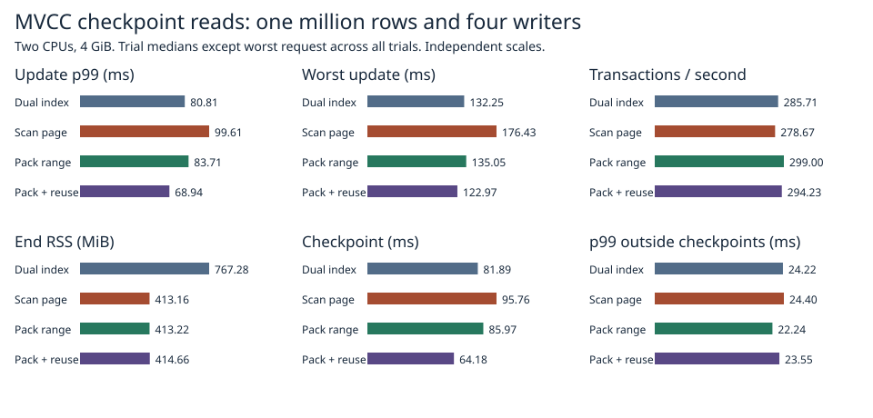

## Reading checkpoint ranges directly from MVCC

Reading changed ranges directly from MVCC reduced end-of-loop RSS from **768.8 to 413.2 MiB**. WAL used 409.8 MiB. The direct path measured 280.8 transactions/s, p99 96.9 ms and a worst request of 143.5 ms. WAL measured 219.1 transactions/s, 479.8 ms and 2851.5 ms respectively. Against the previous dual-index prototype, direct reading reduced end RSS by 355.6 MiB (46.2%), with p99 increasing from 84.2 to 96.9 ms and throughput falling 2.5%.

[Per-trial results, recovery memory and safety checks](docs/benchmarks/direct-mvcc-2026-11-07/README.md).

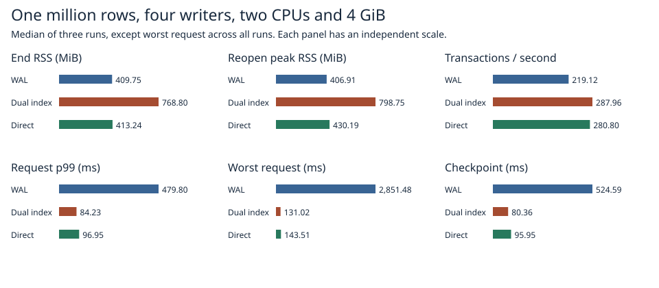

## FIFO delta checkpoints on native MVCC

With native MVCC on both paths, FIFO delta persistence measured **293.2 transactions/s**, p99 **84.2 ms**, and worst request **149.7 ms**. WAL measured 203.4 transactions/s, 579.1 ms and 1,511.1 ms. End RSS was 769 MiB for the prototype and 409 MiB for WAL.

[All six trials, crash tests and setup](docs/benchmarks/mvcc-delta-2026-11-07/README.md).

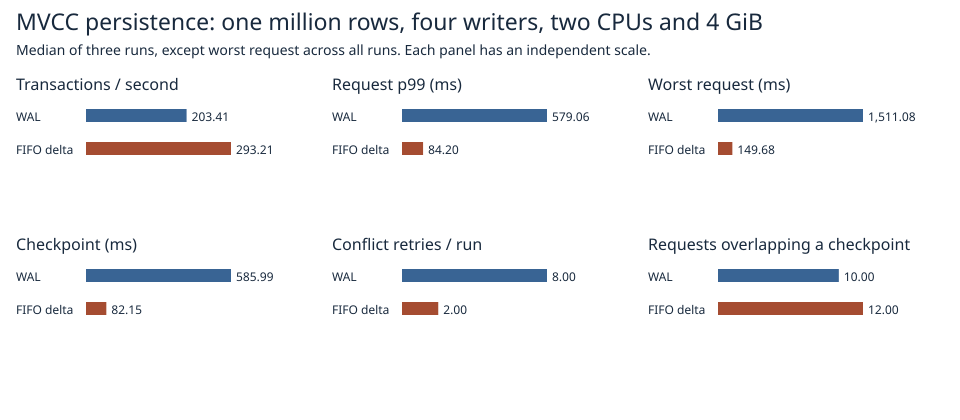

## FIFO publication under four writers

FIFO publication completed 271.5 transactions/s at p99 109.8 ms. The worst request across three runs fell from 2,841.8 ms with the original delta mutex to **164.4 ms**. WAL measured 208.3 transactions/s, p99 207.5 ms and a 2,951.9 ms worst request. The original delta path was slightly faster on throughput (275.0 transactions/s).

[Attribution, measurement overhead, safety checks and trial data](docs/benchmarks/publication-waits-2026-11-07/README.md).

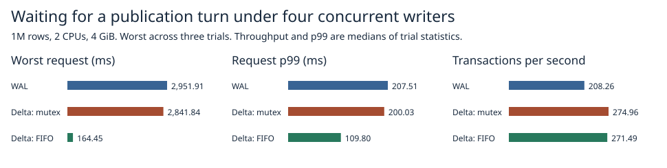

## Four writers with incremental checkpoints

At four writers the worst request measured **2,242.9 ms** with incremental pages, **2,370.5 ms** with the current WAL and **7,202.5 ms** with full dual records. Incremental throughput was 310.3 transactions/s versus 212.6 for WAL. The corresponding p99 values, including conflict retries and admission wait, were 293.10 and 534.73 ms.

[All trials, concurrency policy and crash tests](docs/benchmarks/four-writer-checkpoints-2026-11-07/README.md).

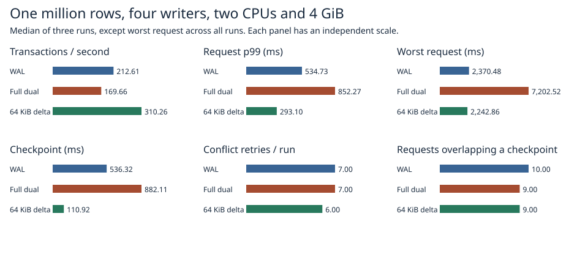

## Incremental dual-record checkpoints

At 1M rows the 64 KiB incremental path submitted **128.5 MiB** against 816.4 MiB for WAL and 1,632.2 MiB for full dual records. The worst checkpoint-inclusive update took **117.9 ms**, compared with 1,230.1 ms and 1,310.9 ms, respectively. Update p99 was 8.22 ms for incremental and 5.38 ms for WAL. Warm reopen took 1.90 s and 0.99 s, respectively. At 100k the incremental path still wrote more bytes than WAL. All 18 main trials verified latest, pinned and reopened data.

[Trial data, recovery checks and reproduction](docs/benchmarks/dirty-pages-2026-11-07/README.md).

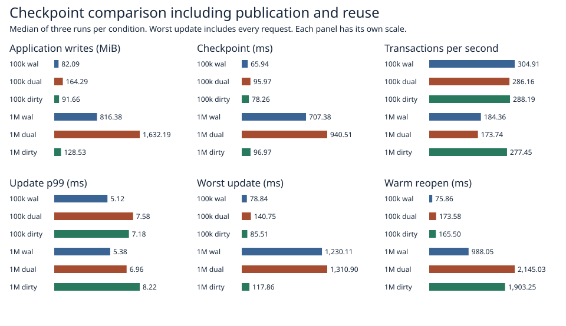

## Dual-record region reuse at one million rows

The experimental store recovered the latest data and preserved the old reader in every final run. It did **not** reduce syncs: both paths used 1,030 for 1,024 transactions and three full checkpoints. At one million rows the prototype submitted about twice the bytes of the current WAL. These are separate single-writer paths, and the prototype protects against at most one detectably damaged copy per record. The production WAL remains unchanged.

[All trials, failure cases and reproduction instructions](docs/benchmarks/scaled-gate-2026-11-07/README.md).

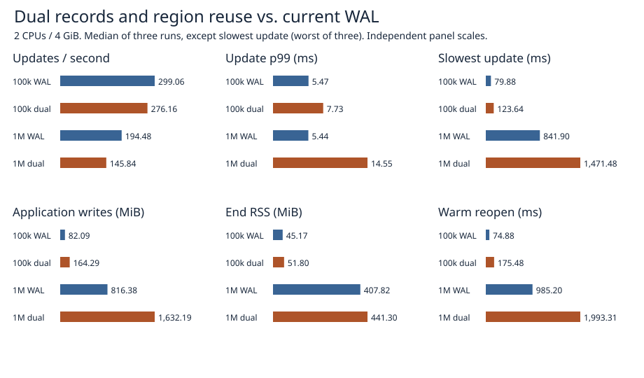

## Inline short keys are now the default

At aged 1M rows /1 CPU /512MiB, short-key RSS falls **420.12 → 390.46 MiB (-7.1%)**.
With half 8-byte and half 32-byte keys, RSS falls **426.48 → 411.90 MiB (-3.4%)**;
update p99 worsens **6.324 → 6.514 ms (+3.0%)**, within the agreed 5% tolerance.
Short-key update p99 is 6.044 → 6.019 ms. All 192,000 requests and the integrity,
old-reader, crash-reopen and API checks pass. `inline-key` now joins `inline-latest`
in defaults; file formats and durability are unchanged.

This adoption is for memory efficiency. Mixed-key warm reopen readiness worsens
**2.417 → 2.718 seconds**; unfavorable trials remain published. The default-built
service and library are byte-identical to the measured explicit candidate.
[All trials, limits, safety and rollback](docs/benchmarks/inline-qualification-2026-11-07/README.md).

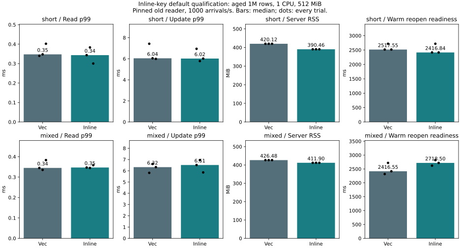

## Bounded log-capacity tradeoff

With real synchronization after every update, moving from 4 to 16 to 64 log slots
raises median throughput **405.66 → 545.80 → 582.05 updates/s** in the small fixture.
The cost is warm full-log reopening **0.453 → 1.497 → 5.805 ms** and reserved files
**384 KiB → 1.125 MiB → 4.125 MiB**. Capacity 16 is a next experimental candidate,
not a production default; the extra gain at 64 is only 6.6% versus 16 here.

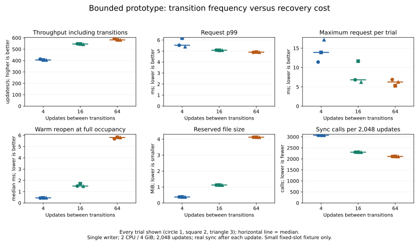

18,432 measured updates and 900 warm reopen checks pass, alongside 39 added external
kills and cross-capacity rejection tests. Production behavior is unchanged.
[All nine trials, p99/maxima, limits and reproduction](docs/benchmarks/capacity-gate-2026-11-07/README.md).

## Bounded reuse: locating long requests

Matched request-phase diagnostics place **94.39–94.59%** of summed request time
inside synchronization envelopes. The slowest clear-mode request is **29.505 ms**,
including **29.194 ms** of sync envelopes; reuse reaches **11.599 ms**, including
**11.499 ms** of append sync. Preparation/publication did not dominate these events.

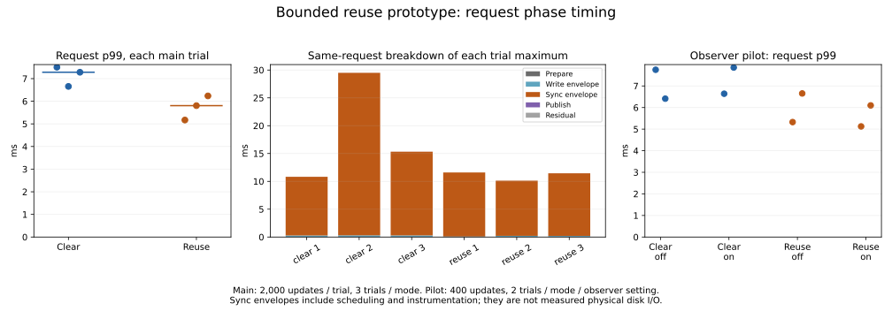

Sync envelopes include scheduling and storage waits, not just physical disk I/O.
This does not explain the earlier uninstrumented 18.214-ms event or prove a tail fix.
Observer cost remains uncertain after short on/off pilots. 15,200 measured updates,
old maps and 1,400 warm reopen checks pass; production/defaults are unchanged.
[Every trial, interval definitions, delayed episode and observer limits](docs/benchmarks/reuse-phases-2026-11-07/README.md).

## Bounded epoch-reuse timing

Three short single-writer trials per mode show median throughput including
transitions **364.89 → 412.68 updates/s (+13.1%)** and request p99
**7.271 → 5.632 ms (-22.5%)**. However, the worst request across all trials
**worsens 15.070 → 18.214 ms**, and append-only p99 is not consistently better.
These are small fixed-slot prototype results, not a production or large-data claim.

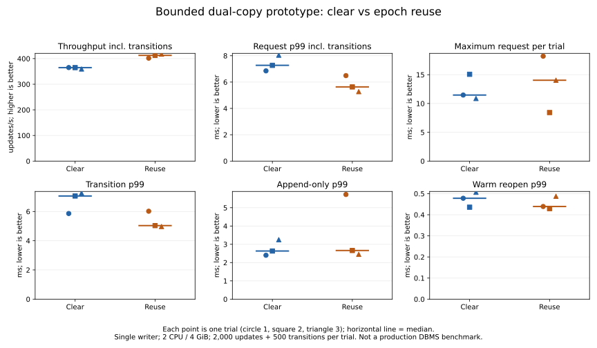

12,000 measured updates, retained old maps and 600 warm reopen checks pass.
Real syncs are maintained; defaults remain unchanged.
[All percentiles, raw requests, conditions and reproduction](docs/benchmarks/reuse-speed-2026-11-07/README.md).

## Bounded epoch-reuse experiment

In the small variable-length fixture, retaining obsolete bank bytes reduces
transition writes **336,550 → 8,870 bytes (-97.36%)** and sync calls **3 → 2**.
File size and ordinary append costs are unchanged. This is write accounting,
not a measured throughput or latency improvement.

Naively removing clearing failed a recovery model: an outer CRC over an already
CRC-protected frame did not distinguish a stale inner sequence. Full inner validation
and narrowly identifying validated older transactions resolved the selected cases.
The corrected test-only candidate passes 44 added external kills and 12,675 added
selector-prefix combinations; the failed variants and both-copy-loss counterexample
remain recorded. Production behavior and defaults are unchanged.
[Matched costs, failure analysis, limits and raw results](docs/benchmarks/epoch-reuse-2026-11-07/README.md).

## Variable-length production-codec gate

A test-only dual-copy store now reuses the production WAL encoder/decoder.
Eleven tests pass, including 30 external process kills, 8,450 selector-prefix
combinations and 4,269 single-copy byte-corruption cases. Multi-key updates recover
atomically within the explicit one-damaged-copy assumption; both-copy loss remains
a counterexample. Existing library tests also pass in two feature configurations.

Ordinary append still uses one sync, but this bounded fixture writes **336,550 bytes
and uses three syncs per generation transition**. Its whole checkpoint must fit one
16-KiB slot. This is a codec/recovery gate, not a scalable implementation or a speedup
claim. Production APIs, persistence formats and defaults remain unchanged.
[Protocol, byte/buffer accounting, raw results and remaining gates](docs/benchmarks/variable-gate-2026-11-07/README.md).

## Repair and generation transition gate

The bounded standalone probe now keeps the old selector pair while preparing a
new pair. Thirteen tests pass, including 8,450 selector-persistence combinations
and 37 external child-process kills across repair, switching and reclamation.
Normal append uses one sync; a complete transition uses three, and repairs add
their own syncs. This is not a production integration or a measured speedup.
[Protocol, costs, negative controls and remaining work](docs/benchmarks/generation-gate-2026-11-07/README.md).

## Bounded dual-copy recovery probe

A separate prototype writes two log copies before one ordinary commit sync.
Under the explicitly limited assumption of at most one damaged copy per record,
10 model/file tests pass, including four external child-process kills. Reopen
repairs require an additional sync. Correlated loss of both copies remains an
explicit counterexample; generation recycling and production integration are not
validated. No speedup, production safety pass or default change is claimed.
[Results, assumptions and remaining gates](docs/benchmarks/dual-copy-gate-2026-11-07/README.md).

## Single-sync recovery safety gate

A preliminary Rust recovery model rejected the simple self-validating-prefix
candidate: interrupted writes and post-acknowledgement suffix damage can leave
identical bytes. Silently discarding the tail loses acknowledged data in one
history; rejecting it prevents automatic recovery in the other. Six model tests
reproduce this limitation, not a production safety pass. No performance trial,
engine/default change or new speedup is claimed.
[Counterexample, scope and next design requirements](docs/benchmarks/single-sync-gate-2026-11-07/README.md).

## Durable I/O: log growth versus reuse

Matched single-writer observations show catdb syncing an extending log in about
3.20 ms; SQLite takes about 3.24 ms while extending and 1.55 ms when reusing space.
SQLite performs more sync calls here, not fewer. Ordinary untraced throughput is
283 versus 548 updates/s. No engine/default was changed; retained-reader observer
results were unstable and are included rather than discarded.
[Full comparison, limitations and raw data](docs/benchmarks/io-phases-2026-11-07/README.md).

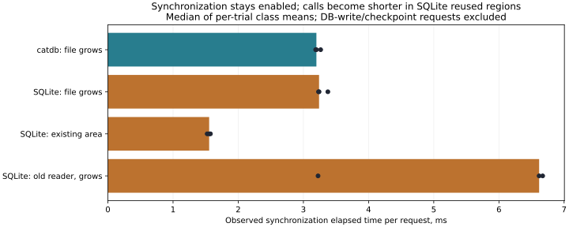

## Single-writer bottleneck investigation

With 100k rows /one writer /2 CPU /4GiB, C ABI and direct Rust both reach about 282
updates/s with grouping and 309–310/s without it. SQLite reaches 541/s. Matched
Rust diagnostics attribute 91–99% of request elapsed time to log synchronization;
removing the 0.273ms collection wait helps but does not explain the whole gap.
Worst observed latencies did not improve consistently; defaults are unchanged.
SQLite's retained-reader sensitivity points to WAL lifecycle as a next hypothesis,
not a proven physical-I/O cause.
[Full results, safety, observer effect and raw data](docs/benchmarks/solo-update-2026-11-07/README.md).

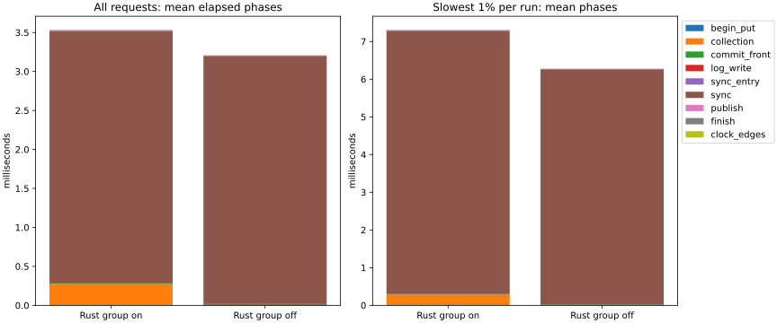

## Refreshed DBMS API comparison

Fresh 100k-row /256B /1- and 4-client measurements use the current default catdb
and its one-request service API, with SQLite, PostgreSQL, MySQL and Oracle Free.
At four clients catdb reaches **1,133 durable updates/s**, versus PostgreSQL
**1,298** and Oracle Free **1,280**; median update p99 is **5.08 /5.55 /5.37ms**
respectively. catdb has higher throughput for the tested service lookup and
100-row read paths. In embedded single-client updates SQLite reaches 596/s versus
catdb 303/s; catdb does not lead every workload. These are Python API microbenchmarks, not a general DBMS ranking.

[All repetitions, conditions, integrity checks and legacy API supplement](docs/benchmarks/peer-refresh-2026-11-07/README.md).

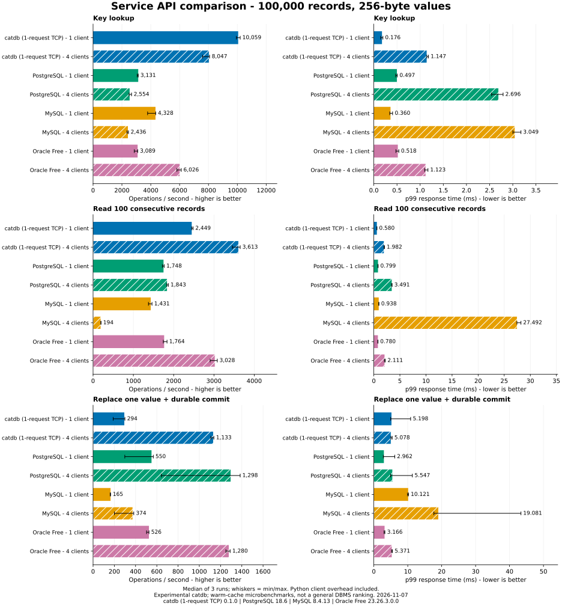
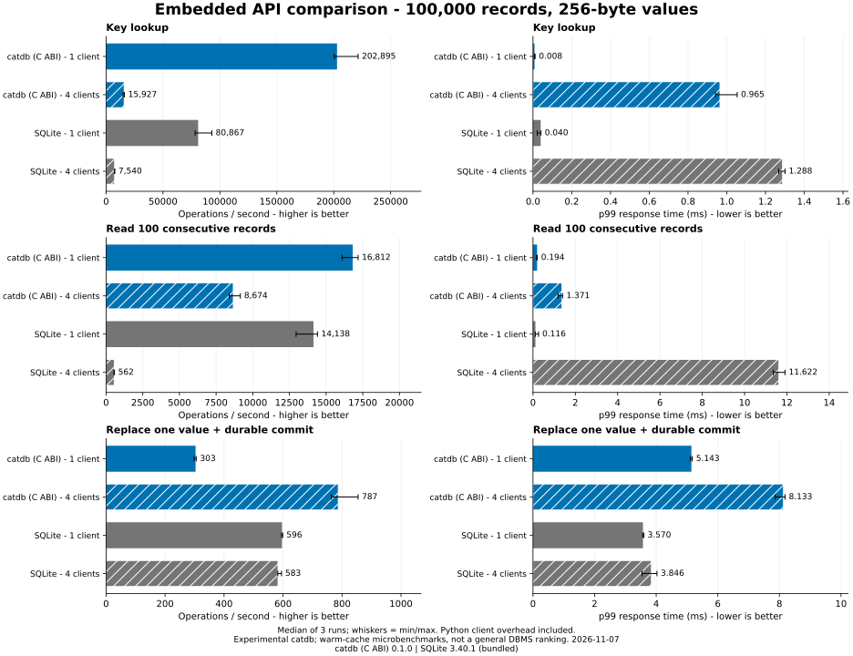

## Optional JSON frame buffering experiment

At aged 1M rows /1 CPU /512MiB /1,000 requests/s, bounded connection-local
buffers reduced median server CPU **9.686% → 8.056% (-16.8%)** across three pairs.
However, mixed read p99 was **0.329 → 0.354ms** and write p99 **5.178 → 5.442ms**.
RSS stayed near 420MiB. This saves CPU work, but is not a demonstrated latency or
capacity improvement; `wire-buffer` remains opt-in and defaults are unchanged.
[Every trial, ramp, allocation diagnostics and safety checks](docs/benchmarks/wire-buffer-2026-11-07/README.md).

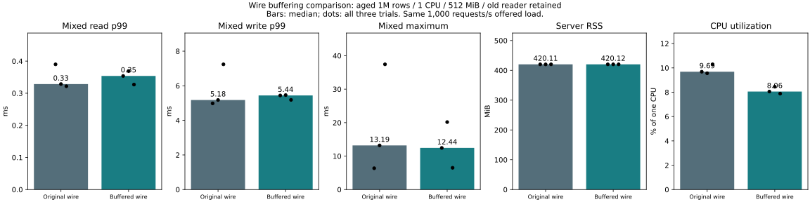

## Short-key storage: initial optional experiment

At 1M rows /1 CPU /512MiB, storing short index keys inline reduced median RSS
**420.11 → 390.51 MiB (-7.0%)**. Separate diagnostics eliminated 2M open-time
allocation calls and 8MB of retained requested memory. However, mixed read p99
was 0.349 → 0.363ms and update p99 5.321 → 5.507ms; this is not a universal speedup.
At that experiment `inline-key` remained optional. See the later
[default qualification](#inline-short-keys-are-now-the-default) for its current setting; persistence remains unchanged.
[All trials, long-key comparison, safety and limitations](docs/benchmarks/inline-key-2026-11-07/README.md).

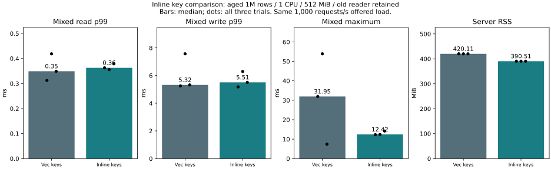
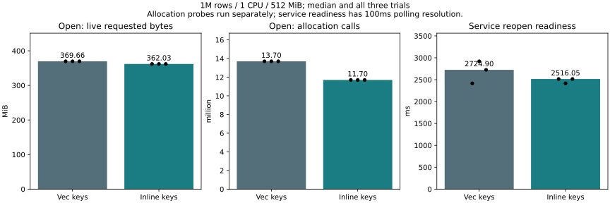

## Budget-partitioned preparation pilot

With 1M rows / 1 CPU / 512 MiB, dividing a 4 KiB staged-write test budget across four
writers capped preparation at two updates each and avoided all refusals. Under a
100ms sync stall, both policies still used 382 syncs; update p99 was 86.88 → 89.58 ms
and maximum 103.16 → 104.79 ms. Screening failed; no longer run or default change.
[Conditions, safety checks, limitations and measurements](docs/benchmarks/budget-backlog-2026-11-07/README.md).

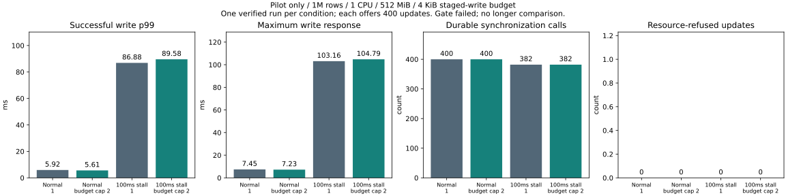

## What is implemented

- Ordered byte keys and opaque byte values.
- Optimistic serializable transactions, snapshot reads, and read/write/range conflict detection.
- Multiple concurrent writers with group commit; successful commits are acknowledged after log synchronization.
- Checkpoints, crash recovery, bounded page reads, and configurable engine resource limits.
- A C ABI and source-level C# bindings.
- An optional authenticated TCP service with bounded connections, requests, and transaction lifetimes.
- A non-root Docker image and Compose configuration with persistent storage.

## Inline latest is now the default

The latest value is held directly in each key's history, with heap history used
for older versions. Normal embedded, service and Docker builds now enable
`inline-latest`; the separate history-elision optimization remains opt-in.
Existing files and APIs are unchanged. Use `--no-default-features` to build the
previous deque layout (add `--features service` for the service).

The 1M-row / 1-CPU / 512-MiB qualification retained an old reader during mixed
traffic. All **96,000 requests**, **30 full-content checks**, and **six seed checks**
passed, including forced-stop recovery. RSS stayed near **420 MiB**.
This adoption is for memory capacity, not higher speed: write p99 median was
**5.540 → 6.008 ms (+8.5%)** versus the earlier explicit-feature build; the worst
response was **14.657 → 15.935 ms**. All individual trials and limitations remain
visible. A 512-MiB service limit is not a 512-MiB total-machine guarantee.

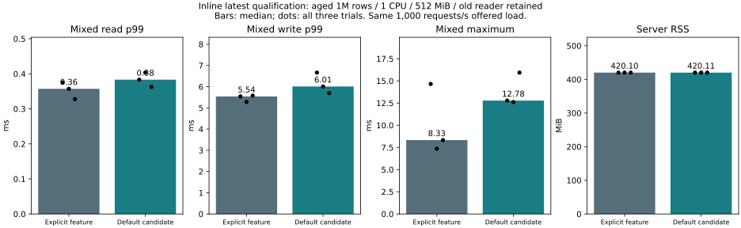

See [safety, compatibility, all measurements and rollback](docs/benchmarks/inline-default-2026-11-06/README.md).
The project remains Experimental.

A [matched-build follow-up](docs/benchmarks/default-tail-2026-11-06/README.md)
did **not reproduce a consistent default-feature slowdown**: the rebuilt binaries
matched the previous images, paired results changed direction, and identical-image
controls showed substantial response-time variation. The original 8.5% observation
remains visible; its cause is unresolved. No engine change or speedup is claimed.

A [kernel-observer follow-up](docs/benchmarks/aged-sync-2026-11-06/README.md)
partitioned **4,794 log syncs** on the same diagnostic binary. Blocking accounted
for **98.47–98.59%** of sync time; runnable CPU wait in the slowest calls was only
**0.007–0.017 ms**. Blocking is **not** a measurement of physical disk latency.
Observer off/on write p99 medians were **5.891 / 5.478 ms**, while the worst write
response was **12.702 / 14.569 ms**. Paired effects varied; no speedup or engine
change is claimed. All **96,000 requests** and recovery checks passed.

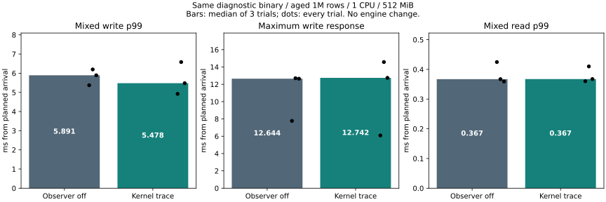

A [storage-path follow-up](docs/benchmarks/storage-path-2026-11-06/README.md)
compared the same 1M-row binary on Docker ext4 volumes and C: folders shared via
9p/DrvFs. Write p99 medians were **6.242 / 4.597 ms**;
the worst write responses were **32.687 / 24.335 ms**.
Median reopen time increased **2.616 → 7.043 seconds** on the shared path.
All trials and recovery checks are published. These are storage-path observations,
**not proof of equal physical power-loss durability**; no engine or storage default
changed.

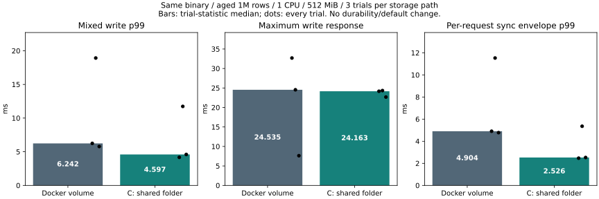

A [constrained-backlog pilot](docs/benchmarks/constrained-backlog-2026-11-07/README.md)
reused the existing batch API with 1M rows, 1 CPU, 512 MiB and the harness's small
**4-KiB staged-write override**. Under one slow sync, both policies made **381 syncs**,
but batching resource-refused **5 of 400 updates**. The screen failed; the longer
comparison was stopped and defaults remain unchanged. The product's staged-write
default is 32 MiB, so this is not a general 512-MiB capacity limit.

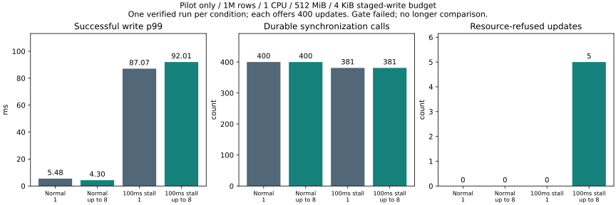

## What is not promised

- No SQL parser, relational query optimizer, replication, or automatic failover.
- No built-in TLS, per-user authorization, or service-side request deduplication.
- No automatic service checkpoint scheduler. Schedule checkpoints before the current 1 GiB WAL limit is reached.
- The transaction engine loads data into memory. Resource budgets are not a hard bound on total process memory or database size during recovery.
- Process-crash tests are not proof against every storage device failure or actual power loss. Durability depends on the operating system and storage honoring synchronization.
- No claim of being faster than SQLite or other databases across workloads.

The service protocol is experimental framed JSON over TCP, **not HTTP or SQL**. The default host binding is loopback. Use an encrypted tunnel or TLS proxy for cross-host access; the shared token alone does not encrypt traffic.

## API microbenchmarks (experimental)

A reproducible comparison of **catdb, SQLite, PostgreSQL, MySQL and Oracle Free**
on one workstation. Embedded and service results are shown separately: the service
measurements include TCP, drivers and an additional client container.

The workload uses **100,000 synthetic records, 256-byte values, 1 or 4 clients**,
with a separate transaction for every lookup, 100-record keyset scan or durable
single-record update. Each condition runs three times in varied order. Bars show
medians; whiskers show the minimum and maximum of the three runs. These original
product comparisons predate the [group-commit follow-up](#follow-up-faster-four-client-service-updates) below.

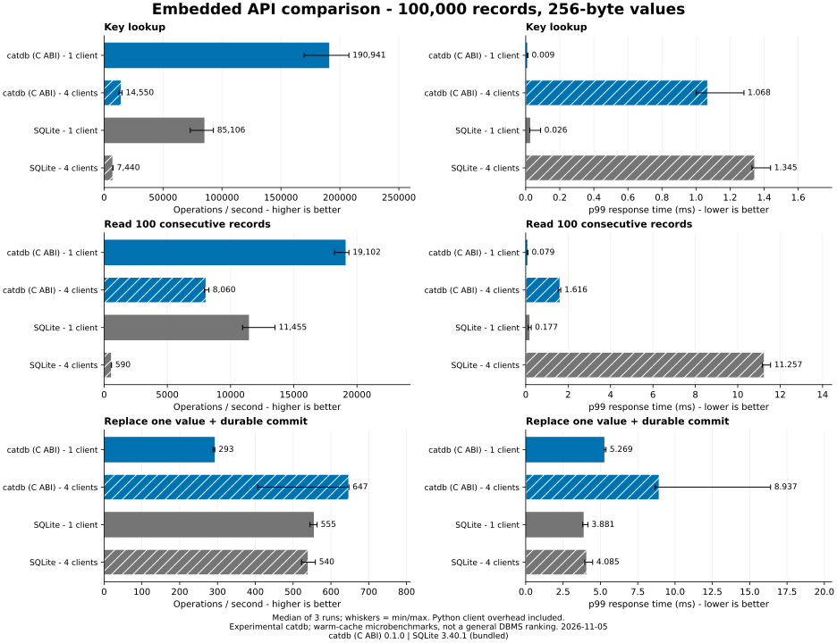

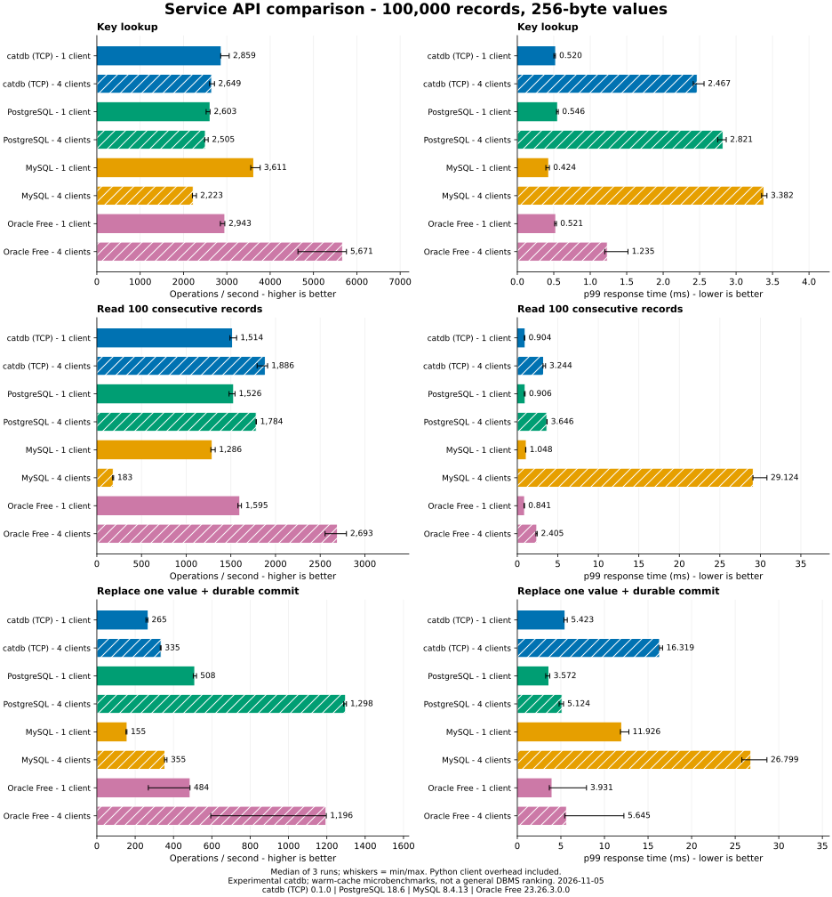

These are **warm-cache Python-client microbenchmarks**, including API and driver
overhead. Python thread scheduling and the GIL can limit four-client throughput.
SQLite is the bundled **3.40.1**, not the latest upstream release.
They are not a general DBMS ranking, an engine-only ceiling, or a comparison of
SQL features, cold startup, larger-than-memory datasets or production reliability.
Faster results in one panel do not imply superiority in the others.

In this run, catdb's embedded single-client reads were faster than the bundled
SQLite path, while service updates lagged PostgreSQL and Oracle Free. All 864,000
operations and 144 full-content checks passed; these checks do not prove power-loss
durability.

See the [results and machine configuration](docs/benchmarks/2026-11-05/README.md),
[complete numerical table](docs/benchmarks/2026-11-05/table.md),
[methodology and reproduction commands](benchmarks/README.md), and
[raw run summaries](docs/benchmarks/2026-11-05/results.json).
SQL Server is not measured because the reviewed edition requires prior written
permission to publish benchmark results; see [product coverage](benchmarks/README.md#product-coverage-and-publication).

### Follow-up: faster four-client service updates

The figures above retain the **original catdb implementation**. A new paired
comparison enables group-commit handoff, so requests arriving during a log sync
can share the next sync. Durability acknowledgement and conflict checks are
unchanged; instrumentation is disabled in the chart below.

With the same 100,000 records, 256-byte values and original client, median
four-client update throughput increased from **324 to 630 operations/s (1.94x)**,
while p99 fell from **16.984 to 8.827 ms (48% lower)**. Three runs per condition,
with before/after order alternated; all read conditions are also shown.

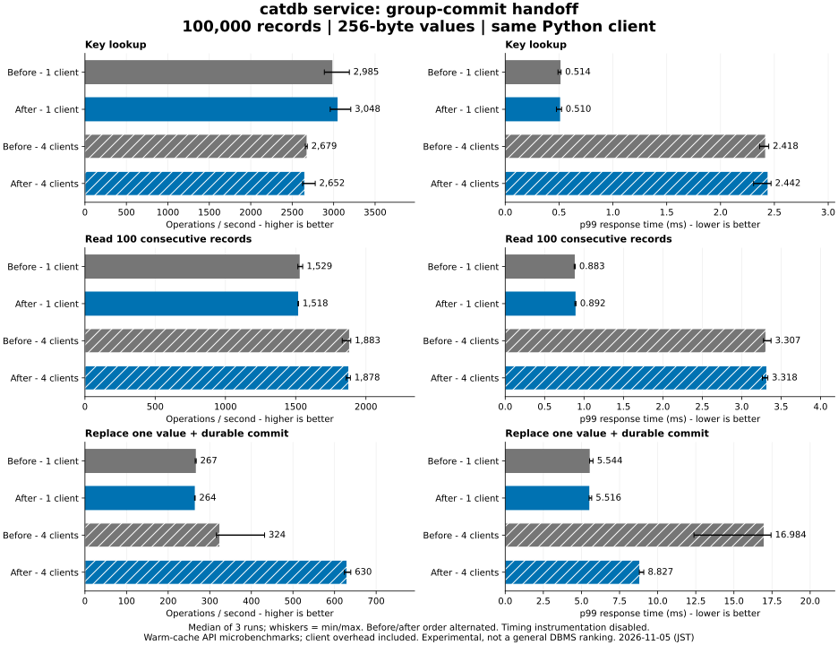

All 288,000 operations and 48 full-content checks, including six restarts, passed.
These checks do not prove power-loss durability. PostgreSQL and Oracle were not
rerun in this follow-up; this improvement does not establish that catdb overtook
them. See the [full report, timing breakdown and observer overhead](docs/benchmarks/service-update-2026-11-05/README.md),
[numerical table](docs/benchmarks/service-update-2026-11-05/table.md) and
[reproduction commands](benchmarks/service-update/README.md).

### Follow-up: sharing the remaining log-sync cost

A further comparison reruns **catdb before/after, PostgreSQL and Oracle Free**
with the same 100,000 records, 256-byte values and original client, three times
in varied order. A bounded collection policy lets recently active writers
re-form a full group. Four-client throughput improves from **568 to 776
operations/s (37% higher)** and p99 from **9.880 to 7.230 ms
(27% lower)**. Single-client throughput remains approximately
238–239 operations/s.

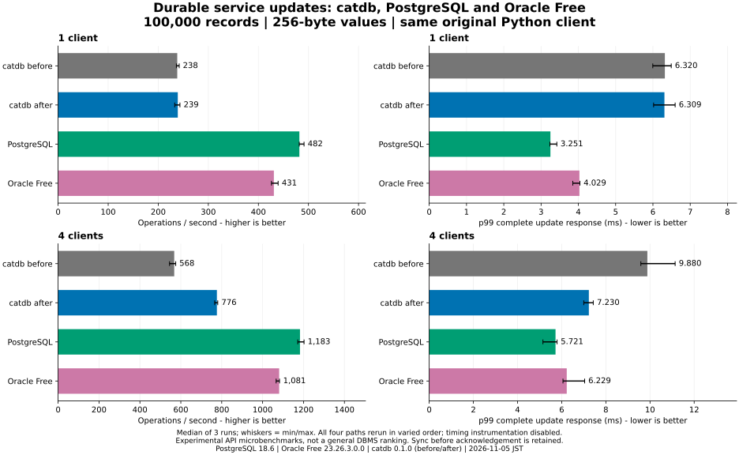

**Individual log syncs still take about 3 ms.** The gain comes from sharing more
updates per sync, not weakening durability. PostgreSQL (1183
operations/s) and Oracle Free (1081) remain faster at four clients.
All 192,000 main-run operations and 48 full-content checks, including restarts,
passed. These checks are not proof against actual power loss.

The [full report](docs/benchmarks/log-sync-2026-11-05/README.md) retains rejected
candidates, I/O probes, timing overhead and limitations. See the
[numerical table](docs/benchmarks/log-sync-2026-11-05/table.md),
[raw results](docs/benchmarks/log-sync-2026-11-05/results.json) and
[reproduction commands](benchmarks/log-sync/README.md).

### Follow-up: fixed-length WAL prototype

A fixed-length prototype preinitializes 64 MiB and stores logical-end records on
separate metadata pages. **Both payload sync and end-record sync complete before
success.** It remains opt-in; the default service still uses the append log.

In the same 100,000-record, 256-byte paired benchmark, four-client throughput
changes from **773 to 787 updates/s (1.8% higher)**, but p99 changes
from **7.297 to 7.390 ms (1.3% worse)**. Each mode runs three times;
this is not a convincing four-client tail-latency improvement. Single-client
results, all run ranges and the unfavorable result are included below.

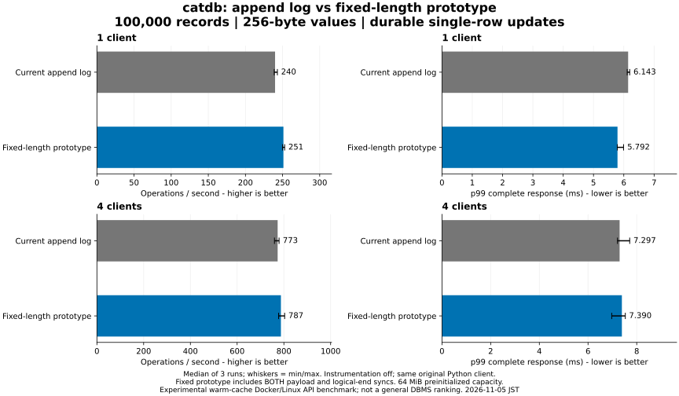

Steady-state application log writes increase by **6.6%** at four clients;
initial zero filling and extra reserved space are additional costs. This is not
physical-device write amplification. A separate block-I/O comparison measured
**81.5% more server-attributed write bytes** (18.99 vs 10.47 MB per 8,000 updates);
it excludes initialization and is not complete physical-media accounting.
All 96,000 main-run operations and 24
full-content checks, including restarts, passed. The new recovery format remains
Experimental and actual power loss has not been tested.

See the [report, synchronization breakdown and reopen times](docs/benchmarks/fixed-log-2026-11-05/README.md),
[format and recovery design](docs/fixed-log.md),
[raw data](docs/benchmarks/fixed-log-2026-11-05/results.json) and
[reproduction commands](benchmarks/fixed-log/README.md). Earlier product results
are retained; PostgreSQL and Oracle were not rerun for this prototype.

### Follow-up: single-request service APIs

Single-request reads and mutations remove explicit begin/finish network round
trips while using the same transaction engine and durable commit path. Ping now
reads only the committed version instead of computing full database statistics.
The original transaction API remains available, including stable multi-page reads.

In three paired repeats at 100,000 records / 256-byte values, four-client updates
rise from **794 to 1,013 operations/s (27.6% higher)** and p99 falls from
**7.334 to 5.889 ms (19.7% lower)**. The new server's original API is also measured
as a control; all three series, including regressions and repeat ranges, appear
below. Key lookups and 100-row scans are included, not only updates.

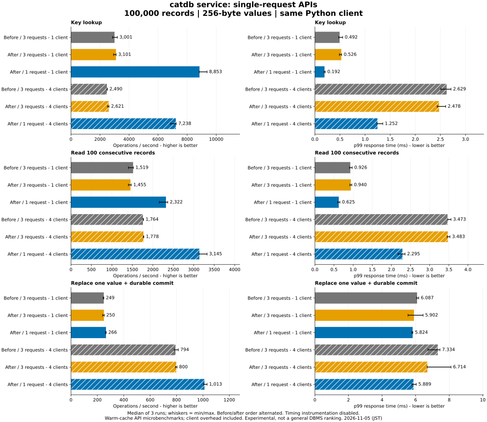

All **432,000 operations and 72 full-content checks**, including nine restarts,
passed. No durability barrier was removed. These remain warm-cache, closed-loop
Python API measurements on one workstation, not a general product ranking.
PostgreSQL and Oracle were not rerun in this follow-up.

See the [full report and ping comparison](docs/benchmarks/single-request-2026-11-05/README.md),
[raw results](docs/benchmarks/single-request-2026-11-05/results.json),
[reproduction commands](benchmarks/single-request/README.md), and
[API semantics](docs/service.md#single-request-operations). In particular,
`scan_latest` pages do not share a snapshot across requests.

### Follow-up: read-only snapshots and bounded reclamation

A further paired comparison uses the same single-request API on both versions.
Read-only transactions avoid write-validation bookkeeping; values are copied
outside the state lock, and old versions are reclaimed in bounded portions.

**The result is a tradeoff, not a general speedup.** At 100,000 records / 256 B,
four-client updates remain near 990 ops/s. Four-client scans improve slightly,
while lookup and single-client scan throughput decline. All 288,000 operations,
48 full-content checks and six restarts pass.

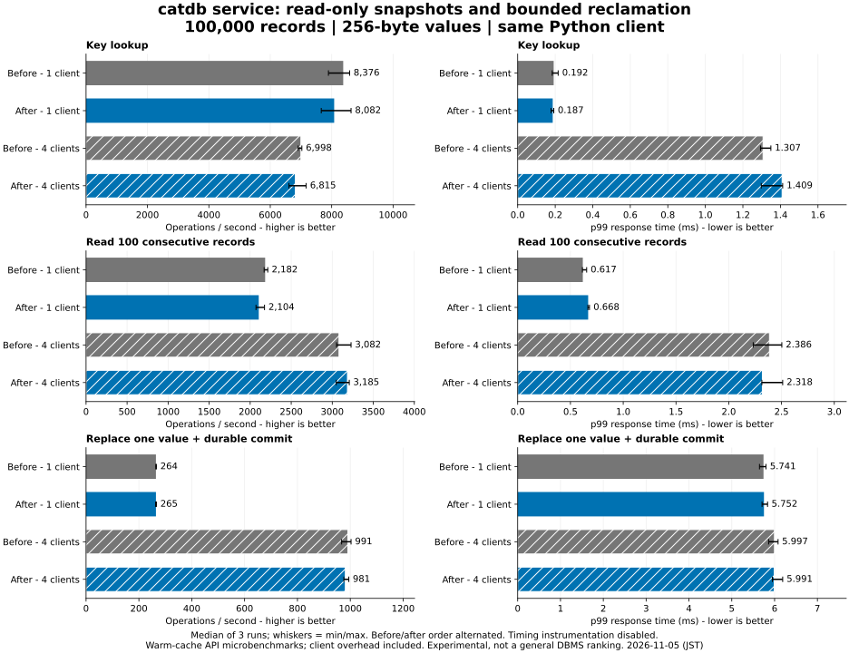

In separate instrumented native tests, large-value read p99 improves from
**0.552 to 0.051 ms**, and releasing an old snapshot from **26.086 to 0.066 ms**.
However, complete reclamation increases from **26.086 to 58.599 ms**, its read p99
worsens, and the worst observed read across those repeats increases from
**26.413 to 32.121 ms**. Deferred reclamation also retains more memory temporarily.
No durability barrier is removed; no peer DBMS is rerun.

See the [full tradeoffs, memory results and safety checks](docs/benchmarks/read-gc-2026-11-05/README.md),
[all service values](docs/benchmarks/read-gc-2026-11-05/table.md),
[native diagnostic results](docs/benchmarks/read-gc-2026-11-05/auxiliary/table.md),
and [reproduction commands](benchmarks/read-gc/README.md).

### Follow-up: optional background reclamation

An opt-in worker moves version reclamation off transaction begin/drop. Three
scheduling candidates were measured; the conservative policy is retained and
**disabled by default**, because it trades collection speed for request latency.

In the native old-generation-release workload, read p99 improves from
**0.078 to 0.023 ms**, and the worst read across all three repeats falls from
**32.239 to 1.277 ms**. Complete reclamation instead grows from **55.689 to
319.453 ms**. Post-drain heap and modeled retained data agree; the extra worker's
stack and total process RSS were not measured. Timing-omitted runs retain the
same tradeoff; all native measurements still include allocation accounting.

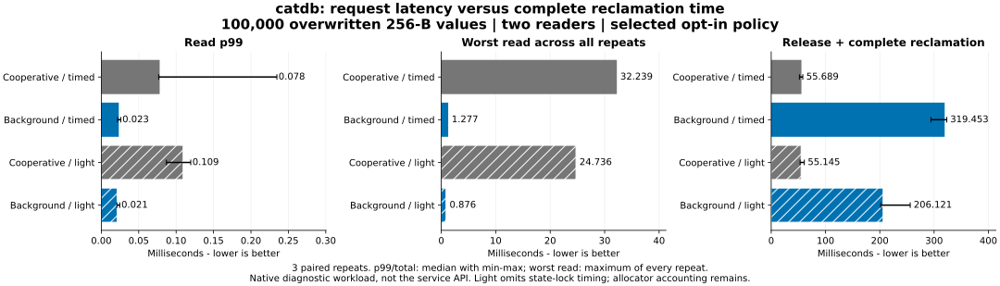

The ordinary 100k-record / 256-B service comparison is mixed: four-client updates
are **1,037 to 1,028 ops/s**, p99 **5.697 to 5.591 ms**, while lookup throughput
and several worst response times worsen. All **288,000 operations, 48 full-content
checks and six restarts** pass. No durability barrier is weakened.

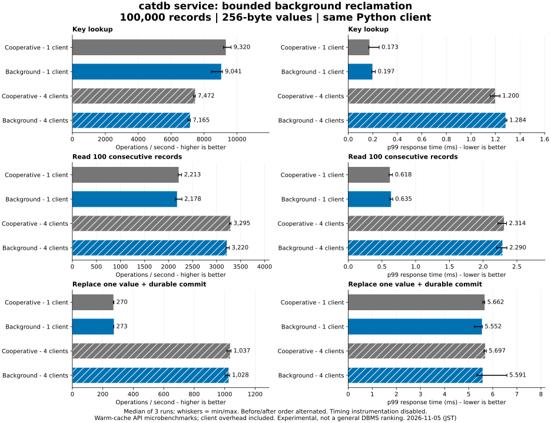

See the [complete report, all three candidates and memory/observer limits](docs/benchmarks/reclamation-2026-11-05/README.md),
[worst response times](docs/benchmarks/reclamation-2026-11-05/service/maxima.md),
[reproduction commands](benchmarks/reclamation/README.md), and
[opt-in configuration](docs/service.md#opt-in-background-reclamation).

### Follow-up: investigating the 319 ms reclamation cost

**The combined improvement target was not met.** Profiling attributes 82–86% of
worker wall time to repeated contention pauses. Three prototypes were tested;
none reduced complete reclamation while preserving read p99. The previous
production policy is retained, with background reclamation still off by default.

The fastest prototype reduces median completion **299.091 → 117.192 ms**, but
read p99 rises **0.028 → 0.033 ms** and worst read across three repeats rises
**1.428 → 1.601 ms**. These are paired native measurements, not an adopted
performance improvement. Light-instrumentation and ordinary-service results,
including regressions, are also published.

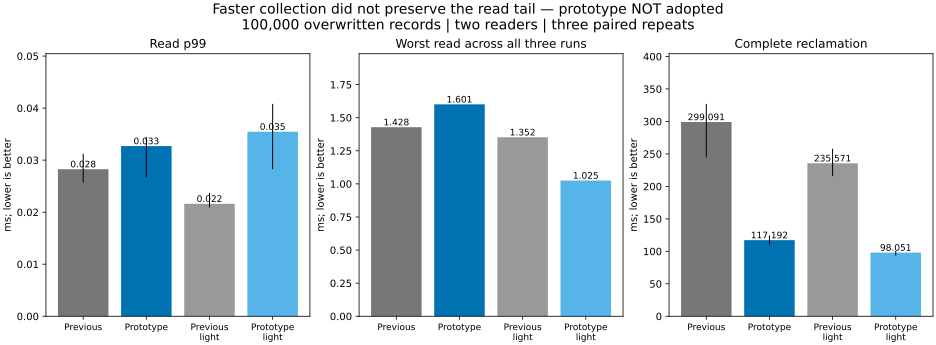

All 102 native runs and 288,000 service operations passed their consistency and
reopen checks; GC drained heap matches at 76.641 MiB. Only optional diagnostics
are retained. See the [cause, all candidates, safety and memory limits](docs/benchmarks/reclamation-cost-2026-11-05/README.md),
[service comparison figure](docs/benchmarks/reclamation-cost-2026-11-05/service/reclamation.svg),
and [reproduction commands](benchmarks/reclamation-cost/README.md).

### Follow-up: fewer shared-lock acquisitions

Two snapshot-registration prototypes reduce data-state lock acquisitions from
**three to two per read**, but neither meets the combined latency and completion
goal. **The production implementation remains unchanged.**

The atomic-release prototype reduces profiled reclamation **286.492 → 199.247 ms**
and worst read **1.178 → 1.016 ms**, while read p99 regresses
**0.026 → 0.034 ms**. With lighter instrumentation, reclamation instead grows
**228.955 → 288.662 ms**. Both favorable and unfavorable results are retained.

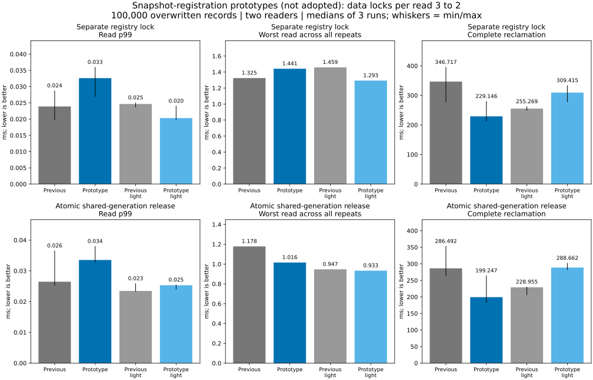

All 72 native runs pass consistency and reopen checks. Drained data charges
match; the prototype registry adds 40 bytes to measured final heap. See the
[report, safety tests, memory limits and service comparison](docs/benchmarks/reclamation-pins-2026-11-05/README.md)
and [reproduction commands](benchmarks/reclamation-pins/README.md).

### Follow-up: preparation outside the reclamation lock

A bounded two-phase prototype captures version metadata, prepares removal counts
outside the shared lock, then validates and applies the plan. **It fails the
light-instrumentation comparison and is not adopted.** Production keeps the
previous collector.

Across three paired 100k-record release runs, read p99 stays approximately
**0.021 ms**, but completion grows **203.396 → 324.006 ms** and worst read
**0.793 → 1.374 ms**. Worst worker lock hold also grows. Final heap matches;
peak requested heap increases by about 9.7 KiB.

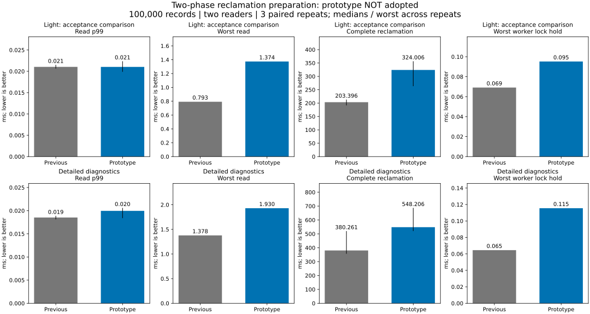

All 36 native runs and the correctness/recovery suites pass. The longer service
comparison is not rerun after this failed gate. See the [full result and limitations](docs/benchmarks/reclamation-plan-2026-11-05/README.md)
and [reproduction commands](benchmarks/reclamation-plan/README.md).

### Follow-up: reusing leading history keys

A small collector change avoids repeated search and copying for fully reclaimable
leading keys. It reduces detailed timed collection work by **23%**, but does not
meet all acceptance targets. One follow-up combines it with 500 us contention
backoff; the measured light release case improves completion **245.172 →
145.638 ms** and worst read **0.941 → 0.636 ms**, while read p99 increases
**0.021390 → 0.022422 ms**. Mixed-workload worst read also grows
**1.015 → 3.415 ms**.

**Neither condition is adopted; production keeps the previous collector.**
All 72 native runs pass consistency/reopen checks, with identical final heap.

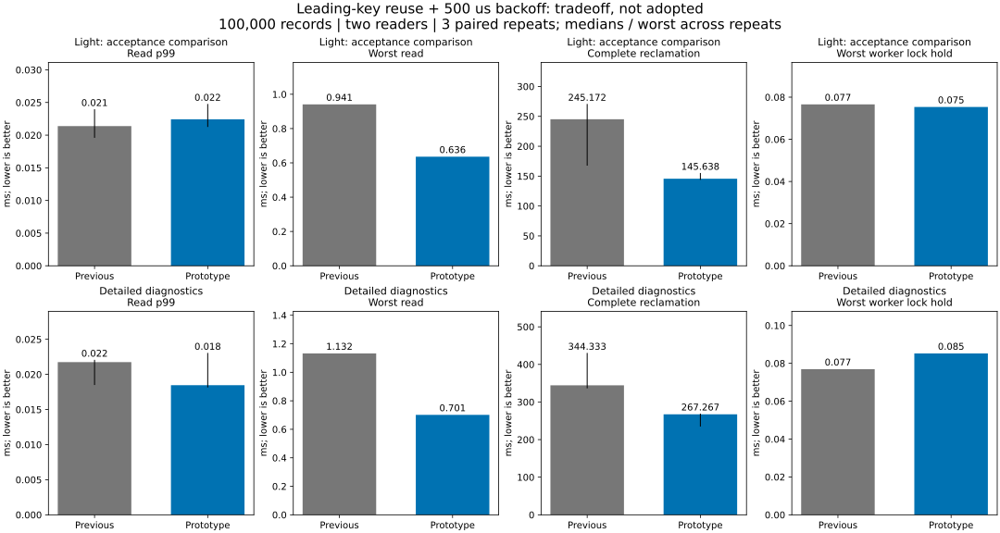

See [both cohorts, memory and recovery validation](docs/benchmarks/reclamation-front-2026-11-05/README.md)
and [reproduction commands](benchmarks/reclamation-front/README.md). Service and
other-product comparisons were not rerun after the failed native gate.

### Follow-up: full scans without an intermediate tree

Ordered merging replaces the temporary full-scan tree while preserving snapshot
selection, range dependencies and conservative buffer reservations. At **1M rows**,
full-result construction changed **530.497 → 197.401 ms** without
staged changes and **556.839 → 224.911 ms** with 10,000 staged edits.
These are medians of three trial medians, not p99 or network throughput.

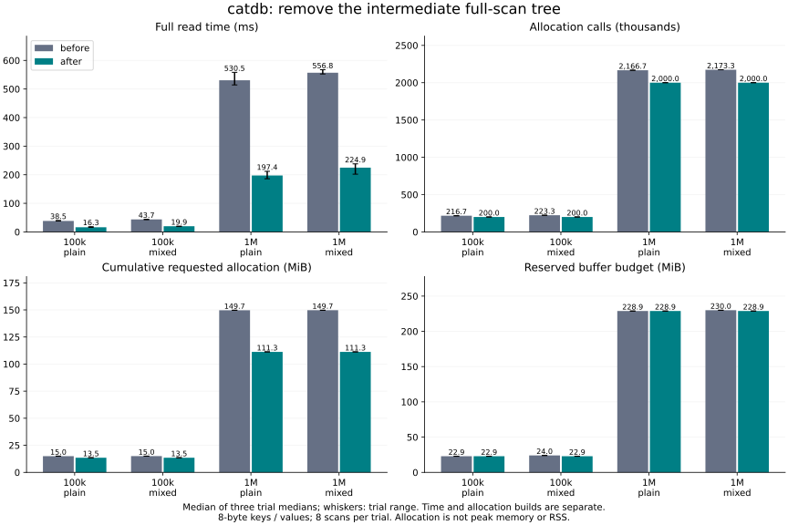

Separate allocation runs and unchanged conservative reservations are both shown:
allocation requests are **not peak memory or RSS**. All 48 runs checked full
contents, old snapshots and reopened committed state. See the
[full report and limitations](docs/benchmarks/scan-merge-2026-11-05/README.md),
[complete table](docs/benchmarks/scan-merge-2026-11-05/table.md) and
[reproduction instructions](benchmarks/scan-merge/README.md).


### Follow-up: fewer key/value copies in full-scan output

The existing C ABI and file export now use an internal shared result. Keys are
packed into one buffer; committed values reuse their existing shared storage.
The public owned Rust scan remains unchanged. At 1M rows / plain, internal frame
construction changed **250.972 → 154.015 ms**, and real durable file export
changed **264.044 → 167.661 ms** (medians of three trial medians).

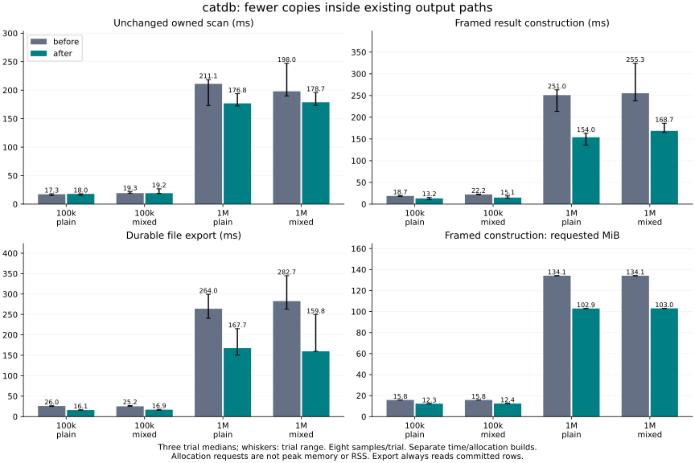

The frame benchmark excludes DLL dispatch and caller-buffer copies. A separate
[shared-result figure](docs/benchmarks/scan-copy-2026-11-05/shared.svg) compares
different return representations; it is not an owned-API speedup. All 48 runs
verified contents, old snapshots, exports and reopened values. Allocation requests
are not peak memory or RSS. See the [report and limitations](docs/benchmarks/scan-copy-2026-11-05/README.md),
[complete table](docs/benchmarks/scan-copy-2026-11-05/table.md) and
[reproduction instructions](benchmarks/scan-copy/README.md).


### Follow-up: speculative WAL preparation (default unchanged)

Three variants compare the current encoder, removal of the intermediate body
copy, and sequence-independent preparation before the writer lock. In the same
100k-row / 256-byte / four-connection workload, median throughput was
**1011 / 1016 / 984 updates/s**, with p99 **5.910 / 5.861 / 6.089 ms**.
Neither candidate demonstrated a consistent overall improvement, so both remain
opt-in experiments (`wal-direct`, `wal-prepare`); the default is retained.

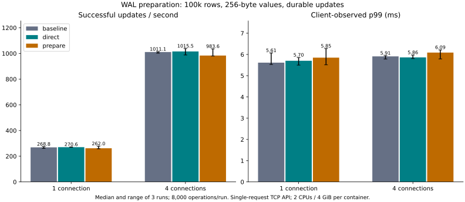

Direct framing reduced isolated allocations **5 → 1**, but the instrumented
large-value and hot-key experiments did not improve commit p99. Hot-key
preparation discarded 384 of 512 prepared frames per trial. See the
[full report and safety limits](docs/benchmarks/wal-preparation-2026-11-05/README.md),
[auxiliary figure](docs/benchmarks/wal-preparation-2026-11-05/auxiliary.svg),
[all results](docs/benchmarks/wal-preparation-2026-11-05/table.md) and
[reproduction commands](benchmarks/wal-preparation/README.md).


### Follow-up: commit latency breakdown and sole-connection collection

Durable log synchronization still takes about **3.2 ms** in the current workload.
New per-request diagnostics cover `put_commit` and separate collection, locks,
encoding, writes, sync and reply handling. An opt-in `single-client-commit`
candidate omits collection waiting when only one service connection exists.

In three uninstrumented trials (100k rows, 256B, 8,000 updates), one-client median
throughput changed **270.0 → 288.9 updates/s** and p99 **5.665 → 5.480 ms**.
Four-client medians changed **988.7 → 1,005.1 updates/s**, p99 **6.040 → 5.730 ms**,
but individual trials reversed direction and worst responses increased.
**The candidate remains opt-in; the default policy is unchanged.**

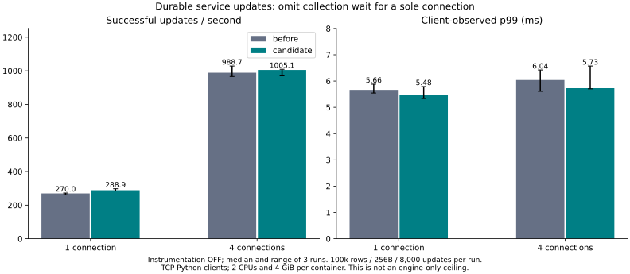

All 192,000 primary/observer updates and 48 full-content/restart checks passed.
Sync-before-success and recovery ordering are unchanged. See the
[breakdown and observer-effect figure](docs/benchmarks/commit-breakdown-2026-11-05/breakdown.svg),
[full results and limitations](docs/benchmarks/commit-breakdown-2026-11-05/README.md),
and [reproduction commands](benchmarks/commit-breakdown/README.md).

### Follow-up: maximum-latency attribution (default unchanged)

Five further trials per mode found **sync-call outliers under both policies**.
The bounded pull diagnostic matched 628 records to their exact requests: sync
was the largest phase in all 20 observer-case maxima and all 285 responses over
10 ms. It does not distinguish device I/O from scheduling inside the sync call.

The unfavorable primary result remains: with one connection, the candidate's
worst response was **78.956 ms versus 39.287 ms**, with eight >50 ms requests
clustered in one run. Typical throughput improved **269.8 → 290.1 updates/s**,
but the maximum is **not fixed**, and that uninstrumented event is not directly
attributed. **The collection bypass remains opt-in.**

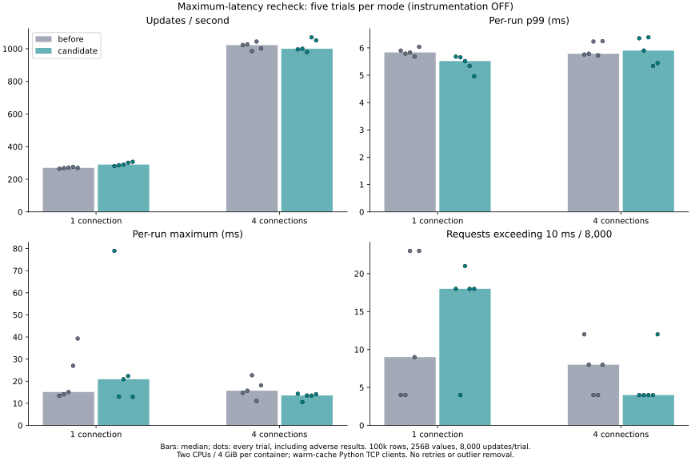

All 320,000 updates and 80 full-content/restart checks passed. See the
[same-request breakdown](docs/benchmarks/commit-tail-2026-11-05/tail-breakdown.svg),
[results, observer effect and unresolved causes](docs/benchmarks/commit-tail-2026-11-05/README.md),
and [reproduction commands](benchmarks/commit-tail/README.md).

### Follow-up: equal offered rates reveal backlog amplification

The next experiment fixes planned arrivals independently of completion: one
connection at **200/250 requests/s**, four at **400/800**, three repeats each.
Run-average synchronization rates mostly converge, but maximum latency remains
unstable. Actual sends do not stay perfectly matched during stalls; all rejection
events and unfavorable results are retained.

At one connection/200 offered per second, queue-inclusive p99 worsens
**44.422 → 174.987 ms** and the worst response **113.919 → 691.487 ms**;
at 250/s the comparison reverses. The largest baseline response is **1065.075 ms**,
of which **1059.036 ms is client queue wait** and only **5.986 ms is that request's
operation**. This does not identify the internal cause of preceding slow requests.
**The default remains unchanged; a robust maximum-latency improvement is not proven.**

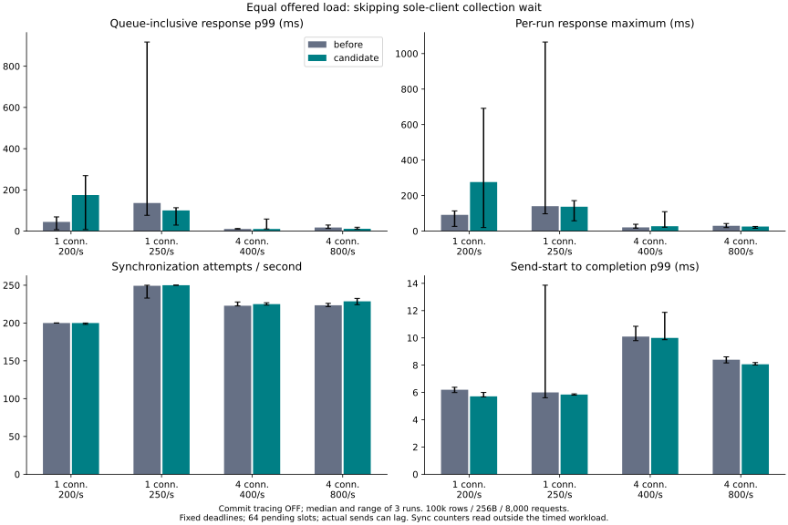

Across primary and separate observer cohorts: **286,849 completed updates,
1,151 client-queue rejections, zero operation errors, and 60 successful full-content
checks including restarts**. Response latency now includes scheduled-to-send wait,
so it is not directly comparable to the older closed-loop charts. See the
[full results, observer overhead and limitations](docs/benchmarks/arrival-rate-2026-11-05/README.md),
[backlog timeline](docs/benchmarks/arrival-rate-2026-11-05/backlog.svg),
[throughput and numerical table](docs/benchmarks/arrival-rate-2026-11-05/table.md),
and [reproduction commands](benchmarks/arrival-rate/README.md).

### Follow-up: draining backlog after slow synchronization

An opt-in `backlog-batch` API submits already-ready independent updates together,
without skipping real sync or waiting for new client arrivals. In the same 100k
rows / 256B workload with bounded outstanding requests and three repeats, injecting
20 ms before each sync for one second gives these results:

- **1 connection, 250 offered/s:** p99 **411.283 → 40.319 ms**, worst response
  **1,195.832 → 50.111 ms**, rejections **2,193 → 0 / 24,000**.
- **4 connections, 800 offered/s:** p99 **444.791 → 90.520 ms**, worst response
  **674.552 → 137.514 ms**, rejections **5,156 → 483 / 24,000**.

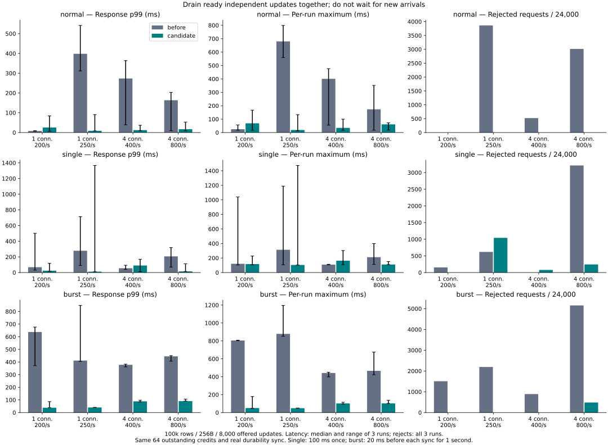

**Not a universal latency improvement:** a single-injection candidate trial still
reaches **1,473.682 ms** and rejects 1,041 requests; normal 1/200 p99 also worsens.
The default remains unchanged. A separate 4/800 experiment with the existing
commit window reduces repeated-delay p99 further to 49.919 ms and rejection to
zero, but worsens the strict recovery-time metric. Both findings are retained.

Across the primary and two supplemental cohorts, **744,656 updates succeed,
23,344 are rejected at finite client admission, zero operation errors occur, and
132 full-content checks including 18 reopens pass**. Batches retain independent
outcomes and require explicit client adoption; C#/PALV is unchanged.
See the [full report and unfavorable cases](docs/benchmarks/backlog-2026-11-05/README.md),
[all numerical results](docs/benchmarks/backlog-2026-11-05/table.md),
[recovery observations](docs/benchmarks/backlog-2026-11-05/recovery.svg), and
[API/reproduction instructions](benchmarks/backlog/README.md).

### Follow-up: attributing the remaining long-tail request

**The previous 1.47 s outlier did not recur, and no maximum-latency optimization
is claimed.** A bounded deferred recorder now follows each independent batch
transaction and separates real synchronization from injected sleep and coordinator
wait. It adds no diagnostic round trip during timed updates.

In 72 same-policy conditions (100k rows / 256B / 1 or 4 connections, three repeats),
the largest response is 127.865 ms: **62.840 ms client waiting, 31.865 ms coordinator
waiting, 20.075 ms injected pre-sync interval, 12.258 ms actual sync**, plus 0.827 ms
elsewhere. Collection itself is only 0.000627 ms. Among 1,101 retained normal-load
requests, the largest phase is actual sync in 928 and coordinator wait in 173.

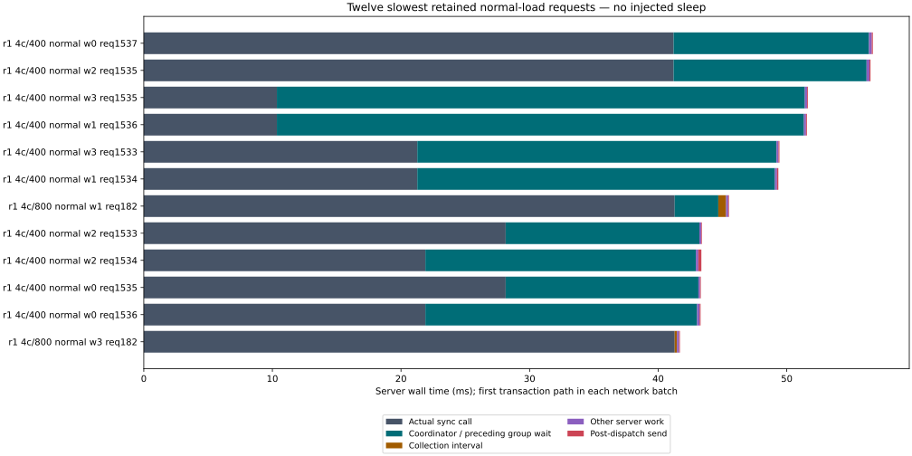

The [observer-control figure](docs/benchmarks/backlog-tail-2026-11-05/observer.svg)
retains adverse results: at normal 4/800, p99 is **9.192 → 10.706 ms** and worst
response **17.535 → 72.555 ms** with recording enabled. This is a diagnostic
comparison, not an improvement before/after chart. Default batching/durability
remain unchanged; the old rare event cannot be attributed retroactively.

All **575,125 successful updates**, **875 admission rejections**, **84 full-content
checks including six reopens**, and **7,180 matched records without loss** are
accounted for. See the [full report and decision](docs/benchmarks/backlog-tail-2026-11-05/README.md),
[numerical table](docs/benchmarks/backlog-tail-2026-11-05/table.md), and
[reproduction instructions](benchmarks/backlog-tail/README.md).

## Build

Requires Rust **1.89 or newer**. Python 3 is used by the optional client and integration tests. Docker is needed only for containers.

```sh
git clone https://github.com/dhq-boiler/catdb.git
cd catdb
cargo build --locked --release --lib
```

The package name is `catdb`. The Rust library target, native library name, C ABI prefixes, and C# namespaces retain `newdbms`/`NewDbms` for compatibility with the original implementation. A default embedded build has no third-party runtime dependencies; service dependencies are opt-in.

### Embedded Rust

Use the repository as a Git dependency (pin a commit for reproducibility):

```toml
[dependencies]
newdbms = { package = "catdb", git = "https://github.com/dhq-boiler/catdb.git" }
```

```rust
use newdbms::transactions::{Database, ResourceLimits};

fn main() -> Result<(), Box<dyn std::error::Error>> {
    // This ID identifies this example database; it is not a credential.
    let db = Database::create_with_limits(
        "example.ndb", *b"catdb-example-01", ResourceLimits::default(),
    )?;
    let mut tx = db.begin()?;
    tx.put(b"hello", b"world")?;
    tx.commit()?;

    let mut reader = db.begin()?;
    assert_eq!(reader.get(b"hello")?, Some(b"world".to_vec()));
    reader.rollback();
    Ok(())
}
```

Use `Database::open_with_limits` to reopen an existing database. Creation refuses to overwrite files. One process owns each database; clones of its handle can be shared between threads. An embedded application and a service cannot directly own the same database simultaneously.

The older `create`/`open` convenience APIs use unlimited engine budgets; prefer the explicit limited variants in applications.

### Standalone service

```sh
python scripts/create-catdb-token.py
cargo build --locked --release --features service --bin catdb-server
mkdir data
./target/release/catdb-server --db data/state.ndb --init --token-file .secrets/catdb-token
```

On Windows, run `target\release\catdb-server.exe` instead. This is a foreground process, not a Windows SCM service installer. The token generator refuses to overwrite an existing credential and never prints the token. `--init` creates a missing database but never replaces an existing one.

See [service configuration and protocol](docs/service.md) for commands, bounds, error handling, and shutdown behavior.

### Docker

```sh
python scripts/create-catdb-token.py  # omit if already generated
docker compose up --build -d
docker compose ps
docker compose down
```

On a Linux host, grant the container's group read access to the file before starting:

```sh
sudo chgrp 10001 .secrets/catdb-token
chmod 640 .secrets/catdb-token
```

Compose publishes only `127.0.0.1:7400`. It uses a named data volume, UID/GID 10001, a read-only root filesystem, dropped capabilities, and a mounted credential file. **`docker compose down` preserves the data; `down -v` deletes the volume.** A volume is persistence, not an independent backup. Do not copy a live database file and assume the result is a consistent backup.

The build context is allowlisted. Local data, credentials, artifacts, and build outputs are not sent into the image.

### Client example

Save these JSON lines as `requests.jsonl`:

```json
{"op":"begin"}
{"op":"put","key":"68656c6c6f","value":"776f726c64"}
{"op":"commit"}
{"op":"begin"}
{"op":"get","key":"68656c6c6f"}
{"op":"rollback"}
```

```sh
python scripts/catdb-client.py --token-file .secrets/catdb-token < requests.jsonl
```

In PowerShell, use `Get-Content requests.jsonl | python scripts/catdb-client.py --token-file .secrets/catdb-token`. Keys and values are hexadecimal byte strings. Authentication is handled by the client. It never retries an uncertain commit automatically.

### Experiment: subtree generations for range validation

A matched count-tree prototype adds each subtree's maximum update generation.
At 1,000,000 rows with updates localized elsewhere, unchanged-half range validation
p99 falls from **22.4 ms to 1.0 µs**, versus the same tree with a global-generation guard.
But update p99 and rank100 latency worsen, and estimated retained node memory rises
**11.1%**. Broad ranges with early conflicts can favor plain traversal.

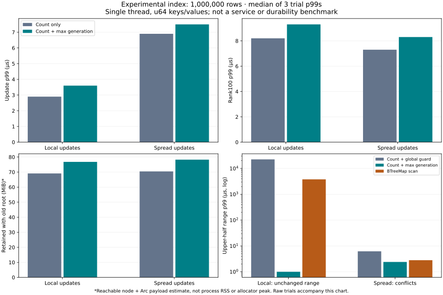

This is a **single-threaded in-memory index experiment with u64 values**, not a
service speedup or persistence change. The tree is not adopted in the engine.
See the [audit of the five original ideas, complete results, tests and limitations](docs/benchmarks/generation-index-2026-11-05/README.md).
A whole-database generation guard can already skip checks when no committed
updates occurred; same-group writes would still need independent validation.

### Follow-up: production generation guard

The production engine now skips committed-state range scans when the transaction
snapshot still equals the database generation. **Same-group earlier writes are
always checked**, and durable acknowledgement is unchanged.

In matched 100k/1M single-writer tests, with three before/after trials per
local/spread distribution, 1M-row range-read-then-update commit p99 falls from
**25.20 to 3.13 ms** (local) and **24.69 to 3.06 ms** (spread). All 24 runs pass
current, old-snapshot and reopened-state full-content checks. This is a targeted
range-validation workload, not a remeasurement of four-client service throughput.

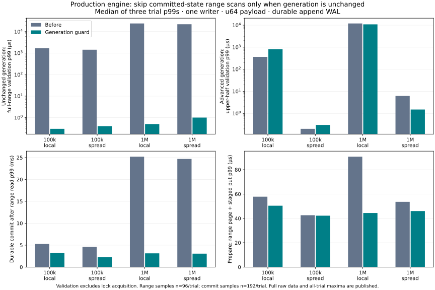

Advancing-generation transactions still scan; the 100k/local stale-range p99
worsens from 365 to 820 µs. The [full report](docs/benchmarks/global-generation-2026-11-05/README.md)
includes that result, all-trial maxima, safety checks, raw samples and reproduction
commands. No persistent metadata or file-format change is needed.

### Follow-up: remove redundant copies and point lookups

Three small production changes remove single-request JSON cloning, committed-row
lookups for unchanged-generation point dependencies, and unused export dependencies.
At 1M rows with 10k read dependencies, validation p99 changes **7.962 ms → 45.9 µs**
and durable commit p99 **11.750 → 3.706 ms**. A 256-KiB in-process single-request
put saves **524,947 allocated bytes and nine allocation calls** per operation.

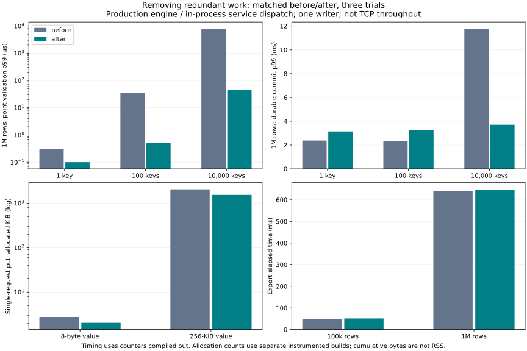

Not every latency improves: 1M-row single-key commit p99 worsens **2.379 → 3.142 ms**,
and export has no demonstrated speedup (only one allocation / 194 bytes removed).
Time and allocation use separate builds, with three paired trials per condition.
See the [full results, safety evidence and reproduction steps](docs/benchmarks/work-elision-2026-11-05/README.md)
and [cross-path audit with deferred candidates](docs/benchmarks/work-elision-2026-11-05/audit.md).
These are targeted engine/in-process measurements, not four-client TCP throughput.

## Tests

```sh
cargo test --locked --features service -- --test-threads=1
cargo clippy --locked --features service --lib --bin catdb-server -- -D warnings
cargo build --locked --features service --bin catdb-server
python tests/service_protocol.py
cargo build --locked --release --lib
python -m unittest discover -s tests -p "*ffi_checks.py"
```

With Docker available:

```sh
docker build -t catdb:local .
python tests/service_container.py
```

Tests use synthetic data under ignored `artifacts/`. Container tests create and clean up their own containers and volumes. Some Rust tests are ignored worker processes or larger experiments; the parent crash tests invoke the required workers explicitly. See [contributing](CONTRIBUTING.md) for environment requirements.

## Repository layout

| Path | Purpose |
|---|---|
| `src/transactions.rs`, `src/group_commit.rs` | Transaction engine and group commit |
| `src/lib.rs` | Immutable snapshot API |
| `src/service.rs`, `src/bin/catdb-server.rs` | Optional service |
| `src/ffi.rs`, `src/transaction_ffi.rs` | C ABI |
| `dotnet/` | Generic C# bindings |
| `tests/` | Core, ABI, protocol, and container checks |
| `Dockerfile`, `compose.yaml` | Container build and local deployment |

This repository was extracted from the NewDBMS prototype. Application-specific integration, private libraries, benchmark results from personal datasets, and workstation task records are intentionally not part of this distribution.

## License

[MIT](LICENSE). Original copyright notices are retained.

## Follow-up: separating log-sync I/O-path and runnable waits

The same server binary was measured with kernel tracing off/on, at 100,000 rows and 1/4 connections. This identifies waits inside sync and the observer effect; it does **not** establish a maximum-latency improvement.

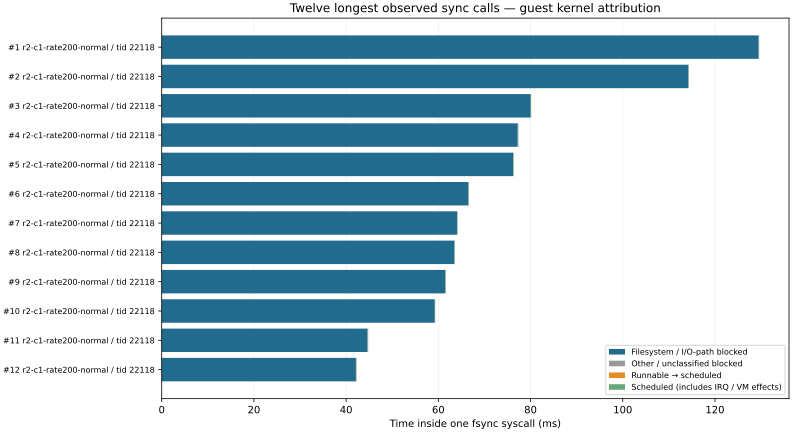

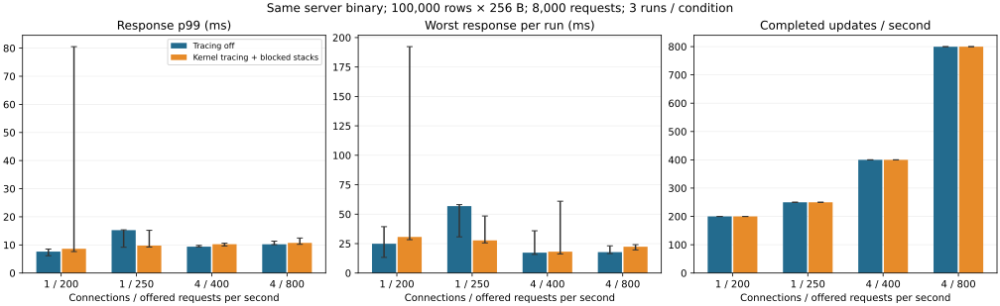

See the [full results, safety checks, raw traces and limitations](docs/benchmarks/sync-os-2026-11-05/README.md). Filesystem/journal blocking is distinguished from runnable-to-scheduled delay; guest observations do not identify physical-device latency. The commit policy and durability guarantees are unchanged.

## Follow-up: journal scheduling and the I/O attribution limit

A short pilot separated journal-thread scheduling, but did not establish ownership of shared/split block I/O. The long comparison was stopped at its feasibility gate; no speedup or durability change is claimed.

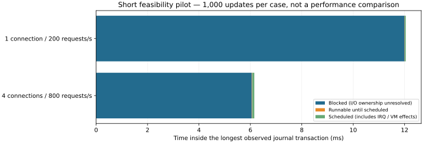

See [the measured boundaries, preliminary observer results and raw evidence](docs/benchmarks/journal-wait-2026-11-06/README.md).

## Follow-up: identifying I/O dispatches without inventing journal ownership

A short observer pilot followed 6,422 dispatch attempts to data completion using opaque request identities and per-slot dispatch counters. Worker-to-journal parentage remains unresolved, so the long comparison was not started and no speedup is claimed.


See [the identity evidence, limitations, observer results and retained attempts](docs/benchmarks/request-id-2026-11-06/README.md).

## Follow-up: tracing journal parents through shared flush completion

A bounded observer now records journal-to-flush membership across worker handoff. The same unchanged engine was measured with tracing off/on, 100k rows, 1/4 connections, 8k updates and three repetitions. This is diagnostic progress; no speedup or durability-policy change is claimed.


See [parentage evidence, overhead, raw data and remaining limits](docs/benchmarks/flush-parent-2026-11-06/README.md).

## Follow-up: locating the virtual storage completion interval

The same flush is now followed from block dispatch through virtual-storage driver submission and completion notification. Host-internal time remains unresolved; no speedup or durability change is claimed.


See [observer overhead, matched requests, failed captures and limits](docs/benchmarks/storage-stage-2026-11-06/README.md).

## Follow-up: reducing observer work while retaining loss checks

A 12-probe observer is compared with the previous 15-probe version. Record size, latency and rejected captures are reported separately; no missing-event check is waived and no production DB speedup is claimed.


See [the pilot, repeated comparison, loss evidence and limits](docs/benchmarks/observer-loss-2026-11-06/README.md).

## Follow-up: CPU and memory limits reveal a service budget ceiling

With 100k rows, the unchanged service handled 1,000 offered requests/s in every
1/2-CPU and 512/1024/2048-MiB configuration (three repetitions), with no refusals.
**All 1M-row attempts were rejected by the service's default 128-MiB retained-data
budget**, even in 2-GiB containers; this was not an OS out-of-memory failure.


The higher-arrival diagnostic and observer cost include adverse results. Across
the workloads, 431,803 requests succeeded, 197 were refused by bounded client
queues, and 109 full-content checks passed, including crash recovery and an
isolated OOM/rescue case. No production engine or durability setting changed.
See [the measured limits, all trials, safety checks and reproduction](docs/benchmarks/resource-envelope-2026-11-06/README.md).

## Follow-up: explicit budgets enable million-row service workloads

The service now exposes resource budgets while retaining its existing defaults
and APIs. With an explicit 640-MiB retained-data budget, all twelve 1M-row trials
in 1/2-CPU, 1/2-GiB containers passed. All six 512-MiB trials hit OOM; their data
was verified after reopening at 1 GiB. This removes a configuration barrier,
not the memory cost: successful cases used approximately 540 MiB at peak.


Across the passing trials and the unchanged-default 100k control, 240,000 requests
completed without refusals or errors, and 66 full-content checks passed including
crash recovery and OOM rescue. Million-row mixed p99 trial medians were
4.453–4.633 ms at 1,000 offered requests/s; this is not a saturation benchmark.
See [all results, safety checks, raw failures and reproduction](docs/benchmarks/resource-config-2026-11-06/README.md).

## Follow-up: smaller initial histories enable the 512-MiB case

Allocating one initial history slot per record reduced the million-row median
container peak from 540.3 to 465.4 MiB at 1 CPU / 1 GiB. All twelve
candidate million-row trials passed, including all six at 512 MiB; all six
baseline 512-MiB trials hit OOM and were separately verified after rescue at 1 GiB.


This is an initial-memory improvement, not a guarantee for prolonged updates:
grown histories still retain capacity. Across the passing fixtures,
384,000 requests completed with 0 refusals and
0 errors, and 102 full-content checks passed including
process-crash recovery and OOM rescue. Update-p99 medians at 1 GiB changed from
6.623 to 7.185 ms at 1 CPU (worse), and 7.050 to 6.835 ms at 2 CPUs; no uniform
latency improvement is claimed. See [per-trial latency, controls, limits and reproduction](docs/benchmarks/history-one-2026-11-06/README.md).

## Follow-up: aging reveals two different kinds of retained memory

The diagnostic separates still-allocated spare history slots from freed allocator
pages. After spreading updates to all 1M keys and draining GC, unused history
capacity reached **68.676 MiB** and process RSS **537.363 MiB**. Hot updates instead
showed RSS remaining high after live allocations fell; diagnostic trim released
about **41.6 MiB** while live requested bytes stayed unchanged.


All six 512-MiB reopens of the fully aged WAL hit OOM; all passed after verification
and checkpointing at 1 GiB. The study passed 142 full-content checks, but
timing observation caused or coincided with large, inconsistent p99 differences;
no latency improvement or negligible observer cost is claimed. Production GC and
defaults remain unchanged. See [all stages, observer results, recovery and limits](docs/benchmarks/history-capacity-2026-11-06/README.md).

## Follow-up: inline latest version reduces aged memory (opt-in)

Keeping the latest version in the tree and allocating history only when needed
reduced full-spread **1M-record RSS from 537.137 to 418.758 MiB (22.0%)**.
Fully aged WAL reopens at 512 MiB changed from **0/3 to 3/3 successful**.


The tradeoff is explicit: hot-history release + GC rose **15.921 to
20.674 ms**. Separately, uninstrumented service mixed-write p99 changed
**6.174 to 6.309 ms**; no uniform latency improvement is claimed.
At that experiment, `inline-latest` remained opt-in. See the later
[default qualification](#inline-latest-is-now-the-default) for the current setting.


96,000 service requests completed without refusal/error and
141 full-content checks passed. See the
[decision, all trials, recovery and reproduction](docs/benchmarks/inline-latest-2026-11-06/README.md).

## Follow-up: avoid history creation only when no snapshots need it (opt-in)

The new `skip-unneeded-history` prototype removes consumed writers' snapshot
pins after successful sync, then skips history creation only when no other
transaction remains. Old values stay charged until freed outside the state lock.
The spread workload skipped **128,117 histories** at full coverage;
post-GC RSS is **419.262 MiB**, versus
**418.629 MiB** for inline latest.

The existing service benchmark holds an old reader throughout, which prevents
this optimization. A separate unpinned control was therefore added. Its write
p99 medians are **5.901 / 6.168 / 6.606 ms**
for deque / inline latest / skip history. The skip candidate was worse in this
comparison, so default adoption is deferred. No latency or capacity improvement
is claimed.


288,000 requests, 0 queue refusals,
0 errors and 249 successful full-content checks.
See [all three variants, pinned control, memory, bounds, recovery and raw data](docs/benchmarks/skip-history-2026-11-06/README.md).

## Follow-up: is freeing old values delaying commits?

A bounded 1M-row / 1-CPU pilot found direct retirement in **779 of 800**
instrumented updates. Old-value release took at most **0.860 microseconds**;
the slowest update was **12.931 ms**, with **12.330 ms** inside the sync envelope.
There is insufficient evidence to change reclamation placement, so defaults
remain unchanged and the conditional long comparison was not run.


Instrumentation-on p99s were higher; two short trials per mode cannot separate
observer cost from storage variability. This is not a speedup claim or an
explanation of the prior p99 regression. All 16,000 requests and 16 full-content
checks passed, including recovery after process termination.
See [phase attribution, observer limitations, raw records and reproduction](docs/benchmarks/retirement-timing-2026-11-06/README.md).

## Follow-up: using aged data within 512 MiB

With one million rows already updated once, `inline-latest` completed a
512-MiB pilot and **three subsequent read/write trials**, including old snapshots,
budget refusal/recovery and process-crash recovery. The then-default deque was OOM-killed
before ready in its 512-MiB pilot and was not retried.

At the same 1-GiB limit, median sampled mixed-phase RSS peaks were
**538.5 / 419.6 MiB** for deque / inline.
Mixed write p99 was **5.405 / 5.215 ms**;
inline at 512 MiB was **5.282 ms**. Memory capacity and speed
are separate outcomes; that experiment left the feature opt-in.
One inline/1-GiB trial worsened to **19.482-ms write p99 / 33.417-ms maximum**,
so the median is not evidence of a uniform speedup.


156,000 timed requests, 60 full-content service checks,
plus 13 full seed checks. No timed-workload errors or queue
rejections in runnable conditions. These are eight-second main phases at a fixed
offered rate, not a long-run memory guarantee or maximum-throughput measurement.
The limit applies to the service cgroup; preparation can leave shared filesystem
cache charged elsewhere. This does not establish a 512-MiB total-machine budget.
See [failed pilot, every trial, limits, raw records and reproduction](docs/benchmarks/aged-service-2026-11-06/README.md).

## Follow-up: rechecking the 19.48-ms inline-latest p99 event

The aged 1M-row / 1-CPU / 1-GiB comparison was repeated in alternating order,
three times per layout. Inline write p99 was **5.005–5.589 ms**, versus
**5.052–5.918 ms** for deque. The earlier **19.482-ms** p99 did not recur;
its original cause remains unresolved. Both layouts still had occasional >10-ms
responses, so this is not a claim that tail latency was fixed.


In the two short diagnostic trials, the slowest requests were **8.235 / 5.670 ms**,
including **7.624 / 5.124 ms** around durable sync. Those samples cannot explain
the uninstrumented original event. Measurement overhead remains uncertain.
Inline RSS retained its approximately **22%** advantage (**419.48 vs 538.52 MiB**).
112,000 requests, 50 full-content service checks and ten full seed checks passed,
including old generations, budget-refusal recovery and process-crash recovery.
No evidence-backed engine change was justified, so that experiment left defaults unchanged
and the conditional candidate/512-MiB follow-up was not run.
See [time-window analysis, observer comparison, raw data and reproduction](docs/benchmarks/aged-tail-2026-11-06/README.md).

## Follow-up: separating default-feature effects from run-to-run delays

The matched-source, matched-toolchain comparison at 1M rows / 1 CPU / 512 MiB
reversed the earlier aggregate result. Identical-default-image controls also
varied substantially. This is evidence against treating the original 8.5% difference
as an established effect of enabling the default feature; it is not proof that
latency variation is harmless or that code layout cannot matter.


160,000 requests, 50 full-content service checks and ten full seed checks passed,
including old generations, refusal/recovery and forced-stop recovery. The default,
engine and durability remain unchanged. See [every trial, build hashes, timing
windows, limitations and reproduction](docs/benchmarks/default-tail-2026-11-06/README.md).
