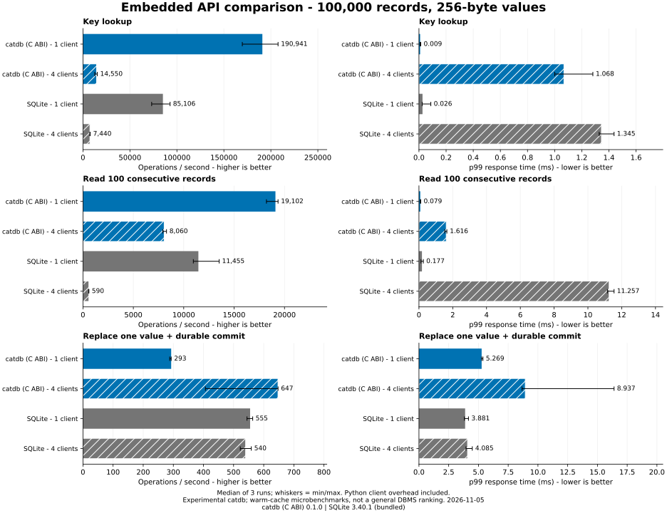
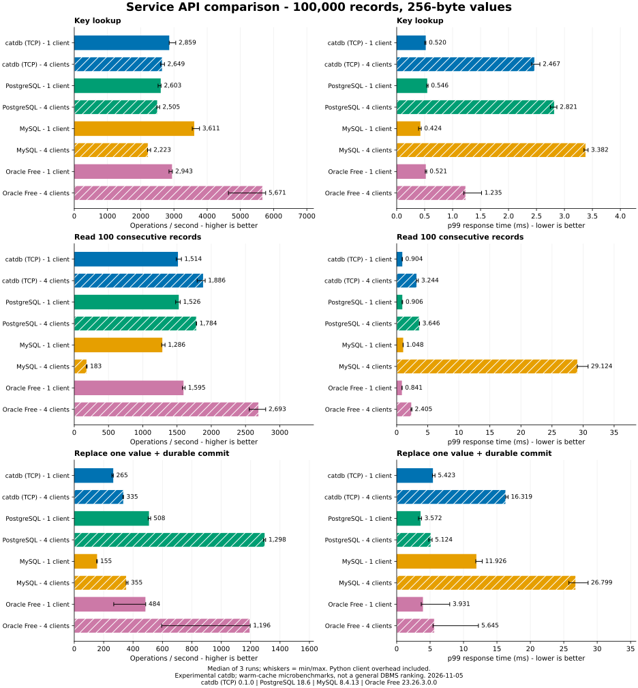

# API comparison — 2026-11-05

**Experimental.** This measures the end-to-end paths in the checked-in Python
harness, not every workload or the maximum performance of each database engine.
The engine source is catdb commit `60a67085f3f90cf8518106146d0c5a09e902ccbd`;
benchmark source hashes and exact image identities are in [environment.json](environment.json).

## Observations from this run

- Embedded single-client lookup: catdb's C ABI path reached a median **190,941
  ops/s**, versus **85,106 ops/s** for bundled SQLite 3.40.1 (about 2.24x).
  This comparison includes the different Python binding costs.
- Embedded four-client update: catdb reached **647 ops/s** versus SQLite's
  **540 ops/s**, but its p99 was **8.937 ms** versus **4.085 ms**. Higher throughput
  did not mean lower tail latency; catdb also had a wider run-to-run spread.
- Service four-client update: catdb reached **335 ops/s**, versus PostgreSQL's
  **1,298 ops/s** and Oracle Free's **1,196 ops/s**. catdb's p99 was **16.319 ms**
  versus **5.124 ms** and **5.645 ms**, respectively. This is a clear improvement
  area for this catdb service path, not evidence that catdb wins every workload.
- Four-client read scaling differs sharply by adapter. Python/driver effects
  prevent attributing that difference solely to the database engine.

**Validation:** all 108 case runs completed all 864,000 attempted operations with
zero operation errors and zero operation retries. All 144 complete-content checks
passed, including 18 checks after reopening/restarting. Content hashes also match
across all six API paths at every stage of each repetition. Raw percentiles,
throughput, source hashes and stable version/configuration were independently
verified by `benchmarks/validate.py`. This does not test power-loss durability.

## Environment

- AMD Ryzen 9 5950X, 16 physical cores / 32 logical processors, 128 GiB-class RAM.
- Python 3.12.16 / GCC 12.2.0 in the client image.
- Windows host, Docker Desktop Linux/WSL2; Linux kernel, Docker version and VM RAM
  are recorded in [environment.json](environment.json).
- Fresh Docker named volumes, no database files on Windows bind mounts. This is
  a virtualized workstation test, not dedicated bare-metal storage qualification.
- Each database server: 2-CPU quota, 4 GiB RAM limit. Each client/embedded container:
  2-CPU quota, 4 GiB RAM limit. CPU affinity is not pinned. See [hardware.json](hardware.json).
- One product at a time. Container initialization and image downloads are outside
  timing. Normal workstation activity is not completely isolated.

## Versions

| Product | Measured version |
|---|---|
| catdb | 0.1.0, source commit above |
| SQLite | 3.40.1, bundled with the Python/Debian client image |
| PostgreSQL | 18.6 |
| MySQL | 8.4.13 (InnoDB; binary logging enabled) |
| Oracle | AI Database 26ai Free, 23.26.3.0.0 |

**This is not a latest-version shootout.** In particular, the bundled SQLite
version is older than current upstream releases; results must not be generalized
to newer SQLite versions. Oracle Free edition limits apply. Actual versions and
image digests are recorded for each repetition.

## Workloads and reporting

100,000 records with eight-byte ordered binary keys and 256-byte values. 8,000
operations per case, one or four closed-loop clients, three repetitions. There
are six API paths: catdb C ABI, SQLite, catdb TCP, PostgreSQL, MySQL and Oracle Free.
Read transactions roll back after materializing results; update transactions wait
for a durable acknowledgement. Full transaction/API cost is included.

Each bar is the median of three independent run summaries; the whisker is their
minimum-to-maximum spread. The p99 bars are **medians of run p99 values**, not a
pooled p99. The [full table](table.md) also includes p50 and p95; [summary.csv](summary.csv)
contains numeric min/max summaries. Failures, if any, must be considered alongside
latency; the chart generator refuses incomplete or failed runs.

## Evidence and reproduction

- [Run summaries](results.json): throughput, percentiles, maximum latency, attempted
  and completed counts, errors/retries, and the raw latency filename for each case.
- `*.json.gz`: raw successful-operation latencies in nanoseconds, one array per case.
- [Environment and validation](environment.json): versions, durability/isolation
  settings, driver versions and per-stage complete-content SHA-256 checks.
- [Methodology and commands](../../../benchmarks/README.md): schema, workload,
  limits, interpretation and publication conditions.
- [Preparation failures and fixes](../../../benchmarks/SETUP.md).

SQL Server is not measured because prior written publication permission required
by the reviewed license has not been obtained. It has no estimated or zero bar.
Oracle results refer specifically to Oracle Free, not Enterprise Edition.

Python's GIL and different drivers materially affect these results, especially
four-client read cases. Small in-memory/warm-cache datasets, single-row updates,
no same-key contention, no joins and no secondary indexes limit generalization.
No production migration decision should rest on these charts alone.
