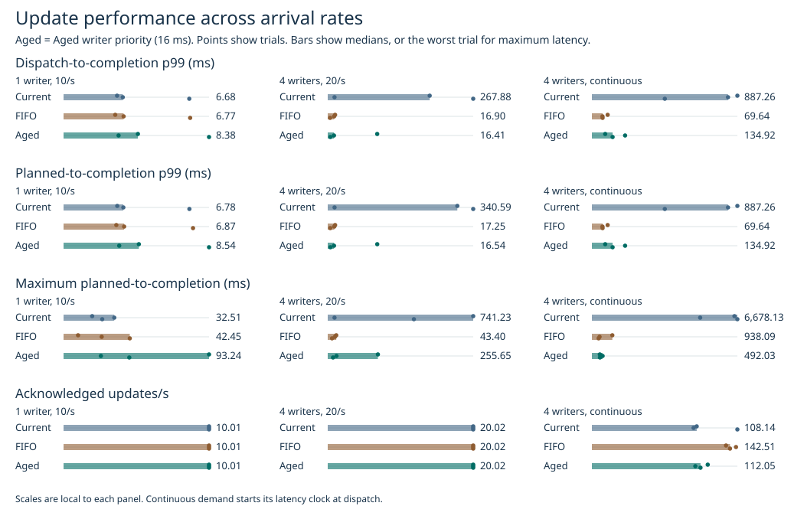
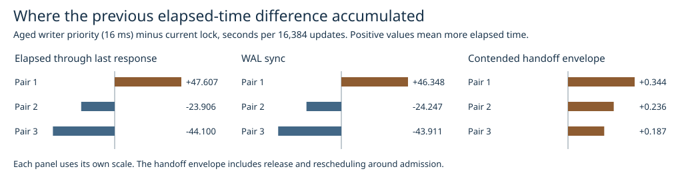

# Does the aged writer priority policy hold up across arrival rates?

Writer-lock legend: **Aged writer priority (16 ms)** (長時間待機優先). Trial data uses `aged`.

Writer-lock legend: **Aged writer priority (16 ms)** (長時間待機優先). Trial data uses `aged`.

Against the current lock, continuous-load p99 improved in 3/3 pairs, worst latency in 3/3, and throughput in 2/3. All three held or improved together in 2/3 pairs. Planned p99 was higher with the candidate in 2/3 single-writer light pairs and 0/3 four-writer light pairs.

The current lock remains the default. The 16 ms threshold is useful when reducing long writer waits takes priority. In continuous pair 3 the worst request fell from 6.68 to 0.37 s, while acknowledged throughput fell from 150.1 to 112.1 updates/s. Strict FIFO delivered higher continuous throughput than the aged writer priority policy in all three runs. This study covers one ext4 environment with 8 MiB writeback enabled.

## Revisiting the 33.9% throughput drop

In the first pair of the earlier campaign, total time to the last response increased by **47.607 s**. The application WAL-sync interval accounted for **46.348 s (97.4%)** of the increase and the contended handoff envelope **0.344 s**. Inside the WAL interval, the change in guest journal-commit sleep was **+44.194 s**. Of that journal sleep difference, +43.842 s occurred between the JBD2 commit start and end events. The last column is a subset of WAL time. The first five component columns sum to elapsed time, subject to rounding.

| Earlier pair | Elapsed s | WAL sync s | Handoff s | Checkpoint lock hold s | Other writer hold s | Remaining s | Journal sleep within WAL s |
|---:|---:|---:|---:|---:|---:|---:|---:|
| 1 | +47.607 | +46.348 | +0.344 | +0.584 | +0.333 | -0.002 | +44.194 |
| 2 | -23.906 | -24.247 | +0.236 | -0.123 | +0.231 | -0.003 | -23.831 |
| 3 | -44.100 | -43.911 | +0.187 | -0.417 | +0.041 | -0.000 | -42.331 |

All intervals use the first request through the last acknowledgement. WAL and checkpoint hold times are serialized by the writer lock. The handoff envelope runs from just before unlock until the next observed acquisition when application markers show a contender. It includes scheduling and marker overhead. Idle time and gaps without such a contender go in the remainder. Guest sleep in jbd2_log_wait_commit is correlated with fsync by thread and monotonic timestamps. A lock policy can shift when WAL syncs coincide with other storage activity. The interval totals cannot separate that indirect effect from fluctuations elsewhere in the guest or host. In that first pair, 13 current-lock publications and 0 candidate publications finished after the last response. [Application accounting](previous.csv) ﾂｷ [Kernel evidence](previous-kernel.csv).

## Fresh measurements

Each lock ran three times per load on a fresh million-row ext4 Docker volume with 256-byte values, 2 CPUs, 4 GiB without swap, an old snapshot and 8 MiB checkpoint writeback. Each light trial ran 1,024 durable updates with three checkpoint publications. For one writer the global rate was 10/s, and for four writers it was 20/s. The continuous four-writer case ran 16,384 updates with 63 publications. Both load order and lock order rotated across repetitions. All runs used the same tracing configuration.

| Demand | Lock | Updates/s | Planned p99 ms | Dispatch p99 ms | Worst planned ms | Worst dispatch ms | Dispatch lag p99 ms | Own WAL p99 ms |
|---|---|---:|---:|---:|---:|---:|---:|---:|
| 1 writer, 10/s | Current | 10.01 | 6.78 | 6.68 | 32.51 | 32.38 | 0.71 | 6.52 |
| 1 writer, 10/s | FIFO | 10.01 | 6.87 | 6.77 | 42.45 | 42.36 | 0.71 | 6.44 |
| 1 writer, 10/s | Aged writer priority (16 ms) | 10.01 | 8.54 | 8.38 | 93.24 | 93.15 | 0.68 | 7.61 |
| 4 writers, 20/s | Current | 20.02 | 340.59 | 267.88 | 741.23 | 741.13 | 140.59 | 21.69 |
| 4 writers, 20/s | FIFO | 20.02 | 17.25 | 16.90 | 43.40 | 43.21 | 0.86 | 15.76 |
| 4 writers, 20/s | Aged writer priority (16 ms) | 20.02 | 16.54 | 16.41 | 255.65 | 255.22 | 0.86 | 15.51 |
| 4 writers, continuous | Current | 108.14 | 887.26 | 887.26 | 6,678.13 | 6,678.13 | 0.00 | 39.67 |
| 4 writers, continuous | FIFO | 142.51 | 69.64 | 69.64 | 938.09 | 938.09 | 0.00 | 17.39 |
| 4 writers, continuous | Aged writer priority (16 ms) | 112.05 | 134.92 | 134.92 | 492.03 | 492.03 | 0.00 | 34.61 |

One common origin establishes the predetermined arrival schedule. Request IDs are assigned to workers round-robin. Each worker dispatches its next request once due and free, preserving delayed slots and retries. Dispatch is local entry to preparing the update. Planned latency includes generator or backlog delay. In the closed-loop continuous case a new request starts at dispatch. Light-load updates/s is governed by demand. All p99 columns are medians of three trial percentiles. Each worst column is the maximum over all trials.

| Demand | Lock | Lock acquisition median ﾂｵs | Lock acquisition p99 ﾂｵs | Contended handoff s | WAL sync s | Checkpoint hold s | Updates/s through drain |
|---|---|---:|---:|---:|---:|---:|---:|
| 1 writer, 10/s | Current | 0.040 | 0.471 | 0.000 | 3.840 | 0.095 | 10.009 |
| 1 writer, 10/s | FIFO | 0.270 | 0.937 | 0.000 | 3.853 | 0.087 | 10.009 |
| 1 writer, 10/s | Aged writer priority (16 ms) | 0.201 | 0.728 | 0.000 | 4.329 | 0.093 | 10.009 |
| 4 writers, 20/s | Current | 0.040 | 214,168.714 | 0.002 | 8.251 | 0.113 | 20.018 |
| 4 writers, 20/s | FIFO | 0.279 | 1.288 | 0.000 | 7.650 | 0.118 | 20.017 |
| 4 writers, 20/s | Aged writer priority (16 ms) | 0.201 | 0.957 | 0.000 | 7.694 | 0.118 | 20.017 |
| 4 writers, continuous | Current | 0.040 | 868,132.981 | 0.496 | 147.683 | 2.104 | 105.296 |
| 4 writers, continuous | FIFO | 20,352.397 | 58,552.800 | 0.772 | 110.695 | 2.118 | 142.507 |
| 4 writers, continuous | Aged writer priority (16 ms) | 22,320.091 | 100,201.173 | 0.813 | 141.688 | 2.331 | 112.050 |

Lock acquisition brackets each writer's lock call, including OS scheduling. The handoff and hold columns accumulate wall time per trial. Locks and storage remain unchanged from the [original candidate](../aged-writer-2026-11-08/README.md).

The light-load check below selects calls where the previous unlock-return marker precedes this attempt, nobody was already waiting and no other attempt began through acquisition. This is observed wall time on an uncontended path. Lock time includes the timestamp probes. Backlogged requests had a previous request on the same lane still active at the scheduled arrival.

| Light demand | Lock | Isolated acquisitions, all runs | Median ﾂｵs | P99 ﾂｵs | Backlogged requests, all runs | Longest lane backlog ms |
|---|---|---:|---:|---:|---:|---:|
| 1 writer, 10/s | Current | 3070 | 0.040 | 0.468 | 0 | 0.00 |
| 1 writer, 10/s | FIFO | 3067 | 0.270 | 0.896 | 0 | 0.00 |
| 1 writer, 10/s | Aged writer priority (16 ms) | 3068 | 0.201 | 0.723 | 0 | 0.00 |
| 4 writers, 20/s | Current | 2976 | 0.040 | 0.319 | 59 | 541.23 |
| 4 writers, 20/s | FIFO | 3064 | 0.279 | 1.007 | 0 | 0.00 |
| 4 writers, 20/s | Aged writer priority (16 ms) | 3043 | 0.200 | 0.889 | 2 | 55.65 |

For the fresh continuous runs, the elapsed-time components below use the same clock boundaries as the earlier comparison.

| Fresh pair, Aged writer priority (16 ms) minus current | Elapsed s | WAL sync s | Handoff s | Checkpoint hold s | Other writer hold s | Remaining s |
|---|---:|---:|---:|---:|---:|---:|
| 1 | -14.405 | -15.302 | +0.320 | +0.207 | +0.372 | -0.002 |
| 2 | -2.710 | -3.060 | +0.256 | +0.053 | +0.041 | +0.000 |
| 3 | +37.064 | +36.327 | +0.345 | +0.269 | +0.125 | -0.002 |

The [p99 and worst request in every trial](tail.csv) separates each selected request into dispatch lag, lock wait, its own WAL sync and other service time. Lane-busy time is included in dispatch lag.

## Paired changes

Positive means a larger value with the aged writer priority policy. Pairing uses the same repetition number. See the trial data for actual arrival lag and every maximum.

| Demand | Reference | Metric | Pairs improving | Pair 1 difference | Pair 2 difference | Pair 3 difference |
|---|---|---|---:|---:|---:|---:|
| 1 writer, 10/s | Current | Planned p99 (ms) | 1/3 | +2.45 | -0.47 | +2.23 |
| 1 writer, 10/s | Current | Worst planned latency (ms) | 1/3 | +74.89 | -8.58 | +17.36 |
| 1 writer, 10/s | FIFO | Planned p99 (ms) | 1/3 | +2.56 | -0.56 | +1.82 |
| 1 writer, 10/s | FIFO | Worst planned latency (ms) | 2/3 | +83.94 | -0.51 | -0.31 |
| 4 writers, 20/s | Current | Planned p99 (ms) | 3/3 | -210.46 | -1.39 | -375.25 |
| 4 writers, 20/s | Current | Worst planned latency (ms) | 2/3 | -485.58 | +10.07 | -412.03 |
| 4 writers, 20/s | FIFO | Planned p99 (ms) | 1/3 | +110.73 | -0.70 | +0.36 |
| 4 writers, 20/s | FIFO | Worst planned latency (ms) | 0/3 | +212.25 | +8.00 | +5.01 |
| 4 writers, continuous | Current | Planned p99 (ms) | 3/3 | -861.44 | -670.88 | -340.34 |
| 4 writers, continuous | Current | Worst planned latency (ms) | 3/3 | -6,179.74 | -4,477.70 | -6,308.64 |
| 4 writers, continuous | Current | Updates/s | 2/3 | +11.36 | +1.85 | -38.05 |
| 4 writers, continuous | FIFO | Planned p99 (ms) | 1/3 | -15.87 | +147.47 | +65.28 |
| 4 writers, continuous | FIFO | Worst planned latency (ms) | 1/3 | -574.06 | +139.42 | +60.46 |
| 4 writers, continuous | FIFO | Updates/s | 0/3 | -18.87 | -41.94 | -30.46 |

## Integrity and reproduction

All 27 runs verified the held snapshot, committed version order, latest contents and reopened data. Successful updates total 165,888 over 621 publications. All planned IDs completed. Guest buffer loss and probe misses invalidate a capture. [Trials](trials.csv) ﾂｷ [Timing diagnostics](diagnostics.csv) ﾂｷ [Capture checks](quality.csv) ﾂｷ [Image IDs](images.json). The compressed request tables and numeric markers support percentile and accounting replay.

Build benchmarks/aged-writer/Dockerfile as catdb-aged-load, with catdb-fifo-products as the observer. Run `python benchmarks/aged-load/campaign.py RAW REPORT` for the new measurements. Run audit_load.py REPORT to verify exported markers and request records, then report.py REPORT to regenerate the figures. To export the original accounting markers and kernel rows, use audit_load.py with --previous-raw and kernel_previous.py with the original raw trace directory.

[Release build test outcomes](safety.txt) ﾂｷ [Prior released-interface comparison](../aged-writer-2026-11-08/README.md#other-database-products). This experiment changes the benchmark workload and keeps the engine implementation and 16 ms threshold fixed.
