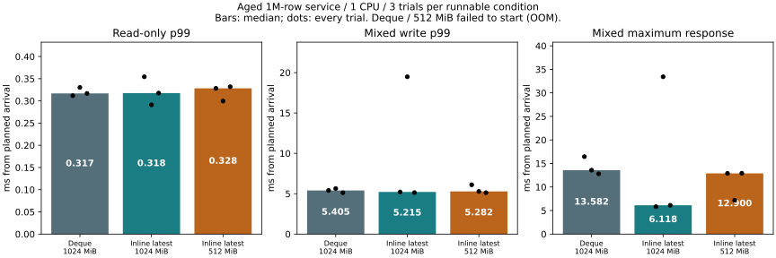
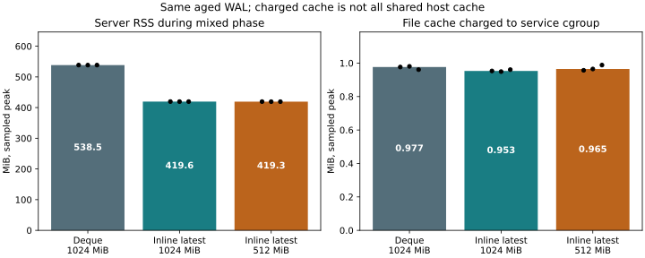

# Aged-data service under 512 MiB and 1 GiB (2026-11-06)

## Decision

Inline latest completed the **512-MiB pilot and all three main trials**, including
reads, updates, an old snapshot, staged-budget refusal/recovery, and reopening
after killing the server. The default deque implementation was OOM-killed before
ready in the 512-MiB pilot and was **not retried**. Both implementations completed
the 1-GiB control. This establishes a useful capacity difference for this bounded
workload, not just the ability to reopen a database without subsequent updates.

Do not interpret this as a universal speedup or production adoption. The default
remains unchanged. Results cover eight-second phases, not sustained operation,
unbounded old snapshots or all application workflows. Exact p99 and maximum
tradeoffs are retained below; three trials are not a reliable tail bound.

## Main results

Medians of three trial statistics (including the median of each trial's maximum):

| Condition | Read p99 ms | Mixed read p99 ms | Write p99 ms | Mixed max ms | RSS MiB | Cache MiB |
|---|---:|---:|---:|---:|---:|---:|
| Deque / 1024 MiB | 0.317 | 0.328 | 5.405 | 13.582 | 538.496 | 0.977 |
| Inline latest / 1024 MiB | 0.318 | 0.340 | 5.215 | 6.118 | 419.551 | 0.953 |
| Inline latest / 512 MiB | 0.328 | 0.313 | 5.282 | 12.900 | 419.297 | 0.965 |

At the same 1-GiB limit, the median sampled mixed-phase RSS peak fell
**22.1%** with inline latest. This is process RSS, not total cgroup memory.
The reported file-cache charge is only about 1 MiB in all conditions. It is
**not the whole DB's shared page cache**. Seed creation/copying happens in other
containers, so already-cached pages may be charged elsewhere. Linux attributes
memory to its allocating cgroup until release; that makes this a plausible
accounting explanation, not a measurement of the external cache's size.
See [kernel memory ownership documentation](https://docs.kernel.org/admin-guide/cgroup-v2.html#memory-ownership).
Thus the result establishes operation under a **512-MiB service-cgroup limit**,
not operation on a machine with only 512 MiB total RAM or a fully cold cache.
Component peaks are not necessarily simultaneous and must not be
added together as if they were a single sample.





See [every pilot and main trial](trials.md) and [machine-readable results](summary.json).
All successful workloads completed **156,000 scheduled requests**,
with **0 queue rejections** and **0 service-operation errors**.
The failed deque/512 pilot has no latency sample; it is not counted as zero latency
or silently excluded from the decision.

One inline/1-GiB main trial had **19.482-ms write p99 and 33.417-ms maximum**,
versus 5.215/5.137-ms write p99 in its other trials. This adverse trial is visible
in the plot and table. The median alone must not be taken as proof of a speedup;
the cause of this variation was not traced in these uninstrumented runs.

## Method

Base commit `4e549d0bba1366e8f0894556ec5c790132237fff`, with benchmark-only changes.
No engine, storage format, C ABI, durability setting or default feature changes.
Images use `service` and `service,inline-latest`; allocation/history/lock/retirement
diagnostic features are disabled. Docker Desktop Linux/glibc, a 1-CPU quota
(not an isolated core), no swap, 512 or 1,024 MiB cgroup memory.

Each fresh synthetic seed has 1,000,000 ordered 8-byte keys and 256-byte values.
Creation is checkpointed, then **every key is updated once**, in 1,000-row batches.
There is **no checkpoint after aging**. Seed preparation and full verification
run outside timing at 2 CPUs / 4 GiB. All 13 seed WALs have
the identical SHA-256 `47a87937e35a91c55f44b7070bf898b6c70a179df42254e84243509b6ce3d78d`; their complete contents are
verified. Each trial gets a disposable copy. No user library is accessed.

Four pilot conditions have 2,000 requests per workload. Only conditions which
pass progress to three main trials with 8,000 requests per workload. Condition
order rotates/reverses between rounds; the exact schedule is saved. A failed/OOM
condition is never repeated. No automatic long-run extension.

Read-only uses four connections; mixed uses one read and four write workers,
80% reads / 20% writes, 1,000 scheduled requests/s (200 scheduled writes/s).
Queues are bounded to 64 per kind. Responses include time from planned arrival,
including client scheduling/queueing. Read then mixed phases use no fixed old
reader; snapshot correctness is tested separately after timing. This offered load
does not measure sustainable maximum throughput. In-flight demand is often below
four, so four workers do not imply four continuously active writes.

All conditions use the same 640-MiB logical retained budget and **4-KiB staged
budget**. The latter admits this workload's small concurrent updates but makes a
controlled 8-KiB staged write fail without intentionally exhausting the host.
These logical limits do **not** guarantee the process stays below the cgroup
limit, as the deque OOM demonstrates. This differs from previous runs using the
default staged budget; compare variants within this report.

A common 100-ms OS observer records process RSS, anonymous memory, file cache,
swap, CPU and throttling. Workload memory/CPU statistics use samples strictly
within each timed phase on the shared Linux monotonic clock; edge intervals are
omitted, and short peaks can be missed. Resource samples include observer cost.
CPU percentages represent cores consumed, not host-wide percentage. Startup and
reopen ready times include process launch and 100-ms polling, not just DB open.
Preparation/full verification and safety probes are outside timing. OS cache is
not flushed between trials; this is not a cold-storage benchmark.

## Correctness and recovery

**60 full-content service checks** passed: initial, after
each workload, after the safety probe and after killing/reopening the owned
server. **13 separate full seed checks** passed.
Every successful trial keeps a read snapshot while the last key is updated eight
times, verifies the old and latest values, then releases it. A staged small update
survives a larger `resource_exhausted` refusal, rollback releases its reservation,
and a later commit succeeds. These intentional refusals are safety-probe outcomes,
not timed workload rejection rates. Old-snapshot testing is deliberately bounded
to eight same-key updates; it does not establish a safe limit for very long readers.

After the workload and probe, the server child is SIGKILLed and all acknowledged
values are verified after reopen. This is process-crash recovery, not hardware
power-loss testing. The failed 512-MiB baseline never reached ready and received
no workload writes; it provides no live-workload recovery result.

A separate 1,000-row smoke trial passed both variants at 512 MiB, including ten
full service checks, and is excluded from main totals. Client tests cover refusal
preserving staged values and reject a bogus success response. Analyzer tests
check time-window selection, cache separation, insufficient samples and percentile
boundaries. The shared benchmark's existing client tests remain in CI.

## Reproduce and records

```sh
docker build -f benchmarks/Dockerfile -t catdb-aged:deque .
docker build -f benchmarks/Dockerfile --build-arg EXTRA_FEATURES=,inline-latest -t catdb-aged:inline .
python benchmarks/aged-service/run.py --out artifacts/aged-service-new/raw
python benchmarks/aged-service/report.py artifacts/aged-service-new
python benchmarks/resource-envelope/test_client.py
python benchmarks/aged-service/test_analysis.py
```

The output directory must be new. Image IDs, source hashes, cgroup limits,
commands, all requests and OS samples are retained under `raw/`; large records
are losslessly gzip-compressed and accepted by the analyzer. Failed pilot data
remain available. The experiment is complete; default adoption, cross-platform
performance, longer workloads and product rollout are separate decisions.
