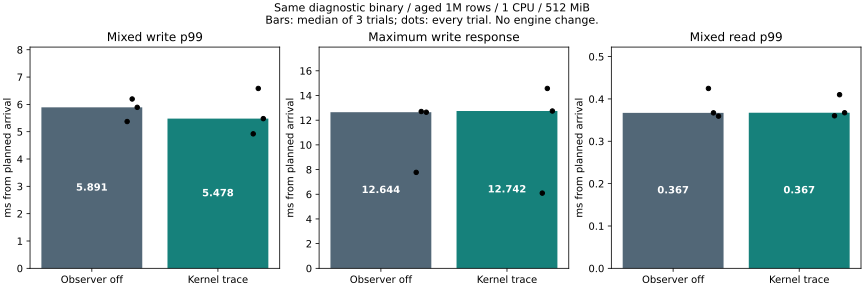
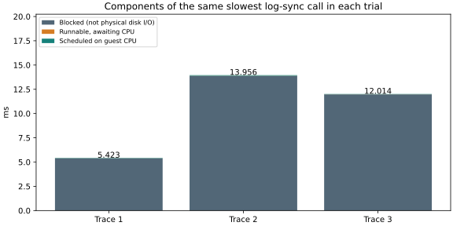

# Log synchronization versus guest CPU wait (2026-11-06)

## Decision

**Keep the engine and durability defaults unchanged.** Across 4,794 observed log
synchronizations, every call matched the DB counter and the scheduler-state
partition. Blocking accounted for **98.47–98.59% of total synchronization time**
per trial. Runnable CPU wait was only **0.007–0.017 ms** in each trial's slowest
sync. This does not justify a CPU-scheduling optimization for these tails.
It does not identify the physical storage or host-side cause of blocking.

The slowest observed sync was **13.956 ms**: **13.879 ms blocked**, **0.017 ms
runnable**, and **0.060 ms scheduled**. These are parts of the **same call**.
They are not independently selected maxima. No synchronization was skipped,
no early success was introduced, and no performance improvement is claimed.

## Same-binary observer comparison

Both modes use the identical diagnostic image, default inline-latest storage,
`service,lock-timing,benchmark-metrics`, and diagnostics enabled. Three trials per
mode alternate off/trace, trace/off, off/trace. Each trial uses an aged 1M-row WAL,
256-byte values, a 1-CPU / 512-MiB service limit, no swap, an old reader, and
8,000 read requests followed by 8,000 mixed requests (80% reads / 20% updates;
one read worker and four write workers). Offered load is 1,000 requests/s.
This is an arrival-rate-limited comparison, **not maximum throughput**.

Across the three trials per mode:

- Write p99 median: **5.891 ms off / 5.478 ms trace**; individual paired effects
  change direction. This is not evidence that tracing improves performance.
- Median trial maximum write response: **12.644 / 12.742 ms**. Worst write response
  across all trials: **12.702 / 14.569 ms**; the adverse result is retained.
- Mixed read p99 median: **0.367 / 0.367 ms**.
- Sampled mixed-phase RSS peak median: **420.020 / 420.156 MiB**.
- Mixed offered/completed throughput remains about **1,000 requests/s** in both.
- All **96,000 main requests** completed, with **zero queue refusals or operation
  errors**. **30 full-content checks**, six seed checks, old-value checks for all
  9,600 mixed updates, and six forced-stop/reopen checks passed.





| Trial | Write p99 ms | Write max ms | Mixed read p99 ms | Requests/s | Rejected | RSS MiB | CPU % | Throttled ms | Reopen ms |
|---|---:|---:|---:|---:|---:|---:|---:|---:|---:|
| pilot-1-off | 5.587 | 6.325 | 0.375 | 1000.26 | 0 | 419.43 | 10.03 | 0.000 | 2517.2 |
| main-1-off | 5.372 | 7.771 | 0.425 | 1000.03 | 0 | 420.02 | 10.95 | 0.000 | 2515.6 |
| main-1-trace | 4.922 | 6.092 | 0.360 | 1000.03 | 0 | 420.16 | 11.19 | 0.000 | 2516.5 |
| main-2-trace | 6.583 | 14.569 | 0.410 | 1000.03 | 0 | 420.12 | 11.83 | 0.000 | 2617.5 |
| main-2-off | 6.197 | 12.702 | 0.367 | 1000.03 | 0 | 420.00 | 10.36 | 0.000 | 2516.0 |
| main-3-off | 5.891 | 12.644 | 0.359 | 1000.05 | 0 | 420.14 | 10.27 | 0.000 | 2522.0 |
| main-3-trace | 5.478 | 12.742 | 0.367 | 1000.05 | 0 | 420.16 | 10.56 | 0.000 | 2717.6 |

| Trial | Sync count | Sync p99 ms | Slowest ms | Scheduled ms | Runnable ms | Blocked ms | Total blocked fraction |
|---|---:|---:|---:|---:|---:|---:|---:|
| main-1-trace | 1600 | 4.296 | 5.423 | 0.036 | 0.008 | 5.379 | 98.52% |
| main-2-trace | 1595 | 4.843 | 13.956 | 0.060 | 0.017 | 13.879 | 98.47% |
| main-3-trace | 1599 | 4.637 | 12.014 | 0.031 | 0.007 | 11.976 | 98.59% |

The pilot-off row is not included in main statistics. The initial failed-identity
pilot and the valid named-thread pilot are retained separately under
`pilot-trace` and `pilot-trace-named`; they used a smaller ring and a different
setup gate and **are not matched performance controls**.

## What is and is not separated

- Kernel `fsync`/`fdatasync` entry/exit bounds the same synchronization interval.
  Scheduler switch/wakeup events partition it into scheduled, runnable, blocked.
  States are disjoint and must sum exactly to elapsed time.
- **Blocked is not physical disk I/O time.** It can include filesystem/journal,
  virtual storage, kernel waits, and effects beyond the guest's visibility.
- Scheduled time is guest scheduler residency, not pure userspace CPU execution;
  interruptions and host/VM scheduling effects remain unseparated.
- Per-request diagnostics separately record queue/collection, writer lock,
  validation/frame, synchronization envelope, and publication/reply intervals.
  Client queue time is also retained in `summary.json`. The Rust relative clock
  is not mapped to kernel absolute time, so we do **not** assign a particular
  request tail to a particular kernel sync or subtract across those clocks.
- Cgroup CPU-throttled time was **0 ms in the sampled mixed intervals** in all
  six main trials. It is an aggregate counter, not a per-request interval; it
  must not be added to the synchronization partition. Samples bracket most,
  not necessarily every instant, of each workload.
- Three short trials do not establish a tail bound or explain all previous
  same-binary p99 fluctuations. No 19-ms-p99 episode recurred here.

## Observer validation and cost

The first PID-filtered pilot saw zero events despite 200 DB syncs and was rejected.
A separate tiny tmpfs probe proved a namespace mismatch: namespace PID 11783
corresponded to trace PID 26071 ([raw proof](namespace-probe.json)). The observer
now uses a run-unique thread name, verifies ownership through `/proc`, and derives
kernel IDs from tagged events. A two-pass export also handles unknown cached
thread names. Thread naming is enabled only in the diagnostic build; normal
production naming is unchanged.

The corrected pilot counted all 199 syncs. Main trials counted 1,600, 1,595,
1,599: fewer than updates can occur through existing group commit. Read-only
phases counted zero. Every observed count equals the DB counter, all per-CPU
ring loss counters are zero, capture bounds include the workload, and all
private trace instances were removed. No long search or weakened loss check
was needed.

A common **3-second setup interval** follows connection readiness in both modes;
measurement aborts if observer setup exceeds it. The private trace is limited to
90 seconds, 2 MiB per CPU / **64 MiB total on this 32-CPU guest**, and 64 MiB of
uncompressed export input. Its collector has a **128-MiB cap**, separate from the
DB's 512 MiB. The cap is not a measured collector peak, and kernel-buffer
accounting is not assumed to be fully covered by the collector cgroup.
Scheduler events are name-filtered. Syscall metadata for other processes can
briefly enter the bounded ring, but only target-thread events are exported.
No CPU stacks, broad block-I/O tracing, or dynamic probes are used.

The off/on comparison measures **incremental OS-observer cost on a diagnostic
binary**, not the full diagnostic overhead versus a production build. CPU use
and tails vary in both directions; these data do not establish zero overhead.
DB RSS excludes the external collector, client, and shared host caches. The
512-MiB result is a service-cgroup result, not a 512-MiB whole-machine guarantee.

## Safety and implementation scope

No transaction, log, checkpoint, memory layout, file format, or durability policy
changed. Only diagnostic service-thread naming, the optional benchmark start
gate, and the observer/reporting tools changed. Existing default APIs remain.
Each workload keeps an old reader, checks full data before/after updates, tests
staged-budget refusal and recovery, kills the DB child, and verifies all values
after reopening. Dedicated Rust and API tests additionally exercise conflicts,
save failures and crash/publication boundaries; see `validation.md`.
Process-kill recovery does not prove physical power-loss behavior.

## Reproduction and raw evidence

The base commit is `7cd1cb565bdcdfdf6a45eb33609c6388d7d8c354`; the measured dirty-source
hashes are in [raw/sources.json](raw/sources.json), image ID in
[raw/image.json](raw/image.json), and executable hashes/toolchain in `build-record`.
The report generator was added after the measurement freeze. Every actual command,
ordering and timestamp is in [raw/schedule.json](raw/schedule.json).

```powershell
docker build --network none -f benchmarks/default-tail/Dockerfile --build-arg BUILDER_IMAGE=catdb-inline-default:build --build-arg EXTRA_FEATURES=,lock-timing,benchmark-metrics -t catdb-aged-sync:profile .
# First validate a short --kernel-mode trace pilot with resource-envelope/run.py.
# run.py requires a valid pilot-trace-named folder and refuses an existing raw folder.
python benchmarks/aged-sync/run.py --out artifacts/aged-sync-NEW
python benchmarks/aged-sync/report.py artifacts/aged-sync-NEW
# Regenerate the published analysis and charts from retained data:
python benchmarks/aged-sync/report.py docs/benchmarks/aged-sync-2026-11-06
```

Tracing needs Linux tracefs and SYS_ADMIN in the observer container, and the local
benchmark builder/runtime images used in earlier experiments. The command is not
an instruction to expose these capabilities on a production DB container.
Published request/resource streams are gzip-compressed; report readers accept
both plain and compressed data. Seeds are synthetic. Individual kernel events,
loss statistics, request timings, resource samples, identity failure, and adverse
trials are retained rather than replaced by medians.

A useful next decision would compare storage environments with this same bounded
workload, or vary safe group-commit batching at higher arrival rates. Neither is
implemented here: this experiment does not establish a beneficial engine change.
