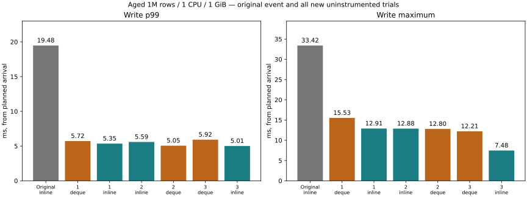
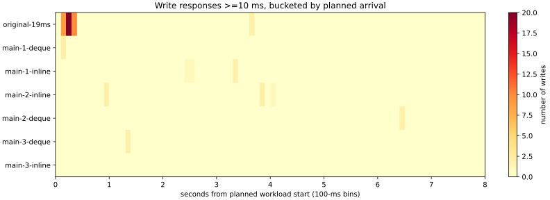

# Rechecking the aged inline-latest p99 regression (2026-11-06)

## Findings and stop decision

**The 19.482-ms p99 regression did not recur in three new paired main trials.**
No evidence-backed engine change is justified by this bounded run. Keep defaults
and the existing opt-in implementation unchanged; no candidate-comparison or
additional 512-MiB qualification was run. Do not call the old event fixed.

- deque: write p99 5.052–5.918 ms; >=10-ms writes 6/4,800; median RSS 538.52 MiB.
- inline: write p99 5.005–5.589 ms; >=10-ms writes 9/4,800; median RSS 419.48 MiB.

Both layouts still had individual >10-ms responses. New main trials had 0
>=20-ms write responses; the old trial had 16. Main inline's RSS reduction remains
22.1% versus deque. All new measured CPU-quota throttling increments were zero,
which excludes observed quota throttling, not arbitrary scheduler or I/O delay.

In the two diagnostic trials, the worst requests were
8.235 / 5.670 ms;
their own sync envelopes were
7.624 / 5.124 ms.
0 diagnostic requests reached 10 ms. These samples identify sync-envelope time
as the dominant interval in those requests, **not the cause of the old burst**.
OS-level I/O versus rescheduling and the original event remain unresolved.

Short observer-off write p99s were
4.594 / 5.467 ms;
observer-on p99s were
6.418 / 4.360 ms.
Two short repetitions do not isolate
instrumentation overhead from storage/host variability; zero overhead is not
claimed. Do not compare two-second probe p99s as if they were the eight-second
main workload. All 800 diagnostic write records passed completeness/order checks.

The next decision is separate from this completed experiment. More tracing or
a durability/batching redesign is not justified automatically by the old maximum.
No long search was started, and the default memory representation was not changed.

## Decision and limits

This report records a bounded reproduction attempt, not an automatically adopted
optimization. Engine code, default features, durable acknowledgements and memory
accounting are unchanged. The findings above distinguish observations from the unresolved original event. Original and new results are kept
separate; an unobserved event must not be called impossible or fixed.

## Existing evidence

The earlier inline/1-GiB trial had write p99 19.482 ms, maximum 33.417 ms,
41 writes >=10 ms and 16 >=20 ms. Most slow writes were scheduled at 0.1–0.3 s,
with another affected 100-ms bin at 3.6 s. Its worst write spent 0.094 ms before
the client request call and 33.323 ms inside that call. The 100-ms OS samples show
zero CPU-quota throttling increment in the workload interval. That does not rule
out host scheduling, I/O waits, or latency between resource samples. Without
per-request server diagnostics, that original event cannot be retrospectively
assigned to sync, allocation or a particular lock.

## Reproduction and observer comparison

Same fully aged 1M rows, 8-byte keys / 256-byte values, 1-CPU quota, 1-GiB service
cgroup, no swap, 640-MiB logical retained and 4-KiB staged budgets. Four write
workers + one reader, 80% reads / 20% writes, fixed 1,000 scheduled requests/s;
bounded queues 64 per kind. Each main trial has 8,000 read-only and 8,000 mixed
requests; default deque / inline alternate order over three rounds. No fixed old
reader in timing; old-generation correctness is checked separately after timing.

Four short observer trials use inline / diagnostic / diagnostic / inline,
2,000 requests per phase. Diagnostics enable **only `inline-latest,lock-timing`**,
not `skip-unneeded-history` or `retirement-timing`. The observer comparison
includes clock calls, extra response bytes, serialization and client decoding;
it is not an isolated timer microbenchmark. The common 100-ms OS observer stays
on in all conditions. Main trials and short observer trials are separate cohorts.
Throughput is arrival-limited and does not measure maximum capacity.

Images are built from the same engine source (base commit
`1edbe18d4e87535ebff774aca2a404b861352e18`). Image IDs and normalized source hashes
are in `raw/`. Synthetic seeds are prepared and verified outside timing at
2 CPUs / 4 GiB; all updated once, without a final checkpoint. All seeds including
the original event have identical WAL SHA-256 `47a87937e35a91c55f44b7070bf898b6c70a179df42254e84243509b6ce3d78d`.
No user database was accessed. Host/OS cache is not flushed; shared page cache
can be charged outside the service cgroup, as documented in the previous report.
This is not a cold-cache or total-machine memory-budget test.





See [all trials and startup/remaining windows](trials.md), [summary](summary.json),
and [main medians](medians.json). The first second and remaining interval use
planned arrival timestamps, not completion timestamps. Counts at exactly 10/20 ms
are included. Rejected requests are reported separately, never treated as fast
completions. A window's p99 has fewer samples than the entire trial's p99.

## Diagnostic attribution

Every successful diagnostic write must have complete, ordered timestamps and a
payload below 2 KiB. The intervals partition **that same request's dispatch**;
validation/frame cost counters are checked but not added a second time. Server
timestamps share one server-local monotonic clock. Client durations are computed
separately; their absolute clocks are never subtracted from server timestamps.

| Server phase | Probe 2 p99 / max ms | Probe 3 p99 / max ms |
|---|---:|---:|
| entry | 0.006173 / 0.023241 | 0.006689 / 0.015766 |
| wait_before_collection | 1.124687 / 3.006059 | 0.000454 / 0.421129 |
| collection_wait | 1.062849 / 1.073306 | 0.269693 / 1.069813 |
| before_writer | 0.000431 / 0.000666 | 0.000166 / 0.000241 |
| writer_wait | 0.000187 / 0.000478 | 0.000065 / 0.000111 |
| initial_state_wait | 0.000758 / 0.001030 | 0.000287 / 0.000324 |
| validate_and_frame | 0.006708 / 0.014361 | 0.003951 / 0.006504 |
| reserve | 0.000140 / 0.000590 | 0.000074 / 0.000102 |
| write_envelope | 0.018885 / 0.028815 | 0.019024 / 0.050343 |
| sync_envelope | 5.169907 / 7.623632 | 3.847788 / 5.124491 |
| publication | 0.004871 / 0.012524 | 0.003377 / 0.006246 |
| post_publish_to_reply | 0.003943 / 0.030210 | 0.003340 / 0.012408 |
| reply_delivery | 0.014810 / 0.019869 | 0.006745 / 0.011695 |
| response_tail | 0.001836 / 0.002051 | 0.001434 / 0.002239 |

`sync_envelope` is the interval around the durable sync call, including adjacent
bookkeeping and any scheduling delay. It does not separate physical I/O from
thread rescheduling. `post_publish_to_reply` includes cleanup and transaction
destruction before response readiness; it is not an allocator-only measurement.
Client request-call time also includes transport and encoding/decoding. CPU-quota
throttling is distinct from general OS scheduling. Do not sum unrelated p99s/maxima.

The two diagnostic worst requests, including their own phase breakdown, are
retained under `worst_write` in the summary. Zero/missing/reversed timing is an
error, not a zero-cost result. Diagnostic record count is bounded by the explicit
operation count. No high-frequency unbounded server log was added.

## Safety and scope

112,000 scheduled requests and 50 full-content service checks
across the new trials; ten additional full seed checks. Each trial also checks
eight updates under a retained old snapshot, staged-budget rejection preserving
the previous staged value, rollback/reservation reuse, and a successful subsequent
commit. Finally, the owned server child is SIGKILLed and all acknowledged values
are verified after reopen. This is process-crash recovery, not hardware power loss.
The deliberately refused safety-probe writes are not workload rejection events.

Existing protocol/diagnostic tests passed **26/26** against the diagnostic Linux
image. New analysis tests cover exact thresholds, duplicates, missing/reversed
timestamps and dispatch partitioning. Existing Rust and API safety suites run in
CI. No engine changes were needed merely to obtain the measurements, so broader
refactoring was not performed. If no evidence-backed engine candidate is justified,
the conditional before/after candidate and 512-MiB qualification runs are not run.

## Reproduce

```sh
docker build -f benchmarks/Dockerfile -t catdb-aged-tail:deque .
docker build -f benchmarks/Dockerfile --build-arg EXTRA_FEATURES=,inline-latest -t catdb-aged-tail:inline .
docker build -f benchmarks/Dockerfile --build-arg EXTRA_FEATURES=,inline-latest,lock-timing -t catdb-aged-tail:diagnostic .
python benchmarks/aged-tail/run.py --out artifacts/aged-tail-new/raw
python benchmarks/aged-tail/report.py artifacts/aged-tail-new
python benchmarks/aged-tail/test_analysis.py
```

Use a new output path. All requests, OS samples, outcomes and timings are preserved
under `raw/`, with large files losslessly gzip-compressed. Failed runs would stop
the schedule rather than be retried or replaced. No automatic long-run extension.
