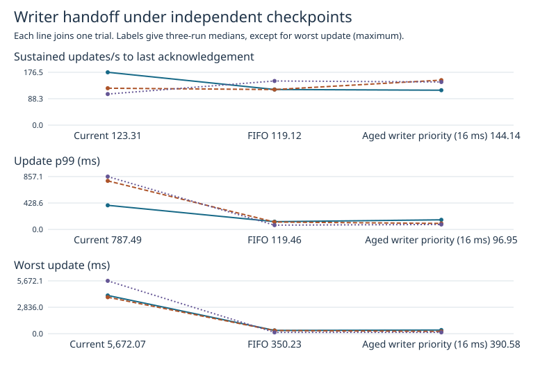
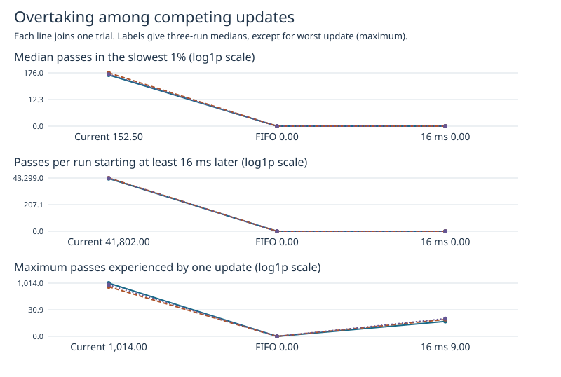
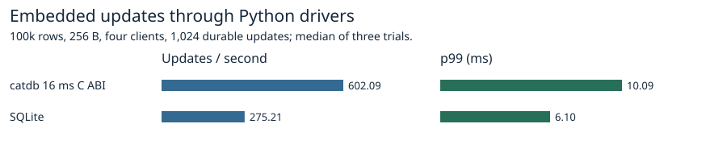
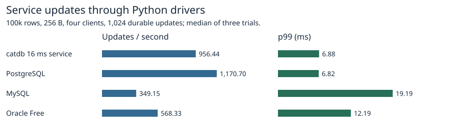

# Age-based writer handoff at 16 ms

The current lock, strict FIFO and 16 ms policy sustained 123.31, 119.12 and 144.14 updates/s. Update p99 was 787.49, 119.46 and 96.95 ms. The worst updates across three trials lasted 5672.07, 350.23 and 390.58 ms.

The 16 ms policy improved maximum latency in 3/3 pairs, p99 in 3/3, and throughput in 2/3 against the current lock. The strict FIFO comparison below shows the cost or benefit of permitting brief barging. A higher median rate alone cannot establish throughput retention in each run.

| Measure | Current | FIFO | 16 ms | Change vs current | Change vs FIFO |
|---|---:|---:|---:|---:|---:|
| Sustained updates/s to last acknowledgement | 123.31 | 119.12 | 144.14 | +16.9% | +21.0% |
| Update p99 (ms) | 787.49 | 119.46 | 96.95 | -87.7% | -18.8% |
| Worst update (ms) | 5,672.07 | 350.23 | 390.58 | -93.1% | +11.5% |
| Updates/s including checkpoint drain | 123.31 | 119.12 | 144.14 | +16.9% | +21.0% |
| WAL journal p99 (ms) | 30.40 | 28.50 | 25.07 | -17.5% | -12.1% |
| Final checkpoint path (ms) | 1,376.74 | 345.19 | 330.63 | -76.0% | -4.2% |
| Application writes (MiB) | 17,186.00 | 17,173.87 | 17,175.41 | -0.1% | +0.0% |

Rates and p99 summarize trial-level medians. Maximum uses the worst request across all trials. Individual paired changes below use each trial's own maximum. Dumps contain every attempt, including conflicts and retries.

| Measure | Reference | Pairs improving | Pair 1 | Pair 2 | Pair 3 |
|---|---|---:|---:|---:|---:|
| Sustained updates/s to last acknowledgement | Current | 2/3 | -33.9% | +21.9% | +38.8% |
| Sustained updates/s to last acknowledgement | FIFO | 1/3 | -2.0% | +26.4% | -2.3% |
| Update p99 (ms) | Current | 3/3 | -60.2% | -87.7% | -90.7% |
| Update p99 (ms) | FIFO | 1/3 | +23.8% | -18.8% | +15.6% |
| Worst update (ms) | Current | 3/3 | -90.5% | -93.8% | -97.5% |
| Worst update (ms) | FIFO | 1/3 | +11.5% | -27.2% | +0.8% |

## What happened in the earlier 6.80 s update

In the previous twelve runs the slowest request (#4853, current lock, writeback on, trial 2) waited 6,788.74 ms for the writer lock. Of 1,012 later-started attempts that acquired it first, 1,008 committed and 1,009 distinct request IDs were involved. Those passing commits used 6,649.90 ms of WAL sync. Including transactions already ahead, 1,011 WAL sync intervals overlapped its wait for 6,673.02 ms in total. The longest overlap was 20.50 ms. Of the slowest 164 updates per trial, 984 of 984 had at least one pass with the current lock and 0 of 984 with strict FIFO. Every old worst-request decomposition is independently checked against the previous published trace results. In another earlier run with FIFO and writeback disabled, a 1,371.94 ms update had zero passes and 1,341.21 ms of overlap with one WAL sync.

Across 49,152 old current-lock updates with writeback on, 4,026 (8.2%) accumulated at least 16 ms of writer wait. This motivated a single experimental threshold. The new policy measures age per queued acquisition, so a request accumulating wait across retries can differ from a single registration exceeding 16 ms.

## How the prototype admits writers

An arriving thread takes the free lock immediately if nobody is queued or the oldest registration is younger than 16 ms. At or beyond 16 ms the oldest registered waiter has priority at the next free lock. Queued threads keep registration order, and release wakes the head. There is no batching timer. The candidate uses the FIFO queue machinery and timestamps contended registrations. The baseline uses Rust's standard mutex. An owner may hold the lock through a slow sync and the eligible thread may wait for CPU time, so the threshold does not bound request latency.

| Lock (49,152 requests each) | Requests passed at least once | Total passes | Passes starting ≥16 ms later | Largest count per request | Passed in slowest 1% |
|---|---:|---:|---:|---:|---:|
| Current | 3,305 | 128,312 | 124,099 | 1,014 | 492/492 |
| FIFO | 0 | 0 | 0 | 0 | 0/492 |
| 16 ms | 6,327 | 13,468 | 0 | 9 | 3/492 |

| Lock | Trial | Slowest 164 with passes | Median passes among 164 | Worst request passes | Of those starting ≥16 ms later | All peer sync overlap ms | Longest overlap ms |
|---|---:|---:|---:|---:|---:|---:|---:|
| Current | 1 | 164 | 143.0 | 585 | 582 | 4,004.42 | 16.89 |
| FIFO | 1 | 0 | 0.0 | 0 | 0 | 329.11 | 268.33 |
| 16 ms | 1 | 1 | 0.0 | 0 | 0 | 243.89 | 143.05 |
| Current | 2 | 164 | 176.0 | 631 | 630 | 3,849.52 | 16.20 |
| FIFO | 2 | 0 | 0.0 | 0 | 0 | 310.17 | 203.96 |
| 16 ms | 2 | 0 | 0.0 | 0 | 0 | 142.60 | 57.49 |
| Current | 3 | 164 | 152.5 | 817 | 813 | 5,551.81 | 20.43 |
| FIFO | 3 | 0 | 0.0 | 0 | 0 | 109.26 | 52.24 |
| 16 ms | 3 | 2 | 0.0 | 0 | 0 | 102.19 | 39.02 |

A pass requires another writer's lock-attempt timestamp strictly after the waiting attempt began and its acquire timestamp strictly before that attempt acquired the lock. Timestamp ties do not qualify. Counts track writer attempts and exclude the checkpoint thread. The timestamps bracket the lock call and can include scheduling before registration. They do not identify OS sleep or the exact instant the internal queue was entered. [Per-trial overtaking and sleep-independent sync intersections](overtaking.csv).

## Workload and verification

Nine fresh WSL2/ext4 Docker volumes, one million 256-byte values, four continuous writers, two CPUs, 4 GiB without swap, 16,384 durable updates per trial and exactly 63 independent publications. All arms use 8 MiB checkpoint writeback. The lock order is current/FIFO/16 ms, FIFO/16 ms/current, then 16 ms/current/FIFO. The workload checks the retained snapshot, latest contents, committed generations and reopened values. The candidate's tests exercise both threshold boundaries, queued handoff and panic poisoning on Linux and Windows. The large checkpoint test injects storage failure and exits before and after synchronization/publication. The old-reader and conflict fixture checks point and range conflicts. [Safety outcomes](safety.txt).

Build the candidate with `cargo build --release --features aged-writer`. The aged-writer Cargo feature includes fifo-writer. Using fifo-writer alone selects strict FIFO. Ordinary builds use the current mutex. [All new trials](trials.csv) · [All new publications](publications.csv) · [Trace quality](quality.csv) · [Previous trial references](prior-trials.csv) · [Image IDs](images.json). The gzip CSVs contain only numeric application attempt records.

Build benchmarks/aged-writer/Dockerfile as catdb-aged-writer and use the observer image described in the [production writeback campaign](../production-range-writeback-2026-11-08/README.md). Run campaign_aged.py RAW REPORT. Use audit.py REPORT --fresh RAW to export the new numeric input and replay the published historical markers. Add --old PREVIOUS_RAW_FULL to export the historical input from original application logs. Use audit.py REPORT to verify the self-contained published data. Generate the figures with report.py REPORT. Run test_analysis.py for timestamp-boundary checks. Inside the test image, mount ext4 at /build/artifacts and run the ignored range_writeback_recovers_after_failure_and_exit_around_final_sync test with CATDB_TEST_RANGE_WRITEBACK=1 and --features aged-writer.

## Other database products

A separate four-client workload used 100,000 rows, 256-byte values and 1,024 durable single-key updates, in three runs per product or interface. catdb's service and C ABI both use the 16 ms feature. This workload has different checkpoint activity from the million-row comparison. All runs verified the full digest after restart.

[Product medians](peers/products.csv) · [Versions, settings and verification](peers/environment.json) · [Raw trial results](peers/results.json).
