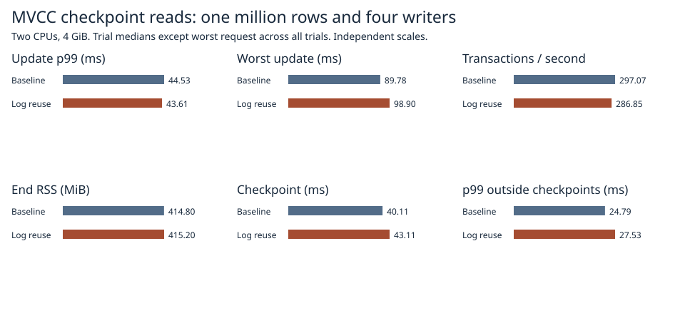
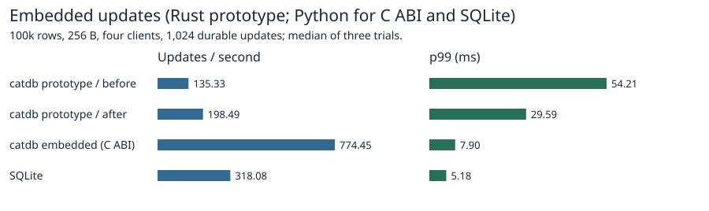
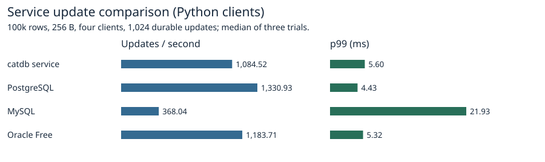

# Durable updating after reusing the log record encoding

Reusing a single encoding for two durable log copies measured 286.9 transactions/s, p99 43.6 ms and worst wait 98.9 ms. The previous path measured 297.1 transactions/s, 44.5 ms and 89.8 ms. The throughput improvement did not reproduce. The candidate remains experimental.



| Path | Tx/s | Update p99 ms | Worst ms | End RSS MiB |
|:---|---:|---:|---:|---:|
| Baseline | 297.07 | 44.53 | 89.78 | 414.80 |
| Log reuse | 286.85 | 43.61 | 98.90 | 415.20 |

The internal workload used one million rows with alternating 8/32-byte keys and 256-byte values, four closed-loop writers, a pinned reader and three synchronous checkpoints during 1,024 multi-key transactions. Each run used a fresh volume, 2 CPUs and 4 GiB with swap disabled. The before/after order alternated across three pairs. End-to-end times include retries and admission. Statistics are trial medians except the worst request across all three trials. [Per-request results](raw/1m/) and [trial statistics](1m.csv).

## Normal commit attribution

In the preceding CRC experiment the three times outside checkpoint intervals were 3,243/3,220/3,216 ms with the old checkpoint writer and 3,264/3,361/3,313 ms with combined CRC. The checkpoint intervals themselves were shorter on every pair. This identified the rest of the update loop as the place to measure the small throughput regression.

The MVCC adapter still decodes the native frame and builds the overlay. Previously, the paired append encoded both identical envelopes separately and encoded a third envelope when deriving its chain digest after sync. The candidate encodes once, submits the same bytes twice and uses the existing checksum from its header after a successful sync. Both paths preserve the two half-write injection boundaries per lane, one real sync per commit, sequence checks, FIFO and publication order.

| Path | FIFO | Prepare | Write | Sync | Publish | Outside | Whole request |
|:---|---:|---:|---:|---:|---:|---:|---:|
| Baseline | 7.949 | 0.022 | 0.023 | 2.565 | 0.024 | 0.655 | 11.237 |
| Log reuse | 9.050 | 0.020 | 0.021 | 2.946 | 0.019 | 0.648 | 12.703 |

Diagnostic off (median of three) versus on (one run), in transactions/s and p99 ms: combine 297.1/44.5 versus 355.4/42.2, logreuse 286.9/43.6 versus 314.5/44.1. Scheduling and storage variability are included in that difference.

Means in milliseconds over 1,024 requests per path in a separate profiled execution. Each row in the [request-level phase data](commit-phases.csv) accumulates the same request's retries. FIFO is time entering the publication queue. Preparation includes validation, framing, decoding and overlay preparation up to the writes; post-sync processing includes publication, applying the overlay and the old path's final chain checksum. Write and sync are elapsed call intervals. Outside includes request preparation, admission/checkpoint wait and time between attempts. Different requests' FIFO waits overlap. These intervals cannot be summed across workers to predict wall-clock throughput. [Instrumented trials](diagnostic.csv).

## Peer comparison





| Engine / driver | Durable updates/s | p99 ms |
|:---|---:|---:|
| SilverHamu prototype / before | 135.33 | 54.21 |
| SilverHamu prototype / after | 198.49 | 29.59 |
| SilverHamu embedded (C ABI) | 774.45 | 7.90 |
| SQLite | 318.08 | 5.18 |
| SilverHamu service | 1,084.52 | 5.60 |
| PostgreSQL | 1,330.93 | 4.43 |
| MySQL | 368.04 | 21.93 |
| Oracle Free | 1,183.71 | 5.32 |

Native prototype throughput varied widely across repetitions (before: 244.5 / 115.4 / 135.3; after: 231.3 / 198.5 / 82.2 updates/s). The candidate had higher throughput in one of the three paired trials. The median alone obscures that variability.

The peer workload is intentionally a separate 100,000-row single-key test. Every engine receives the same eight-byte key stream, 256-byte values, 1,024 durable updates and four clients. Random keys are partitioned by client with the same seeds and stamps. Per-client warm-up uses 50 reads, then a common start. Each participant is measured three times. The embedded prototypes use a Rust test binary calling native MVCC. SQLite and shipped SilverHamu embedded use Python via sqlite3 and the C ABI. The service chart uses the released service path in this checkout plus PostgreSQL, MySQL and Oracle Free with the existing Python benchmark adapters; each client and server container receives 2 CPUs/4 GiB. Storage-engine performance and driver costs both affect these numbers. SQL Server remains outside the published suite pending disclosure permission. The prototype uses 1,024 log slots so no scheduled checkpoint falls inside the peer update window. Each run checks all final rows after reopen. The product harness also checks full digests before and after restart. [Product versions, durability settings and verification records](products/environment.json), [samples](products/results.json), [native comparison trials](native/results.json).

## Safety and reproduction

The append test compares complete files for two multi-key updates with the old and new encoders, corrupts one append copy, reopens and verifies the full map plus byte-for-byte repair. The opt-in Linux library suite exercises old readers, conflicts, sync-before-publication, storage failures and process termination around commit and checkpoint publication. All six main runs verify the current and pinned datasets and reopen at the final commit generation. Process termination leaves the host running.

```sh
docker build -f benchmarks/scaled-gate/Dockerfile -t catdb-append-reuse .
docker run --rm --network none --cpus 2 --memory 4g --memory-swap 4g -e CATDB_TEST_DIRECT=1 -e CATDB_TEST_LOG_REUSE=1 catdb-append-reuse cargo test --release --locked --lib -- --test-threads=1
python benchmarks/scaled-gate/run_append.py --stage pilot --out results/pilot
python benchmarks/scaled-gate/run_append.py --stage diagnostic --out results/diagnostic
python benchmarks/scaled-gate/run_append.py --stage 1m --out results/1m
python benchmarks/scaled-gate/report_pack.py --append results report
python benchmarks/scaled-gate/commit_report.py results/diagnostic report/commit-phases.csv
docker build -f benchmarks/Dockerfile -t catdb-peers-append .
python benchmarks/run.py --image catdb-peers-append --single-request --four-updates --rows 100000 --ops 1024 --reps 3 --out products
python benchmarks/scaled-gate/peer_native.py native
python benchmarks/scaled-gate/report_products.py products native report
```

Run sequentially with fresh directories. Preload the product images listed in the benchmark setup guide. The experimental storage path is enabled in Linux test builds.
