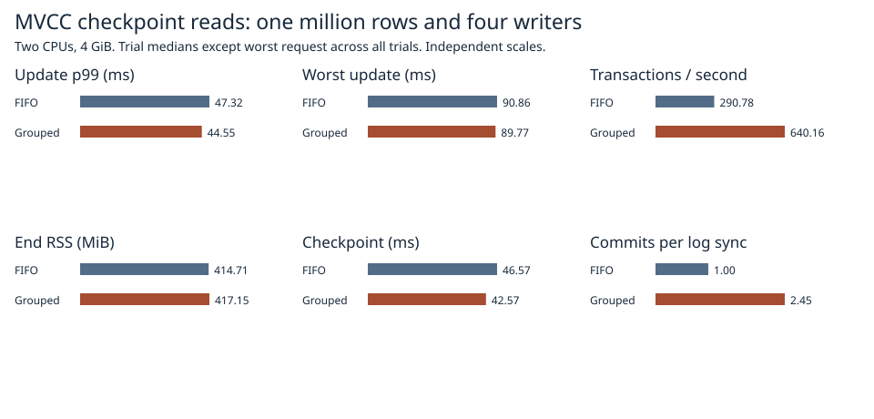
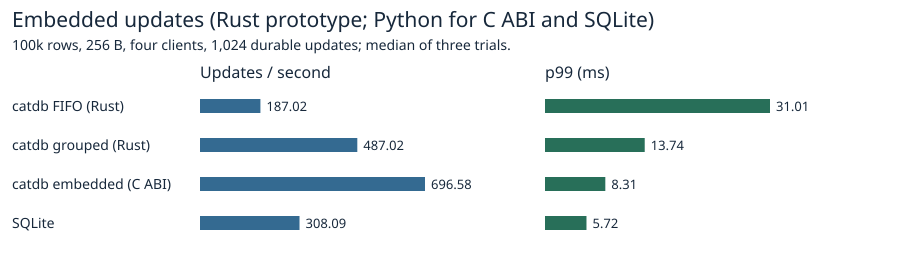
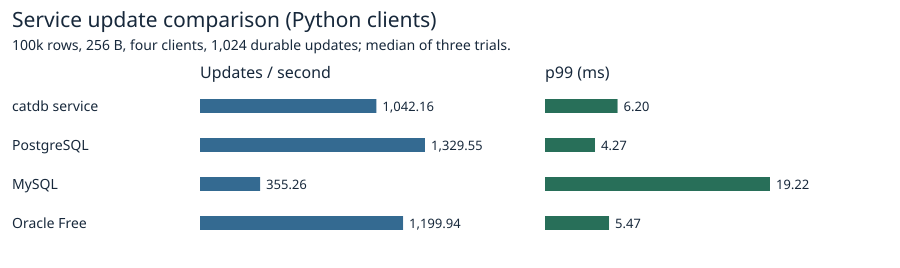

# FIFO group commit with no deliberate collection delay

With four writers the no-delay FIFO group committed **2.45 transactions per log sync** versus 1.00 for single-commit FIFO. The grouped path measured 640.2 transactions/s, p99 44.6 ms and worst wait 89.8 ms. Single FIFO measured 290.8 transactions/s, 47.3 ms and 90.9 ms.



| Path | Log syncs | Commits/sync | Tx/s | p99 ms | Worst ms | Retries | RSS MiB |
|:---|---:|---:|---:|---:|---:|---:|---:|
| Single | 1,024.00 | 1.00 | 290.78 | 47.32 | 90.86 | 3.00 | 414.71 |
| Grouped | 418.00 | 2.45 | 640.16 | 44.55 | 89.77 | 17.00 | 417.15 |

Throughput increased in all three pairs. The grouped maximum was smaller in two pairs; in the other it rose from 88.6 to 89.8 ms. The 1.1 ms difference between overall maxima is too small to conclude a repeatable reduction in worst-case latency. Conflict retries increased from 3 to 17 per run at the median and are included in all elapsed times.

Each variant ran 1,024 multi-key updates against one million rows with a pinned snapshot, four closed-loop writers, two CPUs and 4 GiB with zero swap. Each pair ran in a fresh volume and the pair order alternated. Three synchronous checkpoints occur after each group of 256 successful transactions before admitting the next transaction. Throughput and p99 are medians of three trial statistics; worst wait is the slowest request in any trial and includes conflicts, retries, checkpoint overlap, and admission. Commit sync counts exclude setup, checkpoint barriers and reopen. [Individual trials](1m.csv), [raw request evidence](raw/1m/).

## How the next writer is selected

The design question came from PostgreSQL 18.6, whose XLogFlush rechecks the flushed WAL position after a competing writer finishes. A separate earlier single-run probe counted 1,024 WAL syncs for 1,024 commits at one client and 512 at four clients, with fsync on, synchronous_commit on, commit_delay zero and fdatasync. The PostgreSQL counter is instance-wide. SilverHamu uses its own validation and paired-frame protocol. [PostgreSQL 18.6 WAL source](https://github.com/postgres/postgres/blob/REL_18_6/src/backend/access/transam/xlog.c).

An idle queue immediately elects its first caller. While that group runs, later callers enqueue their transactions. At handoff the oldest pending caller takes the already-present FIFO prefix that fits four transactions, 512 KiB of encoded data and 4,096 physical operations including a generation marker. The pending queue separately caps at 32 requests and 4 MiB of estimated encoded updates. Those caps govern group selection and queued payload; RSS also includes MVCC versions, request objects, log assembly and file buffers. Full queues and oversized requests return a resource error before publication. No timer fills an incomplete group, and no permanent worker or spin loop is needed. Notifications wake callers to check either their own outcome or their eligibility to lead. Transactions validate against native MVCC state and all earlier accepted writes in the group, using the same validation and publication core as the production group-commit path.

The prototype uses the previous 64 KiB CRC-combination checkpoint path. Successful independent changes are encoded into one paired log frame including the group's ending logical generation. Conflicting members have their own rejection and use no generation. Disjoint writes allow recovery to reconstruct the union of a whole group atomically while live MVCC retains separate per-transaction generations. The writer syncs the paired frame once, then publishes accepted versions in order and replies to each caller. Read-only transactions keep their original snapshot result. The checkpoint directory persists the ending logical generation independently of the physical frame sequence. A writable grouped store requires this experimental adapter on reopen. Durability is subject to the existing paired-record failure model of one detectably damaged copy. Process termination leaves the host running.

## Verification

The controlled arrival tests pause the first sync to place independent and conflicting requests into the next group. They verify same-key, point-read and range conflicts, atomic pre-sync invisibility, persistent logical versions, oversized-request refusal, splitting on encoded bytes and a seven-caller burst draining as 1 + 4 + 2 with no waiters left. An injected sync failure returns uncertain outcomes without success acknowledgments. Child-process termination during the second multi-transaction frame or selector publication must preserve the acknowledged first transaction and recover an entire possible group or its absence. Every timed trial checks the pinned view, the latest map reconstructed from successful transaction order and the reopened data and final sequence. The queue saturation fixture pauses a leader, fills either the 32-request or the 4 MiB pending budget, rejects an excess arrival and commits the next request after the queue drains. The adapter reserves room for the one-byte key tag before enqueue. Native 1,024-byte keys exceed this prototype tagged-key bound; they are rejected individually before they can poison a group. The initial performance cohort (before adding this admission check) is archived [separately](preflight-raw/1m/runs.json) and excluded from the main statistics. The preliminary pilot rejected the new mode name in the harness before executing its candidate workload. Its whitelist was corrected before the reported cohorts. [Test results](safety.txt).

## Peer comparison





| Engine / driver | Updates/s | p99 ms |
|:---|---:|---:|
| SilverHamu FIFO (Rust) | 187.02 | 31.01 |
| SilverHamu embedded (C ABI) | 696.58 | 8.31 |
| SQLite | 308.09 | 5.72 |
| SilverHamu service | 1,042.16 | 6.20 |
| PostgreSQL | 1,329.55 | 4.27 |
| MySQL | 355.26 | 19.22 |
| Oracle Free | 1,199.94 | 5.47 |
| SilverHamu grouped (Rust) | 487.02 | 13.74 |

The peer suite uses 100k rows, 8-byte keys, 256-byte values, four clients and 1,024 single-key durable updates. Each client writes its own deterministic key partition. Full verification after reopen checks every key and value across all repetitions. Each container has 2 CPUs and 4 GiB. Native prototypes run through a Rust test binary and use the same key/stamp sequence as the Python API benchmark for released SilverHamu, SQLite, PostgreSQL, MySQL and Oracle Free. The service chart measures the shipped SilverHamu service. SQL Server's previously recorded publication restriction still applies to this suite. [Native trials](native/results.json), [product metadata and verification](products/environment.json), [product trials](products/results.json).

## Reproduction

```sh
docker build -f benchmarks/scaled-gate/Dockerfile -t catdb-arrivals .
docker run --rm --network none --cpus 2 --memory 4g --memory-swap 4g -e CATDB_TEST_ARRIVALS=1 -e CATDB_TEST_DIRECT=1 catdb-arrivals cargo test --locked --release --lib arrival_gate_ -- --ignored --test-threads=1
docker run --rm --network none --cpus 2 --memory 4g --memory-swap 4g -e CATDB_TEST_ARRIVALS=1 -e CATDB_TEST_DIRECT=1 catdb-arrivals cargo test --locked --release --lib -- --test-threads=1
python benchmarks/scaled-gate/run_arrivals.py --stage pilot --out results/pilot
python benchmarks/scaled-gate/run_arrivals.py --stage 1m --out results/1m
python benchmarks/scaled-gate/report_pack.py --arrivals results report
docker build -f benchmarks/Dockerfile -t catdb-arrival-peers .
python benchmarks/run.py --image catdb-arrival-peers --single-request --four-updates --rows 100000 --ops 1024 --reps 3 --out products
python benchmarks/scaled-gate/peer_native.py --arrivals native
python benchmarks/scaled-gate/report_products.py --arrivals products native report
```

Use fresh output folders; run stages sequentially. The alternate persistence and queue are enabled in Linux tests.
