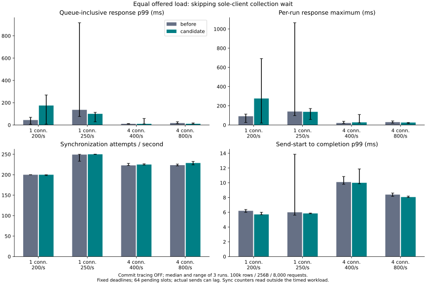
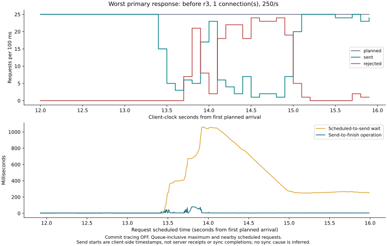
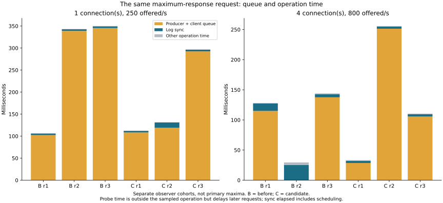

# Equal offered arrivals: synchronization cadence and backlog

2026-11-05. **Default unchanged.** Three repeats of 100,000 rows, 256-byte
values and 8,000 offered updates per condition. One connection at 200/250
requests/s; four at 400/800 requests/s. The candidate is the existing opt-in
`single-client-commit` feature, not a new durability policy.

Matching offered arrivals removed the candidate's automatic increase in average
sync frequency in most one-client runs, **but did not stabilize maximum latency**.
The next visible problem is backlog amplification: a period of slow operations
can leave later requests waiting long after individual operation times recover.
No new batching heuristic or default change is justified by these results.

## Primary comparison

Bars show medians and whiskers the range of three runs. Commit tracing is OFF.
**Response** runs from the independently scheduled arrival to completion;
**operation** runs from client send-processing start to completion. Earlier
closed-loop charts excluded this client queue and must not be compared directly.

| Connections | Offered/s | Response p99, before → candidate (ms) | Worst response, before → candidate (ms) | Rejected, before → candidate / 24,000 |
|---:|---:|---:|---:|---:|
| 1 | 200 | 44.422 → 174.987 | 113.919 → 691.487 | 0 → 74 |
| 1 | 250 | 136.370 → 100.294 | 1065.075 → 171.799 | 544 → 0 |
| 4 | 400 | 10.228 → 10.332 | 38.532 → 109.321 | 0 → 0 |
| 4 | 800 | 17.435 → 11.082 | 42.707 → 26.057 | 0 → 0 |

The one-client **operation** p99 medians were 6.195 → 5.711 ms at 200/s and
5.999 → 5.844 ms at 250/s. Those modest differences do not remove the much larger
queue-inclusive tails. The candidate regresses at the lower offered rate and
looks better at the higher one; three noisy trials do not establish a monotonic
capacity curve or a robust tail improvement. At four active connections the
candidate's wait bypass is inactive, so the apparent four-client improvement
is not evidence for a new batching optimization.

See the [complete table](table.md) for throughput, synchronization, batch size,
operation maxima, observer cohorts and unfavorable outcomes. Primary completed
throughput medians are approximately 200/250/400/800 per second because the
offered rate deliberately limits them; these are not throughput ceilings.

## Did the actual frequencies match?

Only partially. All planned schedules match exactly. Producer p99 lag is small
(0.116–0.347 ms across primary trials), but actual send starts can lag and bunch:

| Connections | Offered/s | Actual mean send-rate range, before | Actual mean send-rate range, candidate |
|---:|---:|---:|---:|
| 1 | 200 | 200.00–200.00 | 198.15–200.00 |
| 1 | 250 | 233.00–249.96 | 250.00–250.00 |
| 4 | 400 | 400.00–400.00 | 400.00–400.01 |
| 4 | 800 | 799.84–800.01 | 799.97–800.01 |

One connection performs exactly one sync attempt per successful update in these
runs. Most run-average sync rates therefore match the intended 200/250 per second;
the 74-rejection candidate trial falls to 198.16 syncs/s and the 544-rejection
baseline trial to 233.00. Even when run averages agree, individual 100 ms bins
can contain only 1 send and later as many as 32. The experiment does **not** hold
instantaneous send or sync cadence constant. Only total sync counters are read
outside the timed workload; primary per-bin sync timestamps are not available.

At four connections, sync-frequency medians are 222.9 → 225.0/s at 400 offered/s
and 223.5 → 228.6/s at 800 offered/s. The corresponding updates/sync are
1.79 → 1.78 and 3.58 → 3.50. Increasing offered updates can increase grouping
instead of sync frequency. Equal request frequency is not equal batch formation.

Thus higher **average** sync frequency is not a sufficient explanation for all
observed tails. However, incomplete actual-rate matching, changed short-window
cadence, and uncontrolled host/storage activity prevent a clean causal claim
about the previous 78.956 ms event. This experiment does not directly recapture
or explain that historical uninstrumented request.

## Where the largest response time went

The largest primary response is **1065.075 ms**, baseline trial 3 at 250/s:

- Producer scheduling lag: **0.053 ms**.
- Client FIFO wait before send: **1059.036 ms**.
- That request's complete operation: **5.986 ms**.

The candidate's worst 200/s response similarly contains **686.376 ms** of client
FIFO wait and a **5.008 ms** operation. These are successive-work backlogs, not
evidence that the maximum-response request itself spent one second synchronizing.
The neighboring operations contain bursts of elevated durations. Primary runs
have no server trace, so their internal synchronization versus scheduling cause
is still unknown. The 64-slot queue bounds pending count, not response time:
requests admitted earlier can still wait while successive slow operations drain.
Rejecting overflow does not falsely acknowledge an update and is not called a
database write failure or a latency improvement.

## Observer effect and same-request attribution

At the higher rates, separate pull-diagnostic cohorts captured **26,022** records
over **95,467** successful observer updates (96,000 offered). All records matched
their original request ID, connection/sequence, server request index, timestamps
and exact phase sum. Every successful maximum and response reaching 10 ms was
covered; there were no missing, mismatched or dropped records.

The largest phase is client FIFO wait in **11 of 12 observer maxima**; the other
maximum is dominated by log-sync elapsed time. Of 25,815 observer responses
strictly above 10 ms, 25,564 have FIFO wait as the largest phase, 229 log sync,
and 22 leader queue. This describes the same requests, not a sum of unrelated
percentiles. It also does not prove what caused their predecessors to slow down.

The collector is disruptive when a backlog persists. Nearly every delayed
request can trigger a diagnostic round trip, slowing later sends further. At
four connections/800 offered/s, response-p99 medians change from 17.435 to
90.523 ms for baseline and from 11.082 to 89.323 ms for candidate when tracing
and pulling are enabled; observer rejection counts are 164 and 220. The 8.692 s
sum of individual probe durations is not additive wall-clock overhead across
threads. Observer results are kept separate and cannot be used to attribute
different primary-cohort stalls. The common arrival-scheduler/timestamp overhead
was not separately measured against an otherwise identical uninstrumented client.

`sync_all` elapsed time includes filesystem/device work and delay before the
calling thread resumes. No ETW or hardware-level cause is claimed here.

## Safety, decision and remaining work

**288,000 offered requests: 286,849 completed, 1,151 rejected by the client queue,
zero operation errors or retries.** All 60 full-content checks, including 12
reopens, match the successful-update oracle. Rejected requests are never added
to that oracle; overload means the final update subset is not identical across
all modes. Raw rejection events remain public. No production data was used.

Validation passed: 142 Rust tests (12 ignored benchmark/child helpers), 19
metrics-enabled and 19 default service/protocol tests, 23 pull-diagnostic tests,
21 legacy diagnostic tests, 35 C ABI checks, 6 arrival-scheduler tests, 5 arrival
report tests, 4 existing collector tests and 3 existing attribution tests. Clippy
passed with warnings denied. These cover old snapshots, same-group/point/range
conflicts, no acknowledgment/publication before sync, storage failures and process
exit recovery. New tests check finite capacity, overload, failures without stranded
requests, exact deadlines and record correspondence. The optional counter reads
do not publish pending writes or change an existing snapshot; default builds do
not expose the command. See [validation details](validation.json).

The only service addition is opt-in `benchmark-metrics`, reading existing counters
at quiescent boundaries. Public default APIs, file format and persistence order
are unchanged. **`single-client-commit` remains opt-in.** This bounded study is
complete; it did not establish a safe additional scheduling improvement. Increasing
queue capacity or weakening synchronization would not resolve the identified
problem. Further work would need controlled stall reproduction or independent
storage/scheduler evidence, followed by separate evaluation of admission limits
and backlog recovery. Those are not claimed as implemented or fixed here.

Process-crash tests do not prove physical power-loss safety. Other DBMS products
were not rerun, and no new product ranking is claimed.

- [Methodology, timing contract and reproduction](../../../benchmarks/arrival-rate/README.md)
- [All run summaries](results.json), [aggregated/per-run analysis](summary.json), [table](table.md)
- [Environment/image IDs](environment.json), [provenance](provenance.json), [measured source](measured-source.zip)
- [Attributed records](attributed-records.json.gz); raw event/profile and 100 ms/1 s bin files alongside this report
- [Short pilot](pilot/results.json), excluded from the comparison
