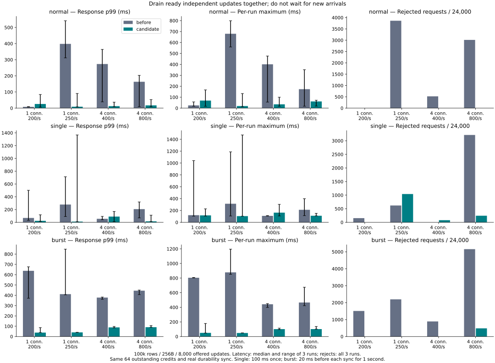
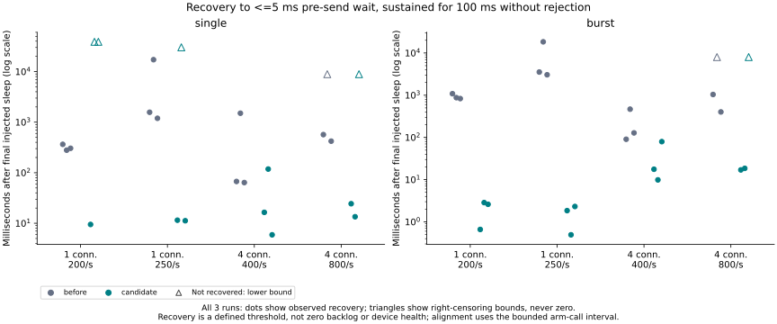

# Bounded backlog draining under slow synchronization

**A ready-work batch reduces amplification during repeated slow syncs, but does
not consistently reduce natural worst-case latency. The production default is
unchanged.** The experimental `backlog-batch` feature exposes an independent-result
batch API; existing clients must explicitly choose it. C#/PALV is not changed.

The primary comparison uses the same server binary, 100,000 rows, 256-byte values,
8,000 offered updates, 1/4 connections and three repeats per condition. The only
policy change is draining up to eight already-ready distinct-key updates instead
of sending one at a time. Both have 64 total outstanding credits, including active
requests. Real log synchronization and individual transaction validation remain.
Equal connection counts do not mean equal logical transaction concurrency.

Bars for latency show the median of three per-run statistics, whiskers their
minimum/maximum. Rejections sum all 24,000 offered updates per condition. Latency
is scheduled time to successful completion, not send-to-reply alone. Rejected
requests are excluded from successful latency but counted separately, never retried.
See the [full table](table.md) and [every trial](summary.json).

## Controlled repeated delay

The hook sleeps 20 ms before every real sync beginning in a one-second window.
It records actual sleep counts/times, and never skips synchronization. The policy
can change the number of injected syncs within that fixed window.

| Connections / offered per second | p99 ms, before → batch | Worst ms, before → batch | Rejected / 24k, before → batch |
|---|---:|---:|---:|
| 1 / 200 | 637.501 → 38.159 | 807.888 → 178.495 | 1,508 → 0 |
| 1 / 250 | 411.283 → 40.319 | 1,195.832 → 50.111 | 2,193 → 0 |
| 4 / 400 | 377.745 → 88.605 | 450.634 → 114.477 | 890 → 0 |
| 4 / 800 | 444.791 → 90.520 | 674.552 → 137.514 | 5,156 → 483 |

At 1/250, completed throughput changes 245.1 → 250.0 updates/s and rejection
9.14% → 0%. At 4/800, it changes 694.1 → 787.5 updates/s and rejection
21.48% → 2.01%. These are rate-limited workloads, not unlimited throughput ceilings.

This supports a specific explanation: a slow predecessor leaves more pending
work, and issuing each successor serially prolongs the backlog. Sending ready
independent transactions together lets the engine share durable syncs and reduces
network round trips. It does not make the original slow sync complete faster.

## Single delay and unfavorable findings

Single-injection cases request one 100 ms sleep; its actual duration and position
are recorded. **The candidate still reaches 1,473.682 ms at 1/250**, compared with
the baseline's worst 1,188.817 ms. Candidate repetition 2 rejects 1,041 updates;
the injected sleep itself is only 100.087 ms, whereas that maximum request's
send-to-reply interval is 1,454.083 ms. The extra time cannot all be attributed to
the injected delay. With no per-request server trace in these trials, it cannot
be assigned specifically to I/O, scheduling or batch execution either.

At 4/400 with one injected delay, median p99 worsens 55.217 → 89.744 ms and
rejections increase 0 → 79. Under normal 1/200 traffic, p99 worsens
7.946 → 25.716 ms and worst response 56.897 → 166.765 ms. Conversely, several
other normal/high-rate conditions improve strongly. Baseline repetition 2 also
has substantial non-injected slowdowns. All runs are retained; three repeats on
this shared workstation do not establish a universal worst-case improvement.

At 800 offered/s, a 100 ms global pause can generate 80 arrivals against only
64 credits. Batching afterward cannot guarantee zero rejection during that pause.
Increasing the queue or acknowledging before sync would not fix durable latency.

## Recovery after the injected pause

Recovery means the first 100 ms arrival window after the last actual injected
sleep with no rejected/failed update and <=5 ms scheduled-to-send wait for every
request. It is not a claim of an empty queue. Server/client alignment is bounded
by the arm-call interval; exact device timing is not inferred.

Repeated-delay recovery at 1/250 changes 3,533.767 → 1.845 ms (median, all three
trials observed); at 4/400, 128.024 → 17.618 ms. Some other cases never meet this
strict threshold before observation ends. The figure shows those trials as
right-censored triangles, and the table states how many failed to reach the
threshold instead of reporting a favorable median of only the recovered subset.

## Separate window experiment

Four connections at 800/s still reject under the primary ready-batch policy.
Source inspection suggests an interaction between a four-transaction collection
target and larger incoming groups. The precise sequence of partial groups was
not traced, so this is a hypothesis, not a measured 8/24 transaction alternation.

A fresh three-repeat supplement compares ready batches against ready batches
plus the existing optional `commit-window` collection policy. The latter targets
32 under backlog and can add bounded server collection time. In the repeated
delay case, p99 changes **90.253 → 49.919 ms**, worst **102.338 → 79.943 ms**,
rejections **366 → 0 / 24k**, and completed throughput **787.4 → 799.7/s**.
Normal p99 changes 12.048 → 9.290 ms; worst 35.892 → 17.861 ms.

However, the strict recovery metric **worsens 16.756 → 136.086 ms** under repeated
delay. Lower whole-run p99 and fewer rejected requests do not imply that every
recovery definition improves. This supplement covers only 4/800 normal/repeated
delay, not one connection or single-injection behavior. Neither option becomes
a default. [Supplement table](window/table.md), [raw data](window/results.json).

## Observer control and environment

A later three-repeat normal-load cohort removes `sync-stall` at compile time,
but keeps the same arrival/event recorder and counter API. At 4/800, clean
baseline/candidate p99 medians are 10.457/9.797 ms, compared with 163.347/16.994 ms
in the earlier primary normal cohort. At 1/250, clean candidate p99 ranges across
7.134, 115.823 and 7.182 ms; clean baseline also varies substantially. Clean
candidate worst response is 229.369 ms at 1/250 and 44.535 ms at 4/800, both worse
than the corresponding clean baseline maxima, despite lower median p99.

These separate-time results show that variation persists without the fault hook;
they do **not** isolate all between-cohort differences as instrumentation cost.
No precise constant observer-overhead claim is made. All 96,000 control requests
complete without rejection or operation error. [Control table](overhead/table.md),
[individual trials](overhead/summary.json).

Linux Docker containers run on the Windows workstation, each client/server with
2 CPUs and 4 GiB; volumes use Docker-managed storage, not PALV or Z: data. Exact
Docker versions/image IDs are in provenance. Builds, test suites and plotting did
not overlap timed cohorts. Small source/document edits and one read-only host /
Docker load inspection occurred; it was not aligned to an outlier and does not
rule out transient host/device activity. Other activity was not fully controlled.

## Correctness, delivery and remaining work

Across primary, window and clean cohorts: **768,000 offered updates, 744,656
successful, 23,344 client admission rejections, zero operation errors/retries**.
All **132 full-content checks, including 18 reopens**, match each run's successful
update oracle. Short pilot/smoke runs are published separately and excluded from
these totals. Rejection means the final successful subset differs between modes.

The batch endpoint validates count/bytes/duplicates before submission, keeps each
transaction's snapshot and conflict result, and publishes only after real sync.
Top-level `ok` means the request was processed; callers must check each ordered
`results[i].ok`. A conflict may coexist with another entry's successful commit.
Fatal uncertain outcomes require reopen; disconnect is not proof of rollback.
The global transaction/resource limits are unchanged. See the
[API and method contract](../../../benchmarks/backlog/README.md).

Final safety/compatibility checks pass: 145 Rust tests in each of the primary
and commit-window feature combinations (12 helper/benchmark tests ignored),
28 batch protocol tests, 6 backlog scheduler tests, 5 backlog report tests,
19 enabled/19 default metrics protocol tests, 6 prior scheduler/5 prior report
tests, 35 C ABI checks, 23 pull tests, 21 legacy diagnostic tests, and Clippy
with warnings denied. See [validation.json](validation.json) and
[validation logs and commands](validation-logs.zip).
Tests cover old snapshots, same-group and point/range conflicts, partial outcomes,
no pre-sync publication, storage failure, process-exit recovery, capacity limits,
disconnect and stranded-request prevention. Process-crash tests are not proof
against physical power loss or misbehaving storage. Other DBMS products were not
rerun and no cross-product ranking is claimed.

The bounded experiment is complete. The opt-in API and reproducible benchmark
are delivered; default adoption, C#/PALV integration, deduplication after uncertain
responses and eliminating natural long stalls remain separate future decisions.

- [All primary results](results.json), [analysis](summary.json), [table](table.md)
- [Environment and full-check records](environment.json), [provenance](provenance.json), [measured source](measured-source.zip)
- [Window supplement](window/table.md), [fault-hook control](overhead/table.md)
- [Excluded pilot](pilot/results.json), [excluded smoke](smoke/results.json)
- Per-request event and batch files (`*.json.gz`) accompany each cohort.
