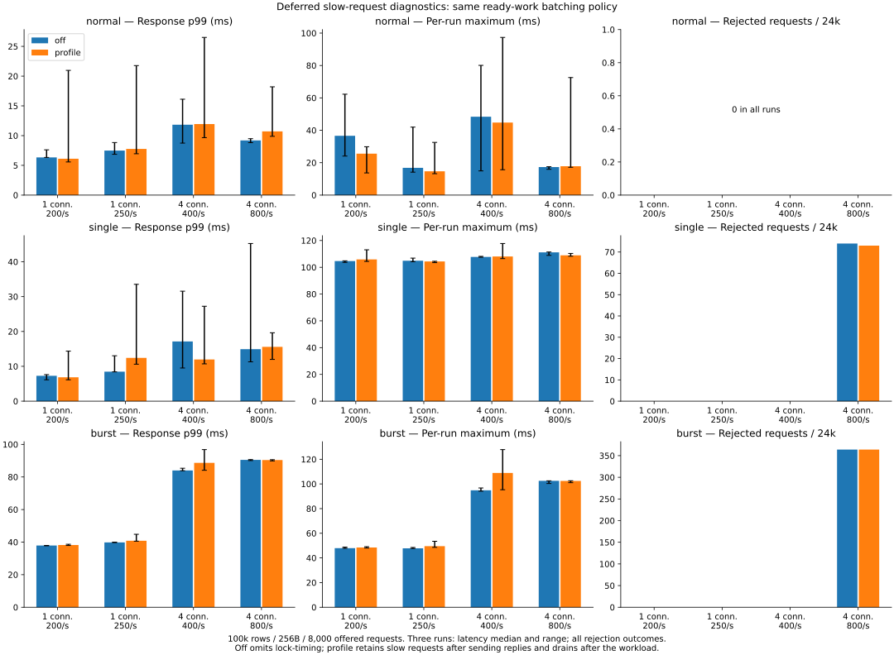
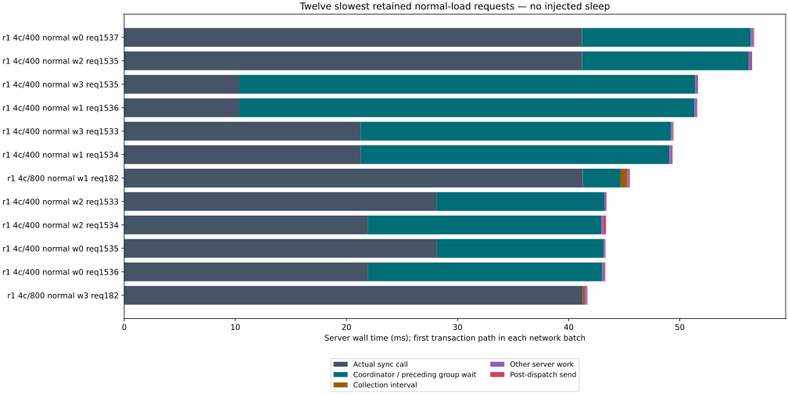

# Attributing the remaining long-tail request latency

**The historical 1,473.682 ms outlier did not recur. No new batching or durability
policy is adopted, and no maximum-latency speedup is claimed.** This bounded study
adds a deferred per-request recorder, including every independent transaction in
a service batch, and compares recording disabled/enabled under the same load.

Across 72 conditions and 576,000 offered updates, the largest observed response
is 127.865 ms. That is an observation from a new cohort, **not a reduction caused
by an optimization**. The old request has no detailed trace and cannot be
retroactively attributed. The experiment does identify where the newly observed
outliers spend time and provides the means to capture a future recurrence.

## What was measured

The previous ready-work policy remains: up to eight already-queued distinct-key
updates per connection, separate transaction outcomes, 64 total outstanding
credits, and real synchronization before acknowledgment. Dataset: 100,000 records,
256-byte values, 8,000 offered updates per condition; one connection at 200/250 per
second and four at 400/800 total per second. Normal, single 100 ms injected sleep,
and repeated 20 ms sleeps in a one-second window run three times each, with mode
order alternated. Both modes retain the sync-stall facility; only the instrumented
image includes `lock-timing` and buffered recording.

The diagnostic keeps decoded-dispatch-through-send intervals >=10 ms in a bounded
per-connection buffer and retrieves them after all updates drain. There are no
additional diagnostic round trips or diagnostic JSON in timed update responses.
Each record matches a client request index and its independent item outcomes.
Sleep-before-sync and the actual `sync_all` call have distinct markers.

Bars show median per-run latency statistics; whiskers show the three-run range.
Rejections include all 24,000 offered updates per condition. Response latency is
scheduled arrival through successful completion, including client waiting.
Rejected requests are counted separately, never retried. [Full table](table.md).

## Normal-load outliers: synchronization, then propagation

All **1,101 retained normal-load network requests** match exactly. Looking at the
first transaction path in each batch, the largest phase is the actual sync call
in **928** records and coordinator/preceding-group wait in **173**. Collection is
not the largest phase in any of these records. These are counts of slow network
requests, not all operations or independent physical disk I/Os; shared group
costs appear in multiple member requests.

For example, the longest retained normal-load server request (repetition 1,
four connections at 400/s, worker 0, request 1537) takes **56.692 ms**:

| Interval in that same request | Milliseconds |
|---|---:|
| Actual sync call | 41.198 |
| Coordinator / preceding-group wait | 15.194 |
| Collection interval | 0.000757 |
| Other server work, including send | 0.300 |

Its client-side response is 92.176 ms, with 35.236 ms of pre-send waiting and
0.248 ms of client/transport residual. The greatest actual sync interval among
retained normal records is **41.285 ms**, in a different request. The greatest
collection interval among those records is **1.130 ms**, also not an added phase
of the example above. Maxima from different requests must not be summed.

These observations support slow synchronization followed by waiting propagation
in this cohort; they do not prove that disk hardware, rather than scheduling
inside the sync call or the virtual storage path, caused the sync interval. The
coordinator interval also includes reacquiring the pending mutex. This experiment
does not supply kernel I/O or off-CPU stacks.

## The largest response in this cohort

The 127.865 ms maximum occurs during repeated injected delays: repetition 2,
four connections at 400/s, worker 2, request 170. Its same-request decomposition is:

| Interval | Milliseconds |
|---|---:|
| Client scheduled-to-send wait | 62.840 |
| Coordinator / preceding-group wait | 31.865 |
| Pre-sync hook, including the injected sleep | 20.075 |
| Actual sync call | 12.258 |
| Remaining server work and client/transport residual | 0.827 |

Collection itself is just **0.000627 ms** in this request. Its immediate predecessor
on the same connection takes 63.976 ms send-to-reply and overlaps **62.800 ms** of
this request's pre-send wait. That predecessor contains 31.770 ms of coordinator
wait, 20.069 ms in the injection hook and 11.443 ms in its real sync call. This
links the waiting successor to the exact preceding operation instead of comparing
unrelated percentile summaries.

A separate single-injection request spends 105.501 ms waiting for the coordinator
and only 7.071 ms in its own sync call. Calling that entire response a slow sync
of its own would misidentify the bottleneck.

## Observer cost and unfavorable results

The recorder does not add a feedback-producing pull after every slow request,
but it is not claimed to be free. Normal-load median p99 / worst response are:

| Connections / offered per second | p99 ms, off → profile | Worst ms, off → profile |
|---|---:|---:|
| 1 / 200 | 6.339 → 6.112 | 62.262 → 29.841 |
| 1 / 250 | 7.489 → 7.760 | 41.971 → 32.531 |
| 4 / 400 | 11.830 → 11.945 | 80.083 → 97.308 |
| 4 / 800 | 9.192 → 10.706 | 17.535 → 72.555 |

At 4/800 repeated delay, p99 is 90.502 / 90.378 ms, throughput is 787.4 / 787.4
updates/s and both reject 364/24,000 (**1.52%**). With a single injected delay,
the same rate rejects 74/24,000 off and 73/24,000 profiled. No other condition
rejects. These rate-limited results are not unlimited throughput ceilings.

Normal p99 can worsen and sampled maxima move in both directions. Captured long
intervals in the profiled cohort are mainly sync/coordinator time, but different
binary paths and I/O cadence can influence timing. Three repeats on a shared
workstation cannot isolate every difference as instrumentation cost or exclude
an indirect observer effect. No zero-overhead or improved worst-case guarantee
is inferred. One residual is -0.029 ms because the server's post-send timestamp
can follow client receipt when its thread is descheduled; negative residuals
remain in the raw analysis instead of being silently clipped.

## Improvement decision

Removing collection wait was considered against the new evidence. In the
largest newly captured requests, that interval is far smaller than preceding
sync/coordinator waits, and it dominates none of the retained normal records.
Therefore this study does **not** introduce another collection bypass or retune
the batch limit to claim a fix for the historical 1.47 s event. Moving validation
or response bookkeeping cannot remove the dominant captured sync interval either.

No unproven performance candidate was promoted to a before/after trial. The
comparison above is expressly an **observer control with identical commit policy**.
The requested maximum-latency improvement has not been demonstrated; defaults,
file format and durability acknowledgment remain unchanged. Previously published
window and sole-client experiments remain available with their unfavorable results.

The scoped investigation ends after the agreed three repetitions, rather than
extending an unbounded search for a rare event. Remaining uncertainty is the
source of latency inside synchronization and whether the old 1.47 s event has
the same cause. Establishing that needs a recurrence with these records and,
if necessary, matching kernel/storage scheduling evidence. Default adoption,
C#/PALV changes and device-level remedies are separate future work.

## Safety, bounds and reproducibility

**575,125 successful updates, 875 finite-admission rejections, zero operation
errors/retries; all 84 full-content checks including six reopens match.** All
7,180 retained network records match their exact client requests with zero dropped
records; each batch's item count, phase order and elapsed-time decomposition are
validated. Short pilot results are excluded from these totals.

The buffer is limited to 8,192 records per connection, at most eight item traces
each; retrieval returns at most 128 records per response. Loss is reported, not
hidden. Diagnostic arrays do not hold transactions, values or old generations.
Per-connection diagnostic allocations are separate from the engine data budget
and multiply with connection count. Disconnect or a failed socket send can make
records unavailable; this recorder is not a durable audit log.

Local validation passes: **150 Rust tests** (13 helper/benchmark cases ignored),
30 buffered/batch service tests, 3 attribution tests, 23 existing pull-protocol
tests, 21 existing streaming-diagnostic tests, 35 C ABI checks, 19 default-protocol
tests, and Clippy with warnings denied. They cover independent results, conflicts,
old generations, no pre-sync publication, storage failures and child-process
exit recovery; new checks cover retention thresholds, capacity/reuse and trace
ordering. [Validation manifest](validation.json), [logs and commands](validation-logs.zip).
Process-crash tests do not prove physical power-loss safety.

Both containers have 2 CPUs and 4 GiB and use unique disposable Docker volumes,
as in the previous study. No PALV/Z: data or other DBMS was used. Builds, test
suites and chart rendering did not overlap timed cohorts. Small source/document
edits and occasional analysis of already completed cases did occur; other
host/device activity was not fully controlled. See exact image/source versions
in provenance and the [original workstation description](../2026-11-05/README.md).

- [Method, timing limits and reproduction commands](../../../benchmarks/backlog-tail/README.md)
- [All run summaries](results.json), [aggregate statistics](summary.json), [exact-request analysis](analysis.json), [table](table.md)
- [Environment and full-content checks](environment.json), [provenance](provenance.json), [measured source](measured-source.zip)
- [Excluded pilot](pilot/results.json); raw events, batches and deferred diagnostics accompany each run as compressed JSON.
