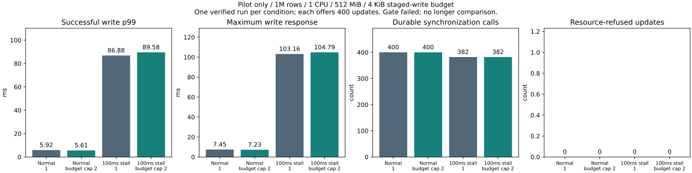

# Budget-partitioned preparation pilot — 2026-11-07

**Refusals were avoided, but sync count and tail latency did not improve. The pilot
failed its screening gate; no longer comparison and no default change.**

| Condition | Requested / effective limit | Accepted updates | Service refused | Write p99 ms | Write max ms | Read p99 ms | Syncs | Accepted/sync | Backlog recovery ms | RSS MiB |
|---|---:|---:|---:|---:|---:|---:|---:|---:|---:|---:|
| normal | 1 / 1 | 400 | 0 | 5.916 | 7.451 | 0.372 | 400 | 1.000 | not applicable | 419.59 |
| normal | 8 / 2 | 400 | 0 | 5.606 | 7.228 | 0.377 | 400 | 1.000 | not applicable | 419.52 |
| single | 1 / 1 | 400 | 0 | 86.876 | 103.157 | 0.380 | 382 | 1.047 | 21.546 | 419.52 |
| single | 8 / 2 | 400 | 0 | 89.582 | 104.787 | 0.336 | 382 | 1.047 | 21.315 | 419.56 |

## Conditions and result

Same image and WAL seed; aged 1M rows, 8-byte keys / 256-byte values, 1 CPU / 512 MiB,
swap disabled, Docker volume, old reader retained, one reader and four writers.
Each condition offers 2000 read-only then 2000 mixed requests at 1000 arrivals/s;
400 updates per mixed phase. One run per condition, ordered normal single, normal
capped, delayed capped, delayed single. Real sync is retained with one injected
100ms pre-sync delay. Same outstanding credits: 64 writes and 64 reads, including
queued, carried and in-flight requests. Latency starts at scheduled arrival.

At 392 charged bytes/update, four equal 1024-byte quotas permit two updates each
(eight / 3136 bytes total). No fill delay, retry, budget increase or durability
change. Requested limit eight becomes effective limit two; baseline remains one.
Normal traffic formed only single-entry calls. Delayed capped traffic formed
384 single-entry calls and eight two-entry calls. Both delayed cases used 382 syncs:
server group commit already combines independent requests, and client batching
provided no additional reduction in this sample. Delayed update p99 rose 3.1%,
maximum rose 1.6%, and backlog recovery shortened only 1.1% (gate requires 10%).
Single-run differences are observations, not statistical significance claims.

All 16000 requests succeeded, with zero service/queue refusals or other errors.
RSS remained around 419.5 MiB. Failed sync-count and recovery gates stop the
experiment before 8000 requests x3. Product defaults remain unchanged.

## Safety and limitations

20 full-content comparisons, four matching seeds, 1600 accepted-update old-version
checks, four budget rollback/recovery probes and four kill/reopen checks passed.
Same-image protocol/safety tests: 33 passed; staged-boundary/rollback/restart: 1
passed. Client tests: 8; analysis: 3; existing resource-client: 9 passed.
The first post-benchmark safety launch failed before running tests because its temp
folder was read-only; a dedicated tmpfs corrected setup and both suites passed.

This is a controlled four-writer client policy, not global server reservation.
Unrelated writers can still consume the budget. General variable-sized batches and
quota borrowing are not implemented. Oversized entries are rejected during setup.
The 4 KiB limit is a test override; product default is 32 MiB. Rust engine, API,
file format and persistence settings are unchanged. No physical power-cut test.

Short orchestration/status queries ran on the host; host activity was not fully
controlled. Diagnostic counters were identical. No new per-request tracing was
added. Reporting code changed during the run; measured client/server stayed fixed.
Final commit CI checks Windows/Linux and existing API compatibility.

## Reproduction and evidence

[Policy and screening gate](../../../benchmarks/constrained-backlog/README.md).
Run `python benchmarks/constrained-backlog/run.py --out artifacts/budget-pilot --budget-aware`
with the recorded image, then `python benchmarks/constrained-backlog/report.py artifacts/budget-pilot`.
[Summary](summary.json) records image identity, seed digest, timings, batch sizes,
resources and gate outcomes. Per-condition compressed request records contain only
allowlisted numeric timings/IDs, operation kind and outcome; no keys, values,
credentials or machine paths. Full local logs/environment were deliberately not
copied to the public repository. Locally generated raw output remains available
for the report's full validation/reproduction; published request records allow
independent latency calculation.
