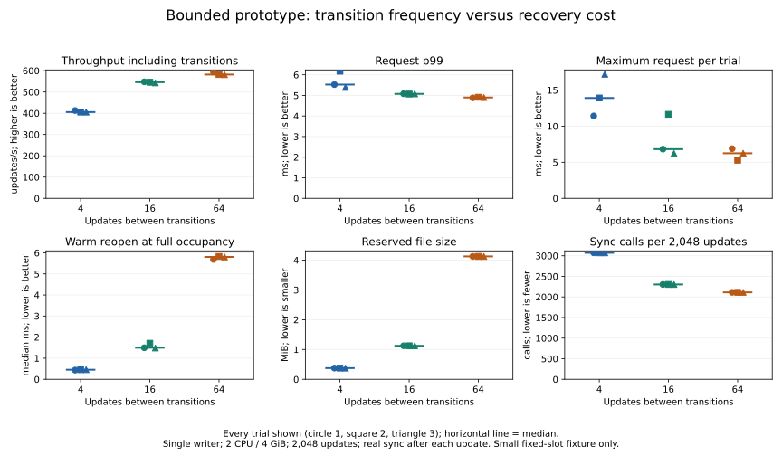

# Bounded log-capacity / transition-frequency experiment (2026-11-07)

## Decision

For this small single-writer prototype, increasing the log from 4 to 16 update slots
improves median throughput **405.66 → 545.80 updates/s (+34.5%)**. Increasing to 64
slots reaches **582.05 updates/s (+43.5% versus 4, +6.6% versus 16)**.
Every update still performs its own real durable sync; only the frequency of the
two-sync generation transition changes. No production setting was changed.

The tradeoff is explicit: median warm reopen at full occupancy rises
**0.453 → 1.497 → 5.805 ms**, and reserved file length rises
**384 KiB → 1.125 MiB → 4.125 MiB**. Capacity 16 is a reasonable next experimental
candidate in this fixture, not a general optimum or an adopted default. Capacity 64
is faster here but costs 3.67x the file space and about 3.88x the warm-reopen time of 16.



## Median trial statistics and exact accounting

Percentiles below are medians of per-trial nearest-rank percentiles, not pooled
percentiles. File bytes, write counts and sync counts are identical across repetitions
of a capacity. All percentiles, including p50/p99/max, are retained in
[trials.csv](trials.csv) and all operations in [requests.csv](requests.csv).

| Metric | 4 slots | 16 slots | 64 slots |
|---|---:|---:|---:|
| Throughput incl. transitions (updates/s) | 405.664 | 545.800 | 582.045 |
| Request p50 (ms) | 1.502 | 1.400 | 1.449 |
| Request p99 (ms) | 5.527 | 5.076 | 4.898 |
| Append-only p99 (ms) | 2.885 | 3.160 | 2.690 |
| Transition p50 (ms) | 3.332 | 3.388 | 3.464 |
| Warm full-log reopen p50 (ms) | 0.453 | 1.497 | 5.805 |
| Warm full-log reopen p99 (ms) | 0.510 | 2.270 | 7.299 |
| File initialization (ms) | 4.450 | 8.184 | 12.774 |
| Transitions / 2,048 updates | 512 | 128 | 32 |
| Sync calls / 2,048 updates | 3,072 | 2,304 | 2,112 |
| Submitted write bytes in timed loop | 22,436,864 | 19,030,784 | 18,179,264 |
| Reserved file bytes | 393,216 | 1,179,648 | 4,325,376 |

Transition p50 stays around 3.3–3.5 ms; this is fewer transitions, not proof of a
faster individual transition. Each warm reopen reads the entire reserved image and
replays the full log. Both quantities grow with capacity. This experiment did not
separate read time from decoding/replay CPU cost or measure RSS/allocator use.

Main-loop writes exclude file initialization and warmup. Initialization writes the
full reserved image and uses file + directory sync; its elapsed time is reported
separately. Counts are application-submitted bytes, not physical storage traffic.
The per-update amortized sync count is **1.5 / 1.125 / 1.03125** during the timed loop.

## All trials, including tails

| Order | Slots / trial | Updates/s | Request p99 ms | Request max ms | >10ms | >20ms | Reopen p50 ms |
|---:|---|---:|---:|---:|---:|---:|---:|
| 1 | 4 / 1 | 412.96 | 5.527 | 11.420 | 1 | 0 | 0.435 |
| 2 | 16 / 1 | 547.77 | 5.082 | 6.815 | 0 | 0 | 1.497 |
| 3 | 64 / 1 | 594.30 | 4.881 | 6.882 | 0 | 0 | 5.686 |
| 4 | 16 / 2 | 545.80 | 5.068 | 11.646 | 1 | 0 | 1.710 |
| 5 | 64 / 2 | 582.05 | 4.912 | 5.281 | 0 | 0 | 5.825 |
| 6 | 4 / 2 | 405.66 | 6.174 | 13.910 | 2 | 0 | 0.453 |
| 7 | 64 / 3 | 581.33 | 4.898 | 6.249 | 0 | 0 | 5.805 |
| 8 | 4 / 3 | 405.58 | 5.390 | 17.200 | 1 | 0 | 0.456 |
| 9 | 16 / 3 | 542.81 | 5.076 | 6.216 | 0 | 0 | 1.484 |

Worst request across trials is **17.200 / 11.646 / 6.882 ms** for 4/16/64 slots.
>10-ms counts are **4 / 1 / 0** out of 6,144 updates per capacity; no request exceeded
20 ms. These short samples do not establish a maximum-latency guarantee. In particular,
a zero exceedance count is not evidence that slow syncs cannot recur.

## Matched conditions

- Same optimized Rust 1.89 test executable and production frame codec. Each capacity
  is a compile-time specialization of one frozen experimental core; resulting machine
  code/layout may differ. No runtime production capacity API was introduced.
- One synchronous writer, Docker Desktop Linux named volume, 2 CPU quota / 4 GiB limit.
  All capacities use epoch reuse, with no whole-bank clearing. No service/network queue,
  fixed-arrival workload, OS tracing or physical-device attribution.
- Same three-key data shape (4,236 key/value bytes), 32 prepared change sets varying
  one value byte, and a held old map. Checkpoints must still fit one 16-KiB slot.
- Each trial creates a new file, seeds two updates, then performs **126 warmup updates**.
  A total of 128 premeasurement updates puts all capacities exactly at the full-log
  boundary. This differs from the preceding experiment's 34-update warmup, so use the
  matched 4-slot control here rather than cross-report timing deltas.
- **2,048 timed updates** are divisible by every capacity. Timing starts with a full
  log, so the first request transitions. All conditions also end with a full log.
  Transition counts are exactly 512/128/32. Output and integrity assertions occur
  after timing. Request time includes a transition when due; append time excludes it.
- Main loop throughput includes timing/row-bookkeeping overhead. Only outer operation
  timers are used, not the prior fine-grained phase recorder.
- Each trial measures 100 same-process warm full-log reopens, stopping the timer before
  assertions/close. This is neither cold startup nor physical-power-loss recovery.
- Condition order rotates as (4,16,64), (16,64,4), (64,4,16), with three trials each.
  Main phases last approximately 3.4–5.1 seconds. No long-run/significance claim.
- Transition sample counts per trial are 512/128/32. At 64 slots, nearest-rank p99
  is the maximum of only 32 transitions; do not interpret it as a stable tail estimate.
  Reopen p99 likewise has only 100 samples per trial.

## Safety and compatibility scope

The added tests pass **15 cases** (five per capacity), with nine ignored helpers or
explicit benchmarks. They cover capacity-minus-one, full and overflow; unchanged file
on refusal; empty no-op; repeated reuse and old maps; epoch exhaustion; interrupted
repair/switch and retry; and **192 tail-prefix model combinations** across capacities.

**39 external child-process kills** exercise last-slot append, switching and repair
(13 per capacity), followed by reopening and a subsequent durable update. Six directed
cross-capacity opens are rejected and leave the source file unchanged. Rejection uses
exact file length: this prototype has no self-describing capacity field and this is
not a production format migration feature.

The full default library suite passed **83 tests**, with 20 ignored helpers/explicit
experiments. Historical safety tests remain intact. All **18,432 timed updates**,
nine final full-map checks, nine held-old-map checks and **900 warm reopen full-map
checks** passed. No repair was needed by the measured reopens.

The core is a frozen copy of the prior test-only `variable_gate` implementation at
`6fce0a7`, removing only its fixed CAP declaration so 4/16/64 share the same source.
This preserves historical experiment inputs rather than silently changing their
layout. It is not another production persistence implementation. Real engine/API/
format/default behavior is unchanged; Linux tests only.

At most one detectably damaged copy per acknowledged record before repair remains
the bounded fault assumption. Prior both-copy-loss counterexamples still apply.
Model prefixes and process kills are not exhaustive persistence ordering or power-loss
proofs. Old snapshots here are Arc map copies, not integrated production MVCC.

## Reproduction and raw evidence

```sh
docker build -f benchmarks/capacity-gate/Dockerfile -t catdb-capacity-gate .
python benchmarks/capacity-gate/run.py --output artifacts/capacity-repeat
python benchmarks/capacity-gate/analyze.py --input artifacts/capacity-repeat
python benchmarks/capacity-gate/chart.py --report artifacts/capacity-repeat/report
```

The portable runner refuses an existing output directory and retains a unique data
volume. The actual recorded invocation is [recorded-run.ps1.txt](recorded-run.ps1.txt),
using the equivalent sequential PowerShell commands. The Python runner CLI was checked;
the analyzer and chart renderer were run on the recorded results, without another timing
round. Matplotlib is needed only for charting.

[Build/safety log](build.log), [trial statistics](trials.csv), [every operation](requests.csv),
[summary JSON](summary.json), [LF-normalized source hashes](source-sha256.txt).
All nine raw `cap-*-*.log` files are included. Log trailing whitespace is normalized.
Recorded image: `sha256:d444471968fd892d2958ab40c61d168cd9cc77984984dc71b3558cea6e61cfba`.

## Remaining decision

Capacity 16 gives most of the observed throughput gain with less recovery/file cost
than 64. This supports further bounded experimentation, not product adoption. Larger
checkpoints, explicit memory budgets and integration with production transactions
remain separate gates. No additional capacities or longer runs were attempted.
Kudaki reflection remains pending because list_documents failed session initialization;
no WBS file was directly edited. Update the existing experiment L1/L2 rather than
creating a task for each capacity or repetition.
