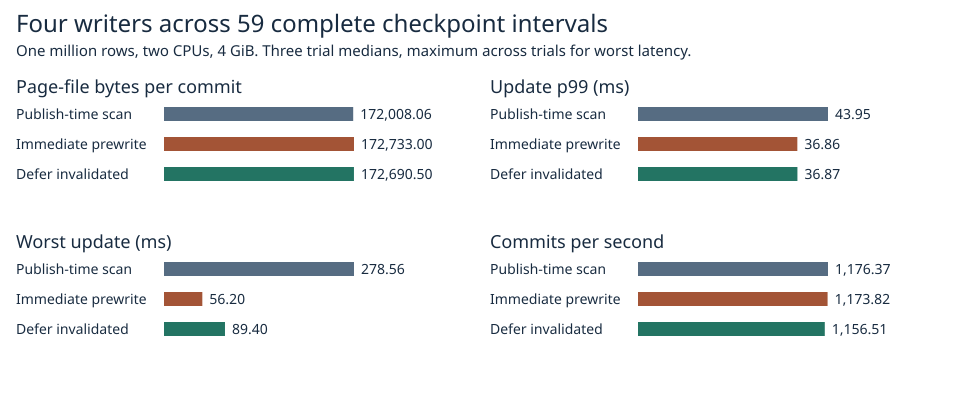

# What happened to the prepared pages after commit 1,024?

Across six prewrite runs, **100% of the 11.84–11.96 MiB already pending at commit 1,024 appeared in the very next checkpoint**. In this workload the next writer must first publish a checkpoint at this exact boundary. The earlier short-run result included preparation for that publication. This observation does not predict the survival rate of pages marked earlier in a cycle.

## Publication-aligned comparison

Each trial began with one million rows and ran 16,384 durable updates from four writers, with two CPUs, 4 GiB and no swap. Each had 63 foreground checkpoints, spaced 256 commits apart. The measured window begins just after publication at version 1,024 and ends just after publication at version 16,128: **15,104 commits across 59 complete intervals per trial**. The warm-up and final open interval are excluded. The same binary runs all three modes; the trial order rotates. The workload uses the same operation IDs; conflicts may change the commit order.

| Policy | Page writes (KiB/commit) | All counted writes (KiB/commit) | Update p99 (ms) | Worst update (ms) | Commits/s |
|---|---:|---:|---:|---:|---:|
| Publish-time scan | 167.98 | 170.85 | 43.95 | 278.56 | 1,176.37 |
| Immediate prewrite | 168.68 | 171.56 | 36.86 | 56.20 | 1,173.82 |
| Defer invalidated | 168.64 | 171.52 | 36.87 | 89.40 | 1,156.51 |

Relative to the publish-time scan, steady page traffic changed by **+0.42%** for immediate prewrite and **+0.40%** for deferral. The [previous three-checkpoint experiment](../defer-2026-11-07/README.md) charged its final pending writes to the short run. In the aligned comparison, surviving prewrites substitute for foreground writes in the same interval. Invalidations and split attempts can still cost extra writes.

For immediate prewrite and deferral respectively, update p99 was lower than the scan in 3/3 and 3/3 paired trials. The throughput changes against scan were -0.2% and -1.7%.

The write counters count application bytes sent to the page file, including both page copies, or to all tracked store files including logs and checkpoint metadata. They do not estimate physical device bytes. Latency covers each request from its first attempt through commit, including retries. It is assigned to the window in which the request completed, preserving any wait before that window. Throughput uses the committed generation difference divided by elapsed wall time. Each table value is the median of three trial statistics except worst update, which is the maximum across all three. Full-run maxima, including warm-up and tail, appear in the [trial data](trials.csv). The [531 per-period observations](windows.csv) show variation within each run; this window definition does not assume a stationary latency distribution.

## Fate of the marked pages

| Policy | Trial | Marked bytes | Published bytes | Invalidated bytes | Published marked slots |
|---|---:|---:|---:|---:|---:|
| Publish-time scan | 1 | 0 | 0 | 0 | 0 |
| Publish-time scan | 2 | 0 | 0 | 0 | 0 |
| Publish-time scan | 3 | 0 | 0 | 0 | 0 |
| Immediate prewrite | 1 | 12,413,246 | 12,413,246 | 0 | 95 |
| Immediate prewrite | 2 | 12,544,032 | 12,544,032 | 0 | 96 |
| Immediate prewrite | 3 | 12,415,670 | 12,415,670 | 0 | 95 |
| Defer invalidated | 1 | 12,545,766 | 12,545,766 | 0 | 96 |
| Defer invalidated | 2 | 12,415,574 | 12,415,574 | 0 | 95 |
| Defer invalidated | 3 | 12,544,674 | 12,544,674 | 0 | 96 |

The backend marks the existing slot and byte identities under the writer lock after processing commit 1,024. Invalidation removes the original identity immediately, so a later incarnation of the same slot cannot count toward publication. A worker can finish another preparation before the checkpoint acquires the lock; that later page is outside the marked set. The measured pages were generated anew under the previous workload conditions. They are not recovered artifacts of the earlier runs.

Every run checks the full current contents against the committed write sequence, the entire retained old snapshot, and the recovered contents and commit generation after reopen. The cohort test exercises an empty set, publication, invalidation, and same-slot same-size reuse. This is a measurement change to the Linux test backend. No durability policy changed. [Release tests](raw/tests.txt), [environment, raw latencies and byte counters](raw/), [summary](summary.csv).

## Reproduction

~~~sh
docker build -f benchmarks/scaled-gate/Dockerfile -t catdb-carry .
python benchmarks/scaled-gate/run_carry.py --stage 1m --out raw
python benchmarks/scaled-gate/report_carry.py raw report
~~~

The report accepts the runner's original logs or the compressed logs in this directory.
