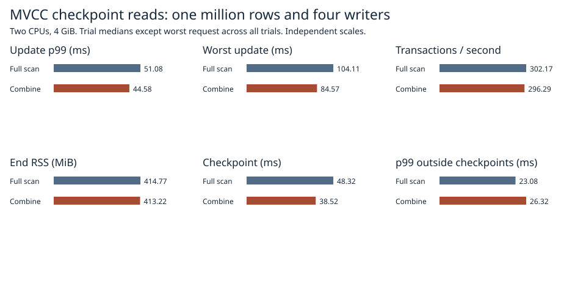

# Reusing the body CRC when sealing checkpoint pages

Combining CRCs in the 64 KiB MVCC checkpoint writer measured **44.6 ms update p99** and a **84.6 ms worst request**, at 296.3 transactions/s and 413.2 MiB RSS. With the previous full scan of the envelope payload the same workload measured 51.1 ms, 104.1 ms, 302.2 transactions/s and 414.8 MiB.



| Path | p99 ms | Worst ms | Transactions/s | End RSS MiB | Checkpoint ms |
|:---|---:|---:|---:|---:|---:|
| Full scan | 51.08 | 104.11 | 302.17 | 414.77 | 48.32 |
| Combine | 44.58 | 84.57 | 296.29 | 413.22 | 38.52 |

Combining the checksums lowered p99 and maximum wait in all three paired repetitions. Median throughput fell 1.9%; two of the three paired trials were slower on throughput.

Each implementation ran the same 1,024 multi-key requests over one million seeded rows with 256-byte values. Four closed-loop writers and a pinned old reader shared two CPUs and 4 GiB of RAM with no swap. The timed loop included three synchronous checkpoints, conflict retries and admission waits. Each trial used a fresh Docker volume. Trial pairs alternated baseline/candidate, candidate/baseline, baseline/candidate. Throughput, RSS, p99 and checkpoint time are medians of three trial statistics; worst wait covers every request across all three trials. [Individual trials](1m.csv) and [per-request records and source/image identities](raw/1m/).

## Where the second scan went

In the [previous experiment](../linear-mvcc-2026-11-07/README.md), the three worst requests each overlapped a checkpoint for 67.82–77.78 ms. The page body already has its own IEEE CRC32. The outer envelope covers the 20-byte frame prefix followed by this same body, ending before the stored body CRC and seal. The baseline scans the concatenation to produce the envelope digest.

The experimental writer computes the CRC of the 20-byte prefix, advances that value by the body length using precomputed powers of the zero-byte operator for reflected polynomial 0xEDB88320, then XORs the result with the existing body CRC. The 4 KiB table is shared and immutable. The on-disk fields, number of checksums, byte order, durable writes and reader validation are unchanged. Recovery computes its checks from actual bytes on disk.

| Path | Scan | Assembly (includes CRCs) | Body CRC | Outer payload CRC | Write | Sync | Remainder | Total |
|:---|---:|---:|---:|---:|---:|---:|---:|---:|
| Full scan | 4.124 | 17.925 | 8.446 | 8.297 | 12.451 | 13.895 | 4.690 | 53.086 |
| Combine | 4.063 | 9.669 | 8.471 | 0.054 | 12.899 | 14.627 | 4.631 | 45.888 |

Phase timings are mean milliseconds per checkpoint in a separate run of each implementation (three checkpoints each). The inner and outer CRC columns are **included in assembly**; adding them again would double-count them. Remaining time includes directory handling and time outside the markers. OS scheduling and storage-cache effects can change the elapsed times. [Diagnostic requests](diagnostic.csv), [individual CRC timers](crc.csv), [checkpoint phases](phases.csv).

## Safety and reproduction

The arithmetic fixture checks all 65,537 lengths from zero through 64 KiB against a streaming CRC of the concatenation and verifies boundary examples with the ordinary full-buffer CRC. The page fixture compares the candidate's entire encoded records and range boundaries with the reference encoder on old and new snapshots, including empty ranges, binary keys, tombstones, splits and a maximum-size row. The corruption fixture changes a body byte, verifies the surviving copy repairs the page and confirms a second clean open needs no repair. It then damages both copies of that referenced checkpoint page and requires rejection. The model permits one detectably damaged copy per paired record; loss of both copies of a log tail remains outside that contract. Process-kill tests exercise recovery after durable updates and checkpoint publication. [Test outcomes](safety.txt).

Every main trial independently verifies all pinned, current and reopened rows and the recovered commit sequence. The experiment is opt-in in the Linux test build.

```sh
docker build -f benchmarks/scaled-gate/Dockerfile -t catdb-crc-combine .
docker run --rm --network none --cpus 2 --memory 4g --memory-swap 4g -e CATDB_TEST_DIRECT=1 -e CATDB_TEST_COMBINE=1 catdb-crc-combine cargo test --release --locked --lib -- --test-threads=1
python benchmarks/scaled-gate/run_combine.py --stage pilot --out results/pilot
python benchmarks/scaled-gate/run_combine.py --stage diagnostic --out results/diagnostic
python benchmarks/scaled-gate/run_combine.py --stage 1m --out results/1m
python benchmarks/scaled-gate/report_pack.py --combine results report
```

Use a new output path for each stage.
