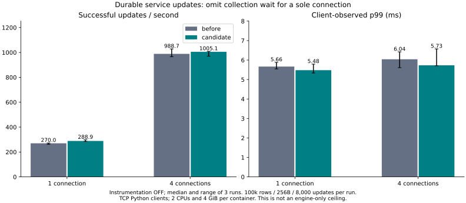
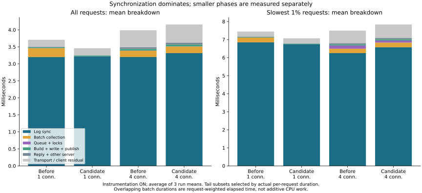

# Commit latency breakdown and sole-connection experiment

**The measured bottleneck remains durable log synchronization.** The new opt-in
`single-client-commit` feature removes a collection wait when the service has
exactly one accepted connection. The default service policy is unchanged:
single-client throughput improved, but four-client differences reversed across
runs and worst observed response times increased. This does not establish a
general p99 or maximum-latency improvement.

The earlier service diagnostic only covered `commit`, although recent benchmarks
used `put_commit`. This change measures both, plus `delete_commit`, and preserves
the original trace array. Fixed-size additional data separates queue, collection,
writer/state locks, validation/encoding, reservation, write, sync, publication and
reply handling. Invalid requests cannot reuse the previous request's trace.

## Uninstrumented comparison

100,000 rows, 256-byte values, 8,000 one-round-trip updates per condition,
1/4 connections and three reversed-order repeats. Each container has two CPUs
and 4 GiB. Values below are medians of three runs unless explicitly stated.

- **1 connection(s):** 270.0 → 288.9 updates/s (+7.0%); p99 5.665 → 5.480 ms (-3.3%). Worst observed response 48.154 → 57.787 ms.
- **4 connection(s):** 988.7 → 1005.1 updates/s (+1.7%); p99 6.040 → 5.730 ms (-5.1%). Worst observed response 16.753 → 18.776 ms.

At one connection, candidate throughput improved in all three paired trials.
At four connections, throughput and p99 comparisons changed direction. These
three trials do not establish a general advantage or a causal regression in the
unchanged multi-client path. No outliers were discarded. No other DBMS was rerun;
the earlier PostgreSQL/Oracle comparisons remain historical measurements.

| Connections | Mode | Updates/s | p50 ms | p95 ms | p99 ms | Worst maximum ms |
|---:|---|---:|---:|---:|---:|---:|
| 1 | before | 269.968 | 3.812 | 4.435 | 5.665 | 48.154 |
| 1 | candidate | 288.915 | 3.527 | 4.212 | 5.480 | 57.787 |
| 1 | before-diag | 271.788 | 3.814 | 4.387 | 5.600 | 60.685 |
| 1 | candidate-diag | 287.649 | 3.584 | 4.288 | 5.544 | 41.360 |
| 4 | before | 988.733 | 4.064 | 4.959 | 6.040 | 16.753 |
| 4 | candidate | 1005.124 | 4.001 | 4.820 | 5.730 | 18.776 |
| 4 | before-diag | 1001.341 | 4.001 | 4.905 | 5.945 | 45.648 |
| 4 | candidate-diag | 953.987 | 4.157 | 5.449 | 6.579 | 13.682 |

All 192,000 timed updates succeeded, with **zero rejections and zero retries**.
All 48 complete 100,000-record content checks passed (initial, after each of two
conditions, and after restart, on twelve fresh server instances). This includes
the observer cohorts; the uninstrumented primary comparison is 96,000 updates.

## Where time is spent

The table averages the three instrumented run means. Sync time is deduplicated
by batch; collection and residual are per-request elapsed time.

| Connections | Mode | Sync / group ms | Updates / group | Collection / request ms | Validation / group µs | Encoding / group µs |
|---:|---|---:|---:|---:|---:|---:|
| 1 | before-diag | 3.1997 | 1.000 | 0.2614 | 0.193 | 2.323 |
| 1 | candidate-diag | 3.2149 | 1.000 | 0.0002 | 0.205 | 2.068 |
| 4 | before-diag | 3.2024 | 3.997 | 0.1827 | 0.821 | 4.181 |
| 4 | candidate-diag | 3.3154 | 3.997 | 0.1944 | 0.976 | 4.907 |

The sole-connection collection interval fell from roughly **0.261 ms to 0.0002 ms**.
Synchronization remained approximately **3.2 ms**; it was not shortened. For the
slowest 1% of actual requests, sync represents roughly **83–95%** of mean request
duration across these modes. Validation and encoding are much smaller. An earlier
unpaired diagnostic discovery run is retained in [discovery](discovery/results.json)
but is not pooled into the three-repeat comparison.

Previous [durable-sync probes](../log-sync-2026-11-05/README.md) found no substantial
benefit from append fsync/fdatasync, preallocation or synchronous-write variants.
The [fixed-length prototype](../fixed-log-2026-11-05/README.md) still required a
second durable end-record update. We did not remove that safety step, switch to
asynchronous acknowledgment, or repeat those probes and present old values as new.
The current improvement targets removable collection delay; the dominant storage
latency remains unresolved. More useful next work would need to change durable
I/O cost or safe batching under a different workload, not just shave validation.

## Observer effect and limitations

Diagnostic code and JSON can perturb arrivals and grouping. In particular,
candidate four-client throughput changes from 1,005.1 to 954.0 updates/s with
diagnostics, while p99 changes from 5.730 to 6.579 ms. The baseline's diagnostic
cohort happens to be slightly faster; that is not evidence that instrumentation
has negative cost. All observer runs are retained rather than subtracting a
supposed constant observer overhead from the primary measurements.

Dispatch starts after server request parsing and ends before response encoding
and socket writes. The residual combines transport, parsing/encoding and client
scheduling; it is not measured pure network time. The breakdown uses the client's
protocol-request timer, while main operation latency also includes surrounding
client work. The tail chart averages phases of each run's actual slowest 80
requests; it does not sum component p99 values. Every successful trace's phases
sum exactly back to its request duration. All 96,000 diagnostic records passed
ordering/completeness validation, with no collector overflow.

## Safety and compatibility

The candidate changes only collection timing, not the writer serialization,
same-group/point/range conflict rules, old snapshots, resource accounting,
file format, synchronization or publication order. Connection-count races can
change group membership, never skip durability. Embedded databases without a
registered service counter retain their existing behavior.

Tests cover no success/visibility before sync, old snapshots, sync failures,
process exit before/after sync, checkpoint recovery, request bounds, disconnects,
legacy protocol and C ABI, diagnostic failure/reset behavior and collector limits.
See [validation.json](validation.json) for actual test counts/configurations.
These are process-crash tests, not a physical power-cut or device-failure proof.

## Reproduction and source

- [Commands, instrumentation schema and QA mapping](../../../benchmarks/commit-breakdown/README.md)
- [All trials](results.json), [complete summary](summary.json), [configuration/image IDs](environment.json)
- [Provenance](provenance.json), [exact measured source](measured-source.zip), [parent runtime source](parent-source.zip)
- Raw per-operation latencies and per-request traces are adjacent gzip JSON files.

The fixed-size diagnostics are available in `lock-timing` builds; the collection
candidate requires `service,single-client-commit`. Neither is enabled in the
default service build. No production library, PALV data or Z: data was opened.
