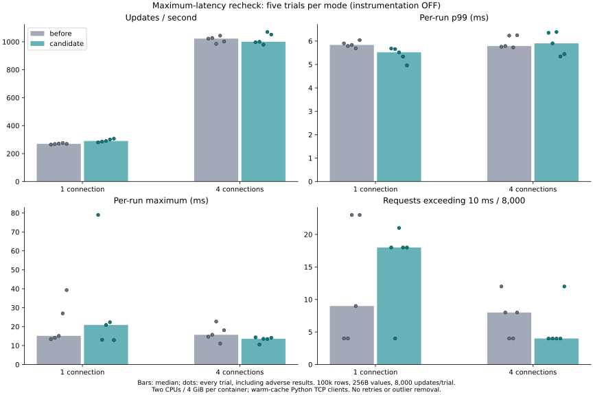
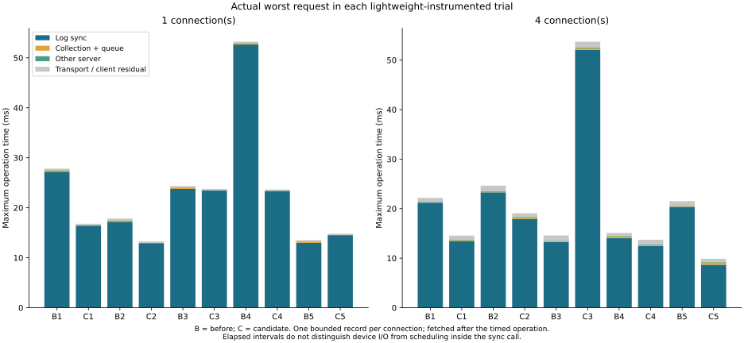

# Maximum-latency attribution: five-repeat follow-up

**Maximum latency is not fixed. The default collection policy remains unchanged.**
The opt-in sole-connection bypass again improves typical single-client throughput,
but its uninstrumented one-client maximum increased to **78.956 ms**, with eight
requests over 50 ms. This unfavorable result is retained. Four-client results
and lightweight observer results do not show the same ordering.

The new bounded pull diagnostic captured the **same requests** as the client
samples. In all twenty lightweight-instrumented cases, sync was the largest
phase of the actual worst request, accounting for **87.8–98.9%** of its duration.
All **285 requests exceeding 10 ms** in those cases were sync-dominated (sync
was both the largest phase and more than half the operation time). No new long
application collection/queue wait was observed in these captured requests.

This is evidence for sync-call outliers occurring under **both** policies, not
proof that the uninstrumented 78.956 ms request had the same cause. A faster
commit cadence could indirectly affect storage behavior; that hypothesis is not
excluded. We therefore do not add an unsupported wait heuristic or weaken
durability and claim the maximum has been improved.

## Five uninstrumented trials

100,000 seeded rows, 256-byte values, 8,000 one-round-trip updates per condition,
1/4 clients, five varied-order repeats, two CPUs and 4 GiB per container. The
primary comparison has 160,000 updates; a separate lightweight observer comparison
has another 160,000. No requests were rejected or retried. All **80 full-content
and restart checks** passed. Bars below show medians; every dot is a trial.

| Connections | Mode | Median updates/s | Median p99 ms | Median run maximum ms | Worst maximum ms | >10ms / 40k | >20ms / 40k | >50ms / 40k |
|---:|---|---:|---:|---:|---:|---:|---:|---:|
| 1 | before | 269.8 | 5.834 | 15.118 | 39.287 | 63 | 4 | 0 |
| 1 | candidate | 290.1 | 5.519 | 20.893 | 78.956 | 79 | 14 | 8 |
| 1 | before-light | 270.0 | 5.705 | 24.312 | 53.226 | 49 | 7 | 2 |
| 1 | candidate-light | 293.0 | 5.482 | 16.793 | 23.768 | 49 | 2 | 0 |
| 4 | before | 1022.6 | 5.786 | 15.701 | 22.696 | 36 | 4 | 0 |
| 4 | candidate | 1000.3 | 5.902 | 13.545 | 14.336 | 28 | 0 | 0 |
| 4 | before-light | 1023.5 | 6.176 | 21.509 | 24.645 | 95 | 12 | 0 |
| 4 | candidate-light | 1004.9 | 6.014 | 14.561 | 53.715 | 92 | 14 | 4 |

Single-client median throughput changes **269.8 → 290.1 updates/s** and p99
**5.834 → 5.519 ms**, but median run maximum changes **15.118 → 20.893 ms** and
worst maximum **39.287 → 78.956 ms**. The candidate's eight >50 ms requests all
occur in repeat 1. In contrast, four-client worst maximum changes
**22.696 → 14.336 ms**, while throughput **1,022.6 → 1,000.3 updates/s** and p99
**5.786 → 5.902 ms** slightly worsen. These are descriptive observations, not
general guarantees or independent-sample statistical claims.

In candidate/one-client/repeat-1, updates **3,448–3,457** (one-based indices) are
ten consecutive requests over 20 ms. Their summed operation time is **637.436 ms**,
and eight exceed 50 ms. The sum is not an independently timestamped wall-clock
window. Their uninstrumented traces are unavailable. This cluster warrants
caution about attributing a single sample maximum to a fixed per-request overhead.

## Same-request attribution

Only **628 diagnostic round trips** were needed across 160,000 observer updates
(0.393%). Each connection stores one fixed-size snapshot, without key/value data.
The client retrieves it after the timed operation if it reaches 10 ms or sets a
new worker maximum. Every record is checked against its worker/operation index,
server request index, exact raw operation time, phase order and phase sum. All
worker maxima and all threshold exceedances were captured; no probe failed or
overflowed. See [attributed records](attributed-records.json.gz) and
[per-trial summaries](summary.json).

The largest one-client observer request was **53.226 ms under the original
policy**; its sync interval accounts for 98.9%. The largest four-client observer
request was **53.715 ms under the candidate**, 97.0% sync. Thus large sync-call
outliers are not exclusive to the new policy. The one-client candidate observer
maximum was only 23.768 ms; it did **not** recapture the primary 78.956 ms event.
We do not substitute one observation for the other.

`sync_all` elapsed time includes device/filesystem work, blocking and rescheduling
before the call returns. This experiment cannot separate those causes. The client
residual includes framing, transport, parsing and scheduling, not pure network
time. One group can give several clients the same stall; counts above are requests,
not independent disk events. No physical power loss was tested.

## Observer effect and adoption decision

Pulling records after the timer avoids adding the query duration to that sample,
but delays later arrivals and contributes to total elapsed time and throughput.
The server still reads clocks on every commit. Five-run observer medians and all
adverse results are shown in the table; they are not pooled into the primary
cohort or corrected by subtracting a constant overhead. The previous full-JSON
observer was not rerun here, so fewer diagnostic messages are not presented as a
measured speedup over that older observer.

The earlier candidate is still opt-in (`service,single-client-commit`). No new
commit scheduling, sync mode, log format or durability policy is adopted. The
new implementation improves **diagnostic volume and correspondence**, not the
worst-case commit guarantee. Additional storage/scheduling attribution or a
rate-matched experiment could resolve the indirect-cadence hypothesis, but is
outside these completed five repeats; extending exploratory runs indefinitely
would not justify a causal claim.

## Safety and reproduction

The default service has no new diagnostic command. The pull command requires
both a `lock-timing` build and explicit `CATDB_DIAGNOSTICS=pull`, after ordinary
authentication. Snapshots are connection-local, replaced/cleared by the next
ordinary request, and bounded independently of request count. Failed requests
cannot reuse an old trace. Existing full-response diagnostics remain supported.

Current validation: **142 Rust tests** passed (12 ignored benchmark/child helpers),
**23 pull-mode protocol tests**, **21 legacy diagnostic/protocol tests**, **35 C ABI
tests**, **4 collector tests** and **3 attribution tests** passed. Clippy passed
with warnings denied. Tests include connection-count transitions, old snapshots,
same-group/point/range conflicts, no early acknowledgment or visibility, storage
failure and process exit before/after synchronization. See [validation.json](validation.json).

- [Reproduction commands and measurement contract](../../../benchmarks/commit-tail/README.md)
- [Raw run summaries](results.json), [full numerical table](table.md), [all trial details](summary.json)
- [Configuration and image IDs](environment.json), [source provenance](provenance.json), [exact measured source](measured-source.zip)
- Raw latency arrays and bounded diagnostic records are stored alongside this report as gzip JSON.
- [Short smoke run](smoke/results.json) is validation only, excluded from performance comparisons.

No PALV, production library, or Z: data was used. Other DBMS products were not
rerun; the older product comparison figures remain historical results.
