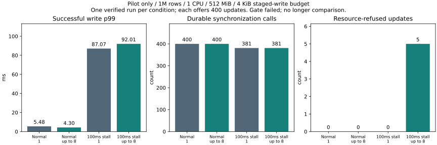

# Existing backlog batching under a small staged-write budget (2026-11-07)

## Decision: stop at the pilot

**Do not extend to the 8,000-request repeated benchmark and do not change defaults.**
The existing ready-work batch API was not a new optimization: it had already been
implemented and tested on 100k rows. This experiment asks whether it transfers to
aged 1M rows / 1 CPU / 512 MiB / an old reader plus concurrent reads, while retaining
the previous harness's **4-KiB global staged-write budget**.

The stalled verified comparison used **381 real syncs in both policies**. Limit-1
accepted all 400 updates; limit-8 accepted 395 and resource-refused five. Successful
write p99 was **87.069 → 92.011 ms**. Apparent backlog recovery improved from
**21.307 → 15.067 ms**, but refusal also removes outstanding work. It cannot be
called a successful latency optimization. Two predeclared gates failed:
**sync count did not fall**, and **refusals increased**.

Normal traffic formed no multi-entry batches: both policies made 400 single-entry
calls and 400 syncs. The normal p99 difference (**5.480 / 4.304 ms**) is therefore
not evidence of a batching benefit. Only one pilot per condition was measured;
these values are not statistically established improvements or tail bounds.



| Condition | Limit | Accepted updates | Service refused | Write p99 ms | Write max ms | Read p99 ms | Syncs | Accepted/sync | Backlog recovery ms | RSS MiB |
|---|---:|---:|---:|---:|---:|---:|---:|---:|---:|---:|
| normal | 1 | 400 | 0 | 5.480 | 7.234 | 0.331 | 400 | 1.000 | not applicable | 419.65 |
| normal | 8 | 400 | 0 | 4.304 | 5.205 | 0.321 | 400 | 1.000 | not applicable | 419.47 |
| single | 1 | 400 | 0 | 87.069 | 103.448 | 0.385 | 381 | 1.050 | 21.307 | 419.46 |
| single | 8 | 395 | 5 | 92.011 | 103.063 | 0.345 | 381 | 1.037 | 15.067 | 419.48 |


Latency percentiles include successful requests only. Refusals are shown separately,
not retried or hidden as fast successes. Read traffic had zero refusals; queued
admission refusals were zero. Accepted updates per sync actually fell from
**1.050 to 1.037** in the stalled comparison. Existing engine group commit already
shared syncs for individually submitted requests.

## Why this is a resource-budget issue, not a 512-MiB capacity result

`Transaction::stage` charges **128 + key bytes + value bytes**. This workload's
8-byte key and 256-byte value cost **392 bytes** each. Ten simultaneously staged
updates use 3,920 bytes; eleven need 4,312 bytes and exceed 4,096. Four workers
preparing up to eight updates each can exceed this bound even though their client
queues have spare credits. The batch API creates separate transactions before
submitting the group, so this constraint applies before a single group sync.

A dedicated real-service boundary test reproduced the mechanism deterministically:
10 staged writes fit and the 11th is refused; with three writes held, an eight-entry
batch is refused without publishing any of its entries or losing the held values.
After rollback releases the budget, the same eight-entry batch succeeds and survives
process termination/reopen. This supports the budget explanation without weakening
or increasing the limit in the benchmark.

**4 KiB is a deliberate test override, not the product default.** The default
staged-write budget is **32 MiB**. RSS remained about 419.5 MiB, and no OOM was
observed. Do not interpret this experiment as proving that batching cannot work
within a 512-MiB service, or that 512 MiB inherently implies a 4-KiB stage limit.
No general recommendation to enlarge budgets follows from a single pilot either.

The actionable design constraint is to coordinate preparation concurrency and
batch size with available staged-byte budget. For this fixed four-worker synthetic
workload, two entries per worker would require at most 3,136 staged bytes, before
accounting for any other writers. That is an **unmeasured future candidate**, not a
change implemented or a speedup claimed here. Fixed eight-entry grouping is not
adopted under the present constraints.

## Workload and screening contract

- Same image `sha256:1a02836d32862cce1fe4381ee734acf44aa998bea791da67a309a487d6ae6451` with existing
  `service,backlog-batch,benchmark-metrics,sync-stall,lock-timing` and default inline
  latest; no Rust engine, storage format, synchronization or service API code changed.
- Docker ext4 named-volume DB; separate common control volume for telemetry,
  tokens and expected values. 1 CPU / 512 MiB and zero swap checked at both opens.
- 1,000,000 aged rows / 256 bytes / identical seed-WAL hash; held old snapshot.
- Each pilot offers 2,000 read requests, then 2,000 mixed requests at 1,000/s:
  1,600 reads plus 400 writes, one reader and four writers in mixed traffic.
- Both policies have **64 total outstanding write credits**, 16 per writer,
  including queued, carried and active work, plus 64 read credits. Key-to-worker
  routing and offered deadlines are identical. These credits differ from the old
  resource-envelope queue-only capacity; historical numeric results are not pooled.
- The candidate immediately drains up to eight ready distinct keys, never waits
  for a batch to fill, and stops at a repeated key. Independent outcomes remain
  independent; failures do not imply rollback of another successful transaction.
- Both use the same three-second readiness interval. A diagnostic hook inserts
  one 100-ms sleep just before a real sync, starting after 500 ms of mixed work.
  It never skips the real sync or acknowledges before durable publication.
- The [predeclared gate](predeclared-gate.md) required fewer syncs, >=10% shorter
  outstanding recovery, no increased refusals, bounded normal latency/RSS regressions.
  It is a screening rule, not a statistical significance test.

Recovery is the time from the first maximum outstanding-write count in the client
window `[arm_begin+500ms, arm_end+1000ms]` to the first return to at most four
outstanding writes. Outstanding work ends at response completion, including a
refusal response, **not at dequeue/send**. This window brackets the intended stall
but is not an exact guest/server clock attribution. The refusal gate prevents
calling rejection-driven recovery a successful optimization.

## Failures retained and safety follow-up

The first launch failed before workload measurement because a container-side
Python path was wrong. It is retained under `setup-failure`, with no invented
performance sample. The path was corrected and the normal pilots passed.

The first stalled limit-8 pilot completed its workload but returned two
`resource_exhausted` results. The original harness treated those as generic operation
errors and stopped before post-workload/reopen verification. Its raw results remain
under `resource-refusal-first`; it is **not** called fully verified or silently lost.

We then classified resource refusal explicitly, without retrying failed updates,
raising the budget or changing the workload. The outstanding stalled baseline and
one limit-8 **safety follow-up** completed all correctness/recovery checks. The
follow-up observed five resource refusals. It was not an attempt to rescue the
failed screen or trigger the longer performance cohort. Normal results and safety
results retain separate client-source manifests (`sources-normal.json` and
`sources-safety.json`); the server binary is identical throughout.

The four fully verified conditions offered **16,000 requests**, completed **15,995**,
and reported **five resource refusals**. They passed **20 full-content checks**,
four identical seed checks, held-old-value checks for all 1,595 accepted mixed
updates, four staged-budget refusal/rollback recovery probes, and four forced-stop
reopen verifications. The earlier partial run is excluded from these safety counts.
The deterministic budget test and the measured-image protocol tests cover the
existing ownership, independent batch results, conflict, disconnect and durability
contracts; see [validation](validation.md). Process kills do not prove power-loss
behavior for arbitrary hardware.

## Reproduction and provenance

The source base is `649ba081a2ebceea0dd9404c628e9b2e69924655`. Binary hashes/toolchain
are in `build-record`; actual commands, order and times are in
[raw/schedule.json](raw/schedule.json). Diagnostics are enabled in both variants;
this experiment does not quantify diagnostic overhead versus production builds.
The image build and real-service protocol/budget suites ran outside workload runs.
Small harness checks and status queries occurred during orchestration; host activity
was not fully controlled. This further limits interpretation of one-run differences.

```powershell
docker build --network none -f benchmarks/default-tail/Dockerfile --build-arg BUILDER_IMAGE=catdb-inline-default:build --build-arg EXTRA_FEATURES=,backlog-batch,benchmark-metrics,sync-stall,lock-timing -t catdb-constrained-backlog:profile .
python benchmarks/constrained-backlog/test_client.py
python benchmarks/constrained-backlog/test_analysis.py
python benchmarks/constrained-backlog/run.py --out artifacts/constrained-backlog-NEW
# Only if needed for refusal/recovery verification, not to override a failed gate:
python benchmarks/constrained-backlog/run.py --out artifacts/constrained-backlog-safety-NEW --safety-only
# Analyze the retained combined normal/safety evidence, without rerunning workloads:
python benchmarks/constrained-backlog/report.py docs/benchmarks/constrained-backlog-2026-11-07
```

The runner uses fresh output paths and the prior local benchmark builder/runtime
images. Large raw request/resource streams are gzip-compressed; the analyzer reads
plain or compressed files. Owned containers and volumes were cleaned after success
and failure. No application libraries or original user data were used.
