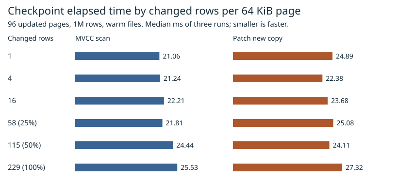
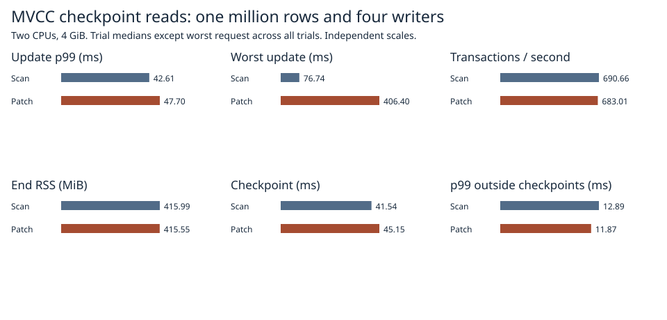

# Copying a 64 KiB checkpoint page for same-size updates

At one changed row per page, scanning the committed MVCC range took 21.06 ms and patching a validated copy took 24.89 ms for the same 96 pages. Copying won three of 18 paired measurements. No density won a majority of its pairs. We retained the existing MVCC scan.



| Changed rows per page (229 rows) | Scan, ms | Patch, ms | Patch wins / 3 |
|---:|---:|---:|---:|
| 1 | 21.06 | 24.89 | 1 |
| 4 | 21.24 | 22.38 | 1 |
| 16 | 22.21 | 23.68 | 0 |
| 58 (25%) | 21.81 | 25.08 | 0 |
| 115 (50%) | 24.44 | 24.11 | 1 |
| 229 (100%) | 25.53 | 27.32 | 0 |

The times are medians of three whole checkpoints including page writes, sync and publication. Each matched condition uses the same 96 distributed pages, 256-byte values and 8/32-byte keys in a million-row database. Each page receives one transaction. All 96 pages used the intended path in every density measurement. Each process starts with a fresh volume and warms it by constructing the database. Density order rotates by two between repetitions, so the first checkpoint and file growth can affect different densities. The baseline and candidate alternate order between repetitions. Cold-cache behavior remains unmeasured. [Trials](trials.csv), [medians and paired wins](summary.csv), [raw output and image identity](raw/density/).

The baseline already scans only changed MVCC ranges. The candidate reads an additional 6 MiB per checkpoint from the old page file. With phase timers enabled in separate runs, reading those bytes took 0.65–0.83 ms, and checking the source page and its identity took another 2.36–2.43 ms. At one change per page, the baseline MVCC scan phase took 1.42 ms. The patch still seals, writes and syncs each new page. These application intervals include cache effects. [Phase measurements](phases.csv).

## Four concurrent writers

The same grouped FIFO path ran 1,024 mixed updates with three checkpoints, a pinned old reader, two CPUs and 4 GiB. The candidate can fall back on each page. For example, at version 256 in its first trial it patched 250 pages and scanned 87. P99 increased in all three matched trials. The 406 ms maximum occurred in one candidate trial. Its cause was not isolated.

| Metric | Scan | Patch |
|---|---:|---:|
| Update p99, median of trials | 42.61 ms | 47.70 ms |
| Slowest update across trials | 76.74 ms | 406.40 ms |
| Transactions/s, median | 690.66 | 683.01 |
| End RSS, median | 415.99 MiB | 415.55 MiB |



[Individual trials](mixed/1m.csv), [raw mixed runs](raw/mixed/). The adoption condition was not met. The [last cross-product comparison](../arrival-group-2026-11-07/README.md) remains the reference for that separate workload.

## Correctness and recovery

The experiment copies an immutable page into scratch memory, validates its envelope and payload, applies the sorted changes and writes a freshly sealed pair to a new slot. The selector is published through the existing durable checkpoint protocol. Missing keys, deletions and changed value lengths trigger the original MVCC range scan. A damaged source copy can be read from its validated peer. The failure model assumes at most one damaged copy per pair.

The density runs verified all current values after each checkpoint, the original million rows through a pinned reader, and all values plus generation 576 after reopen. Dedicated tests covered shape changes, fallback, one damaged copy, and process termination during page writes, after page sync and on either side of selector publication. The grouped commit tests covered conflicts and process exit. The release library suite completed with 111 passed and 37 ignored, including opt-in benchmarks. These process-exit tests do not simulate a physical power loss. [Patch tests](raw/safety.txt), [group tests](raw/group.txt), [library suite](raw/suite.txt).

## Reproduction

Run from the repository root using Docker Linux containers and fresh output directories.

```sh
docker build -f benchmarks/scaled-gate/Dockerfile -t catdb-pagepatch .
docker run --rm -e CATDB_TEST_DIRECT=1 -e CATDB_TEST_PATCH=1 catdb-pagepatch cargo test --release --locked --lib
python benchmarks/scaled-gate/run_density.py density-raw
python benchmarks/scaled-gate/report_density.py density-raw density-report
python benchmarks/scaled-gate/run_patch_mix.py --stage pilot --out mixed-raw/pilot
python benchmarks/scaled-gate/run_patch_mix.py --stage 1m --out mixed-raw/1m
python benchmarks/scaled-gate/report_pack.py mixed-raw mixed-report --patch
```
