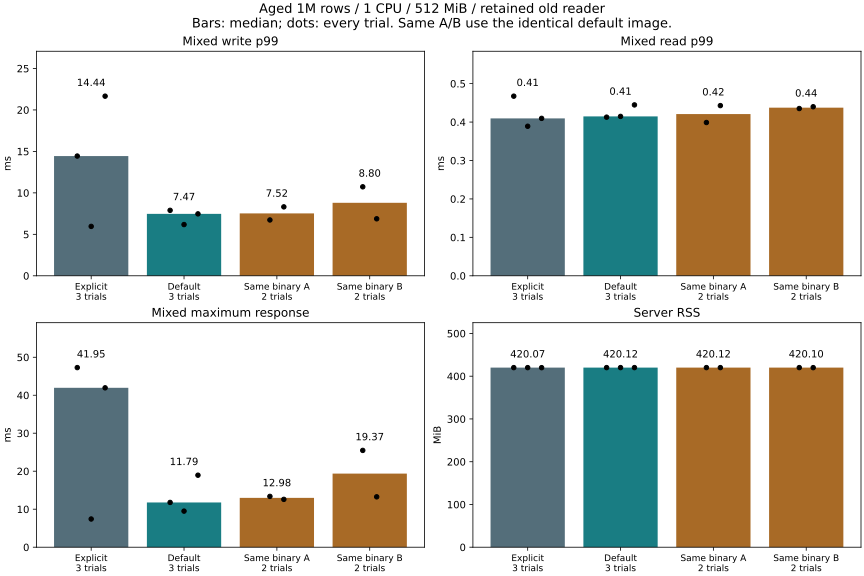

# Rechecking the default-feature p99 difference (2026-11-06)

## Decision

The previous **8.5% higher write p99** is **not a reproducible default-feature
regression in this experiment**. Its original cause remains unresolved.
Keep inline latest as the default; do not change the engine, synchronization,
resource budgets or API on the basis of this comparison.

In the six matched-build trials, write p99 median was **14.437 ms
explicit / 7.466 ms default**. The default was faster in two
pairs and slower in one. This reverses the previous aggregate result but is **not
evidence of a speedup**. All trials, including adverse explicit results, are retained.

Four supplemental runs used **the exact same default image** under two labels.
Their write p99 ranged **6.731–10.728 ms**, a **59.4%** min-to-max
change with no binary or configuration change. This establishes substantial
observed run-to-run variation; it does not establish its source or prove that
code layout can never affect latency. These are real response delays, not values
to discard as measurement error.

The original direction did not persist, so the conditional diagnostic build and
engine optimization comparison were not run. There is no evidence-backed engine
change to qualify. No automatic long-duration extension, tracing campaign or
change to the accepted default was made.



| Trial | Mixed read p99 ms | Write p99 ms | Mixed max ms | Writes >=10/20/50 ms | Requests/s | Queue refusals | RSS MiB | Cgroup MiB | CPU throttled ms | Reopen ms |
|---|---:|---:|---:|---|---:|---:|---:|---:|---:|---:|
| matched-1-explicit | 0.467 | 14.437 | 47.276 | 21/12/0 | 1000.024 | 0 | 420.094 | 429.508 | 0.000 | 2619.441 |
| matched-1-default | 0.413 | 7.891 | 11.786 | 3/0/0 | 1000.015 | 0 | 420.121 | 429.652 | 0.000 | 2927.003 |
| matched-2-default | 0.415 | 6.178 | 9.499 | 0/0/0 | 1000.031 | 0 | 420.141 | 430.207 | 0.000 | 2717.693 |
| matched-2-explicit | 0.389 | 5.955 | 7.424 | 0/0/0 | 1000.013 | 0 | 420.070 | 429.777 | 0.000 | 2722.799 |
| matched-3-explicit | 0.410 | 21.660 | 41.950 | 45/21/0 | 1000.009 | 0 | 419.973 | 430.645 | 0.000 | 3027.544 |
| matched-3-default | 0.445 | 7.466 | 18.954 | 6/0/0 | 1000.022 | 0 | 420.125 | 429.824 | 0.000 | 3131.225 |
| control-1-same-a | 0.399 | 6.731 | 13.374 | 2/0/0 | 1000.019 | 0 | 420.129 | 430.254 | 0.000 | 2920.324 |
| control-2-same-b | 0.435 | 10.728 | 25.479 | 21/5/0 | 999.992 | 0 | 420.148 | 430.781 | 0.000 | 2921.429 |
| control-3-same-b | 0.440 | 6.872 | 13.261 | 4/0/0 | 1000.027 | 0 | 420.047 | 431.605 | 0.000 | 2818.848 |
| control-4-same-a | 0.443 | 8.310 | 12.592 | 6/0/0 | 999.991 | 0 | 420.105 | 430.879 | 0.000 | 2826.211 |


## What the build check establishes

Both variants were rebuilt from the same source and lockfile, in the same
Rust/Cargo build image and runtime image. Linux dependency packages and enabled
features match after excluding only the root `default` marker. That marker
selects the already enabled `inline-latest`; no source branch tests it.

**The rebuilt executable and shared-library hashes each match their own previous
comparison image exactly.** Reusing the older explicit image did not introduce
a stale executable in that comparison. See [build resolution](builds/comparison.json)
and [runtime hash verification](builds/runtime-verification.json).

The explicit/default binaries and their `.text` section bytes do differ from one
another. A section-byte difference alone cannot identify added work, an instruction
layout penalty or the cause of a latency outlier. The compiler/version/feature
records are retained; no assembly-level cause is claimed.

## Timing evidence and limits

The first explicit trial had first-second write p99 **28.556 ms**, then
**9.623 ms** after the first second. In the third explicit trial, the first-second
p99 was **5.495 ms**, but the later p99 was **21.817 ms**. A startup-only explanation
does not fit both trials. Their maximum before-call waits were **27.286 / 21.642 ms**,
while separate call maxima were **47.161 / 41.824 ms**. These maxima are not
necessarily the same request and must not be added.

| Trial | First-second write p99 ms (200 requests) | Later write p99 ms (1,400 requests) | Before-call p99 ms | Before-call max ms | Call p99 ms | Call max ms |
|---|---:|---:|---:|---:|---:|---:|
| matched-1-explicit | 28.556 | 9.623 | 0.285 | 27.286 | 9.518 | 47.161 |
| matched-1-default | 7.471 | 7.937 | 0.210 | 0.961 | 7.755 | 11.640 |
| matched-2-default | 5.776 | 6.178 | 0.200 | 0.990 | 6.083 | 9.406 |
| matched-2-explicit | 5.589 | 5.979 | 0.153 | 3.433 | 5.815 | 6.827 |
| matched-3-explicit | 5.495 | 21.817 | 1.668 | 21.642 | 19.217 | 41.824 |
| matched-3-default | 6.463 | 7.466 | 0.165 | 0.750 | 7.374 | 18.871 |
| control-1-same-a | 4.479 | 6.896 | 0.160 | 0.238 | 6.655 | 13.254 |
| control-2-same-b | 9.211 | 10.728 | 0.189 | 5.179 | 10.331 | 25.387 |
| control-3-same-b | 7.564 | 6.359 | 0.197 | 0.490 | 6.731 | 13.187 |
| control-4-same-a | 8.772 | 8.234 | 0.169 | 0.264 | 8.214 | 12.482 |


The request records preserve planned arrival, enqueue, call start and completion.
Call duration includes transport, service queuing, locks, durable synchronization,
publication and response. Without the conditional server trace, these components
cannot be attributed separately. CPU quota counters are shown in the table;
zero quota throttling would not rule out other scheduling or I/O waits.

## Memory, correctness and recovery

- **160,000** timed requests, **50** full-content service checks and **10** full seed checks.
- Old snapshots checked through **16,000** mixed updates and **80** safety-probe updates.
- No OOM, timed-operation error or queue refusal. Memory results for every trial
  are shown, including service RSS and cgroup usage; the previous memory saving
  is not traded away for latency.
- Each disposable server is killed without graceful close, reopened under the
  same 512-MiB limit and checked against every acknowledged value.
- The safety probe retains a snapshot across eight versions, rejects an oversized
  staged change without losing the prior staged value, rolls back and commits again.
- Existing C ABI and real-service tests are rerun against the measured default
  image. CI retains Rust conflict, sync-before-publication, save-failure and
  crash-recovery tests, Windows/Linux and legacy-layout file compatibility.
- New analysis tests reject dependency/feature differences disguised as equivalence,
  reversed timestamps, duplicate requests and missing/empty percentile data;
  exact 10/20/50-ms and one-second boundaries are covered.

No Rust engine source, Cargo feature default, storage format, durability setting
or service behavior changed. Process termination is not physical power-loss testing.
No PALV or `Z:\A` library was modified. Verification records are under [validation](validation/).

## Conditions

Same workload as qualification: fully aged 1,000,000 rows, 8-byte keys, 256-byte
values, 1 CPU quota, 512 MiB service-cgroup memory, no swap, old reader retained.
Each trial has 8,000 reads followed by 8,000 mixed requests at 1,000 offered requests/s.
Mixed traffic is 80% reads / 20% writes, serviced by one read and four write workers.
There are 1,600 writes per mixed trial, so p99 reflects roughly the slowest 16
writes; a short cluster can materially shift it. No sample was removed.

The same deterministic aged WAL hash is checked for all ten trials. Queues are
bounded at 64 per kind. The staged/retained budgets remain 4,096 / 671,088,640 bytes.
The retained budget is not a total process-memory ceiling. Client (2 CPUs / 2 GiB)
and preparation (2 CPUs / 4 GiB) run separately; shared cache can be charged
outside the service cgroup. **This is not a 512-MiB total-machine or cold-cache guarantee.**

Schedule: explicit/default, default/explicit, explicit/default, then identical
image labels A/B/B/A. The control is supplemental, later in time; it does not
correct host drift or isolate the storage device. Read/mixed phase order is held
constant. OS sampling is unchanged in every variant. Heavy builds and validation
are kept outside measured runs. No claim of zero observer overhead, peak throughput,
a latency SLO or a statistically established effect is made.

## Reproduce

Create a common builder (with cached locked dependencies) and common runtime,
then use them for both builds. The recorded experiment reused the fixed local
images `catdb-inline-default:build` and `catdb-inline-default:default`; their IDs
and layer checks are included in the build verification record. Rebuilding those
bases later can change the environment, so compare the captured versions/hashes.

```sh
docker build -f benchmarks/Dockerfile --target build -t catdb-default-tail:builder .
docker build -f benchmarks/Dockerfile -t catdb-default-tail:runtime .
docker build -f benchmarks/default-tail/Dockerfile --build-arg BUILDER_IMAGE=catdb-default-tail:builder --build-arg RUNTIME_IMAGE=catdb-default-tail:runtime --build-arg FEATURE_FLAGS=--no-default-features --build-arg EXTRA_FEATURES=,inline-latest -t catdb-default-tail:explicit .
docker build -f benchmarks/default-tail/Dockerfile --build-arg BUILDER_IMAGE=catdb-default-tail:builder --build-arg RUNTIME_IMAGE=catdb-default-tail:runtime -t catdb-default-tail:default .
docker tag catdb-default-tail:default catdb-default-tail:same-a
docker tag catdb-default-tail:default catdb-default-tail:same-b
python benchmarks/default-tail/run.py --out artifacts/default-tail-repeat/raw
python benchmarks/default-tail/report.py artifacts/default-tail-repeat
```

Build records are in `/build-record` inside each measured image. Export them to
`builds/explicit` and `builds/default`, then run `python benchmarks/default-tail/audit.py
BUILD_RECORD_DIRECTORY` for the compiler/dependency check. Docker hashes and
source hashes accompany the raw data. The source parent is
`115f1c079d081a9f03309cfd5d54602a5ebf36f0`.

[Summary](summary.json), [all trials](table.md), [timing windows](timing-windows.md),
[raw records](raw/). The earlier [qualification result](../inline-default-2026-11-06/README.md)
remains unchanged as a historical observation.
