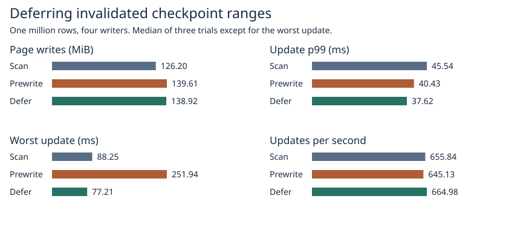
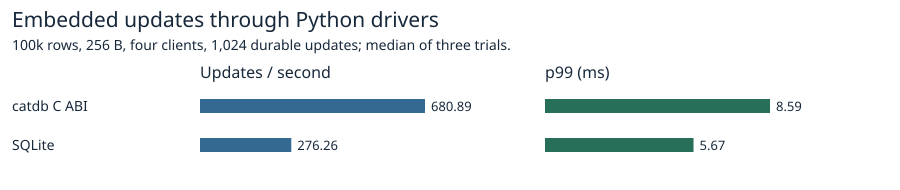
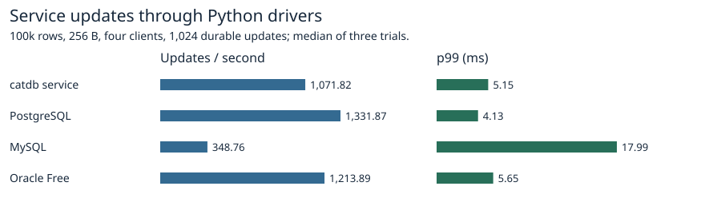

# Delaying the next speculative write for an invalidated page range

[Source used for all nine timings](https://github.com/dhq-boiler/SilverHamu/tree/a40f71e7f62c7161993ab261878763850e0abb90/benchmarks/scaled-gate). A committed update invalidates any matching prepared page. The candidate remembers up to 96 such range keys until the next successful directory publication. Other eligible ranges may still be prepared. A range that stays hot gets rebuilt by the foreground scan; a range that cools may miss an opportunity for early reuse. The suppression set is bounded and resets on publication or reopen. Commit sync, old readers and recovery use the existing paths.

## Four writers, one million rows

One binary, three modes, three rotated trial orders, 2 CPUs, 4 GiB, 1,024 mixed commits (including retries), a pinned old reader and three checkpoints. The same worker interval, four-range preparation batch and maximum of 96 prepared page pairs apply to both prewrite modes. Page writes include both file copies, early and foreground writes, and preparation still pending at the end. They exclude log and manifest traffic and do not measure physical device writes.

| Mode | Page writes (MiB) | Update p99 (ms) | Worst update (ms) | Updates/s | Foreground checkpoint (ms) | End RSS (MiB) |
|---|---:|---:|---:|---:|---:|---:|
| Publish-time scan | 126.20 | 45.54 | 88.25 | 655.84 | 45.24 | 415.79 |
| Prewrite | 139.61 | 40.43 | 251.94 | 645.13 | 39.59 | 417.27 |
| Defer invalidated | 138.92 | 37.62 | 77.21 | 664.98 | 35.17 | 417.24 |

Medians of three trials except for the worst update across all trials. Compared with immediate re-preparation, the candidate measured -0.49% page writes (2/3 pairs lower) and -6.94% update p99 (2/3 lower). The worst update for immediate preparation (251.94 ms) came from trial three, where its p99 also reached 234.39 ms. The candidate had a higher maximum in the other two paired trials. The slowest request overlapped a checkpoint for 237.73 ms. The phase responsible within that interval was not measured. The default remains unchanged.

## Where the prewritten bytes went

| Mode | Published (MiB) | Invalidated (MiB) | Split (MiB) | Failed (MiB) | Still prepared at shutdown (MiB) |
|---|---:|---:|---:|---:|---:|
| Prewrite | 35.880 | 1.707 | 0.000 | 0.000 | 11.965 |
| Defer invalidated | 35.881 | 0.896 | 0.000 | 0.000 | 11.962 |

Each trial reconciles its early write counter to the sum of all five categories. Category medians are calculated separately. Pending pages awaited a possible fourth checkpoint beyond the measurement window; their eventual reuse is unknown. Published pages substitute for foreground page writes. In a shape-changing range the first speculative output can be written before a second output reveals a split. Errors account for bytes recorded before the injected failure. [All trials](trials.csv), [environment and requests](raw/1m/).

## Controlled checks

With 12 commits to one range, immediate preparation lost 1,438,646 bytes to re-updates and used the final prepared copy. The candidate lost 130,786 bytes to the first invalidation and rebuilt once at publication (130,786 bytes). The 97-range capacity check verifies admission beyond the 96 suppression markers, reset at publication, split accounting and full recovery. [Boundary test](raw/boundary.txt), [partial-write accounting](raw/failed-accounting.txt).

Repeated updates to one range exercise the deferral rule, file extent bound, point conflict and restart. The shift pilot updates 16 ranges twice, moves updates to 16 other ranges, publishes and then returns to the original ranges. Both versions lost 2,092,912 staged bytes to invalidation in that pilot. They prewrote 8,371,744 and 6,278,832 bytes respectively; the avoided preparation would otherwise have been reused. The full workload comparison includes the cost of rebuilding at publication. [Hot range, immediate](raw/hot-prewrite.txt), [hot range, deferred](raw/hot-defer.txt), [shift, immediate](raw/pilot-prewrite.txt), [shift, deferred](raw/pilot-defer.txt).

The focused suite checks an old snapshot, updates and deletions, staging count and byte limits, partial write failure and retry, and process termination during page writes and around page sync and selector publication. It verifies the acknowledged generation after reopening. The group tests cover point, range and write conflicts. [Focused tests](raw/safety.txt), [group tests](raw/group.txt), [release library tests](raw/suite.txt).

## Reproduction

~~~sh
docker build -f benchmarks/scaled-gate/Dockerfile -t catdb-defer .
docker run --rm -e SCALED_VARIANT=defer -e DEFER_COUNTS=1 catdb-defer cargo test --release --locked --lib ::defer_pilot -- --ignored --nocapture
docker run --rm -e SCALED_VARIANT=defer -e CATDB_TEST_ARRIVALS=1 catdb-defer cargo test --release --locked --lib ::prewrite_ -- --ignored --test-threads=1
python benchmarks/scaled-gate/run_defer.py --stage 1m --out raw/1m
python benchmarks/scaled-gate/report_defer.py raw/1m report
~~~

Use SCALED_VARIANT=prewrite for the immediate pilot. Add PREWRITE_COUNTS=1 and DEFER_COUNTS=1 to the recycling test to print its final and speculative page traffic.

## Product reference

100k rows, 256-byte values, four clients, 1,024 synchronous updates per run, three trials per product. All reopened digests matched. These charts use the released SilverHamu interfaces. The native prototype is timed in the million-row checkpoint workload above. [Product medians](products.csv), [drivers, versions and raw samples](raw/products/).

~~~sh
docker build -f benchmarks/Dockerfile -t catdb-defer-products .
python benchmarks/run.py --image catdb-defer-products --single-request --four-updates --rows 100000 --ops 1024 --reps 3 --out products
python benchmarks/scaled-gate/report_prewrite_products.py products report
~~~
