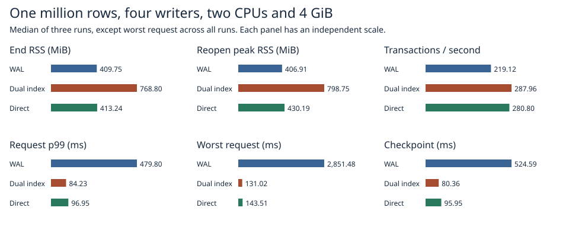

# Reading changed checkpoint ranges from native MVCC

Reading changed ranges directly from MVCC reduced end-of-loop RSS from **768.8 to 413.2 MiB**. WAL used 409.8 MiB. The direct path measured 280.8 transactions/s, p99 96.9 ms and a worst request of 143.5 ms. WAL measured 219.1 transactions/s, 479.8 ms and 2851.5 ms respectively. Against the previous dual-index prototype, direct reading reduced end RSS by 355.6 MiB (46.2%), with p99 increasing from 84.2 to 96.9 ms and throughput falling 2.5%.



| Path | End RSS MiB | Reopen peak MiB | Worst ms | p99 ms | Tx/s |
|:---|---:|---:|---:|---:|---:|
| Current WAL | 409.75 | 406.91 | 2,851.48 | 479.80 | 219.12 |
| Prior FIFO delta | 768.80 | 798.75 | 131.02 | 84.23 | 287.96 |
| Direct FIFO delta | 413.24 | 430.19 | 143.51 | 96.95 | 280.80 |

Throughput, RSS and p99 are medians of three trial statistics. Worst is the single slowest request across all three trials. End RSS is Linux VmRSS after the timed update loop with the old reader still pinned. For each trial a fresh child process separately opened the warm files and checked the recovered commit sequence. Reopen peak is that process's lifetime VmHWM through database readiness, including process startup. Ready RSS and pre-open RSS are in [trials.csv](trials.csv). The parent subsequently reopened and verified every row. [Per-request logs, image and Rust source hashes](raw/1m/).

## Implementation

Both delta variants use native MVCC conflict detection, FIFO admission and synchronous paired records. The direct backend appends changed values to the durable control log and marks the affected key ranges. It keeps the range directory and pending log overlay. Its checkpoint writer pins the current MVCC generation under the writer lock and requests only the marked half-open key ranges. Each scan is bounded by 256 returned rows, 64 KiB of key/value payload and 512 visited entries. It follows the continuation even when a page of scanned entries produces no live rows. The writer packs the results into immutable paired 64 KiB disk pages, drops empty ranges and publishes the directory using the existing sync order. Each directory entry also tracks its live row count in memory, so checkpoint metadata can report the total without visiting every row. The previous dual-index backend participates in the same executable and uses its own in-memory rows to supply the equivalent ranges.

Initial rows on the direct benchmark path are generated in batches into the native state. During recovery the page decoder hands validated write sets directly to that state, then applies the durable overlay. The final generation is restored even when the selected checkpoint contains zero rows. The legacy file layout and the per-record limit of one detectably damaged copy are shared with the previous experiment.

## Workload and verification

One million 256-byte values, 8/32-byte keys, four closed-loop writers, 1,024 multi-key transactions and three checkpoints. Each fresh Docker volume ran with two CPUs, 4 GiB and no swap. The three variants rotate through first, second and third position. WAL uses native commits with group commit disabled, as in the [previous comparison](../mvcc-delta-2026-11-07/README.md). Every request includes admission, conflict retries, persistence and overlapping checkpoint stalls. Setup, old reader acquisition, validation and both reopens are outside the throughput timer. Aged or longer-lived workloads can have different memory behavior.

The direct-path Linux release library suite passed 106 tests. The new range fixture holds an old reader, deletes 900 consecutive rows, reinserts and enlarges boundary rows, checks the checkpoint's live count and verifies the reopened map. It also checkpoints an empty database with a nonzero generation and reinserts an empty key. The native MVCC cases exercise stale write/point/range dependencies, readers during a paused sync, injected append/page/selector failures and process kills at seven commit or publication boundaries with full data and generation checks. [Safety results](safety.txt). The crash tests terminate the process on a running host.

## Reproduction

```sh
docker build -f benchmarks/scaled-gate/Dockerfile -t catdb-direct-pages .
docker run --rm --network none --cpus 2 --memory 4g --memory-swap 4g -e CATDB_TEST_DIRECT=1 catdb-direct-pages cargo test --release --locked --lib -- --test-threads=1
python benchmarks/scaled-gate/run_direct.py --stage pilot --out results/pilot
python benchmarks/scaled-gate/run_direct.py --stage 1m --out results/1m
python benchmarks/scaled-gate/report_four.py --direct results/1m report
```

Use a new output directory for each stage. The alternate checkpoint path is available in Linux test builds.
