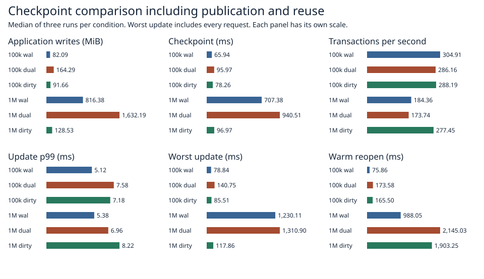

# Incremental dual-record checkpoints with 64 KiB pages

A single writer ran 1,024 multi-key transactions, creating checkpoints before requests 256, 512 and 768. Each size used three fresh containers per variant with each variant occupying each position once. Initial datasets used alternating 8- and 32-byte keys and 256-byte values. The container enforced two CPUs, 4 GiB RAM and zero swap. A pinned reader stayed open throughout the timed loop. Every run checked all keys, values, row counts and ordering of the old reader, latest state and warm reopen.

| Rows | Path | Tx/s | p99 ms | Worst ms | Checkpoint ms | Writes MiB | Syncs | End RSS MiB | Reopen ms |
|---:|:---|---:|---:|---:|---:|---:|---:|---:|---:|
| 100,000 | wal | 304.91 | 5.12 | 78.84 | 65.94 | 82.09 | 1,030.00 | 45.25 | 75.86 |
| 100,000 | dual | 286.16 | 7.58 | 140.75 | 95.97 | 164.29 | 1,030.00 | 51.81 | 173.58 |
| 100,000 | dirty | 288.19 | 7.18 | 85.51 | 78.26 | 91.66 | 1,033.00 | 47.98 | 165.50 |
| 1,000,000 | wal | 184.36 | 5.38 | 1,230.11 | 707.38 | 816.38 | 1,030.00 | 407.89 | 988.05 |
| 1,000,000 | dual | 173.74 | 6.96 | 1,310.90 | 940.51 | 1,632.19 | 1,030.00 | 441.29 | 2,145.03 |
| 1,000,000 | dirty | 277.45 | 8.22 | 117.86 | 96.97 | 128.53 | 1,033.00 | 440.74 | 1,903.25 |

Each number is the median of three trial statistics, except worst update, which covers every request in all three runs. Checkpoint time is the median of the per-trial medians. End RSS includes the pinned reader. Submitted writes cover both files and all three checkpoints during the loop. WAL bytes use the encoded frame and checkpoint lengths. Filesystem allocation, high-water RSS, pin time and every trial are in [trials.csv](trials.csv). The timing harness, real syncs, update stream and request boundaries are shared with the [full checkpoint experiment](../scaled-gate-2026-11-07/README.md).



At 1M rows the 64 KiB incremental path submitted **128.5 MiB** against 816.4 MiB for WAL and 1,632.2 MiB for full dual records. The worst checkpoint-inclusive update took **117.9 ms**, compared with 1,230.1 ms and 1,310.9 ms, respectively. Update p99 was 8.22 ms for incremental and 5.38 ms for WAL. Warm reopen took 1.90 s and 0.99 s, respectively. At 100k the incremental path still wrote more bytes than WAL. All 18 main trials verified latest, pinned and reopened data.

## Storage and recovery

The incremental path keeps a sorted directory of lower key bounds and addresses. Each immutable page occupies a pair of 64 KiB slots and each write covers its actual encoded bytes. Updates append to the existing dual-record log. A checkpoint visits dirty key ranges, splits oversized pages, removes empty ranges and retains the other addresses. It syncs the new page pairs, writes and syncs the entire directory to the control file, then publishes and syncs the new generation selector. A checkpoint with no touched ranges skips the page-file sync.

A slot becomes reusable after durable publication and after its last pinned reader releases it. A reader owns its key index, shared values, page references and a lease on the page file. On reopen the store validates the chosen directory and page identities, reconstructs free space from reachability, repairs a damaged peer, applies the durable log overlay and syncs the page file before admitting writes. Deleted rows have explicit tombstones. Unreachable slots can be overwritten on subsequent checkpoints. The file retains its high-water length.

The current WAL, full dual-store and incremental dual-store have different in-memory indexing and recovery work. These are end-to-end single-writer results. The incremental format admits only rows that fit a page. Snapshot creation clones the key index and shares values. The durability model covers one detectably damaged copy per record. Two lost log-tail copies can hide an acknowledged transaction. The crash harness terminates processes and leaves the host running.

## Safety and reproduction

The small-file checks exercise no-change checkpoints, concentrated and distributed changes, splitting and deleting pages, reading a pinned generation across repeated switches, and reopening after the pin is released. Nine child-process kills interrupt page writing, page synchronization, directory preparation, selector publication, reclamation and one-copy repair. Each case requires the acknowledged map in full after reopening, followed by another successful checkpoint and reopen. The Linux release library suite passed 99 tests with 23 opt-in entries skipped. [Safety results](safety.txt).

From the repository root, run each stage after the preceding stage passes. The runner creates a fresh volume per trial and requires new output paths.

```sh
docker build -f benchmarks/scaled-gate/Dockerfile -t catdb-dirty-gate .
python benchmarks/scaled-gate/run_dirty.py --stage pilot --out results/pilot
python benchmarks/scaled-gate/run_dirty.py --stage 100k --out results/100k
python benchmarks/scaled-gate/run_dirty.py --stage 1m --out results/1m
python benchmarks/scaled-gate/report_dirty.py results report
```

[Raw request times, per-run container state and measured source hashes](raw/).
