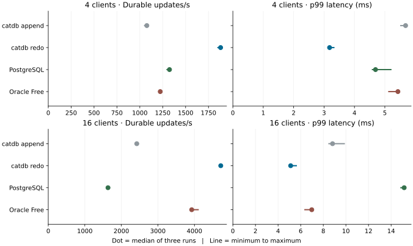

# Durable single-key service updates with a preallocated WAL

The 4-client median rose from 1,076.6 to 1,882.3 updates/s (1.75×). The 16-client median rose from 2,422.0 to 4,720.3 updates/s (1.95×).

## Throughput and latency

Each cell reports the median of three runs. Throughput counts completed transactions per second. The p99 includes per-request encoding and decoding, network round trips, commit and any serialization retry.

| Service | 4 clients, updates/s | 4 clients, p99 ms | 16 clients, updates/s | 16 clients, p99 ms |
|---|---:|---:|---:|---:|
| catdb append | 1,076.6 | 5.682 | 2,422.0 | 8.818 |
| catdb redo | 1,882.3 | 3.182 | 4,720.3 | 5.115 |
| PostgreSQL 18.6 | 1,324.1 | 4.693 | 1,634.3 | 15.155 |
| Oracle 26ai Free | 1,223.2 | 5.430 | 3,925.5 | 6.979 |



| Clients | catdb redo trial rates | Paired wins over PostgreSQL | Paired wins over Oracle |
|---:|---|---:|---:|
| 4 | 1,846.6 / 1,904.7 / 1,882.3 | 3/3 | 3/3 |
| 16 | 4,724.9 / 4,720.3 / 4,676.4 | 3/3 | 3/3 |

100,000 ordered eight-byte keys with 256-byte values. Disjoint random keys per writer, warm cache, one key replacement and one durable commit per operation. Every service and its client had a two-CPU quota and 4 GiB of memory. Each case contained 8,000 updates. The driver changed product and case order between repetitions on the same Docker Desktop/WSL2 host. All services used fresh Docker named volumes on the same storage. The throughput interval excludes initial load, prewriting the arena, conversion, full verification and restart. catdb performed no checkpoint during these 8,000-update timed cases. The figures do not include the cost of periodic checkpoints in a long-running workload. These rates describe these API calls, client and storage configuration.

The final study completed 192,000 transactions. The latency records and all 48 full-database checks, including 12 restarts, were verified independently against the seeded workload. Final operation errors were zero. Serialization retries by service were catdb append 0, catdb redo 0, PostgreSQL 18.6 0, Oracle 26ai Free 2. A retry used the same key and value and remained inside the original latency. PostgreSQL used fsync=on and synchronous_commit=on. Oracle used WAIT, IMMEDIATE and INITRANS=16. Both SQL services used SERIALIZABLE. catdb returned success after synchronizing the log. [Measured settings and images](comparison/environment.json) · [Per-trial results](comparison/results.json) · [Independent audit](comparison/independent-audit.json).

## Where the time went

The separate instrumented runs each executed 4,096 updates per case, twice. Requests sharing a log synchronization were counted once when computing group duration and wall-clock share. Intervals include work inside the persistence call, including the extra recovery-copy processing in the new format. These are application-side elapsed times.

| Clients | WAL | Updates per sync, runs 1 / 2 | Mean sync interval, ms | Share of timed wall clock |
|---:|---|---|---|---|
| 4 | append | 4.00 / 4.00 | 3.12 / 3.18 | 79.55 / 79.48% |
| 4 | redo | 3.99 / 4.00 | 1.56 / 1.53 | 68.34 / 67.61% |
| 16 | append | 8.00 / 7.98 | 3.16 / 3.17 | 93.58 / 93.63% |
| 16 | redo | 7.91 / 7.64 | 1.52 / 1.79 | 90.38 / 88.49% |

Four writers already filled nearly every four-request group with the append WAL. At sixteen writers, arrivals during an active sync typically formed two alternating groups. Validation, encoding and writing were small next to the synchronization interval. The new format reduced this interval while servicing similar group sizes. The before/after study measures the complete storage change; it does not isolate a particular filesystem or device subcomponent. [Append traces](profile-append/) · [Redo traces](profile-redo/).

## Persistence and recovery

Format 4 prewrites its data area plus four 64 KiB witness slots. Each small commit group appends its ordinary catdb frames within the prewritten area. It writes two complete checksummed copies of that group to alternating locations, then performs one data synchronization. Only a successful sync permits MVCC publication and an acknowledgement. Two prior-generation slots remain intact during the write. When encoded frames exceed 65,456 bytes, payload is synchronized before writing and synchronizing end-only witnesses.

On reopen, record identity, checksums, generations, bounds and WAL contents are validated. A healthy witness can supply the latest small group while the main copy is checked. Contradictory intact records fail closed. Repairs and abandoned-tail cleanup are synchronized before writable reuse. Reopen scratch is charged against the actual resource budget. Checkpoints atomically preserve the format. Capacity exhaustion is a recoverable refusal: checkpoint or explicitly expand the data area. [Configuration, capacity and compatible builds](../../service.md#preallocated-wal-with-recovery-copies).

The fault suite exercises independently torn primary and witness writes, prior acknowledged data, oversized fallback, capacity and resource refusal, old snapshots, uncertain commits, concurrent checkpoints, interrupted repair, and divergent valid copies. Child processes exit at six commit boundaries. The final Linux Rust suite passed 241 tests, the Windows suite passed 178, and the real TCP and TLS suites passed 23 and six, respectively. A 1 KiB recovery-buffer test exercises a small converted database and a refusal before modifying an image when its actual recovery data exceeds the budget. The two recovery copies occupy separate offsets on the same device. Erasure of the latest small group and both corresponding witnesses can be indistinguishable from an interrupted unacknowledged append. Filesystem persistence depends on the storage honoring completed synchronization; no physical power cut was performed.

| SIGKILL while writing | Success responses before kill | Transactions recovered |
|---:|---:|---:|
| 4 clients | 186 | 189 |
| 16 clients | 340 | 344 |

Every success response was matched to its exact value after reopen. An in-flight transaction with no reply could be present or absent; multi-key transactions remained atomic. An explicitly open transaction remained absent. The service was checkpointed and read again after each restart. [Final service crash evidence](crash-release/result.json).

## Reproduce

Build two comparison images from this tree. Use a fresh output directory for each invocation. The runner checks the catdb on-disk format after startup. The 64 MiB capacity in this run was chosen for this dataset. A database converted to format 4 subsequently requires a compatible build.

```sh
docker build -f benchmarks/Dockerfile -t catdb-append:study .
docker build -f benchmarks/Dockerfile --build-arg EXTRA_FEATURES=,redo-witness -t catdb-redo:study .
python benchmarks/run.py --out artifacts/redo-repeat/comparison --single-request --image catdb-redo:study --baseline-image catdb-append:study --engines oracle catdb-service postgres --clients 4 16 --workloads update --rows 100000 --ops 8000 --reps 3 --oracle-initrans 16 --serialization-retries 3 --redo-log-bytes 67108864
python benchmarks/validate.py artifacts/redo-repeat/comparison
python benchmarks/redo-witness/plot.py artifacts/redo-repeat
python benchmarks/redo-witness/crash_check.py --image catdb-redo:study --out artifacts/redo-repeat/kill --server-env CATDB_EXPERIMENTAL_REDO_LOG_BYTES=67108864 --expect-format 4
cargo test --locked --features service,redo-witness
```

For the diagnostics, build separate comparison images adding `lock-timing` to each feature set. Use the existing [commit breakdown runner](../../../benchmarks/commit-breakdown/README.md) with `--clients 4 16 --workloads update --ops 4096 --reps 2 --profile` and the single-request adapter. Add `--redo-log-bytes 67108864` for the redo run. Run `benchmarks/redo-witness/profile_groups.py` on each output directory to recompute the group statistics.

The [early screen](prototype-screen/) used one recovery copy. The [preceding dual-copy comparison](qualified-comparison/) used the same small-group commit path with a fixed worst-case reopen allocation. The final release charges actual recovery allocations. Each campaign retains its own results; the table above uses only the final release campaign. The packaged service and the final timed image contained the same server executable (SHA-256 `a218deb44841bf8574a7481799ba89a531ae6e72a503047b28da3e1d251aa7cc`).
