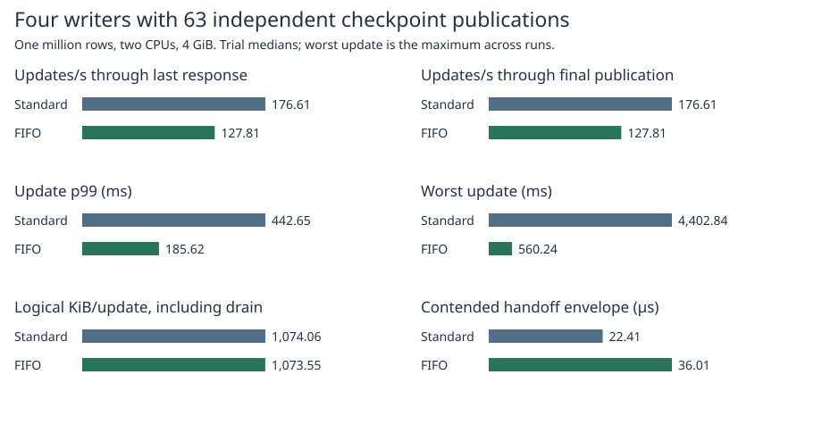
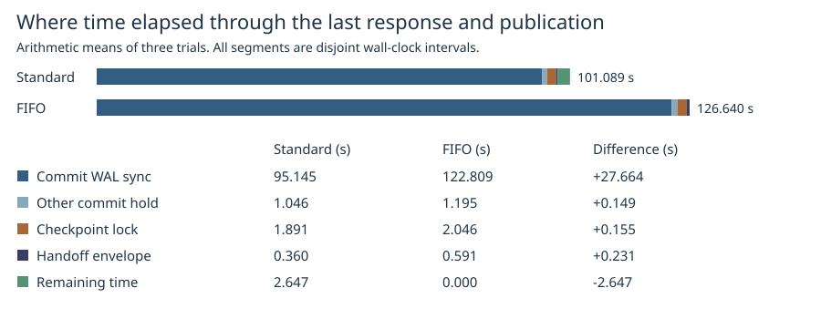

# Equal publication counts with independent checkpoints

The standard and FIFO writer locks both completed **63 full checkpoint publications in every trial**. Throughput through the final write response changed by **-27.63%** with FIFO. Including all outstanding maintenance, the change was **-27.63%**. FIFO matched or exceeded standard-lock drained throughput in 1/3 pairs. The previous [coalescing experiment](../writer-fifo-2026-11-07/README.md) measured a 4.3% response-throughput deficit while the standard lock completed 51–55 publications and FIFO completed 63. These are separate campaigns. Equalizing the count did not remove the median throughput difference here. The FIFO runs spent 27.664 s longer inside commit WAL sync calls on average, versus 0.231 s more in the directly observed contended handoff envelopes. The extra envelope time alone cannot account for the 25.551 s difference through drain.

| Metric | Standard writer lock | FIFO |
|---|---:|---:|
| Throughput to last response (updates/s) | 176.61 | 127.81 |
| Throughput including drain (updates/s) | 176.61 | 127.81 |
| Update p99 (ms) | 442.65 | 185.62 |
| Worst update (ms) | 4,402.84 | 560.24 |
| Logical writes including drain (MiB) | 17,184.93 | 17,176.79 |
| Logical KiB/update | 1,074.06 | 1,073.55 |
| Time after final response (ms) | 0.00 | 0.00 |
| Publications finishing after last response (range across trials) | 0–13 | 0 |
| Publications starting after last response (range) | 0–13 | 0 |

Medians of three per-mode trials except maximum latency across the three. All response latencies include retries. Prefix preparation (2,048 chunks), 1M seeded rows, 256-byte values, 4 continuous writers, 2 CPUs, 4 GiB, no swap, 16,384 updates and the commit-ordinal trigger schedule match the earlier comparison. Trials alternate order. The maintenance worker handles every trigger, retaining an out-of-order notification until its predecessor arrives. Writers never wait for the worker to receive or service a notification. A late trigger can publish already-current data; its publication still performs the replacement and counts its bytes. Update progress against the set of durable versions can differ because workers race. Logical bytes comprise update WAL frames and every full replacement, its WAL suffix and header rewrite. Device writes are not measured.

| Trial pair | Through drain, standard (updates/s) | Through drain, FIFO (updates/s) | FIFO change | Publications after last response, standard / FIFO |
|---:|---:|---:|---:|---:|
| 1 | 194.73 | 127.81 | -34.37% | 13 / 0 |
| 2 | 129.66 | 133.82 | +3.21% | 0 / 0 |
| 3 | 176.61 | 126.71 | -28.25% | 0 / 0 |

## What time can be assigned to handoff?

We sampled lock attempt, observed acquisition, immediately before guard release and immediately after release on all four writers and on the checkpoint thread. For adjacent owners, a transition counts as contended if some acquisition attempt had started and had not yet been observed as acquired when the previous holder started releasing. This includes a standard-lock holder that reacquires while another caller waits. The mean interval is measured from the **previous pre-release probe to the next acquired probe**, including unlock work, wakeup, scheduling, acquisition and instrumentation. The subsequent release-return probe can occur after a new owner acquires.

| Handoff statistic | Standard | FIFO |
|---|---:|---:|
| Contended transitions per run | 16,112.00 | 16,510.00 |
| Transitions changing threads | 1,903.00 | 16,510.00 |
| Mean observed envelope (µs) | 22.41 | 36.01 |
| Mean envelope when switching threads (µs) | 32.90 | 36.01 |
| p99 observed envelope (µs) | 44.30 | 68.34 |
| Total observed envelope through drain (ms) | 355.26 | 594.53 |
| Time left from release-return until next acquired probe, clipped at zero (ms) | 115.11 | 320.31 |

The following accounting uses arithmetic means of three runs so the components add to elapsed time. It partitions the wall-clock span from first request through the later of final response and final publication. Commit sync is the actual sync-call interval under the lock, which can include time off CPU. Other commit hold is the rest of measured writer ownership; maintenance hold covers prefix capture and checkpoint cutover. The handoff envelope has no observed holder. The remainder includes gaps without known waiters and independent work outside observed ownership. Checkpoint scan or sync outside the lock can overlap commits and is not added again.

| Mean seconds per trial | Standard | FIFO | FIFO minus standard |
|---|---:|---:|---:|
| Commit WAL sync | 95.145 | 122.809 | +27.664 |
| Other commit hold | 1.046 | 1.195 | +0.149 |
| Maintenance hold | 1.891 | 2.046 | +0.155 |
| Contended handoff envelope | 0.360 | 0.591 | +0.231 |
| Other time | 2.647 | 0.000 | -2.647 |
| Total through drain | 101.089 | 126.640 | +25.551 |

Across the paired runs the mean difference in total elapsed time including drain was **+25.551 s**; the difference in the observed handoff envelopes was **+0.231 s**. These are wall-clock intervals. The probes cannot isolate the cost of the mutex instructions, runnable-thread delay or indirect changes to WAL sync and concurrent checkpoint I/O. Fixing the count controls how many replacements must finish, not when they overlap the writers. Three runs on this host do not establish a general throughput penalty.

Commit WAL sync intervals overlapped prefix preparation for 15.43 s (standard) and 16.38 s (FIFO) per trial on average. The corresponding overlaps with foreground snapshot encoding/writing were 12.69 s and 13.97 s, and with the snapshot sync call 11.27 s and 16.74 s. These are subsets of the commit WAL sync time, not additional work or proof of the cause of a storage stall.

## Validation and reproduction

Each run requires trigger IDs 1 through 63 exactly once in order, corresponding successful commits before publication starts, concurrent admissions and completions during checkpointing, and matching old, current and reopened views against the commit-order oracle. The analyzer reconciles every commit attempt to its lock observation, both maintenance acquisitions per checkpoint, no overlapping measured ownership and the time-accounting sum. Both lock variants test reordered notifications and reject missing or duplicate signals. [Trial results](trials.csv), [maximum and p99 requests](request-phases.csv), [all publications](checkpoints.csv), [traces, test results and image identity](raw/).

~~~sh
docker build -f benchmarks/scaled-gate/Dockerfile.fifo -t catdb-equal .
python benchmarks/scaled-gate/run_independent.py --fifo --equal-publications --pilot pilot
python benchmarks/scaled-gate/run_independent.py --fifo --equal-publications raw
python benchmarks/scaled-gate/report_equal.py raw report
~~~

[Timed sources](https://github.com/dhq-boiler/catdb/tree/2deeac0a56485fc5177c20ec60ddba5df9b024f2). The reporter also accepts the published compressed logs. The timing probes are confined to Linux test builds with the default feature set or FIFO. Their cost is included in both arms; it was not subtracted.
