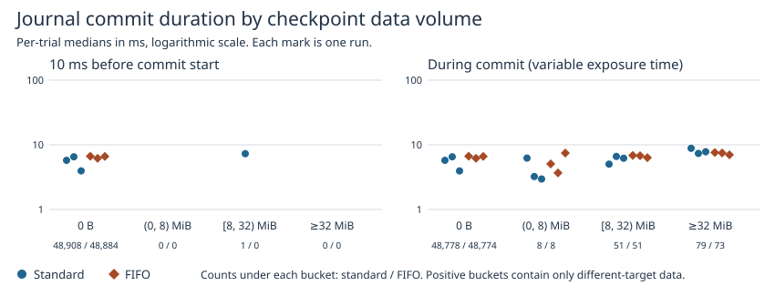
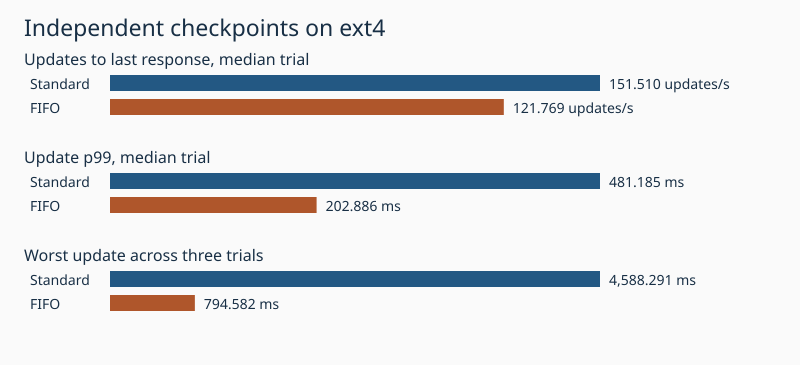

# Checkpoint data volume around ext4 journal commits

Of the WAL-targeted ext4 commits, 138 standard and 132 FIFO epochs overlapped submissions exclusively targeting other transactions. Their median durations were 6.909 and 6.913 ms, versus 5.755 and 6.617 ms with zero checkpoint bytes. The fixed 10 ms window before commit start showed exclusively different targets for 1 and 0 epochs respectively. Longer commits allow more opportunities for concurrent writeback. These observational differences alone cannot establish the delay caused by a checkpoint.

Within the different-target-only group, median commit duration was higher with at least 32 MiB submitted than with 8 to under 32 MiB in each of the six trials. These exploratory volume bins were added after all positive during-commit samples exceeded 1 MiB. At the 5 ms landmark, different-target writeback was followed by about 0.50 ms more remaining time with standard and 0.58 ms more with FIFO, comparing trial medians to zero-byte cases. The near-absence of exclusively different-target exposure before commit start limits causal inference. [Writeback volume and duration by trial](volume.csv).

Each lock ran three times on one million 256-byte values, four writers, two CPUs, 4 GiB, 16,384 acknowledged updates and 63 independently published prefix checkpoints. The pair order was standard/FIFO, FIFO/standard, standard/FIFO. Each run checked the retained reader, latest values, commit sequence and reopened data. Database persistence and engine code follow the previous journal identity experiment.

| Measure | Standard | FIFO |
|---|---:|---:|
| Updates/s | 151.510 | 121.769 |
| Update p99, ms | 481.185 | 202.886 |
| Worst update, ms | 4,588.291 | 794.582 |
| WAL waits attributed | 49,152.000 | 49,152.000 |
| 10 ms before start, zero, count | 48,908.000 | 48,884.000 |
| 10 ms before start, zero, median ms | 5.759 | 6.617 |
| 10 ms before start, only different targets, count | 1.000 | 0.000 |
| 10 ms before start, only different targets, median ms | n/a | n/a |
| 10 ms before start, any proven different targets, count | 38.000 | 48.000 |
| 10 ms before start, any proven different targets, median ms | 12.434 | 11.251 |
| 10 ms before start, any checkpoint bytes, count | 244.000 | 268.000 |
| 10 ms before start, any checkpoint bytes, median ms | 33.641 | 32.817 |
| During commit, zero, count | 48,778.000 | 48,774.000 |
| During commit, zero, median ms | 5.755 | 6.617 |
| During commit, only different targets, count | 138.000 | 132.000 |
| During commit, only different targets, median ms | 6.909 | 6.913 |
| During commit, any proven different targets, count | 374.000 | 377.000 |
| During commit, any proven different targets, median ms | 13.396 | 16.377 |
| During commit, any checkpoint bytes, count | 374.000 | 378.000 |
| During commit, any checkpoint bytes, median ms | 13.396 | 16.251 |
| First 5 ms among surviving commits, zero, count | 28,628.000 | 37,012.000 |
| First 5 ms among surviving commits, zero, median ms | 1.789 | 1.863 |
| First 5 ms among surviving commits, only different targets, count | 80.000 | 78.000 |
| First 5 ms among surviving commits, only different targets, median ms | 2.292 | 2.443 |
| First 5 ms among surviving commits, any proven different targets, count | 283.000 | 289.000 |
| First 5 ms among surviving commits, any proven different targets, median ms | 12.504 | 14.677 |
| First 5 ms among surviving commits, any checkpoint bytes, count | 309.000 | 321.000 |
| First 5 ms among surviving commits, any checkpoint bytes, median ms | 17.463 | 20.575 |
| strict local matches | 1.000 | 0.000 |
| strict local paired difference, ms | n/a | n/a |
| broad local matches | 38.000 | 48.000 |
| broad local paired difference, ms | 5.955 | 3.206 |

Counts sum three runs. Durations and throughput are medians of trial medians or trial rates; maximum is the worst update across the three. An unavailable trial median makes the three-trial median n/a. The first-5-ms outcome measures remaining time after 5 ms. Local comparisons match the closest zero-exposure commit within one second in the same publication and phase. A control can serve several exposed commits. Per-trial counts of distinct controls are in trials.csv.

## Measuring checkpoint bytes

The checkpoint thread's successful write return sizes must match the application's total for every publication. A private probe at submit_bio filters ext4_end_bio on the workload device. It reads BIO size, inode identity and the inode fsync target i_sync_tid using the running kernel's BTF layout. The checkpoint inode is identified at snapshot fsync, then followed from prefix preparation through final data sync; after replacement it can become the active WAL. The counts include background workers. BIO sizes measure guest data submissions and include page rounding or rewrites. They omit metadata and cannot measure the physical drive. [Linux ext4 data submission](https://github.com/torvalds/linux/blob/v6.18/fs/ext4/page-io.c).

An initial large trial probing ext4_io_submit saw 6.91 GB versus 17.98 GB of logical writes. Its performance data were discarded. The replacement probe calibrated on two million-row publications measured 570,814,464 submitted bytes versus 570,799,758 logical bytes. Each retained publication must reconcile within 2% or 128 KiB, whichever is larger.

## Matching a journal commit

Each WAL wait must match a unique start/end event for the device and transaction and have a verified JBD2 sleep. Repeated WAL waiters count once per epoch. For each data BIO, compare the inode target at submission and the snapshot/tail fsync target to the WAL ID. Both equal means same; both known and different from WAL means different. The data separates contradictory and missing targets. This is fsync-target attribution; individual data BIOs have no JBD2 ownership field.

The primary exposure is the half-open 10 ms before commit start. During-commit counts are also shown with two byte-volume bins. Preceding windows can overlap, so only per-publication sums measure total traffic. The broad category includes any proven different-target bytes even when other bytes are ambiguous. That sensitivity analysis and a fixed 5 ms landmark were added after observing sparse exclusive exposure in the first full trial. The landmark compares remaining duration only for commits still active at 5 ms. Phase, load and previous I/O can affect both exposure and commit duration.

## Observer pilot

Two 10,000-row trials of 512 updates and 15 publications per mode and observer setting. Differences in these short means include ordinary workload variability. All retained traces must pass ring drop, probe miss and cleanup checks.

| Mode | Measure | Plain mean | Traced mean | Change |
|---|---|---:|---:|---:|
| standard | updates_s | 196.45 | 189.96 | -3.3% |
| standard | p99_ms | 290.18 | 210.44 | -27.5% |
| standard | max_ms | 1494.99 | 1504.58 | +0.6% |
| fifo | updates_s | 160.68 | 177.32 | +10.4% |
| fifo | p99_ms | 49.93 | 38.43 | -23.0% |
| fifo | max_ms | 67.24 | 45.13 | -32.9% |

[All six runs](trials.csv) · [Exposure groups and sample sizes](groups.csv) · [All publication byte counts](publications.csv) · [Pilot trials](pilot-trials.csv) · [Capture checks](quality.csv). Per-run compressed tables contain one row per WAL epoch. Build the two images from the [journal identity experiment](../journal-identity-2026-11-07/README.md). Use the [new collector](../../../benchmarks/ext4-checkpoint-bytes/) to run run.py --pilot PILOT, then run.py FULL, report_bytes.py PILOT FULL REPORT and verify_bytes.py REPORT on fresh directories.
