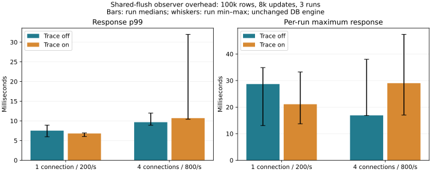

# Shared-flush parentage — 2026-11-06

**The observer now follows journal-origin requests through worker-dispatched flush completion. This is attribution progress, not a database speedup.** No production implementation, durability setting or default changed.

## Method and observer cost

100,000 synthetic records × 256 bytes; 1 connection at 200 offered requests/s and 4 at 800/s; 8,000 updates per case, three repetitions, alternating off/on order. Both variants use the same profile-enabled server image and bounded client queues. This measures response under a fixed arrival rate, not maximum throughput. The preliminary 1,000-update runs are retained separately. All 96,000 main updates committed without rejection or operation error. Full-content verification follows each case and each restart.

| Connections | Tracing | Median run p99 ms | Maximum across runs ms | Median updates/s |
|---:|---|---:|---:|---:|
| 1 | off | 7.524 | 34.889 | 200.0 |
| 1 | on | 6.806 | 33.234 | 200.0 |
| 4 | off | 9.670 | 38.021 | 799.8 |
| 4 | on | 10.701 | 47.375 | 799.7 |

## Directly observed parentage

The collector adds flush insertion, sequence transition, completion entry and completion return probes. A parent is identified at insertion, including the current journal device and transaction. A pre/post-flush transition nested inside a particular completion callback establishes membership in that flush. Membership is a list, allowing multiple parents. Request slots, insertion serials and dispatch serials are distinct. Free events remove stale attribution. No nearest-time matching is used.

The [Linux flush implementation](https://raw.githubusercontent.com/torvalds/linux/v6.18/block/blk-flush.c) advances waiting parent requests during the flush completion callback. That callback can also return early while references remain. The pilot observed such an empty callback followed by a member-bearing callback for the same dispatch; counting both as separate completed flushes would be wrong. These version-specific probes do not copy kernel implementation into catdb.

| Case | Callbacks | Parent transitions | Journal assigned | Unknown | Multiple-parent callbacks | Unresolved dispatches |
|---|---:|---:|---:|---:|---:|---:|
| candidate-profile-trace-r1-c4-rate800-normal | 4482 | 4480 | 4480 | 0 | 0 | 0 |
| candidate-profile-trace-r1-c1-rate200-normal | 15987 | 15982 | 15982 | 0 | 0 | 0 |
| candidate-profile-trace-r2-c4-rate800-normal | 4506 | 4504 | 4504 | 0 | 0 | 0 |
| candidate-profile-trace-r2-c1-rate200-normal | 16001 | 15998 | 15998 | 0 | 0 | 0 |
| candidate-profile-trace-r3-c1-rate200-normal | 15956 | 15952 | 15952 | 0 | 0 | 0 |

**Trace-quality failure:** candidate-profile-trace-r3-c4-rate800-normal was excluded from causal attribution because rq_update, rq_update_return and rq_free each reported one missed probe instance. All raw records remain published; there was no selective rerun. The timing plot includes all measured runs, including this case, but only five traces support the causal analysis. Complete three-repetition causal validation was not achieved.

Across the five accepted traces, 56,916 parent transitions were assigned to journals, with no unknown members or unresolved dispatches. No real multi-parent callback occurred; that branch is validated synthetically only.

## Long waits and remaining limits

| Case | Maximum fsync ms | Maximum journal ms | Journal runnable max ms | Maximum flush dispatch-to-callback ms |
|---|---:|---:|---:|---:|
| candidate-profile-trace-r1-c4-rate800-normal | 12.338 | 12.046 | 0.232 | 10.612 |
| candidate-profile-trace-r1-c1-rate200-normal | 20.413 | 20.248 | 0.270 | 13.451 |
| candidate-profile-trace-r2-c4-rate800-normal | 12.429 | 12.239 | 0.065 | 10.906 |
| candidate-profile-trace-r2-c1-rate200-normal | 13.007 | 12.816 | 0.084 | 10.886 |
| candidate-profile-trace-r3-c1-rate200-normal | 21.143 | 16.572 | 0.275 | 11.995 |

The longest observed journal was 20.248 ms: 20.201 ms blocked, with directly attached pre-flush at 13.451 ms and post-flush at 1.908 ms from dispatch to callback. Those two flush spans account for about 76% of that journal interval. They do not explain the remaining interval or identify the host/device cause. Across accepted traces, the maximum journal runnable wait was 0.275 ms. This supports investigating the flush completion path before changing journal-thread scheduling, but does not justify disabling or weakening synchronization.

Column maxima may belong to different events and must not be added or treated as one causal chain. `flush-summary.json` retains the worst journal and its directly attached flushes. Guest dispatch-to-callback time includes storage/host work and completion delivery; it is not physical device service time. This observer does not split that interval into Windows storage latency, virtual interrupt delivery and vCPU scheduling. It also does not prove that every guest-wide request belongs to catdb. Earlier 129-ms/1.47-s events are not retrospectively explained.

Multiple-parent support, missing entries/returns, duplicate membership, preexisting requests, reuse, different CPU context and error retention have synthetic tests. Whether actual shared membership occurred is shown in the table; absent live branches are not claimed as live fault-injection coverage. The inherited request tests cover partial data completion and requeue.

## Safety, bounds and reproducibility

The private trace instance uses ten owned dynamic probes, a 16 MiB/CPU ring (512 MiB capacity on this guest), and a 180-second capture deadline. Loss counters and missed-probe counts are checked. Dumping/aliasing happens after timing; request and queue addresses are replaced by opaque aliases. Export-failure cleanup is tested; forced process/VM termination can still leave tracing resources. Production snapshots, conflicts, save failures and process-crash recovery are checked by the existing Rust/service/C ABI suites after measurement. Actual power-loss safety is not inferred from process-crash tests.

No builds, tests or chart rendering overlap timed cohorts. Small host source/document edits and occasional reads of completed results occurred; unrelated host/device activity is not fully controlled. See [validation](validation.txt), [raw results](results.json), [exact parentage](flush-analysis.json.gz), [summary](flush-summary.json), [provenance](provenance.json), [pilot](pilot/results.json), and [reproduction](../../../benchmarks/flush-parent/README.md). Negative observer effects are retained.
