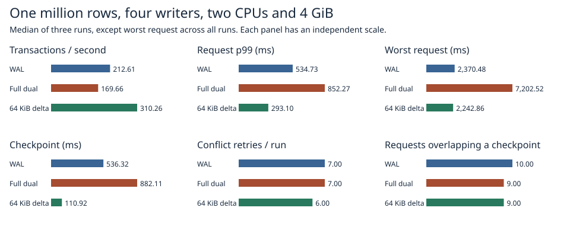

# Four concurrent writers with 64 KiB incremental checkpoints

At four writers the worst request measured **2,242.9 ms** with incremental pages, **2,370.5 ms** with the current WAL and **7,202.5 ms** with full dual records. Incremental throughput was 310.3 transactions/s versus 212.6 for WAL. The corresponding p99 values, including conflict retries and admission wait, were 293.10 and 534.73 ms.

The incremental path beat WAL on worst request in one of the three repetitions. The 5.4% difference between the two overall maxima therefore leaves the WAL comparison unresolved. All three incremental maxima were below the corresponding full-dual maxima.

The longest incremental request lasted 2,242.86 ms. Its lifetime intersected checkpoint execution for 117.50 ms. The other writers completed 510 requests during that interval, and the slow request retried once. This concurrent progress explains how a short checkpoint can coexist with a long individual request. Per-lock acquisition and OS scheduling intervals were not recorded.



| Path | Tx/s | p99 ms | Worst ms | Checkpoint ms | Retries | Overlapping requests | End RSS MiB |
|:---|---:|---:|---:|---:|---:|---:|---:|
| WAL | 212.61 | 534.73 | 2,370.48 | 536.32 | 7.00 | 10.00 | 409.37 |
| Full dual | 169.66 | 852.27 | 7,202.52 | 882.11 | 7.00 | 9.00 | 446.70 |
| 64 KiB incremental | 310.26 | 293.10 | 2,242.86 | 110.92 | 6.00 | 9.00 | 446.02 |

Each rate and p99 is the median of three per-trial measurements. Worst request is the maximum across all three trials. The checkpoint column takes the median of the three checkpoint durations per trial, then the median across trials. Conflicts count retries per trial. Each request retains its initial timestamp until it commits successfully. [All trial statistics](trials.csv) and [per-request timing and checkpoint intervals](raw/1m/) are available.

## Workload

One million seeded rows with alternating 8/32-byte keys and 256-byte values. Four application threads each submit 256 requests sequentially, using every fourth ID of the same 1,024 multi-key transactions as the [single-writer comparison](../dirty-pages-2026-11-07/README.md). The first four transactions begin together. Neighboring request IDs can insert and delete the same key. A conflict starts a fresh transaction and replays that request. Final contents therefore depend on commit order. Every trial sorts the recorded commit sequences, checks contiguity and reconstructs expected values. The pinned old snapshot, latest contents and warm-reopened database are checked in full.

Each trial ran in a fresh Docker volume with two CPUs, 4 GiB RAM and zero swap. Each path occupied each position once in the trial order. WAL uses its native transaction validation, with group commit disabled as in the single-writer comparison. The dual-record paths allow concurrent preparation and serialize validation, durable append and publication using a mutex. Their benchmark adapter records the last committed change for keys including deletions. A stale point or range dependency rejects the transaction. A pinned reader retains an explicit snapshot. The adapter's change index grows with touched keys during the trial.

The three paths use the same admission rule. After 256 successful commits, the next waiting thread obtains exclusive admission, runs a checkpoint, and reopens admission. Failed attempts return their slot. A request includes admission wait, retries, synchronization and publication. Checkpoint overlap means any part of its measured lifetime intersected the timed checkpoint interval. Old-reader setup and subsequent full verification are outside the timed window. This experiment measures a synchronous checkpoint policy, with four closed-loop writers and one real sync per committed update. Queue depth in an open-loop service and asynchronous production checkpoints require separate measurements.

## Recovery and verification

The small parallel checks exercise stale same-key writes, a deleted point dependency and an insertion into an empty range across checkpoint publication. The adapter publishes its new generation only after the durable append returns. For each dual-record variant four worker threads acknowledge independent updates. A parent kills the child during the following transaction's pre-sync or post-sync phase, or during checkpoint selector publication. Reopen must restore every acknowledged key and a whole transaction. The existing suite also exercises old-generation pinning, safe slot reuse, one-copy repairs and WAL recovery. The corruption model allows one detectably damaged copy per paired record. Process termination leaves the host and its storage cache running.

The first parallel crash fixture had four log slots for four acknowledged commits followed by a fifth transaction. It timed out before the intended sync injection. The fixture now provides eight slots. The measured configurations use 256 slots. The final Linux release library suite passed 101 tests with 24 opt-in entries skipped. [Test outcome](safety.txt).

## Reproduction

Run from the repository root, using new output paths for each invocation.

```sh
docker build -f benchmarks/scaled-gate/Dockerfile -t catdb-four-gate .
docker run --rm --network none --cpus 2 --memory 4g --memory-swap 4g catdb-four-gate cargo test --locked --release --lib -- --test-threads=1
python benchmarks/scaled-gate/run_four.py --stage pilot --out results/pilot
python benchmarks/scaled-gate/run_four.py --stage 1m --out results/1m
python benchmarks/scaled-gate/report_four.py results/1m report
```
