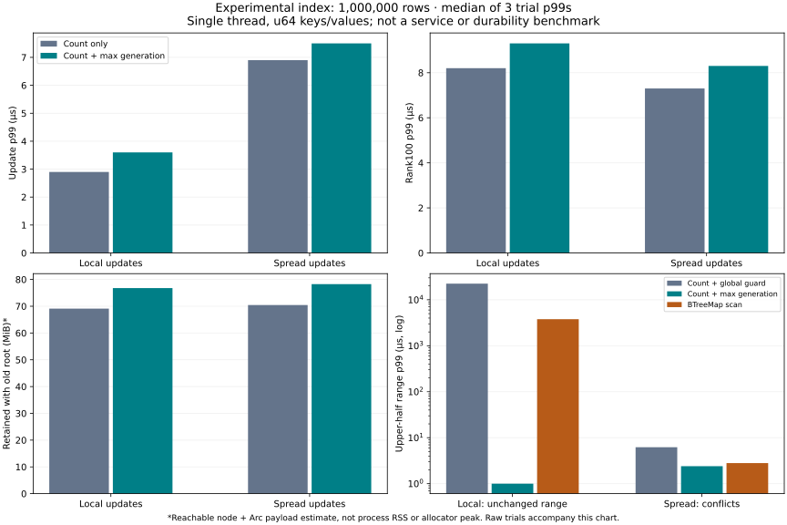

# Count and maximum-generation index experiment

This is an isolated, single-threaded, in-memory prototype. It does not change SilverHamu's transaction engine, WAL, service API, or persistence format. It is not a new durability claim.

## Decision

Keep the maximum-generation summary as a candidate for **range-conflict validation**, not a replacement for all indexes. On 1,000,000 rows with local updates, checking an unchanged upper half after updates elsewhere fell from 22,439.4 µs to 1.0 µs p99 versus the same count tree with a global-generation guard. BTreeMap's range scan took 3,775.6 µs. These are medians of three trial p99s, not pooled percentiles or production service timings.

There are costs: local-update p99 rose 2.9 → 3.6 µs, spread-update p99 6.9 → 7.5 µs, and rank100 p99 8.2 → 9.3 µs / 7.3 → 8.3 µs. Estimated retained node bytes and logical node-allocation bytes increased 11.1%. Spread updates with an early conflict can favor plain traversal: stale-wide p99 was 1.2 µs with the global guard versus 3.6 µs with the subtree summary. No wholesale production adoption is justified.

The simplest separate opportunity is a **global-generation guard**: if the database sequence has not advanced since a transaction's snapshot, its committed-state range scan can be skipped without changing the index. In production, earlier writes in the same group must still be checked independently. This guard is measured in the prototype only; it is not wired into catdb.



## What was already implemented?

| Original idea | Audit result | Evidence |
|---|---|---|
| Constant-work ping | Implemented; `current_version()` replaces the full `stats()` scan. Mutex wait is still possible. | [Source](../../../src/service.rs), [comparison](../single-request-2026-11-05/README.md) |
| One-request get/scan/put/delete | Implemented; writes retain durable commit before success. | [Source](../../../src/service.rs), [comparison](../single-request-2026-11-05/README.md) |
| Read-only transactions and off-lock value copies | Implemented; read-only operations omit write-validation dependencies and reject writes. | [Source](../../../src/transactions.rs), [comparison](../read-gc-2026-11-05/README.md) |
| Bounded reclamation and off-lock destruction | Implemented with key/version/byte bounds and charge release after destruction. Optional background reclamation remains default-off. A hard wall-clock bound is **not** implemented or guaranteed. Subsequent unsuccessful scheduling/structure candidates were reverted. | [Background comparison](../reclamation-2026-11-05/README.md), [latest rejected candidate](../reclamation-front-2026-11-05/README.md) |
| Count + subtree maximum update generation | Previously untested; implemented and measured here. | [Prototype](../../../benchmarks/generation-index/index.rs), [tests](../../../tests/generation_index.rs) |

The earlier private NewDBMS counted-rank prototype was a 16-way tree carrying counts only. This experiment uses a deterministic-priority persistent binary treap for both control and candidate, isolating the summary change. It does **not** extend or beat that earlier 16-way implementation. Its rank100 performance also loses to a sorted vector (about 0.7 µs p99 at 1M rows in this run). Carrying summaries into a cache-friendly wider tree remains future work.

## Design and safety scope

Each node stores a u64 key, optional u64 value, latest update generation, live-subtree count, and two shared child pointers. The candidate additionally stores the maximum generation of itself and both children. Updates copy the path; pinned roots keep old values and structure. Nodes with `maximum <= snapshot` cannot contain a later update and are skipped. Boundary checks still restrict the search to the requested range.

Deletion leaves a tombstone carrying the deletion generation even when live count becomes zero. Tombstones are **never reclaimed in this experiment**, and delete/reinsert follows the same monotonically increasing generation rule. Removing tombstones later requires an active-snapshot floor and separate proof. Maximum generation alone is not sufficient for garbage collection. Input generations cannot regress; multiple keys may share a generation.

Five tests cover full contents, arbitrary rank pages, retained old roots, empty/all-deleted trees, inclusive/exclusive/unbounded endpoints and u64 extremes, same-generation boundaries, generation regression rejection, randomized insert/delete/resurrection, and agreement with a full-scan oracle. The retained-root accounting test checks shared-node deduplication. Every benchmark separately checks current and original full contents, all timed pages, and every conflict answer. This is not a test of group-commit publication, resource admission, file recovery, multithreaded behavior, or adversarial-key depth. The treap's deterministic hash has no worst-case balance guarantee.

## Method and limitations

- Synthetic 100,000 and 1,000,000 rows; u64 keys and u64 values, **not** the service's 256-byte values.
- 2,400 operations per tree: every third operation inserts an odd key, deletes an even key, or sets an even key. Local targets occupy the first 1% of key space; spread targets span all keys. Repeated targets are allowed.
- Three trials per size/distribution, with tree order plain/max, max/plain, plain/max. Both use the identical rows and edits. One old root stays pinned through updates. Per-update timings include assignment and destruction of the previous current root.
- 4,096 rank100 reads per tree; 96 queries per range case. p99 uses nearest rank (`ceil(0.99*n)-1`); with 96 range samples this is the maximum, so it is not a precise tail estimate. All raw samples are included.
- `stable_*`: snapshot equals current global generation. `stale_*`: snapshot is generation 1. Narrow ranges span at most 100 original keys; wide ranges span up to a quarter of the original key domain. `stale_upper_half` repeats the upper-half query: unchanged under local updates, conflicting under spread updates.
- Queries run after updates, with oracle validation outside the timer; these are warm synthetic probes, not randomized concurrent arrivals. Global-guard query measurements follow the count-only probes; BTreeMap and sorted-vector references run last and are auxiliary, not a fully balanced independent product comparison.
- Clock granularity is 100 ns in the recorded samples. Sub-microsecond numbers are near measurement overhead; no precise speedup ratio is inferred from them. Background OS noise is not isolated.
- Memory counts unique reachable nodes in current + pinned roots including estimated Arc counters; it excludes allocator rounding, fragmentation, build scratch arrays, oracle storage, output buffers, and process RSS. Current-only bytes are also reported. Logical allocation bytes sum copied nodes, **not disk writes**. There is no disk I/O in the measured operations.
- An initial 12-run pilot omitted the global guard and placed a compiler barrier inside the BTreeMap predicate. It informed no published numeric claims; its samples are retained under `pilot/`. The final runner moves that barrier to the query input and reruns all 12 configurations. No successful/unsuccessful final trials were filtered.

## Results

| Rows | Updates | Method | Build ms | Update p99 µs | Rank100 p99 µs | Current MiB | With old root MiB | Allocated/update KiB |
|---:|---|---|---:|---:|---:|---:|---:|---:|
| 100,000 | local | count_only | 7.807 | 1.900 | 5.200 | 6.905 | 6.973 | 1.182 |
| 100,000 | local | count_max | 9.008 | 1.700 | 6.000 | 7.672 | 7.748 | 1.313 |
| 100,000 | spread | count_only | 7.860 | 3.700 | 5.000 | 6.921 | 7.902 | 1.606 |
| 100,000 | spread | count_max | 8.403 | 4.200 | 6.300 | 7.690 | 8.780 | 1.785 |
| 1,000,000 | local | count_only | 83.217 | 2.900 | 8.200 | 68.717 | 69.102 | 1.607 |
| 1,000,000 | local | count_max | 97.534 | 3.600 | 9.300 | 76.353 | 76.780 | 1.785 |
| 1,000,000 | spread | count_only | 80.654 | 6.900 | 7.300 | 68.719 | 70.433 | 1.848 |
| 1,000,000 | spread | count_max | 98.083 | 7.500 | 8.300 | 76.355 | 78.259 | 2.053 |

| Rows | Updates | Range case | Count-only p99 µs | Global guard p99 µs | Count+max p99 µs | BTreeMap p99 µs |
|---:|---|---|---:|---:|---:|---:|
| 100,000 | local | stable_wide | 2792.700 | 0.100 | 0.200 | 220.200 |
| 100,000 | local | stable_narrow | 13.500 | 0.100 | 0.200 | 0.700 |
| 100,000 | local | stale_wide | 740.100 | 641.300 | 0.600 | 59.800 |
| 100,000 | local | stale_narrow | 5.100 | 1.600 | 0.200 | 0.600 |
| 100,000 | local | stale_upper_half | 916.200 | 490.600 | 0.200 | 118.800 |
| 100,000 | spread | stable_wide | 4648.800 | 0.100 | 0.100 | 236.100 |
| 100,000 | spread | stable_narrow | 7.700 | 0.100 | 0.100 | 0.800 |
| 100,000 | spread | stale_wide | 1.000 | 0.300 | 3.500 | 0.300 |
| 100,000 | spread | stale_narrow | 0.300 | 0.200 | 1.900 | 0.300 |
| 100,000 | spread | stale_upper_half | 2.500 | 0.400 | 1.500 | 0.300 |
| 1,000,000 | local | stable_wide | 40061.500 | 0.700 | 0.800 | 7844.900 |
| 1,000,000 | local | stable_narrow | 11.900 | 0.100 | 0.100 | 3.400 |
| 1,000,000 | local | stale_wide | 10889.000 | 10535.900 | 1.600 | 1688.200 |
| 1,000,000 | local | stale_narrow | 7.300 | 5.100 | 0.900 | 4.300 |
| 1,000,000 | local | stale_upper_half | 18267.000 | 22439.400 | 1.000 | 3775.600 |
| 1,000,000 | spread | stable_wide | 38735.500 | 0.600 | 0.800 | 7852.200 |
| 1,000,000 | spread | stable_narrow | 22.700 | 0.100 | 0.100 | 3.300 |
| 1,000,000 | spread | stale_wide | 1.700 | 1.200 | 3.600 | 3.800 |
| 1,000,000 | spread | stale_narrow | 1.100 | 0.500 | 1.700 | 1.600 |
| 1,000,000 | spread | stale_upper_half | 13.400 | 6.200 | 2.400 | 2.800 |

Sorted-vector rank100 p99 (µs; reference only): 100,000/local: 0.500, 100,000/spread: 0.400, 1,000,000/local: 0.700, 1,000,000/spread: 0.700


## Reproduce

From the repository root, with Rust and Python installed:

```sh
cargo test --test generation_index
rustc --edition 2024 -O benchmarks/generation-index/bench.rs -o artifacts/generation-index-bench
python benchmarks/generation-index/run.py artifacts/generation-index-bench artifacts/generation-index-new-run
python benchmarks/generation-index/report.py artifacts/generation-index-new-run artifacts/generation-index-new-report
```

On Windows, append `.exe` to the executable path. `run.py` requires a new output directory; the executable refuses existing output files. The report script needs matplotlib. [Summary](summary.json), all per-query CSV files compressed as `.csv.gz`, [environment/provenance](environment.json), and [tables](tables.md) accompany this report.

Product integration remains a separate, conditional task: first evaluate the global guard with same-group writes; then consider range summaries in the existing production structure, including byte-string keys, resource accounting, active-snapshot-aware deletion retention and reconstruction/recovery. No changes were made to PALV or user libraries.

Exact measured Rust sources are preserved in [measured-source](measured-source/). The published prototype subsequently collapses a nested conditional in the untimed memory-accounting traversal for Clippy; the timed update/read/conflict code is unchanged.
