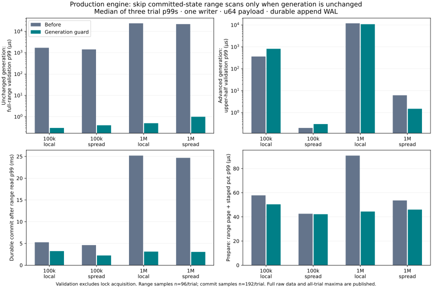

# Production global-generation guard

The production `Transaction::validate_commit` now skips **only the committed-state range scan** when `state.sequence == transaction.snapshot`. Point read/write checks and same-group earlier-write checks remain in place. This uses the existing sequence under the existing state mutex; it adds no persistent metadata and changes no file format, sync, publication, or wire/API contract.

## Outcome

In the 1,000,000-row single-writer range-read-then-update workload, median-of-three commit p99 changed from **25.200 → 3.131 ms** for local prior updates and **24.686 → 3.055 ms** for spread prior updates (about 88% lower). These are actual durable production-engine commits, not the earlier treap simulation. The range read is prepared separately and the table reports its time too. All 24 runs passed current-state, old-snapshot and reopened-state full-content checks (72 checks total).

The full-range validation itself fell from 23.977 / 22.020 ms to 0.5 / 1.0 µs when the snapshot generation was current. Sub-microsecond observations are near the clock/observer floor; no exact speedup multiplier is claimed. When the generation has advanced, the engine still scans: this change does **not** implement subtree summaries.

Adverse results are retained. At 100k/local, stale upper-half validation p99 increased 365.2 → 820.2 µs; its median sample within each run remained approximately 155–181 µs in both builds. The largest after-sample was the first query in two trials. Skipping preceding scans may change cache warmth, but this is an inference, not an isolated cause. The all-trial maximum also rose 797.7 → 894.1 µs. At 1M/local, the same stale-case all-trial maximum rose 15.358 → 15.557 ms despite a lower median trial p99. Do not read the unchanged-generation improvement as a universal tail bound.



The guard is retained in production because it removes provably unnecessary work with a small localized change, maintains the tested safety properties, and materially improves the target workload. Its benefit depends on how often no other committed update occurs between a transaction's snapshot and validation. Continuous overlapping writers may rarely qualify; ordinary point-update throughput and the previous PostgreSQL/Oracle comparison were not remeasured here.

## Safety evidence

- Same-group insert, value update and deletion inside the scanned range still conflict even while the committed sequence equals the reader's snapshot. The exclusive endpoint is allowed. Empty ranges, point write conflicts and point read dependencies retain their behavior.
- Existing committed-state tests cover advancing generations, phantom insertion/deletion, range endpoints, old snapshots, page-range protection and checkpoint overlap.
- The group process-exit fixture now reads a range before committing, exercising the guard before/after sync. The injected partial-write/sync-failure fixture also includes a range dependency. Successful publication still follows sync, and same-group earlier writes are always checked independently.
- Full Rust suite: **126 passed, 7 ignored** with `service`; **137 passed, 9 ignored** with `service,fixed-log`. Ignored entries include explicit experiment/child-process fixtures; recovery parents invoke the required child fixtures. The range-bearing sync-failure test was rerun in both configurations after that fixture extension.
- **30 C ABI tests**, **18 service protocol tests**, Clippy and formatting checks passed. Service tests include acknowledged commits surviving process termination. These are process-failure tests, not proof of actual power-loss durability or every device failure.

The runtime change is in [transactions.rs](../../../src/transactions.rs); same-group regression coverage is in [group_commit.rs](../../../src/group_commit.rs). The test-only benchmark is [engine_bench.rs](../../../benchmarks/global-generation/engine_bench.rs). No production benchmarking switch or new API was introduced.

## Conditions and interpretation

Before: commit `73d3ff6`, with only the same test-only benchmark module added. After: the production generation guard and regression tests. Both compile with `cargo test --release --features service --lib`, with runtime diagnostics disabled. OS/CPU/compiler and executable hashes are in [environment.json](environment.json); the exact before/after transaction sources and benchmark sources are archived under [measured-source](measured-source/).

The sizes and local/spread distributions match the preceding index experiment: 100k/1M synthetic rows, u64 keys encoded big-endian, 8-byte values, 2,400 insert/delete/value-set operations targeting the first 1% or the entire key space. The production seed uses durable batches of 4,096 records, and the 2,400 preparation operations form one transaction (rather than one treap generation per edit). Hence this is a matched **production before/after** experiment, not directly comparable to the former treap timing.

There are three runs per size/distribution/build, ordered before/after, after/before, before/after. All files live in new C: work directories. No disk cache purge or CPU isolation was attempted; this is a warm-cache workstation experiment. No other agent builds/tests ran during timed trials.

Each trial records:

1. Four validation cases, 96 samples each. `stable_wide` covers the full range and `stable_narrow` covers 100 original keys; both use the current committed snapshot. `stale_upper_half` and `stale_narrow` retain the pre-update snapshot. Validation calls the real `validate_commit` while the state mutex is already held, so this isolates validation work and excludes lock acquisition. It does not isolate a contended multiwriter queue. Every result is checked against an independent full-scan predicate outside the timer.
2. 192 real commits, each beginning at the current snapshot, reading one 100-row page with a full-range dependency, then putting an 8-byte value at the same outlying key. `prepare` is page acquisition plus staged put; `commit` includes validation, durable WAL write/sync, publication and transaction destruction. Group commit is disabled for this timing; group safety is tested separately. An old read snapshot remains pinned.
3. Full current and old-state comparisons, close/reopen and full recovered-state comparison. The scan and comparisons are outside the timing. Failed or uncertain commits would fail the trial rather than silently retry; all trials succeeded.

The p99 estimator is nearest rank. With 96 validation samples, p99 is the maximum; with 192 commit samples it is the second-largest. Charts use the median of three trial p99s, not a pooled percentile. The table also exposes the largest observation across all trials. Clock quantization in the samples is 100 ns. Conditions run in a fixed within-process order, so the removal of scans can itself affect later cache warmth. `stable_wide` is a deliberately qualifying workload and not an estimate of the real-world qualification rate. Extra metadata is zero by design; whole-process memory/physical disk amplification were not newly measured.

## Results

| Rows | Updates | Case | Before p99 µs | After p99 µs | Before max µs¹ | After max µs¹ |
|---:|---|---|---:|---:|---:|---:|
| 100,000 | local | stable_wide | 1711.800 | 0.300 | 2469.500 | 0.300 |
| 100,000 | local | stable_narrow | 0.600 | 0.100 | 1.300 | 0.100 |
| 100,000 | local | stale_upper_half | 365.200 | 820.200 | 797.700 | 894.100 |
| 100,000 | local | stale_narrow | 0.400 | 0.800 | 0.400 | 1.000 |
| 100,000 | local | prepare | 57.800 | 50.400 | 77.200 | 53.400 |
| 100,000 | local | commit | 5276.000 | 3239.400 | 10425.500 | 4063.000 |
| 100,000 | spread | stable_wide | 1433.100 | 0.400 | 1597.700 | 0.400 |
| 100,000 | spread | stable_narrow | 0.500 | 0.100 | 0.500 | 0.100 |
| 100,000 | spread | stale_upper_half | 0.200 | 0.300 | 0.200 | 0.400 |
| 100,000 | spread | stale_narrow | 1.000 | 0.800 | 1.100 | 1.200 |
| 100,000 | spread | prepare | 42.600 | 42.200 | 60.900 | 234.800 |
| 100,000 | spread | commit | 4621.300 | 2239.800 | 13471.200 | 3524.900 |
| 1,000,000 | local | stable_wide | 23976.800 | 0.500 | 26337.600 | 0.500 |
| 1,000,000 | local | stable_narrow | 0.800 | 0.100 | 1.800 | 0.100 |
| 1,000,000 | local | stale_upper_half | 11963.000 | 10868.500 | 15357.600 | 15557.100 |
| 1,000,000 | local | stale_narrow | 1.300 | 1.100 | 6.600 | 1.200 |
| 1,000,000 | local | prepare | 90.700 | 44.400 | 213.900 | 59.000 |
| 1,000,000 | local | commit | 25200.100 | 3131.000 | 27562.800 | 4122.000 |
| 1,000,000 | spread | stable_wide | 22020.000 | 1.000 | 31059.800 | 1.000 |
| 1,000,000 | spread | stable_narrow | 0.800 | 0.100 | 0.900 | 0.100 |
| 1,000,000 | spread | stale_upper_half | 6.200 | 1.500 | 8.300 | 1.800 |
| 1,000,000 | spread | stale_narrow | 0.500 | 0.900 | 0.600 | 4.400 |
| 1,000,000 | spread | prepare | 53.600 | 46.000 | 212.500 | 48.900 |
| 1,000,000 | spread | commit | 24685.500 | 3055.300 | 29893.700 | 5767.700 |

p99 columns are medians of three trial p99s. ¹Max columns are maxima across all three trials; they are not medians.


All [summary records](summary.json) and 24 per-operation `.csv.gz` files are published alongside this report. No trial was dropped. The previous [subtree-generation experiment](../generation-index-2026-11-05/README.md) and product charts remain unchanged as historical results.

## Reproduce

From this commit's checkout, with Rust, Python and matplotlib available:

```sh
cargo test --locked --features service -- --test-threads=1
cargo test --locked --features service,fixed-log -- --test-threads=1
python benchmarks/global-generation/build.py artifacts/global-guard-build-new
python benchmarks/global-generation/run.py artifacts/global-guard-build-new/binaries.json artifacts/global-guard-runs-new
python benchmarks/global-generation/report.py artifacts/global-guard-runs-new artifacts/global-guard-report-new
```

All named build/run/report directories must be new. `build.py` extracts the fixed baseline commit and attaches the same benchmark; it never switches or overwrites the current checkout. Allow roughly a few minutes and several GiB of free workspace, depending on compilation caches. The run retains synthetic WALs for inspection; only CSV results are published. PALV and user libraries are not modified.
