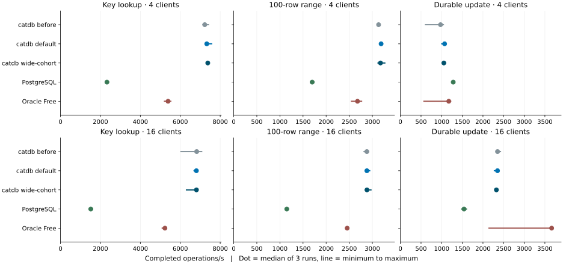

# Service reads and durable group writes on November 8, 2026

In this warm-cache client benchmark, each request reads one key, returns 100 consecutive rows, or replaces one value and waits for durable commit. Throughput counts completed logical operations. The client includes any serialization retry in the original latency.

The default build led PostgreSQL 18.6 and Oracle Free on lookup and range throughput at both connection counts. Four-client durable update throughput rose from 972.4 to 1,071.1/s (+10.1%) and p99 fell from 6.131 to 5.501 ms. Both peers still completed more four-client updates. The paired throughput gains were 80.7%, 1.4% and 2.5%, so a stable 10% improvement on another machine cannot be inferred.

At sixteen clients the default build completed 2,352.4 durable updates/s, ahead of PostgreSQL and behind Oracle Free. Before/after throughput was nearly flat and default p99 worsened from 9.159 to 9.862 ms. The larger-group option reached 2,325.7/s and 10.776 ms p99. It remains opt-in: the improvement seen in the short screening run did not carry over to the final comparison. Oracle Free also had lower sixteen-client range p99 even though catdb completed more ranges per second.

## Results

| Operation | Clients | catdb before | catdb default | catdb wide-cohort | PostgreSQL | Oracle Free |
|---|---:|---:|---:|---:|---:|---:|
| Key lookup | 4 | 7,226.0 | 7,327.0 | 7,377.9 | 2,326.1 | 5,387.7 |
| Key lookup | 16 | 6,822.5 | 6,807.1 | 6,809.6 | 1,517.4 | 5,231.5 |
| 100-row range | 4 | 3,135.2 | 3,189.5 | 3,176.5 | 1,698.4 | 2,679.0 |
| 100-row range | 16 | 2,881.2 | 2,881.9 | 2,883.3 | 1,148.7 | 2,455.3 |
| Durable update | 4 | 972.4 | 1,071.1 | 1,052.7 | 1,279.8 | 1,172.0 |
| Durable update | 16 | 2,353.0 | 2,352.4 | 2,325.7 | 1,541.8 | 3,663.7 |

Completed operations per second, median of three runs. Each server and the shared Python client had a two-CPU quota and 4 GiB of memory. One 100-row range counts as one operation.



### Client p99 latency in milliseconds

| Operation | Clients | catdb before | catdb default | catdb wide-cohort | PostgreSQL | Oracle Free |
|---|---:|---:|---:|---:|---:|---:|
| Key lookup | 4 | 1.282 | 1.225 | 1.270 | 3.062 | 1.279 |
| Key lookup | 16 | 5.698 | 5.715 | 5.715 | 17.745 | 6.326 |
| 100-row range | 4 | 2.342 | 2.266 | 2.363 | 3.815 | 2.388 |
| 100-row range | 16 | 12.526 | 12.811 | 12.737 | 21.893 | 11.877 |
| Durable update | 4 | 6.131 | 5.501 | 5.751 | 4.825 | 5.701 |
| Durable update | 16 | 9.159 | 9.862 | 10.776 | 16.397 | 7.396 |

The p99 cells are medians of the three per-run p99 values. The [CSV summary](summary.csv) includes min/max for throughput, p50, p95 and p99. [Every latency sample and environment](comparison/) is retained.

## Changes

- The service transfers decoded keys and values to the staged transaction, reuses the previous entry lookup for limit checks and constructs only the final response to an implicit write. Scan replies take ownership of the hexadecimal strings and row arrays.
- The grouped WAL writer submits frame slices together. It advances partially written slices, retries interrupted writes, and propagates other write errors through the existing uncertain-commit path. A single-frame group retains the ordinary write path. Persisted frame contents, the synchronization barrier and the visibility order are preserved.
- The optional Cargo feature `wide-cohort` raises the collection target from four to eight, sixteen or thirty-two when the queued or recently completed group indicates more writers. The extra collection wait is bounded to one millisecond. The absolute group count and byte caps still apply. The regular service uses the existing four-request policy.

An allocation-instrumented Windows probe measured **809 to 307 allocations** and **178,287 to 63,071 requested bytes** for assembly of a 100-row response with an 8-byte key, 256-byte value and continuation. Both encoders produced identical bytes. The 8-byte-key / 256-byte-value single-write dispatch fell from **28 to 19 allocations** and **3,721 to 2,575 requested bytes** (medians of 64). These counts measure allocation requests on the dispatch thread. Network latency, process RSS and the cost of a storage flush have different units. [Before](allocations-before.csv) · [After](allocations-after.csv).

## Conditions and verification

All 720,000 logical operations completed. There were 0 serialization retries: catdb before 0, catdb default 0, catdb wide-cohort 0, PostgreSQL 0, Oracle Free 0. All 120 full-content checks passed, including 15 checks after a server restart. Every product produced the same ordered key/value hash after each corresponding stage in each repetition. The verifier recomputes the percentiles and rates from the raw samples.

The database held 100,000 synthetic records with eight-byte keys and 256-byte values. Each operation used its own transaction. Four or sixteen persistent connections ran 8,000 operations per case. Each fixture used a fresh volume and deterministic seeds. Writers updated disjoint key sets. Product and case order changed between repetitions. The client started timing after warmup and waited for each response before submitting the next request on that connection. This measures service APIs, including their different wire protocols and drivers. Joins, adversarial contention, mixed production workloads and power loss were outside this workload.

PostgreSQL 18.6 used SERIALIZABLE, fsync=on and synchronous_commit=on. Oracle 26ai Free 23.26.3 used SERIALIZABLE, COMMIT_WAIT=WAIT and COMMIT_LOGGING=IMMEDIATE. The Oracle table reserved 16 initial transaction entries per data block, confirmed from USER_TABLES. The final client allowed up to three retries for a definite serialization conflict, checked rollback, reused the same value and included all attempts in elapsed time. A connection failure or uncertain commit was terminal. See the [Oracle transaction guide](https://docs.oracle.com/en/database/oracle/oracle-database/26/adfns/sql-processing-for-application-developers.html).

In the [initial 100k-row pilot](raw/), Oracle with its original table settings returned ORA-08177 for 5 of 8,000 sixteen-client updates; the runner recorded the failures and stopped. The [10k-row fixture check](oracle-fixture-check/) with INITRANS=16 still reported six such errors with retries disabled. These incomplete runs are excluded from the final summaries. The [separate 4/16-client collection screen](collection-screen/) used 4,096 updates per case and three repetitions. Individual results varied strongly over time on this workstation. Only the five configurations in the final cohort appear above.

Baseline source is `102dbe6252f5e4bc4d8b375ed32c77f118fb1824`. The two optimized images were built from local changes on that base. The recorded image IDs distinguish the binaries even though the working copy had the same Git HEAD. The final formatted opt-in build and the timed opt-in build have identical 1,564,672-byte ELF .text sections (SHA-256 `94529670a199c01a5737197e898ce097ac439a55dc12b7908f7f3d8cee3be3eb`).

## Reproduction

Build the baseline comparison image from a clean checkout of the baseline revision. In the checkout containing the changes, run the following with the PostgreSQL and Oracle images identified in [environment.json](comparison/environment.json). The output directory must be new. [Base benchmark setup](../../../benchmarks/README.md).

```sh
docker build -f benchmarks/Dockerfile -t catdb-before:local /path/to/baseline
docker build -f benchmarks/Dockerfile -t catdb-current:local .
docker build -f benchmarks/Dockerfile --build-arg EXTRA_FEATURES=,wide-cohort -t catdb-wide:local .
python benchmarks/run.py --out artifacts/grouped-repeat/comparison --single-request --image catdb-current:local --baseline-image catdb-before:local --experimental-image catdb-wide:local --engines oracle catdb-service postgres --clients 4 16 --workloads get range100 update --rows 100000 --ops 8000 --reps 3 --oracle-initrans 16 --serialization-retries 3
python benchmarks/grouped-writes/report.py artifacts/grouped-repeat/comparison
CATDB_ELISION_ALLOC=1 cargo test --locked --lib --features service scan_response_moves_encoded_rows_without_extra_payload_copies -- --ignored --nocapture
```

For the write allocation probe, run `work_elision_single_requests` from the work-elision benchmark with the counter enabled. Use the same eight-byte hex key in all put and get requests and the three payload sizes 8, 256 and 262,144 in both builds. The timed service comparison has allocation instrumentation disabled.
