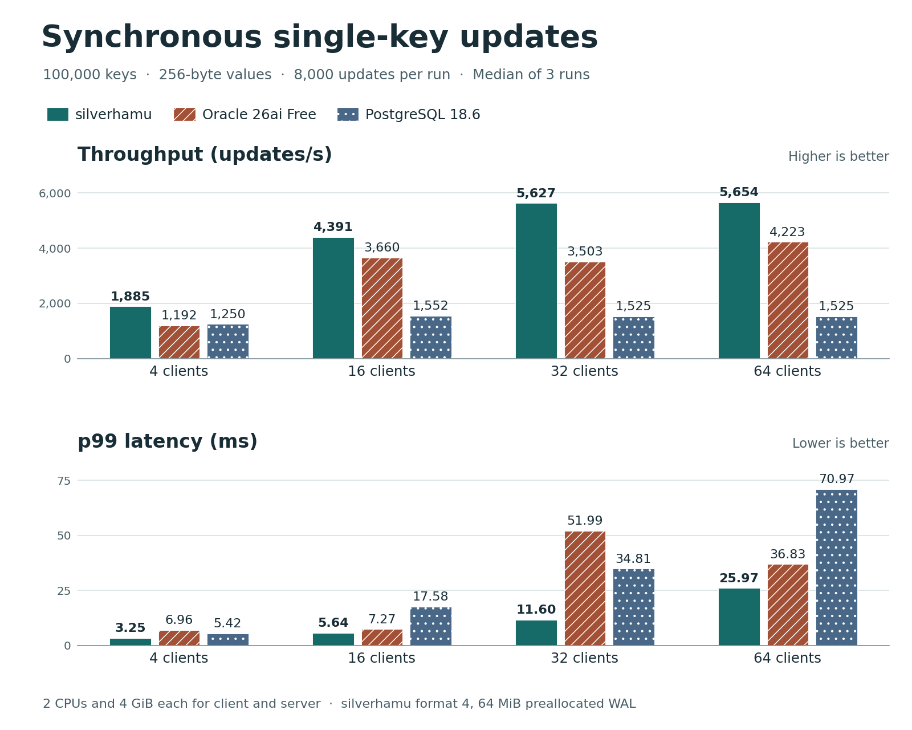

# Durable single-key updates with 4 to 64 clients



## Throughput and latency

The table gives the median of three trials, followed by their minimum and maximum. Retries are totals across the three trials. Throughput counts completed durable updates per second. The p99 is the time within which 99% of updates completed in a trial.

| Clients | Service | Updates/s (range) | p99 ms (range) | Retries |
|---:|---|---:|---:|---:|
| 4 | SilverHamu | 1,885.0 (1,712.7–1,900.2) | 3.25 (3.15–3.89) | 0 |
| 4 | Oracle 26ai Free | 1,192.2 (586.4–1,224.8) | 6.96 (5.54–12.97) | 0 |
| 4 | PostgreSQL 18.6 | 1,249.6 (614.2–1,294.8) | 5.42 (5.23–11.90) | 0 |
| 16 | SilverHamu | 4,391.4 (4,232.2–4,656.9) | 5.64 (5.21–6.39) | 0 |
| 16 | Oracle 26ai Free | 3,660.4 (2,137.8–3,808.8) | 7.27 (7.27–13.46) | 3 |
| 16 | PostgreSQL 18.6 | 1,551.7 (1,482.7–1,570.6) | 17.58 (16.19–17.66) | 0 |
| 32 | SilverHamu | 5,626.9 (5,400.7–6,081.4) | 11.60 (9.56–14.27) | 0 |
| 32 | Oracle 26ai Free | 3,503.1 (2,943.2–4,454.0) | 51.99 (15.71–53.02) | 15 |
| 32 | PostgreSQL 18.6 | 1,524.7 (1,500.5–1,527.5) | 34.81 (34.77–35.57) | 0 |
| 64 | SilverHamu | 5,654.4 (5,454.4–6,063.8) | 25.97 (23.50–30.59) | 0 |
| 64 | Oracle 26ai Free | 4,223.2 (4,043.1–4,678.7) | 36.83 (29.47–48.88) | 29 |
| 64 | PostgreSQL 18.6 | 1,525.3 (1,506.7–1,530.5) | 70.97 (68.43–72.17) | 0 |

In each of the three trials at each client count, SilverHamu had the highest throughput and the lowest p99. Going from 32 to 64 clients increased SilverHamu's median throughput by 0.5% and its p99 by a factor of 2.24. Oracle's 32-client p99 varied from 15.71 to 53.02 ms.

## Comparison conditions

We reran all four client counts with the three images and client workload from the [original 4- and 16-client comparison](../durable-redo-2026-11-08/README.md). Each service and its client ran with 2 CPUs and 4 GiB each on the same Docker Desktop/WSL2 host. Each trial started with 100,000 eight-byte keys and 256-byte values. Each writer chose random keys from its own partition and waited for a durable acknowledgement before sending the next update. Each timed case included 8,000 updates in total. Product and case order varied across repetitions.

| Service | Configuration |
|---|---|
| SilverHamu | One `put_commit` per update. Manually sized 64 MiB format-4 WAL with room for all timed writes before a checkpoint. The server connection limit was raised from 32 to 64 for all cases. |
| Oracle 26ai Free | SERIALIZABLE, COMMIT_WAIT=WAIT, COMMIT_LOGGING=IMMEDIATE, INITRANS=16. |
| PostgreSQL 18.6 | SERIALIZABLE, fsync=on, synchronous_commit=on. |

Latency includes client encoding and decoding, network round trips, commit and any serialization retry. Loading, warm-up, content checks and restarts took place outside the timed cases. All 288,000 logical updates completed successfully. Oracle retried 47 serialization conflicts. SilverHamu and PostgreSQL had zero retries. Independent replay of the seeded workload matched all 100,000 rows at each of 54 checks, including nine checks after service restart. [Per-trial results](comparison/results.json) · [Settings, image identifiers and content hashes](comparison/environment.json) · [Individual latency samples](comparison/)

## Automatic checkpoints and growth

A separate workload used the v0.1.0 release image and its default storage policy. Each trial wrote 2 KiB values over 2,048 keys for five passes, starting with a 1 MiB WAL data area. A reader held its original snapshot while 32 or 64 writers issued synchronous updates. Connection limits of 34 and 66 allowed for the reader and the health check. The timings include updates that triggered automatic storage maintenance.

| Writers | Updates/s (range) | p99 ms (range) |
|---:|---:|---:|
| 32 | 4,146.2 (4,103.9–4,306.0) | 25.46 (23.21–25.87) |
| 64 | 4,210.3 (4,131.5–4,218.7) | 36.96 (34.48–39.22) |

All 61,440 writes completed. Across the six trials, 18 intervals included WAL growth and 30 included a checkpoint at the same capacity. The harness checked the original snapshot 36 times. After each of six forced stops, all 2,048 keys matched their expected contents and a new write succeeded. [Summary and raw samples](managed/) · [Earlier 4- and 16-writer trials](../managed-wal-2026-11-08/README.md)

## Verify or repeat

Run these commands from this study directory. The checks read the published samples and require Python 3.10 or later. Regenerating the chart also requires Matplotlib.

```sh
python benchmarks/validate.py comparison
python verify_expected.py comparison
python verify_managed.py managed
python chart.py comparison/results.json comparison.png
```

To repeat the measurements, use Docker and a fresh output directory. The comparison used the original `catdb-redo-witness:release` benchmark image, PostgreSQL 18 and Oracle Free with the image identifiers recorded in [environment.json](comparison/environment.json). The maintenance run used the [catdb v0.1.0 Docker release](https://github.com/dhq-boiler/SilverHamu/releases/tag/v0.1.0). The drivers below preserve the settings and source used for these trials.

```sh
python benchmarks/run.py --single-request --image catdb-redo-witness:release --engines oracle catdb-service postgres --clients 4 16 32 64 --workloads update --rows 100000 --ops 8000 --reps 3 --oracle-initrans 16 --serialization-retries 3 --redo-log-bytes 67108864 --out comparison-repeat
python managed-harness/benchmarks/managed-wal/run.py --image catdb:0.1.0 --out managed-repeat --clients 32 64 --reps 3
```
