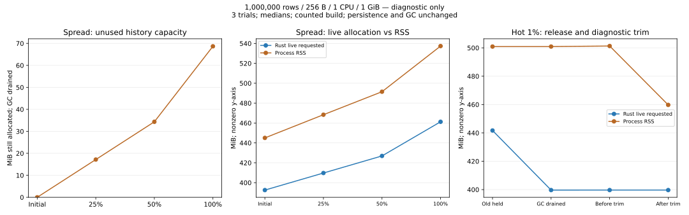
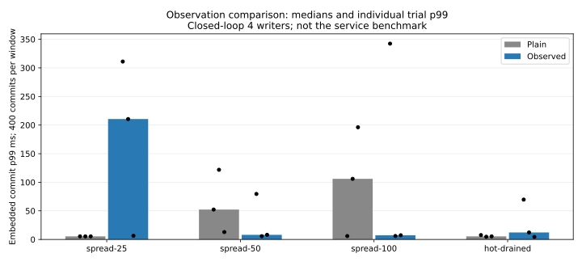

# History capacity after sustained aging

2026-11-06. Experimental diagnostic of the persistent Rust database in Linux/glibc
containers. Base commit `995ced3`; [source hashes](source-sha256.json),
[environment/image identity](raw/main/environment.json), and [all results](summary.json).
No production GC, allocation policy, resource default, WAL format or durability
guarantee was changed in this investigation.

## Findings and next decision

Two distinct forms of retained memory are demonstrated:

1. **Allocated but unused history slots.** With one million current records and
   GC drained, spreading updates to 25/50/100% of keys left approximately
   **17.166 / 34.342 / 68.676 MiB** of unused version-array capacity. Versions
   returned to exactly one million; the extra capacity did not. At full coverage,
   process RSS rose from **445.023 to 537.363 MiB**. Diagnostic trim reduced it
   only to **537.129 MiB**, leaving live requested bytes and version capacity intact.
2. **Freed memory not yet returned to the OS.** Updating the first 1% sixteen
   times with an old reader held produced 1,160,000 versions. After the reader
   released and GC completed, live requested bytes fell from **441.694 to
   399.647 MiB**, but RSS stayed at **500.914 MiB**. After the separate latency
   window, diagnostic `malloc_trim(0)` reduced RSS from **501.312 to 459.750 MiB**
   while live requested bytes stayed **399.654 MiB** and capacity stayed unchanged.

These are medians of three observed runs. The first issue requires changing
storage/retention of spare capacity; an allocator trim cannot free buffers the
database still owns. The second demonstrates releasable allocator-held pages,
but does not fully attribute the remaining RSS/live-allocation gap.

The next candidate is a representation that keeps a single latest version inline
and allocates a history buffer only while older versions must survive. A bounded
shrink-on-GC alternative can be compared with it. Neither is implemented here;
both need old-snapshot, conflict, recovery, accounting and update-p99 validation.
Automatic production trimming is not selected: its effect is allocator-specific,
and this diagnostic did not measure concurrent request latency during trim.



The left axis starts at zero; the two memory-comparison panels explicitly use
nonzero axes. Stage-specific values are process RSS and live requested bytes.

## Memory observations

| Pattern / stage | Versions | Capacity slots | Unused version MiB | Live requested MiB | RSS MiB | Logical retained MiB |
|:---|---:|---:|---:|---:|---:|---:|
| spread / initial | 1000000 | 1000000 | 0.000 | 392.551 | 445.023 | 503.540 |
| spread / spread-25 | 1000000 | 1750000 | 17.166 | 409.718 | 468.344 | 503.540 |
| spread / spread-50 | 1000000 | 2500432 | 34.342 | 426.894 | 491.477 | 503.540 |
| spread / spread-100 | 1000000 | 4000496 | 68.676 | 461.228 | 537.363 | 503.540 |
| spread / after-trim | 1000000 | 4000496 | 68.676 | 461.228 | 537.129 | 503.540 |
| hot / initial | 1000000 | 1000000 | 0.000 | 392.551 | 444.961 | 503.540 |
| hot / hot-held | 1160000 | 1310000 | 3.433 | 441.694 | 500.914 | 552.368 |
| hot / hot-released | 1159872 | 1310000 | 3.436 | 441.660 | 500.914 | 552.329 |
| hot / hot-drained | 1000000 | 1310000 | 7.095 | 399.647 | 500.914 | 503.540 |
| hot / before-trim | 1000000 | 1310288 | 7.102 | 399.654 | 501.312 | 503.540 |
| hot / after-trim | 1000000 | 1310288 | 7.102 | 399.654 | 459.750 | 503.540 |


`versions` is the actual version count; `capacity_slots` is the sum of deque
capacities. Unused bytes are `(capacity_slots - versions) * size_of(Version)`;
the observed Version size is 24 bytes. Live requested bytes count allocations
through Rust's global allocator, including harness overhead. They exclude malloc
rounding, allocator metadata and allocations not made through that allocator.
RSS is independently read from `/proc/self/status`. None of these is a substitute
for the logical retained-data budget, which remains **503.540 MiB** after GC even
as spare history storage grows.

The reader drop itself reclaims one bounded portion; `hot-released` therefore
already has 128 fewer versions. `hot-drained` is the subsequent full GC result.
Response-time probes rewrite four keys and can enlarge their histories further;
that small growth is included in later snapshots rather than subtracted away.

Whole-aging-container measurements are separate:

| Pattern | Observation | Container peak MiB | Process RSS peak MiB | File-cache peak MiB |
|:---|:---|---:|---:|---:|
| spread | off | 818.863 | 537.465 | 261.926 |
| spread | on | 820.023 | 537.367 | 261.926 |
| hot | off | 557.156 | 501.340 | 42.805 |
| hot | on | 556.887 | 501.312 | 42.828 |

These are medians of independent maxima, **not additive components at one instant**.
The cgroup includes the Python observer, kernel charges and file cache. Spread
aging writes enough WAL to charge roughly 262 MiB of file cache; equating its
container peak with heap usage would be incorrect. The cgroup stream is sampled
every 100 ms and is not precisely aligned to each internal snapshot; only the
whole-phase peak is reported here. Raw anon/file/kernel/swap and CPU-throttling
records remain available for every phase. No swap use was observed.

## Reopen and checkpoint evidence

Across both observation settings and three repetitions:

| Aged pattern | Reopen aged WAL at 512 MiB | Verify/checkpoint at 1 GiB | Reopen checkpoint at 512 MiB |
|:---|---:|---:|---:|
| Spread to all keys | 0/6 (OOM) | 6/6 | 6/6 |
| Hot 1% | 6/6 | 6/6 | 6/6 |

Each failure is retained in the raw results. The same owned fixture was verified
at 1 GiB before checkpointing, and verified again at 512 MiB afterward. Restart
without checkpoint did **not** restore the initial compact state for the spread
case. The hot case does not restore the held reader or all its in-memory history
on restart. This is not evidence that every million-row workload fits 512 MiB.
The experiment covers startup OOM and subsequent recovery, not physical power loss.

## Observation cost and timing limits



| Pattern / stage | Plain p99 ms | Observed p99 ms | Plain trial p99 ms | Observed trial p99 ms |
|:---|---:|---:|:---|:---|
| spread-25 | 5.394 | 210.533 | 5.433, 5.378, 5.394 | 311.098, 210.533, 6.397 |
| spread-50 | 52.307 | 8.119 | 52.307, 121.837, 12.913 | 79.584, 5.714, 8.119 |
| spread-100 | 106.014 | 7.349 | 5.913, 106.014, 196.202 | 342.414, 6.044, 7.349 |
| hot-drained | 5.396 | 12.206 | 7.637, 4.737, 5.396 | 69.703, 12.206, 4.462 |


The paired builds differ in allocation counters and explicit full-history scans.
The shared cgroup observer remains on in both. History scans are outside the
response-time windows, but scan work/cache effects and quota consumption can still
affect following work. The largest observed full-history scan was **49.533 ms**.
This opt-in method holds the state lock; it must not be added to request handling.

Commit-p99 differences are large and inconsistent across stages/trials. For
example, the spread-25 median was 5.394 ms plain versus 210.533 ms observed, while
the spread-100 medians went the other way. **Observation overhead is not established
as negligible or as a constant correction.** We do not attribute these tails
specifically to allocation counters, locks, CPU quotas or disk sync without
additional evidence. No service speedup or production regression is claimed:
these are 400-commit closed-loop embedded windows, not the previous fixed-arrival
network-service benchmark. The bounded study ends with that timing uncertainty.

Diagnostic trim ran only after the latency windows. Its median duration in the
observed build was 0.080 ms for spread and 2.857 ms for hot. The subsequent full
content checks passed. These durations do not establish a safe production cadence.

## Method, safety and reproduction

- Pilot: 100k rows, spread/hot, observation off/on; four cases. It established
  separable capacity/live/RSS measurements before the million-row runs.
- Main: 1M rows, 256-byte values, 8-byte ordered keys, 1 CPU / 1 GiB, 640-MiB logical
  retained-data budget, no swap, three rounds for each pattern/observation pair.
  Even rounds reverse pattern and observation order. No benchmark runs overlap.
- Seed creation uses 2 CPUs / 4 GiB outside measured phases. Host caches are warm
  and shared. Limits are asserted against Docker HostConfig, and cgroup memory,
  swap and CPU records are collected. This does not emulate a cold low-RAM PC.
- Spread state preparation updates 25%, then 50%, then 100% of keys in 1,000-row
  durable transactions, draining GC after each batch. Hot preparation updates 1%
  sixteen times while the original read snapshot is held. Preparation times are
  logged separately from response-time windows.
- Each window uses 1,000 point reads, then four writers with 100 one-key commits
  each. Writer keys 0..3 receive their already expected values. All key/value bytes
  and ordering are checked with bounded pages, including the held old generation.
- The phase runner has a 180-second limit; GC has a 60-second limit. Observation
  buffers are bounded by these run limits. Existing files are never overwritten
  during seed creation, and only newly owned containers/volumes are used/removed.

**142 full-content checks passed** across pilot, aging, old-generation,
reopen and rescue/checkpoint phases. Rust regression tests passed **144 tests**
(11 intentionally ignored); new tests cover empty/growing histories, stable
snapshots, non-mutating statistics, refusal and admission recovery. Clippy passed
with warnings denied. The new features are opt-in; the ordinary service does not
expose the diagnostic API or allocation counter. CI includes both platforms with
the diagnostic features enabled in addition to the existing configurations.

See [runner instructions](../../../benchmarks/resource-envelope/README.md#history-capacity-after-aging).
Generate this report after both datasets finish:

```sh
python benchmarks/resource-envelope/history_capacity_report.py --pilot artifacts/history-capacity-pilot --main artifacts/history-capacity-million --out docs/benchmarks/history-capacity-2026-11-06
```

All [raw measurements](raw), including OOM evidence, failed exits, the original
pilot runner and observer variability, are retained. The report checks snapshot
counts, spare-capacity arithmetic, logical charges, full-content markers, completion,
trim invariants, swap, and failure classification before plotting. These findings
are specific to the measured Linux/glibc environment; Windows, Android and Apple
allocator behavior remains unmeasured.
