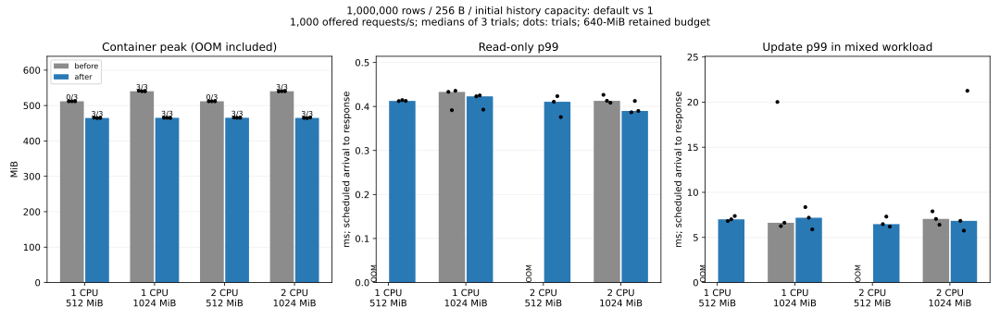

# One-slot initial history allocation

Date: 2026-11-06. Experimental, synthetic data only.
Baseline engine: `79b18f0` / `c460662`, image identity in [manifest](manifest.json).
Candidate engine source is identified by [normalized hashes](source-sha256.json)
and [the small production change plus tests](change.patch).

## Result and decision

The candidate initializes each new record's version deque with capacity one.
Previously, inserting the first version into an empty deque allocated four slots
in the measured Rust 1.89 build. The standalone layout investigation found
72,000,000 bytes (68.665 MiB) of unused version slots in one million records.
The production experiment measures real process/container memory, not just that
theoretical payload saving.

All twelve candidate million-row trials passed at 1/2 CPUs and 512/1024 MiB.
The six baseline 512-MiB trials failed with OOM, while its six 1-GiB trials passed.
Each OOM fixture was recovered and verified separately at 1 GiB. Both versions'
100k default-budget controls passed all three rounds.

For 1 CPU / 1 GiB, median container peak fell from **540.320 to
465.387 MiB**, a **74.934-MiB (13.9%)** reduction.
The candidate's smaller initial allocation is retained because it demonstrates
a repeatable capacity benefit. This is not a change to resource budgets,
transaction semantics, the WAL format or sync-before-success durability.
Latency results and individual trials are retained below; they do not establish
a universal throughput or tail-latency improvement.

Bars are medians of three trials, dots are individual trials. OOM cells have no
latency measurement. Peak-memory bars include failed startup; their labels show
passing trials, so 512 MiB at an OOM limit is not presented as useful consumption.

## All conditions

| Rows | CPU | MiB limit | Version | Passed | Peak MiB | RSS MiB | Read p99 ms | Update p99 ms | Mixed req/s | Reject % | Launch ms | Reopen ms |
|---:|---:|---:|:---|---:|---:|---:|---:|---:|---:|---:|---:|---:|
| 100000 | 1 | 512 | after | 3/3 | 65.695 | 48.078 | 0.394 | 5.773 | 1000.022 | 0.000 | 938.000 | 906.000 |
| 100000 | 1 | 512 | before | 3/3 | 73.086 | 55.570 | 0.416 | 6.859 | 1000.012 | 0.000 | 906.000 | 875.000 |
| 1000000 | 1 | 512 | after | 3/3 | 464.758 | 446.492 | 0.413 | 7.006 | 1000.026 | 0.000 | 1797.000 | 1703.000 |
| 1000000 | 1 | 512 | before | 0/3 | 512.000 | — | — | — | — | — | — | — |
| 1000000 | 1 | 1024 | after | 3/3 | 465.387 | 446.500 | 0.423 | 7.185 | 1000.020 | 0.000 | 1719.000 | 1719.000 |
| 1000000 | 1 | 1024 | before | 3/3 | 540.320 | 521.664 | 0.433 | 6.623 | 1000.018 | 0.000 | 1765.000 | 1750.000 |
| 1000000 | 2 | 512 | after | 3/3 | 465.449 | 446.531 | 0.411 | 6.469 | 1000.006 | 0.000 | 1750.000 | 1641.000 |
| 1000000 | 2 | 512 | before | 0/3 | 512.000 | — | — | — | — | — | — | — |
| 1000000 | 2 | 1024 | after | 3/3 | 464.898 | 446.504 | 0.390 | 6.835 | 1000.024 | 0.000 | 1640.000 | 1703.000 |
| 1000000 | 2 | 1024 | before | 3/3 | 540.441 | 521.648 | 0.413 | 7.050 | 1000.022 | 0.000 | 1734.000 | 1703.000 |

Read p99 is from the four-connection read-only workload. Update p99 includes
only successful write requests in the mixed workload (one reader, four writers),
measured from scheduled arrival through response. It is not the mixed-request
p99 and not server-only processing time. Mixed req/s includes reads and writes.
Launch/reopen times include Docker orchestration. Failure has no valid workload
latency or launch time. Raw per-trial maximum latency and CPU throttling are also
included in [summary](summary.json).

Direct update-latency comparisons at the common 1-GiB limit:

- 1 CPU / 1 GiB: update p99 median 6.623 -> 7.185 ms (+8.5%). Individual trial p99: before 20.013, 6.251, 6.623; after 8.358, 7.185, 5.891 ms.
- 2 CPU / 1 GiB: update p99 median 7.050 -> 6.835 ms (-3.1%). Individual trial p99: before 7.889, 7.050, 6.399; after 6.835, 5.750, 21.250 ms.

Positive percentages mean a worse median. Three trials and variable sync latency
do not establish causality for these differences. The adoption decision is based
on the repeatable memory/capacity gain, not an assertion that all latency metrics
improve. Any higher update-p99 median is part of the reported tradeoff.

## What this does not solve

The workload issues 8,000 requests at 1,000/s, with 80% reads and 20% writes in
the mixed case: 1,600 distinct keys are updated while an old snapshot is held.
This verifies expansion from the initially compact state, not steady-state memory
after updating every record. Growing history deques still retain capacity after
GC. A long-lived old reader can still require substantial memory. Therefore,
**this does not guarantee that a million-row database will always fit in 512 MiB**.

Only initial capacity changed. Shrinking grown deques, embedding a single latest
version, and reducing tree-node costs remain separate design candidates. Logical
retained-data accounting is unchanged and must not be interpreted as an RSS cap.
Allocator rounding/retention and the observer also affect measured RSS/cgroup
memory; the observed reduction need not equal the 68.665-MiB slot calculation.

## Reproduction and measurement limits

The million-row runs explicitly allow 640 MiB of logical retained data; the
100k controls retain the original 128-MiB default. Values are 256 bytes and keys
are ordered 8-byte values. Each round executes versions sequentially, with
before/after, after/before, before/after ordering. Each invocation uses the same
shuffled four-cell order and read-then-mixed order. There are no overlapping
benchmark runs. Images, source hashes, commands and execution order are recorded
in the manifest. The baseline image was preserved from the preceding experiment.

The bounded client queue holds 64 requests per kind; no retries hide refusal.
Swap is disabled. CPU quotas are not core pinning. The client has a separate
2-CPU/2-GiB container. Seed creation is outside the measured cap, host caches are
warm/shared, and the server observer samples every 100 ms. This follow-up does
not independently re-estimate observer cost or establish maximum throughput.
See the [original method](../resource-envelope-2026-11-06/README.md) and
[configuration follow-up](../resource-config-2026-11-06/README.md).

Reproduce with [the paired runner instructions](../../../benchmarks/resource-envelope/README.md#initial-history-capacity-comparison).
All [raw trials](raw), including failures and rescue logs, are retained.

## Correctness and regression checks

Across the passing workloads, **384,000 requests completed**,
with **0 queue refusals** and **0 processing errors**.
All **102 full-content checks** passed, including OOM rescues.
Passing fixtures verify initial content, content after both workloads, pinned
old-generation values for updated keys, and content after deliberate process
termination and reopening. This is process/OOM recovery, not physical power-loss
testing. Recovery never silently changes a failed cell into a passing one.

The local Rust suite passed 142 tests (11 intentionally ignored); Windows and
Linux service protocol suites each passed 23 tests, the C ABI suite passed 35,
and the workload-oracle suite passed 5. Clippy passed with warnings denied.
New tests cover snapshots through 1/2/4/8-history boundaries, concentrated updates,
delete/reinsert, checkpoint/reopen, budget refusal before WAL mutation, and
capacity reuse after old readers release. Existing same-key/point/range conflict,
save failure, sync-before-publication and crash-recovery suites remain enabled.
The change to initial capacity does not remove any durability or conflict checks.
