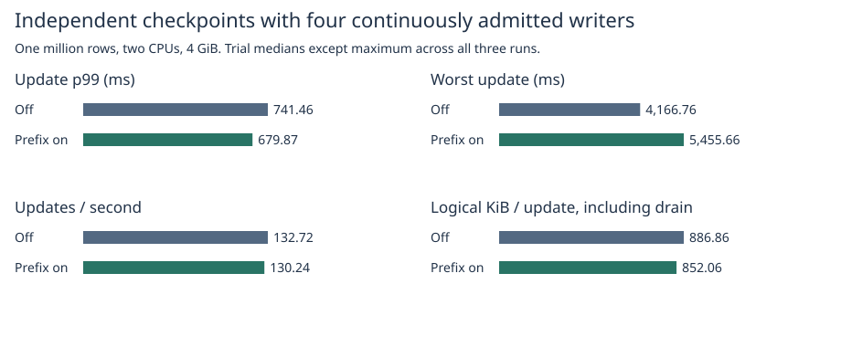
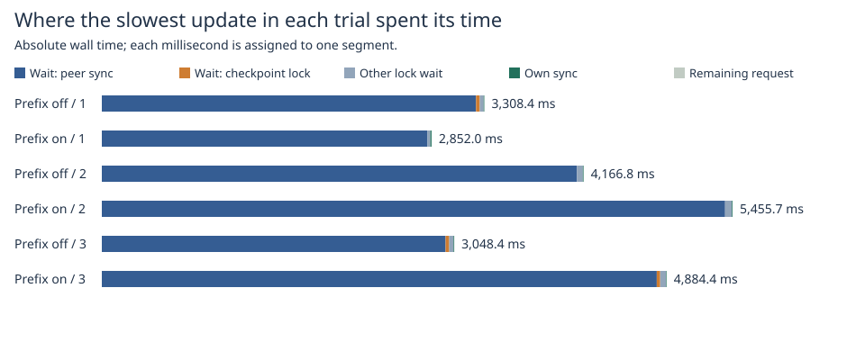

# Independent checkpoint scheduling under four continuous writers

The previous driver gated writers at every scheduled checkpoint. This driver admits the next transaction immediately on each of four closed-loop connections. A separate thread requests real production WAL checkpoints. Requests can stage writes throughout the scan and final publication; commits still need the engine's writer lock. The experiment changes scheduling and instrumentation in the **test driver**. The database default is unchanged.

## Matched workload

| Metric | Prefix off | Prefix on |
|---|---:|---:|
| Update p99 (ms) | 741.46 | 679.87 |
| Slowest update across all trials (ms) | 4,166.76 | 5,455.66 |
| Updates/s through last response | 132.72 | 130.24 |
| Updates/s including final maintenance drain | 132.72 | 130.24 |
| Logical writes including drain (MiB) | 14,189.72 | 13,633.00 |
| Logical KiB per update | 886.86 | 852.06 |
| MiB per actual publication | 272.60 | 272.66 |
| Completed checkpoints per trial | 44–55 | 42–58 |
| Coalesced of 63 triggers per trial | 8–19 | 5–21 |

With independent admission, prefix preparation changed median update p99 by **-8.3%**, throughput by **-1.9%**, and worst latency by **+30.9%**. Between 13 and 18 requests per trial began during the final publication writer-lock hold. Logical writes per publication were almost identical; the difference in total bytes includes the different number of actual publications.

Each mode used one million seeded rows, 256-byte values, two CPUs, 4 GiB without swap, four writers and 16,384 updates. Three trials per mode alternated order. Timings cover receipt through completion including retries. The table uses medians of per-trial statistics, except the worst update across all trials. Writes count actual appended frames and completed replacement files including their 48-byte header rewrite. The copied WAL tail and prefix are already included. They are logical file writes, not device traffic. [All trials including actual admissions and final drain](trials.csv).

The worker is triggered every 256 commits up to commit 16,128. While it is busy, triggers accumulate; on its next pass it publishes through the latest available trigger. The enabled arm starts each 2,048-chunk prefix before receiving that trigger. The worker finishes through trigger 63 in every run. Consecutive triggers can share a publication; extra triggers never turn into a series of duplicate checkpoints after writers stop. Thus each mode runs the same updates and trigger policy but may do a different number of full-file rewrites. Totals include any checkpoint that completes after the final response. The earlier fixed-count benchmark and these totals have different measurement windows.

## Reconstructing the previous 3.44-second request

The previous prefix-on trial 1 maximum was request 10119, lane 3, with 0 retries. From its start to checkpoint 42 took 7.662 ms, the checkpoint lasted 2299.969 ms, and 1131.986 ms elapsed after that checkpoint before the response. **49 other updates completed in the final interval.** The old capture does not have lock or sync timestamps for this request. The split is a wall-clock overlap, not proof that the whole checkpoint interval was spent waiting on any one mutex or on a physical device. [Original request and checkpoint timestamps](../native-prefix-2026-11-07/raw/1-prefix-on.log.gz).

## What the new long requests actually waited for

| Mode / trial | Worst (ms) | Writer-lock wait (ms) | Of lock wait: checkpoint hold (ms) | Of lock wait: peer WAL sync (ms) | Peer sync intervals | Own WAL sync (ms) |
|---|---:|---:|---:|---:|---:|---:|
| off / 1 | 3,308.35 | 3,302.36 | 32.46 | 3,236.93 | 487 | 5.79 |
| on / 1 | 2,852.05 | 2,841.83 | 0.00 | 2,817.42 | 296 | 10.13 |
| on / 2 | 5,455.66 | 5,449.24 | 0.00 | 5,391.22 | 895 | 6.29 |
| off / 2 | 4,166.76 | 4,160.48 | 0.00 | 4,110.00 | 668 | 6.19 |
| off / 3 | 3,048.44 | 3,042.18 | 31.63 | 2,973.16 | 444 | 6.04 |
| on / 3 | 4,884.40 | 4,879.09 | 29.61 | 4,800.17 | 703 | 5.15 |

Other writers' WAL sync intervals alone covered more than half of the slowest request in 6/6 trials and of the actual p99 request in 6/6 trials. The overall maximum (prefix on, trial 2) spent 5,449.24 ms waiting to acquire the writer lock. It intersected 895 peer sync intervals totalling 5,391.22 ms; the largest individual intersection was 15.88 ms. The measured final-publication writer-lock hold covered 0.00 ms of this wait. These measurements can identify repeated peer progress while a particular writer waits. They cannot distinguish mutex wake policy from OS scheduling for that waiting thread.

The two overlap columns partition part of the writer-lock wait; adding them to the lock-wait total would double-count time. Sync intervals measure elapsed time around the actual sync call and can include rescheduling. The short initial snapshot lock and any scheduling delay on lock acquisition are not individually resolved. The remainder of lock wait, transaction staging, gaps between attempts, and other commit time are reported separately. A whole-checkpoint overlap can also include time when ordinary writers own the lock. All six runs use the same test-only timestamps; the timing overhead has not been subtracted. [Per-request accounting for p99 and maximum](request-phases.csv), [checkpoint phase lengths and concurrent requests](checkpoints.csv).

The controlled test commits a write while the snapshot is being prepared, then starts another transaction and stages its value while final publication holds the writer lock. It verifies the old snapshot and reopens at the expected generation with both acknowledged values. Each long run also compares the entire current and old views and the reopened database against the commit-order oracle. [Focused test](raw/focused.txt), [release suite](raw/final-tests.txt), [raw request traces](raw/).

## Reproduction

~~~sh
docker build -f benchmarks/scaled-gate/Dockerfile -t catdb-independent .
python benchmarks/scaled-gate/run_independent.py --pilot pilot
python benchmarks/scaled-gate/run_independent.py raw
python benchmarks/scaled-gate/report_independent.py raw report
~~~

The reporter also reads the compressed traces published here. [Measured source](https://github.com/dhq-boiler/catdb/tree/aad0990102f93facbb02c52960ad6866980a8557).
