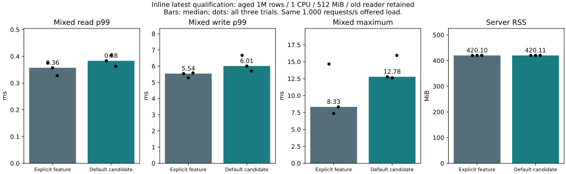

# Inline latest default qualification (2026-11-06)

## Decision

This change enables `inline-latest` in Cargo's default features, subject to the
Windows/Linux CI gate before merging to the default branch. This selects the already tested implementation; it does not change
transaction logic, the C ABI, service protocol, WAL/checkpoint formats, or durability.
`skip-unneeded-history`, diagnostics and fixed-length logging remain opt-in.
The normal embedded build, service build and production Dockerfile inherit this choice.
The project remains **Experimental**.

This is a memory-capacity decision, **not a speedup claim**. The prior 1-GiB
comparison measured about 22% less RSS than deque, and deque failed to start at
512 MiB. Here both the previously explicit feature and the new default completed
all three 512-MiB trials with an old reader retained throughout each workload.
No OOM, timed operation error or queue refusal occurred.

The default candidate was slower in this small comparison: mixed write p99
median **5.540 → 6.008 ms (+8.5%)**. All three candidate write p99s
were above all three explicit-feature trials. The worst mixed response across
all trials was **14.657 → 15.935 ms**; median per-trial maxima were
**8.329 → 12.781 ms**. Do not hide these regressions or label them proven noise.
The experiment does not isolate their cause. No request was refused and the
fixed offered load was sustained. We accept this observed sub-millisecond p99
increase for the default memory layout, retain the deque escape hatch, and make
no latency SLO or peak-throughput claim. The earlier 19.482-ms event remains
unexplained; default adoption does not establish that it has been fixed.



| Trial | Mixed read p99 ms | Write p99 ms | Mixed max ms | Requests/s | Queue refusals | RSS MiB | Cgroup MiB | Reopen ms |
|---|---:|---:|---:|---:|---:|---:|---:|---:|
| main-1-explicit | 0.375 | 5.540 | 14.657 | 1000.050 | 0.000 | 419.879 | 431.656 | 2517.132 |
| main-1-default | 0.383 | 6.663 | 12.781 | 1000.010 | 0.000 | 420.133 | 429.930 | 2617.475 |
| main-2-default | 0.403 | 6.008 | 12.616 | 1000.020 | 0.000 | 420.113 | 430.023 | 2416.517 |
| main-2-explicit | 0.357 | 5.280 | 7.356 | 1000.011 | 0.000 | 420.148 | 430.656 | 2516.600 |
| main-3-explicit | 0.328 | 5.580 | 8.329 | 1000.039 | 0.000 | 420.102 | 429.828 | 2617.185 |
| main-3-default | 0.363 | 5.696 | 15.935 | 1000.037 | 0.000 | 420.098 | 429.320 | 2617.492 |


Bars show medians; dots show every trial. Maximum latency is evaluated across
individual requests, not inferred by adding unrelated phase percentiles.

## Conditions and limits

- 1,000,000 rows, 8-byte keys, 256-byte values; every row updated once before boot.
- Same deterministic aged WAL in every trial; no checkpoint after seed aging.
- 1 CPU quota, 512 MiB service-cgroup limit, no swap. Client: 2 CPUs / 2 GiB;
  seed preparation: 2 CPUs / 4 GiB. Docker Desktop Linux containers on the same host.
- 8,000 read-only requests followed by 8,000 mixed requests, each at 1,000/s;
  mixed traffic is 80% reads / 20% writes, handled by 1 read and 4 write workers.
  The four write workers do not mean 80% write traffic.
- Old snapshot retained throughout each phase, verified for every successfully
  updated key (1,600 per mixed trial). Separate safety probe retains a snapshot
  over eight generations, checks refused staged data, rollback and later commit.
- Finite queue of 64 per kind. Staged budget 4,096 bytes, retained budget
  671,088,640 bytes. That engine budget is not a hard process-memory ceiling;
  a different workload can still exhaust the 512-MiB cgroup.
- Three alternating pairs: explicit/default, default/explicit, explicit/default.
  No timing/allocation diagnostic feature. OS resources sampled by the existing
  supervisor; both variants have the same observer. No new observer-overhead
  comparison was made here.
- Each phase is about eight seconds. This is not a long-duration qualification,
  a cold-machine test, arbitrary-value-size guarantee, or a maximum throughput test.
  Shared filesystem cache may be charged outside the service cgroup. **512 MiB
  here is not the memory budget of the entire machine.**

## Safety and compatibility gates

- 96,000 timed requests; 30 full-content service checks plus six full seed checks.
- Old generations checked through all 9,600 mixed updates and 48 safety-probe updates.
- Each trial kills the server process without graceful close, restarts under the
  same 512-MiB limit, and verifies every acknowledged value.
- Existing Rust tests cover point/range/group conflicts, old generations,
  memory-budget refusal/recovery, read visibility before durable sync,
  partial writes, sync/save failures and process termination around publication.
- Local Linux verification passed 143 Rust tests (11 existing benchmark/helper
  cases ignored), 35 C ABI tests and 23 real-service protocol tests. Fallback
  verification passed 152 Rust tests (13 existing benchmark/helper cases ignored).
- `tests/storage_transition.py` alternates deque/default and default/deque in
  separate processes, verifies empty keys/values, missing/deleted/re-added keys,
  256-KiB values and every record after WAL and checkpoint exchange. Both directions
  are covered (eight full-content checks). No conversion is required.
- CI retains Windows/Linux default-feature matrices and adds explicit
  `--no-default-features` fallback configurations. Both OSes run cross-layout file checks.
- Process termination and injected errors do not establish physical power-loss safety.

See [validation logs](validation/) for local results and the commit's GitHub CI
for Windows/Linux results. All compatibility tests are synthetic and disposable;
no PALV library or `Z:\A` data was used.

## Build and rollback

```sh
# New defaults: inline latest for the embedded library and service.
cargo build --locked --release --lib
cargo build --locked --release --features service --bin catdb-server

# Explicit fallback to deque; the existing file can be reopened without conversion.
cargo build --locked --release --no-default-features --lib
cargo build --locked --release --no-default-features --features service --bin catdb-server
```

For a Rust dependency, use `default-features = false` to request deque. Cargo
feature unification still applies: another dependency enabling `inline-latest`
can enable it for the shared build. Check the resolved feature set when rolling back.
Do not add `skip-unneeded-history` or `retirement-timing` to a deque build; those
features depend on `inline-latest`.

## Reproduce

```sh
# Equivalent explicit-feature build with defaults disabled.
docker build -f benchmarks/Dockerfile --build-arg CARGO_FEATURE_FLAGS=--no-default-features --build-arg EXTRA_FEATURES=,inline-latest -t catdb-inline-default:explicit .
# Candidate uses ordinary defaults.
docker build -f benchmarks/Dockerfile -t catdb-inline-default:default .
python benchmarks/inline-default/run.py --out artifacts/inline-default-repeat/raw
python benchmarks/inline-default/report.py artifacts/inline-default-repeat
```

The recorded explicit image was reused from `catdb-aged-tail:inline` built for
the previous report. Its recorded hashes for the transaction engine, group commit,
service, workload runner, client and seed generation match this experiment.
The parent revision of this change is `8ae48a08f8438be2612a6670a8c88b59750eea9a`.
Image IDs and host settings are retained in each `environment.json`. Source
hashes and the exact measurement runner are in `raw/`; the final runner only adds
OOM/memory metadata to its schedule. Native engine source is unchanged.
Historical benchmark instructions that expect a deque baseline now need
`CARGO_FEATURE_FLAGS=--no-default-features`, or their original source revision.
The reported historical results are not rewritten as new measurements.

[Machine-readable summary](summary.json), [all trials](table.md), [raw records](raw/).
