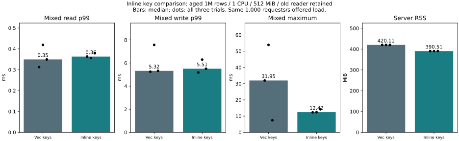
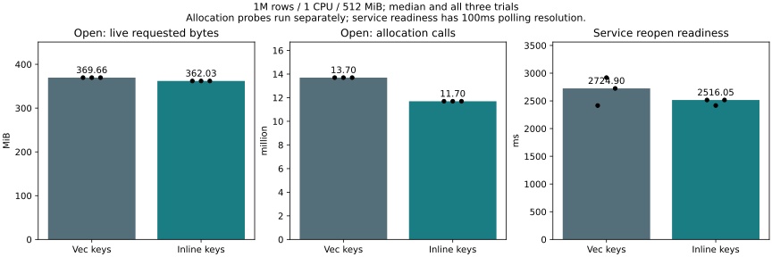

# Inline short index keys — 2026-11-07

**Memory reduction reproduced; latency did not uniformly improve. Keep the feature
optional and the default unchanged.** Only in-memory primary-index keys change.
Keys up to 15 bytes live inside the key object; longer keys use an owned byte box.
Comparison and borrowed lookup use byte order, preserving prefixes and zero bytes.
The layout test requires the key object to fit within the original Vec header.
No unsafe representation code, WAL/checkpoint change, API change or weaker sync.

| Median of 3 trials | Vec keys | Inline keys |
|---|---:|---:|
| Mixed service RSS MiB | 420.105 | 390.508 |
| Mixed read p99 ms | 0.349 | 0.363 |
| Update p99 ms | 5.321 | 5.507 |
| Service reopen readiness ms | 2724.903 | 2516.045 |
| Separate open probe: live requested MiB | 369.662 | 362.032 |
| Separate open probe: allocation calls | 13,700,674 | 11,700,674 |

RSS fell **7.0%** in the median and in every paired trial. Retained requested bytes
fell by exactly 8,000,000 bytes; open allocation calls fell by 2,000,000 for the
same two-generation million-row WAL. These are different quantities: malloc size
classes/metadata and retained pages can make RSS savings exceed requested bytes.
We did not separately attribute every RSS byte to an allocator mechanism.

Median read p99 worsened **3.9%**, update p99 **3.5%**. Worst mixed response across
all trials was 53.893 ms baseline vs 14.182 ms candidate, but the third pair went
in the opposite direction (7.404 vs 14.182 ms). No stable tail bound or universal
speedup is claimed. Reopen readiness fell 7.7%, with 100ms polling resolution;
this is service process readiness, not a precise engine-only recovery timer.

| Trial | Mixed read p99 ms | Write p99 ms | Mixed max ms | Requests/s | Queue refusals | RSS MiB | Cgroup MiB | Reopen ms |
|---|---:|---:|---:|---:|---:|---:|---:|---:|
| main-1-baseline | 0.313 | 5.253 | 31.949 | 1000.039 | 0.000 | 420.121 | 429.684 | 2415.347 |
| main-1-inline | 0.363 | 5.180 | 12.309 | 1000.046 | 0.000 | 390.508 | 400.043 | 2516.045 |
| main-2-inline | 0.356 | 6.294 | 12.425 | 1000.043 | 0.000 | 390.438 | 401.016 | 2416.233 |
| main-2-baseline | 0.419 | 7.569 | 53.893 | 1000.012 | 0.000 | 420.105 | 430.379 | 2919.487 |
| main-3-baseline | 0.349 | 5.321 | 7.404 | 1000.034 | 0.000 | 420.000 | 428.992 | 2724.903 |
| main-3-inline | 0.379 | 5.507 | 14.182 | 1000.040 | 0.000 | 390.531 | 400.617 | 2516.148 |

## Conditions

Same source/toolchain/dependencies, regular durable WAL, default inline-latest in
both builds; only candidate adds inline-key. 1M aged rows, 8-byte keys, 256-byte
values, one CPU /512MiB cgroup, swap disabled, Docker volumes. 8000 read-only then
8000 mixed requests per trial; old reader held, one read +four write workers,
1000 scheduled arrivals/s, 80% reads/20% writes. Order alternates over three pairs.
Logical retained budget 640MiB and staged budget 4KiB remain unchanged in both.
They are logical accounting limits, not process RSS limits. Latency includes planned
arrival and client queueing. Fixed offered throughput is not maximum capacity.

The allocation probe runs separately with allocator counters; the service binary
has none. It seeds two generations outside the limit at 2CPU/2GiB, then opens and
verifies every value at 1CPU/512MiB, three alternating pairs. For 100k **32-byte keys**,
both variants held 41,162,662 requested bytes and used 1,370,076 allocation calls.
Median instrumented engine-open duration was 196.159 vs 201.487ms (candidate 2.7%
slower). The 1M short-key instrumented open medians were 2812.470 vs 2436.113ms.
Those timings include allocation instrumentation, are distinct from service
readiness, and are not long-key service p99 measurements.

All timed service runs had zero queue refusals, operation errors and OOM kills.
RSS excludes the external client and host cache. Seed creation warms caches;
this does not emulate a cold 512MiB whole machine. Host activity is not fully
controlled. Short status commands ran during tests; allocation probes, build and
Rust/API suites did not overlap service performance workloads.

## Safety and validation

- 96,000 service requests; 30 full-content checks; six matching seed hashes;
  six budget-refusal/rollback probes; old-generation checks for 9600 successful
  updates; six forced-stop/full-reopen checks.
- 12 allocation/long-key diagnostic runs each verified every value. Candidate-written
  files with 8/32-byte keys were also reopened and verified by the baseline binary.
- Rust candidate full suite: 147 passed, 11 ignored explicit benchmarks/helpers;
  baseline library: 63 passed, 9 ignored. Measured-image service protocol:23 passed;
  measured-library C ABI suites:30 passed. New cases cover empty/14/15/16/17/max
  length, shared prefixes and arbitrary bytes, old generations, delete/reinsert,
  point/range conflicts, checkpoint/reopen and layout. Existing suites cover sync
  failure, budget recovery, sync-before-publication and child-process crashes.
- Initial default parallel unit invocation failed an existing panic/fork file-lock
  test (60 passed/1 failed/9 ignored). Existing CI explicitly requires serial tests;
  serial runs passed. No assertion was weakened.
- Initial benchmark setup failed seed verification before timing because the image
  retained the base's old embedded library. Matching library/server/harness fixed
  this; a subsequent 1000-row smoke passed before the six main trials. One image
  build also failed due excluded benchmark files; an explicit context allowlist
  fixed it. A formatter first required installing rustfmt. These setup failures
  are not performance samples; local logs are retained.
- Windows/Linux CI now includes inline-key with history metrics. Its final status
  is reported by Actions. No physical power-cut test was performed.

## Reproduce and evidence

[Benchmark sources and scope](../../../benchmarks/inline-key/README.md).
Build baseline with `docker build -f benchmarks/inline-key/Dockerfile -t catdb-inline-key:baseline .`
and candidate with the same command plus `--build-arg EXTRA_FEATURES=,inline-key`
and tag `catdb-inline-key:inline`. Use Rust1.89 and locked dependencies.
Run `python benchmarks/inline-key/run.py --out artifacts/inline-key-new/raw`,
then `python benchmarks/inline-key/report.py artifacts/inline-key-new`.
After performance runs, run `python benchmarks/inline-key/diagnose.py --out artifacts/inline-key-alloc-new`.

[Summary](summary.json), [allocation results](allocations.json), and compressed
per-trial request timings retain all measured outcomes. Published requests include
only numeric IDs/times, operation kind and outcome; no keys/values, credentials,
internal paths or full environment logs. Full raw logs remain local for the report's
validation. Defaults and conservative retained-budget charges are unchanged.
Enable the prototype explicitly with Cargo feature `inline-key`; production
adoption is a separate decision, especially given the latency and long-key results.
