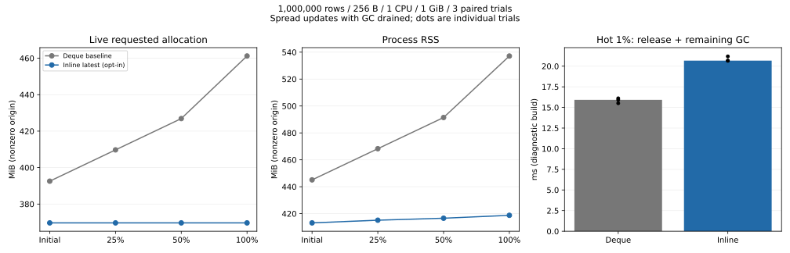
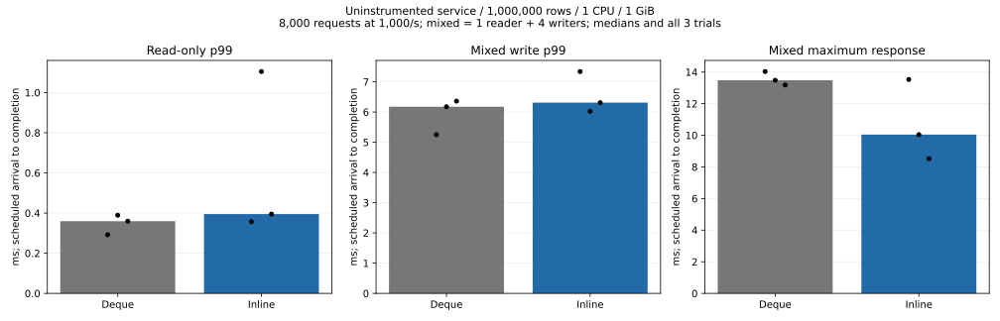

# Inline latest version, optional heap history

2026-11-06. Experimental opt-in `inline-latest`, based on `36e1d6d`.
The default deque implementation remains available and unchanged in configuration.
Both variants use the same source revision; the Cargo feature selects the layout.

## Results and decision

**Memory improved; overall speed did not consistently improve. Keep `inline-latest`
opt-in and retain the default deque implementation.**

| Median of 3 trials | Deque baseline | Inline latest |
|:--|--:|--:|
| Full-spread live requested allocation, MiB | 461.225 | 369.663 |
| Full-spread RSS, MiB | 537.137 | 418.758 |
| Hot-reader release + remaining GC calls, ms | 15.921 | 20.674 |
| Uninstrumented service read-only p99, ms | 0.360 | 0.395 |
| Uninstrumented service mixed write p99, ms | 6.174 | 6.309 |
| Median trial maximum mixed response, ms | 13.481 | 10.040 |

Full-spread RSS fell **22.0%**, and live requested allocation fell
**19.9%**. At 25/50/100% coverage the candidate has **zero heap
history bytes after GC**, rather than retaining expanded version buffers.
This is a structural reduction, not merely allocator trimming.

In the hot-history workload, release + remaining GC increased
**29.9%**. This is the sum of time inside those
calls, excluding the diagnostic scan between them, not end-to-end wall time
from reader release until the final observation. Releasing empty history buffers
adds work; this experiment does not uniquely attribute all latency differences
to allocation or deallocation.



For the fully aged spread WAL, 512-MiB reopen passed **0/3 baseline vs 3/3
candidate**. Baseline failures were confirmed OOM kills. Hot-pattern reopens
passed 3/3 in both, and all twelve post-checkpoint 512-MiB reopens passed.
Reopen stages verify contents without user updates; checkpointing is a separate
explicit stage. Failed runs remain failures. All successful reopens verify every
key/value.



All **96,000 service requests** completed with
**0 queue refusals and 0 errors**.
Throughput stays near the offered 1,000 requests/s; no higher saturation
throughput is established. All **141 full-content checks**
passed across memory and service main trials, including old generations and
service restart after process kill. The 100k-row smoke trial also passed both
patterns, outside these totals.

See [all memory stages](memory-table.md), [every service trial](service-table.md)
and [machine-readable summary](summary.json). Trial maxima are noisy; three
runs do not establish a reliable tail bound. No uniform latency win is claimed.

The next decision is whether history creation can be skipped **when no live
snapshot needs the previous version**, or whether bounded reuse offers a better
tradeoff. Neither optimization is implemented here; skipping history would
require renewed snapshot/conflict/accounting tests. Default adoption, platform
validation and product rollout remain separate from this completed experiment.

## Change and safety

The latest `Version` is stored inside the B-tree value. Older versions use an
optional boxed deque; GC detaches the empty deque and frees it outside the state
lock, before releasing the existing logical retained-memory charge. The 64-bit
tree value is **32 bytes in both variants**. Every new history incurs two heap
allocations (the deque header and its initial buffer); this can cost more during
repeated updates than reusing the baseline's spare capacity.

Snapshots, tombstones, conflict checks, WAL encoding, acknowledgement after sync,
C ABI and service protocol are unchanged. Budgets remain conservative logical
charges, not exact heap/RSS limits; the new diagnostic counts heap history
separately. `capacity_slots` includes the inline slot, so multiplying all slots
by `version_size` no longer means heap bytes in the candidate.

## Method

- Linux/glibc Docker Desktop, 1 CPU, 1 GiB, swap disabled, 1,000,000 ordered
  8-byte keys and 256-byte values. Seed creation uses 2 CPUs / 4 GiB outside
  measured work. Engine retained budget is 640 MiB in both variants.
- Three outer rounds: before/after, after/before, before/after. Each memory
  trial covers spread updates at 25/50/100% with GC drained, then a separate DB
  with sixteen updates to the first 1% while retaining an old reader.
- Counted diagnostic builds measure live requested allocations, history heap,
  RSS and explicit GC. A shared 100-ms OS sampler records cgroup usage, cache,
  swap, OOM and CPU throttling. No assertion of negligible observation cost.
- Aged WAL reopens at 512 MiB are attempted without changing data. OOM counts
  as failure, not success. A separate 1-GiB reopen verifies contents and creates
  a checkpoint; another 512-MiB reopen verifies the compacted store.
- Separate **uninstrumented service binaries** (no allocation/history metrics)
  use fresh seeds: 8,000 read-only requests and 8,000 mixed requests per trial,
  1,000 scheduled requests/s. Mixed uses 1 reader + 4 writers, 80% reads / 20%
  writes. Latencies include scheduled-arrival and client queue time. The common
  OS sampler remains on. Throughput here is arrival-rate-limited, not capacity.
- The memory probe's embedded latency samples remain in raw data, but are not
  used for service speed claims. The service trial does not establish p99 after
  full-keyspace aging. Diagnostic `malloc_trim(0)` is never production policy.

All per-phase environments, image IDs, commands, limits, samples and results
are in [raw](raw/). Outer-round order is in [schedule.json](raw/schedule.json).
Individual memory runner repetition IDs restart at 1; use the parent directory
and schedule for the actual paired round.

## Reproduce

```sh
python benchmarks/resource-envelope/inline_latest_run.py --out artifacts/inline-latest/raw
python benchmarks/resource-envelope/inline_latest_report.py --input artifacts/inline-latest
```

The runner builds baseline/candidate images, runs service and FFI checks, then
runs the twelve memory cases and six service cases sequentially. It creates
unique disposable Docker volumes and networks. Results directories must be new.
The report also accepts gzip-compressed raw files.

Build the experimental service with `cargo build --release --features service,inline-latest`.
Omit `inline-latest` for the default implementation. The benchmark Dockerfiles
accept `--build-arg EXTRA_FEATURES=,inline-latest`; the production Dockerfile's
default has not been changed.

## Verification and limits

Windows Rust suites: candidate 146 passed / 11 ignored; baseline 144 passed /
11 ignored. Clippy passed for both. Linux candidate
service protocol: 23 passed; C ABI: 35 passed. Dedicated assertions cover
repeated history growth/release, old readers, delete, no larger tree value,
budget refusal/recovery and retaining charges through detached-buffer release.
Existing tests cover reinsert, point/range conflicts, checkpoint, failed saves
and child-process crashes. CI additionally exercises both platforms, diagnostic
and fixed-log candidate configurations.

Process-crash tests do not simulate actual power loss. This experiment does not
establish behavior on Windows allocators, ARM/mobile targets, long-lived large
histories or sustained CPU-bound updates. RSS includes allocator retention;
cgroup memory also includes file cache and the observer. Never equate these
with requested allocations or the engine's logical budget.
