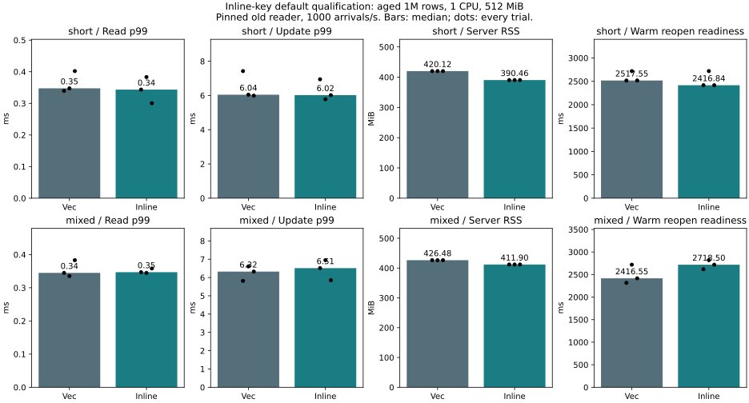

# Inline-key default qualification — 2026-11-07

**Adopted for memory efficiency.** `inline-key` joins `inline-latest` in the default
feature set. The pre-agreed numerical gate passed in both key shapes, with safety,
API compatibility and rollback checks passing. This is not a universal latency or
recovery-speed improvement, and SilverHamu remains Experimental.

| Median of three trials | Short Vec | Short inline | Mixed Vec | Mixed inline |
|---|---:|---:|---:|---:|
| Server RSS MiB | 420.121 | 390.465 | 426.484 | 411.902 |
| Mixed-load read p99 ms | 0.347523 | 0.343479 | 0.344863 | 0.346930 |
| Update p99 ms | 6.044361 | 6.018591 | 6.324196 | 6.513501 |
| Read-only p99 ms | 0.361219 | 0.330203 | 0.372321 | 0.357591 |
| Warm reopen readiness ms | 2517.546 | 2416.844 | 2416.549 | 2718.498 |
| Queue refusals / OOM | 0 / 0 | 0 / 0 | 0 / 0 | 0 / 0 |

Short-key RSS falls **7.06%**, exceeding the agreed 5% reduction. Short-key read and
update p99 change **-1.16% / -0.43%**. Mixed-key RSS falls **3.42%**, while mixed-key
read and update p99 worsen **0.60% / 2.99%**, within the agreed 5% tolerance.
This tolerance is an operational adoption decision, not statistical significance.

Mixed-key reopening worsens **12.50% (about 302 ms)** in the median; all three
paired reopen observations are slower. Readiness polling has 100-ms resolution,
so these are not precise engine recovery durations. We accept that observed cost
for lower working memory, rather than describing adoption as an overall speedup.
No tighter reopen SLA was part of this gate. Workloads needing one should retain
the explicit Vec-key configuration below and evaluate their own recovery budget.

Worst mixed request across all trials changes **20.256 → 13.825 ms** for short keys
and **13.660 → 13.173 ms** for mixed keys. Individual paired maxima can worsen:
short trial 1 is 13.799 → 13.825 ms and mixed trial 1 is 8.335 → 9.749 ms.
These observations do not establish a tail guarantee. Two of three mixed-key
update-p99 pairs worsen; the median criterion passes, not every individual pair.



[Every trial](table.md), [decision inputs](decision.json),
[short-key summary](short/summary.json), [mixed-key summary](mixed/summary.json).
Read-only results, resource samples and all request records remain in the raw
subdirectories; `.gz` files are losslessly compressed, without dropping outliers.

## Conditions and interpretation

Same source at parent `716bf84583d74b4afd33902df48eb82c2463e809` plus the archived
harness, Rust 1.89, locked dependencies, Linux Docker named volumes, one CPU quota,
512MiB with swap disabled. One million rows, 256-byte values, all rows updated once
before reopening. Short keys are 8 bytes; mixed keys alternate 8/32 bytes equally,
with the same unique big-endian numeric prefix and unchanged 256-byte values.

Each of twelve fresh trials runs 8000 read-only then 8000 mixed requests at 1000
scheduled arrivals/s. Mixed work has one read worker/four write workers, 80% reads.
An old snapshot is pinned during each workload. Each shape uses baseline/inline,
inline/baseline, baseline/inline order; all short-key trials precede mixed-key trials.
Logical retained/staged budgets remain 640MiB/4KiB in both variants. They are not
RSS guarantees. Seed setup is outside measurement at 2 CPU/4GiB and warms caches.
This does not simulate an entire cold 512MiB machine. Client processes and host
cache are outside the server memory limit; cgroup and cache values are also retained.

Response time includes scheduled-arrival/client-queue delay. p99 uses nearest rank;
tables compare medians of three trial p99s, not pooled percentiles. Offered-rate
throughput near 1000/s is not a maximum capacity measurement. OS/allocator tracing
is disabled. All builds and safety suites finish before the main timing cohort;
short host status reads occur during it. Host background activity is not controlled.

## Safety, compatibility and actual default

- **192,000 main requests**, 60 full-content checks, 12 seed full-content checks,
  19,200 updated-key checks against held old snapshots, 12 budget refusal/recovery
  probes and 12 forced-stop/reopen checks pass. All timed runs have zero refusal,
  operation error and OOM. Within each shape, seed WAL hashes match across variants.
- A 1000-row mixed-key smoke passes in both variants before the main runs.
  Two fixture tests verify the exact half/half distribution, ordering, end boundary
  and unchanged value size. Nine existing client scheduler/safety tests pass.
- Pre-adoption candidate Rust library: **100 passed /22 ignored**; Vec-key control:
  **98 passed /22 ignored**. Ignored entries include benchmarks and crash helpers
  exercised by their parent tests. Boundary/prefix/arbitrary-byte, old-generation,
  point/range and same-group conflict, budget, sync-before-publication, failed-save
  and process-exit tests remain intact. No engine algorithm or persistence changes.
- Measured candidate C ABI **35 passed** and service protocol **23 passed**.
  Mixed-key file interchange checks two directions and eight full-content states,
  including update/delete/reinsert and WAL/checkpoint reuse by the other layout.
- After adoption, the ordinary `--features service` build passes the library
  suite again (**100/22**, plus one server test), the 35 C ABI and 23 service tests,
  and mixed-key file interchange with an explicitly built rollback library.
  **Both service executable and shared library are byte-identical to the measured
  explicit inline-key candidate**, verified by `cmp`; no additional timing run is
  needed to compare an identical executable under another feature spelling.
- Local validation here is Linux. Windows/Linux CI coverage is retained, with
  explicit rollback and mixed-key compatibility added; CI status is distinct from
  the local results above. No physical power-cut test or PALV deployment occurred.

[Pre-adoption safety log](safety.log), [default/rollback log](default.log), [binary hashes](binary-equivalence.json).
No data migration is needed: key storage changes only in memory; file format,
public APIs, resource accounting and real durable synchronization are unchanged.

## Build and rollback

```sh
# New default, embedded or service
cargo build --locked --release --lib
cargo build --locked --release --features service --bin catdb-server
# Return to Vec keys while keeping inline-latest
cargo build --locked --release --no-default-features --features inline-latest --lib
cargo build --locked --release --no-default-features --features service,inline-latest --bin catdb-server
```

Stop the owning process before replacing a binary and reopen the same file; do not
have two processes mutate it concurrently. The compatibility test exercises both
directions. The previous all-legacy `--no-default-features` option also remains,
but removes inline-latest as well and is not the matched Vec-key comparison here.

[Reproduction](../../../benchmarks/inline-qualification/README.md).
The comparison recipe freezes the measured pre-adoption Cargo manifest, avoiding
an accidental "both variants inline" comparison after defaults change. Archived
[measured sources](measured-sources/) match both per-shape source hash manifests;
image IDs, environment, commands and every run remain in each raw directory.
Kudaki reflection is pending a session-initialization connection error; no WBS
file was edited directly.
