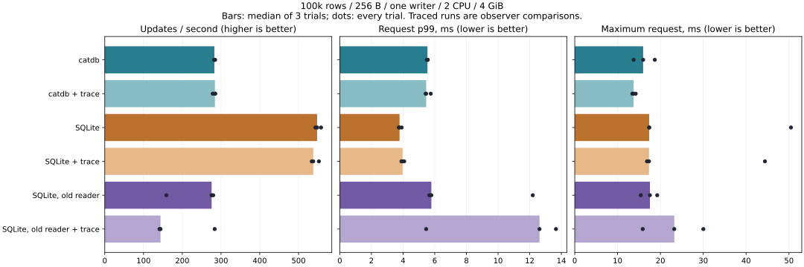
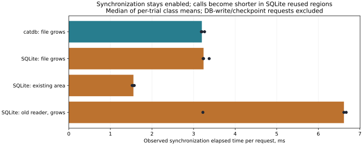

# Matched SilverHamu / SQLite durable-I/O comparison

**The observed gap tracks the cost of synchronization while extending versus
reusing the log, not fewer sync calls in SQLite. No engine/default was changed.**
This follows the [single-writer isolation study](../solo-update-2026-11-07/README.md).

100,000 synthetic rows / 256-byte values / one writer / 2 CPU / 4 GiB;
8,000 updates per fixture, three repeats with reversed/rotated condition order.
Each fixture uses a new Docker named volume. SilverHamu uses its default group commit;
SQLite uses WAL/FULL. Primary conditions have no retained reader during timing.
SQLite with an initial retained reader is a separate sensitivity condition.

## Overall results and observer cost

Throughput and p99 are medians of three trials. Worst maximum is the largest
individual request in any trial. All samples, including adverse trials, remain.

| Condition | Updates/s | p99 ms | Worst maximum ms |
|---|---:|---:|---:|
| catdb-plain | 282.846 | 5.540 | 18.689 |
| catdb-trace | 284.275 | 5.457 | 14.224 |
| sqlite-plain | 548.048 | 3.777 | 50.468 |
| sqlite-trace | 537.998 | 3.969 | 44.403 |
| sqlite-pinned-plain | 275.730 | 5.787 | 19.252 |
| sqlite-pinned-trace | 143.879 | 12.621 | 30.023 |

The ordinary catdb/SQLite results reproduce the gap: 282.846 versus 548.048
updates/s. Traced SilverHamu median throughput differs by +0.5%; ordinary SQLite by
-1.8%, with SQLite p99 increasing from 3.777 to 3.969 ms (+5.1%). These differences
are observations, not a precise estimate of instrumentation cost.

The retained-reader condition is **not a clean low-overhead validation**:
plain throughput is 275.7 / 158.9 / 279.9 updates/s and traced throughput is
143.9 / 141.2 / 283.6. Its traced median throughput is 47.8% lower and p99 is
118.1% higher. One plain trial also deteriorated. We cannot separate observer
effects from environment variation with these samples. No trial was dropped,
replaced or extended. Do not use its pooled median as proof of a causal slowdown
from the observer or as a general product ranking.

## Matched request classes

The table reports medians of per-trial mean **sync elapsed per request**, not
physical-device service time. Requests writing the main database are separated.

| Observed class | Requests per trial | Sync elapsed, ms |
|---|---:|---:|
| SilverHamu, extending log | 8,000 | 3.199 |
| SQLite, extending WAL without DB write | 999 | 3.240 |
| SQLite, reusing space without DB write | 6,993 | 1.554 |
| SQLite, main-database write/checkpoint | 8 | 12.921 |
| SQLite, retained reader, extending files | 8,000 | 6.617 |

Across the three ordinary SQLite traces, extension-class sync is 3.232 / 3.375 /
3.240 ms, while reuse-class sync is 1.524 / 1.574 / 1.554 ms. Each trace observes
seven WAL rewinds and eight requests writing the main database. Reuse is therefore
observed repeatedly within the same traced runs; it is not inferred only from a
cross-product throughput comparison. The retained-reader traces observe zero WAL
rewinds and zero main-database writes, but their absolute latency is unstable.

SQLite's [version 3.40.1 WAL implementation](https://github.com/sqlite/sqlite/blob/version-3.40.1/src/wal.c)
uses checksums/counters to distinguish valid frames from old content when a WAL
is reused. Its [WAL documentation](https://www.sqlite.org/wal.html) describes how
long readers can prevent checkpoint progress and WAL reuse. This is consistent
with the observed classes; it does not prove which filesystem or host operation
accounts for the faster sync. File layout, checkpoint state, cache and sync type
are not independently randomized here.

## Calls and application bytes

Every traced request has an observed successful synchronization. Counts below
are per 8,000-update fixture; real calls are never skipped.

| Trace condition | Sync calls | Observed write bytes |
|---|---:|---:|
| SilverHamu | 8,000 `fsync` | 2,536,000 log bytes |
| SQLite | 8,024 `fdatasync` | 32,960,256 WAL + 30,552,064–30,597,120 DB bytes |
| SQLite, retained reader | 8,001 `fdatasync` | 32,960,032 WAL + 8 explicit shared-memory bytes |

Ordinary SQLite has 8,016 WAL syncs plus 8 DB syncs. It performs **more**, not
fewer, sync calls than SilverHamu in this workload and writes more application bytes,
yet is faster overall. Memory-mapped writes and physical block/media amplification
are not measured by these totals. File extension totals are 2,536,000 bytes for
SilverHamu, 4,120,032 for ordinary SQLite, and 32,992,800 across the pinned SQLite files.
An extension is a logical EOF change, not a separate physical allocation timer.

## What remains outside the measured calls

| Median of per-run means, ms/request | SilverHamu traced | SQLite traced |
|---|---:|---:|
| Begin + update preparation (enclosing phase) | 0.009441 | 0.028271 |
| Commit (enclosing phase) | 3.502523 | 1.810647 |
| Sync (disjoint I/O phase) | 3.199493 | 1.776128 |
| Write calls (disjoint I/O phase) | 0.009368 | 0.009566 |
| Residual outside observed I/O | 0.303102 | 0.045734 |

The enclosing phases and I/O phases are **alternative partitions**, not additive.
Medians across runs also need not sum exactly. SilverHamu residual includes group
collection, validation/encoding, publication, Python/wrapper work and scheduling.
The preceding study measured collection near 0.273 ms using engine diagnostics;
we do not subtract that number from this independent run. SQLite page search,
encoding, locks and checkpoint CPU work are not individually timed here. Sync
elapsed includes OS blocking and scheduling, not just disk activity. The current
evidence prioritizes the log lifecycle rather than further splitting tiny CPU work.

## Safety, validation and boundaries

All 18 main fixtures passed: 144,000 timed updates and 72 full-content checks
(initial, retained old snapshot, latest and ordinary reopen). The six pilot
fixtures additionally passed 1,800 updates and 24 full-content checks. Content
hashes agree across conditions within each repetition. The traced main fixtures
cover 72,000 requests with successful per-request sync, matched monotonic times,
non-overlapping events, no recorded overflow/active descriptor close, and final
file lengths matching reconstructed writes/truncations. There are 72,075 observed
sync calls. Missing or invalid observations are rejected, not imputed.

Five analyzer tests and a native observer test passed, including invalid/nested
times, missing sync, failed-write records, EOF mismatches, rewind/truncation,
disabled recording, exact overflow boundaries and active-close detection. The
first build caught a misspelled observer function pointer and was fixed before
the pilot; no performance observation was discarded. The existing engine binary
and durability protocol are unchanged. Prior engine safety tests remain relevant,
but this study adds no new process-kill or physical power-cut certification.

The observer captures known pre-opened descriptors through libc interposition;
direct syscalls, hidden calls and memory-mapped writes can be outside its view.
Validation covers the expected workload, not arbitrary file rotations. Its fixed
buffer reserves 14.4 MB of virtual address space; resident usage was not measured.
All limitations and the adverse retained-reader observer results are retained.

## Decision and next design question

No production setting or format changed. Earlier
[append/fixed file probes](../log-sync-2026-11-05/README.md) already found that
switching append `fsync` to `fdatasync` alone did not remove the floor. The prior
[fixed-length log prototype](../fixed-log-2026-11-05/README.md) needed separate
payload and end-record syncs, which largely consumed the benefit.

The narrower next question is whether reusable, generation-identified log records
can establish an unambiguous durable commit boundary with one sync per group.
That requires a new recovery design and torn-write/stale-tail/crash proof; the
current results do **not** authorize removing the old end-record safeguard or
claim an implemented speedup. Long-lived readers and checkpoint/segment recycling
must remain part of that design.

## Artifacts and reproduction

[Method, commands, boundaries and tests](../../../benchmarks/io-phases/README.md),
[environment/source hashes](environment.json), [all trial summaries](summary.json),
[per-trial request classes](classes.json), [pilot evidence](pilot/environment.json).
The compressed per-trial JSON files retain every numeric request/event, synthetic
hash and check outcome; the plan files contain only synthetic keys/stamps.
The base image is `sha256:1473ef47248f65ee13b65ee6685a0e0896149d2ad3df879fa8909348c1561d56`,
matching the previous study's recorded binary/source environment. The new observer
image ID is recorded separately. SQLite is 3.40.1; SilverHamu is the unchanged release
engine built with Rust 1.89 and the service feature, accessed locally via C ABI.
