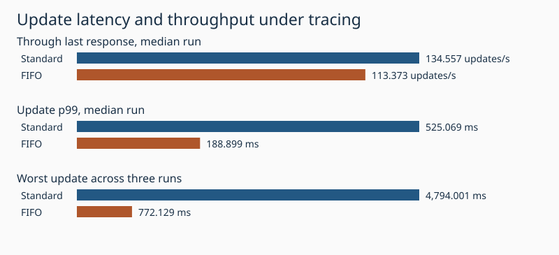
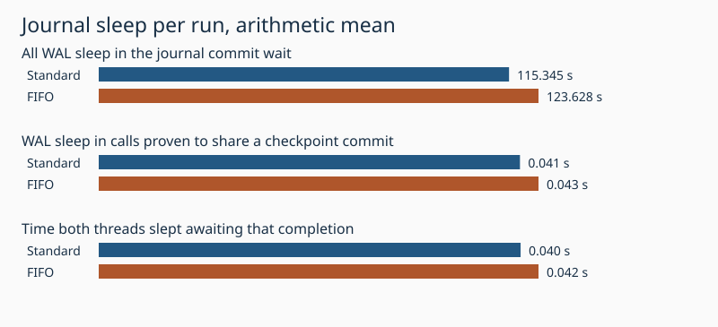

# Do WAL and checkpoint fsyncs wait for the same ext4 commit?

Standard and FIFO had **11 and 10** WAL calls respectively that slept for the same journal transaction as a checkpoint across three runs each. FIFO minus standard was **+8.283 s/run** for all WAL journal sleep and **+0.002 s/run** for WAL journal sleep in the proven shared calls. The remaining difference was **+8.281 s/run**. Other I/O on the guest device, journal batching and underlying storage latency can affect different transactions too. This experiment establishes identity and overlap, not how either call would perform without the other.

| Measure | Standard | FIFO | FIFO minus standard |
|---|---:|---:|---:|
| WAL fsync, s | 121.483 | 131.032 | +9.549 |
| WAL journal sleep, s | 115.345 | 123.628 | +8.283 |
| Attributed sleep before JBD2 start, s | 0.627 | 0.696 | +0.069 |
| Attributed sleep during JBD2 commit, s | 114.054 | 122.220 | +8.166 |
| Attributed sleep after JBD2 end, s | 0.664 | 0.712 | +0.048 |
| WAL calls targeting any observed checkpoint epoch | 3.667 | 3.333 | -0.333 |
| Shared WAL calls | 3.667 | 3.333 | -0.333 |
| Shared with snapshot sync | 3.667 | 3.333 | -0.333 |
| Shared with tail sync | 0.000 | 0.000 | +0.000 |
| Shared with replacement | 0.000 | 0.000 | +0.000 |
| Shared with other checkpoint calls | 0.000 | 0.000 | +0.000 |
| WAL journal sleep in shared calls, s | 0.041 | 0.043 | +0.002 |
| Simultaneous sleep to shared completion, s | 0.040 | 0.042 | +0.002 |
| Updates/s to last response, median | 134.557 | 113.373 | -21.185 |
| Updates/s through drain, median | 134.557 | 113.373 | -21.185 |
| Update p99, ms, median | 525.069 | 188.899 | -336.170 |
| Maximum update, ms, worst of three | 4,794.001 | 772.129 | -4,021.872 |

Each run used one million 256-byte values, four writers, 16,384 acknowledged updates, 63 independently published checkpoints, prefix prewriting enabled, two CPUs and 4 GiB in Docker on WSL2/ext4. Conditions alternated by pair. The workload checks the retained reader, successful version sequence, and reopened data. Both arms used synchronous persistence. The only Rust instrumentation change labels the checkpoint thread. Rates and p99 summarize the three trial-level observations. Sleep figures are per-run means.

## How a shared wait is identified

The five workload threads carry unique labels. Device-scoped journal events include other activity on that ext4 filesystem, so a nearby commit event alone carries no attribution. Each successful WAL syscall is joined to its application sync interval and thread. Each checkpoint snapshot sync is matched to its publication. The ext4 inode event identifies the workload device. Two entry probes read the requested transaction ID in ext4_fc_commit and jbd2_log_wait_commit. A qualifying sleep requires a scheduler stack in jbd2_log_wait_commit, a matching wait entry, and one unique start/end pair for that device and transaction ID. The end event must lie in both sleep intervals. Previously completed IDs, missing epochs and duplicate or ambiguous IDs do not qualify. Trace timestamps have microsecond precision on this guest. The time in shared calls includes the calls' entire journal sleep. The simultaneous column counts only the overlap through commit end. Guest sleep does not measure physical disk time. See [ext4 fsync](https://github.com/torvalds/linux/blob/v6.18/fs/ext4/fsync.c) and [JBD2 commit publication](https://github.com/torvalds/linux/blob/v6.18/fs/jbd2/commit.c).

## Filesystem scope

The measurement applies to the Docker volume on the guest ext4 filesystem. A native NTFS comparison would use the same update stream, checkpoint count, resource limits where possible, and flush-before-acknowledgement rule. A Windows candidate is measuring the buffered flush path against aligned write-through I/O under the same durable-acknowledgement contract ([Microsoft file flush documentation](https://learn.microsoft.com/en-us/windows/win32/api/fileapi/nf-fileapi-flushfilebuffers)). Windows file-flush and scheduler events can identify waiting phases; JBD2 transaction IDs are specific to the Linux measurement.

## Observer check

Two 512-update, 15-publication runs per mode and trace setting, on 10,000 rows. These short trials measure workload variation as well as observer overhead. Buffer overruns, dropped events and probe miss counters were checked in every capture.

| Mode | Measure | Plain mean | Traced mean | Change |
|---|---|---:|---:|---:|
| standard | updates_s | 319.618 | 318.086 | -0.5% |
| standard | p99_ms | 116.490 | 109.809 | -5.7% |
| standard | max_ms | 841.902 | 887.301 | +5.4% |
| fifo | updates_s | 292.676 | 303.303 | +3.6% |
| fifo | p99_ms | 23.061 | 19.276 | -16.4% |
| fifo | max_ms | 26.843 | 22.443 | -16.4% |

[All six full runs](trials.csv) · [All eight pilot runs](pilot.csv). The per-run compressed CSVs preserve fsync roles, transaction IDs, completion and sleep timestamps, and classification. Times are monotonic guest nanoseconds. To reproduce, build benchmarks/scaled-gate/Dockerfile.fifo as catdb-journal-identity and prepare the observer image used by benchmarks/wal-sync-waits. Run run.py first with --pilot and a fresh output directory, then with a separate output directory for full runs. Pass both directories and a report directory to report.py. The observer requires Linux tracefs, the two named kernel functions and ext4/JBD2 trace events.
