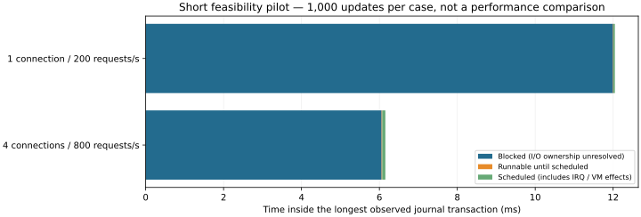

# Journal-wait feasibility investigation — 2026-11-06

**The feasibility gate did not fully pass.** Journal transaction phases and its thread scheduling can be paired, but these block tracepoints do not provide a stable request ID or a journal-transaction association. Physical/virtual I/O service time cannot be inferred from overlapping events alone. Following the agreed stopping rule, the 8,000-request / three-repetition main comparison was **not run**. No performance improvement or default change is claimed.

## What was measured

The existing unchanged server image and workload used 100,000 records of 256 bytes, 1 connection at 200 offered requests/s and 4 at 800/s. Each condition offered only 1,000 updates, once with tracing off and once with tracing on. The observer records journal start/locking/flushing/logging/end, journal/DB thread switch and wakeup, ext4 sync and block issue/complete/merge/requeue events. Per-switch stack acquisition was removed. Its ring capacity is still 16 MiB per CPU (512 MiB on this guest), so lower maximum memory use is not claimed.

| Pilot condition | Journal transactions | Longest journal transaction (ms) | Blocked (ms) | Runnable (ms) | Scheduled (ms) |
|---|---:|---:|---:|---:|---:|
| candidate-profile-trace-r1-c4-rate800-normal | 282 | 6.153 | 6.057 | 0.016 | 0.080 |
| candidate-profile-trace-r1-c1-rate200-normal | 997 | 12.045 | 11.999 | 0.008 | 0.038 |

The 1,279 journal transactions and 1,279 fsync calls were complete, with no reported overrun, dropped events, missing wakeup or phase-order error. Equal counts are a coverage check, **not proof of ownership between a particular DB sync and journal transaction**. The longest journal transaction was 12.045 ms: 11.999 ms blocked, 0.008 ms runnable and 0.038 ms scheduled. Across journal transactions the largest runnable interval total was 0.087 ms. The previous 129-ms outlier did not recur in this short pilot; its internal cause remains unassigned.

## Why the I/O attribution gate failed

The observed device was 8,64. Flush issue events used sector 0, while corresponding-looking flush completions used sector 18446744073709551615. Journal commit writes also emitted a nonzero-sector-count completion followed by a zero-sector-count completion. Pairing by nearest timestamp, sector, or one issue/one completion would therefore be unsafe. Other writes share this device and work can move from the journal thread to a worker.

The kernel [block tracepoint definition](https://raw.githubusercontent.com/torvalds/linux/v6.18/include/trace/events/block.h) exposes device, range and operation fields but no request pointer in this output; a completion can represent a portion of a request. The [journal commit path](https://raw.githubusercontent.com/torvalds/linux/v6.18/fs/jbd2/commit.c) also involves commit-record submission and waiting, with flush/FUA behavior depending on filesystem flags. These upstream definitions guide interpretation; this run uses the WSL2 kernel recorded in the preceding study, and its actual event formats were inspected.

We therefore report journal **blocked time**, not proven disk time. We cannot yet split that time between virtual-device completion, worker scheduling and shared filesystem work. The next instrumentation would need stable request identity across submission, split/merge/requeue/completion plus a defensible journal association; host Windows/device tracing would be needed to investigate below the guest. Neither stronger tracing nor filesystem policy changes were silently introduced in this pilot.

## Observer effect: preliminary only

| Connections / offered rate | Trace | p99 response (ms) | Maximum response (ms) | Updates/s |
|---|---|---:|---:|---:|
| 4 / 800 | off | 10.831 | 16.834 | 797.2 |
| 1 / 200 | off | 42.279 | 86.004 | 200.0 |
| 4 / 800 | on | 10.514 | 14.175 | 794.7 |
| 1 / 200 | on | 7.401 | 15.838 | 200.1 |

One short run is insufficient to quantify tracing overhead or a speedup; unfavorable results are retained. Removing stacks reduces one source of work, but this pilot does not demonstrate negligible observer overhead. There were 4,000 committed updates, no rejection or operation failure, eight full-content checks including two restarts. No benchmarks overlapped the safety test suites.

The first pilot accidentally mounted the previous collector. The missing journal event set was detected, the mount and an explicit event-set assertion were fixed, and its data are retained under `invalid-collector-attempt` rather than used for journal conclusions.

## Safety and reproduction

The export-failure check initially raced with writing the ready-file contents. The checker now waits for a complete instance name; the interrupted instance was explicitly removed and the repeated check verified cleanup after export failure. See [the result](export-failure-validation.json).

No production Rust/service/C ABI implementation or durability policy changed. Existing safety tests cover old snapshots, conflicts, failure and process-crash recovery; the new analyzer rejects incomplete/contradictory journal histories. See [validation.txt](validation.txt). Process-crash tests do not prove physical power-loss durability.

See [the harness](../../../benchmarks/journal-wait/README.md), [all pilot results](results.json), [exact journal partitions and block context](journal-analysis.json.gz), [summary](summary.json), [environment](environment.json), and [source/image provenance](provenance.json). Both owned trace instances were stopped and removed. Block events are context only, never silently converted to per-journal I/O durations.
