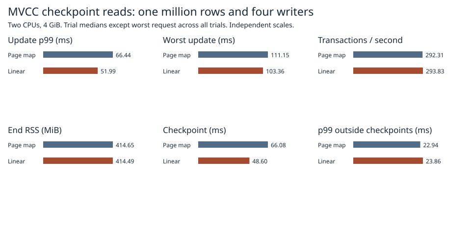

# Direct checkpoint encoding into a reusable 64 KiB buffer

Direct encoding of sorted MVCC rows measured **52.0 ms update p99**, a **103.4 ms** worst request, and 293.8 transactions/s at 414.5 MiB end RSS. The previous page-map encoder measured 66.4 ms, 111.2 ms and 292.3 transactions/s at 414.6 MiB.



| Path | p99 ms | Worst ms | Transactions/s | RSS MiB | Checkpoint ms |
|:---|---:|---:|---:|---:|---:|
| Previous | 66.44 | 111.15 | 292.31 | 414.65 | 66.08 |
| Linear | 51.99 | 103.36 | 293.83 | 414.49 | 48.60 |

All three paired repetitions had lower p99 and maximum latency with linear encoding. Throughput changed by just +0.5% at the median; in the first pair it fell from 331.0 to 290.6 transactions/s.

Each implementation ran the same 1,024 multi-key requests with four closed-loop writers, a pinned old reader and three checkpoints over 1M rows with alternating 8/32-byte keys and 256-byte values. Each trial used a fresh Docker volume, two CPUs, 4 GiB RAM and zero swap. Trial order alternated old/new, new/old, old/new. Median of three trial statistics except the slowest request across all runs. RSS was measured after the update loop with the old reader still pinned. Latency includes retries, checkpoint stalls and admission. [Individual trials](1m.csv) and [raw request and checkpoint records](raw/1m/).

## Why change the encoder?

In the [preceding experiment](../packed-mvcc-2026-11-07/README.md) the longest request in each trial of the then-fastest candidate spent 87.61, 97.96 and 91.47 ms overlapping checkpoint execution. None of those three requests retried. The checkpoint diagnostic averaged 12.88 ms of MVCC traversal/filling the page map and 20.77 ms in other assembly. The encoder still allocated a key/value pair per live row in a temporary ordered map and copied their bytes into an encoded frame. MVCC already provides the required order.

Both paths now use the same loop to select the version visible to the pinned reader, obey key fences, skip deleted rows, and release the state mutex after at most 512 visits or a page split. The candidate writes the inner operation header, key and value directly into a single preallocated 64 KiB vector, reused across the entire checkpoint. Continuation and split keys still need bounded copies. Once the state mutex is released, it fills lengths, generation and checksums, then writes the same encoded buffer to both independent disk slots. The frame limit, durable barriers, presentation to readers, file layout and conservative scratch reservation are shared with the control.

## Checkpoint timing

| Path | Scan | Assembly | Write | Sync | Remainder | Total |
|:---|---:|---:|---:|---:|---:|---:|
| Previous | 14.04 | 23.47 | 15.10 | 13.71 | 8.57 | 74.90 |
| Linear | 4.47 | 18.71 | 12.88 | 15.02 | 5.07 | 56.14 |

Mean milliseconds per checkpoint from one separate diagnostic trial per path, three checkpoints each. Scan includes row traversal and adding the selected bytes to the page. Assembly includes finishing the frame and envelope and allocating disk slots. Write includes file seeks and write calls. Sync measures the actual sync_data calls. The remainder includes directory processing and time outside markers. The diagnostic switches categories to avoid double-counting nested work. Timed performance cohorts run with phase recording disabled. [Per-checkpoint phases](phases.csv).

## Safety and reproduction

The byte comparison traverses pinned snapshots before and after editing and deleting rows. It checks empty and partial ranges, an empty value, binary keys, a maximum-size row, multiple page splits and long tombstone runs. It compares the full encoded bytes and lower fences to the existing encoder, the live row count to a transaction scan and the underlying allocation address across reuse. The process-kill and persistence-failure tests run through the linear checkpoint path. The budget boundary test separately checks one byte below and exactly at the existing reservation, including successful recovery after rejection. Every full-scale run verifies the latest map in commit order, the retained reader and the reopened map and sequence. The paired-record failure model covers one detectably damaged copy per record. [Test outcomes](safety.txt).

```sh
docker build -f benchmarks/scaled-gate/Dockerfile -t catdb-linear-page .
docker run --rm --network none --cpus 2 --memory 4g --memory-swap 4g -e CATDB_TEST_DIRECT=1 -e CATDB_TEST_LINEAR=1 catdb-linear-page cargo test --release --locked --lib -- --test-threads=1
docker run --rm --network none -e CATDB_TEST_PACK=1 -e CATDB_TEST_LINEAR=1 catdb-linear-page cargo test --release --locked --lib packed_budget_refusal -- --ignored
python benchmarks/scaled-gate/run_linear.py --stage pilot --out results/pilot
python benchmarks/scaled-gate/run_linear.py --stage diagnostic --out results/diagnostic
python benchmarks/scaled-gate/run_linear.py --stage 1m --out results/1m
python benchmarks/scaled-gate/report_pack.py --linear results report
```

Use new output directories. The encoder is opt-in within Linux test builds.
