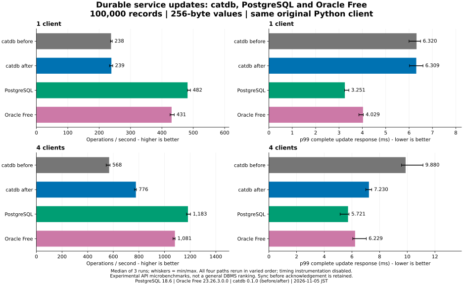

# Log synchronization and service grouping follow-up

The selected change improves **amortization of durable synchronization**, not the
latency of an individual synchronization. No file format, `sync_all` call,
conflict check or acknowledgement ordering was changed.

In three contemporaneous runs, four-client throughput rose from **567.8
to 776.4 operations/s (36.7% higher)** and median
run p99 fell from **9.880 to 7.230 ms (26.8% lower)**.
All plots include slow and fast runs. These are warm-cache, closed-loop Python
API measurements, not general DBMS rankings or engine-only ceilings.

| API | Clients | ops/s | p50 ms | p95 ms | p99 ms |
|---|---:|---:|---:|---:|---:|
| catdb before | 1 | 238.0 | 4.300 | 5.051 | 6.320 |
| catdb after | 1 | 239.0 | 4.259 | 4.959 | 6.309 |
| PostgreSQL | 1 | 481.9 | 1.847 | 2.837 | 3.251 |
| Oracle Free | 1 | 430.9 | 2.102 | 3.149 | 4.029 |
| catdb before | 4 | 567.8 | 6.837 | 8.031 | 9.880 |
| catdb after | 4 | 776.4 | 5.146 | 6.196 | 7.230 |
| PostgreSQL | 4 | 1182.7 | 3.487 | 4.135 | 5.721 |
| Oracle Free | 4 | 1080.8 | 3.747 | 4.555 | 6.229 |

## Gap to peers

- postgres: catdb reaches 65.6% of its update throughput, up from 48.0%. The absolute throughput gap shrinks by 33.9%.
- oracle: catdb reaches 71.8% of its update throughput, up from 52.5%. The absolute throughput gap shrinks by 40.7%.

PostgreSQL and Oracle Free remain faster here. They were rerun in the same
experiment; comparisons do not mix this run with the older workstation results.
The single-client panel exposes the cost when grouping is unavailable.

## Why the original sync cost remains

The append probes compare a 32 MiB file and 512 writes of 600 bytes per run,
three shuffled repeats. Numbers below are the median of each run's mean and p99;
they are file I/O diagnostics, not database throughput measurements.

| Probe (sync time) | Mean ms | p99 ms |
|---|---:|---:|
| append-fdatasync-combined | 3.377 | 5.510 |
| append-fdatasync-reserved | 3.407 | 5.761 |
| append-fdatasync-split | 3.350 | 5.627 |
| append-fsync-combined | 3.309 | 4.773 |
| append-fsync-reserved | 3.363 | 5.011 |
| append-fsync-split | 3.347 | 4.742 |
| fixed-fdatasync | 1.626 | 2.843 |
| fixed-fsync | 2.866 | 5.156 |

| Probe (durable time) | Mean ms | p99 ms |
|---|---:|---:|
| O_DSYNC | 3.418 | 5.602 |
| O_DSYNC-reserved | 3.343 | 4.592 |
| O_SYNC | 3.344 | 4.750 |
| RWF_DSYNC | 3.359 | 5.625 |
| fdatasync | 3.409 | 5.551 |
| fsync | 3.323 | 4.656 |

The raw [append/fixed-size probe](probes/append-and-fixed.json.gz) and
[durable-write probe](probes/durable-write.json.gz) retain every observation.
Append fsync/fdatasync, keeping allocation beyond EOF, combined writes,
O_SYNC/O_DSYNC and RWF_DSYNC all remained near 3.3–3.4 ms per durable operation.
Fixed-size overwrite with fdatasync was near 1.6 ms, but it changes the file's
logical-length model. Adopting it requires a separate recovery protocol and is
**not part of this change**. It is evidence consistent with file growth metadata
contributing to the cost, not a definitive kernel-level attribution.

[Linux fsync/fdatasync semantics](https://github.com/mkerrisk/man-pages/blob/master/man2/fsync.2)
require metadata needed to retrieve data, including changed file length, to be
synchronized even with fdatasync.
[KEEP_SIZE preallocation](https://man7.org/linux/man-pages/man2/fallocate.2.html)
keeps logical EOF unchanged, so it cannot remove that requirement.
The implementation retains Rust's
[`File::sync_all`](https://doc.rust-lang.org/std/fs/struct.File.html#method.sync_all).

## Selected policy and rejected candidates

The selected service policy allows a recently full group to re-form within one
1 ms collection budget; four queued requests end collection early. A group that
actually waited behind a prior writer can also refill an expired partial batch.
The two extra budgets do not accumulate. The recent-full hint expires after 2 ms
and uses one fixed-size entry per database. Idle/small-group operation retains the
existing 200 us collection budget. A sudden four-to-one transition inside that
2 ms interval can incur one extra wait; OS scheduling may exceed the requested
wait, so this is not a real-time guarantee. Queue count/byte limits are unchanged.

This follows the general principle that arrivals during one durable flush can
form the next group, discussed in
[PostgreSQL's WAL configuration documentation](https://www.postgresql.org/docs/18/wal-configuration.html).
No external database source code was copied.

Rejected exploratory pilots are retained rather than omitted:

- [Partial-group-only refill](pilots/partial-only/results.json): 570.5 to 621.8
  operations/s, but p99 worsened from 10.463 to 11.118 ms at four clients.
- [Actual-handoff-only refill](pilots/handoff-only/results.json): instrumented
  567.8 to 603.9 operations/s, but p99 worsened from 9.808 to 10.646 ms.
- [Recent-full-group pilot](pilots/recent-full-group/results.json): instrumented
  748.7 operations/s and 7.596 ms p99; selected for the full comparison.

These are one-repeat exploratory runs with different policies, not evidence of
statistical significance. Their image IDs, configurations and raw distributions
remain in each pilot directory. They do not all correspond to the final source.

## Diagnostic overhead and synchronization breakdown

Separate four-client runs alternate ordinary and instrumented builds, three
repeats each. Instrumentation includes server timestamps, response encoding and
client collection. It can change arrival timing; a higher measured throughput
with instrumentation does not imply negative overhead. The main plot has it off.

| Build | Operations/s | p99 ms |
|---|---:|---:|
| current | 569.6 | 9.780 |
| current-diag | 567.7 | 9.798 |
| candidate | 775.2 | 7.328 |
| candidate-diag | 747.9 | 7.841 |

| Instrumented build | Updates/sync | Mean sync ms | Sync p99 ms |
|---|---:|---:|---:|
| current-diag | 2.000 | 3.426 | 5.539 |
| candidate-diag | 3.984 | 3.435 | 5.229 |

Stage statistics are per commit (a shared sync appears for every member), with
medians across runs. Stage p99s cannot be added to reconstruct response p99.
See [all stage distributions](observer/diagnosis.json), [observer raw results](observer/results.json)
and [methodology/reproduction](../../../benchmarks/log-sync/README.md).

## Verification, provenance and limitations

- Main run: 192,000 attempted/completed operations, zero errors/retries, 48
  full-content/boundary checks and 12 restarts. Cross-engine hashes agree.
- Observer run: 96,000 operations, 36 full-content checks and 12 restarts.
  All commit traces are present, monotonic and within group limits.
- Selected-policy Linux Rust suite: 101 passed, four worker helpers ignored;
  service protocol: 13 passed; C ABI: 30 passed; clippy passed.
- Existing tests cover old snapshots, conflicts, resource limits, failed writes,
  incomplete logs and subprocess termination around synchronization/publication.
  Policy boundary tests cover empty/small/full groups and hint expiry. A gated
  sync test proves no early successful response or uncommitted visibility.
- [Implementation CI](https://github.com/dhq-boiler/catdb/actions/runs/41890144568)
  passed on Windows and Linux, including service/C ABI checks and the Docker
  restart test.
- Process termination and fault injection are not real power-loss testing.
  Durability still depends on the OS and device honoring synchronization.
- This workload has no concurrent checkpoint, mixed reads, replication, cold
  cache, open-loop arrivals or larger-than-memory data. Results from three runs
  describe this machine and workload; they are not confidence intervals.

[Environment and image digests](environment.json), [raw run summaries](results.json),
[all numerical results](table.md) and [source/build provenance](provenance.json)
are published with the original compressed response-time samples. Earlier
comparisons remain unchanged.
