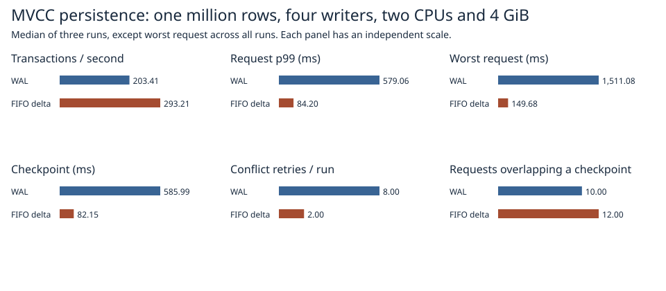

# FIFO delta persistence connected to SilverHamu MVCC

With native MVCC on both paths, FIFO delta persistence measured **293.2 transactions/s**, p99 **84.2 ms**, and worst request **149.7 ms**. WAL measured 203.4 transactions/s, 579.1 ms and 1,511.1 ms. End RSS was 769 MiB for the prototype and 409 MiB for WAL. The candidate reduced p99 and maximum latency in every pair. Throughput improved in two pairs; the third measured 189.56 versus 190.70 transactions/s.



| Run | Path | Tx/s | p99 ms | Worst ms | Checkpoint ms | Retries | End RSS MiB |
|---:|:---|---:|---:|---:|---:|---:|---:|
| 1 | wal | 203.41 | 606.38 | 1,418.16 | 603.75 | 8.00 | 409.41 |
| 1 | mvcc | 293.21 | 84.05 | 138.43 | 82.15 | 2.00 | 768.42 |
| 2 | mvcc | 293.28 | 84.20 | 149.68 | 81.35 | 2.00 | 768.79 |
| 2 | wal | 219.45 | 535.43 | 1,511.08 | 506.26 | 8.00 | 409.64 |
| 3 | wal | 190.70 | 579.06 | 1,226.56 | 585.99 | 10.00 | 409.42 |
| 3 | mvcc | 189.56 | 95.04 | 129.55 | 85.43 | 3.00 | 768.96 |

The headline uses median trial throughput and p99, and the single worst request across three trials. Checkpoint time is the median of three checkpoints within each trial.

All three trial pairs used the same deterministic 1,024 multi-key requests, four closed-loop writers, a pinned old reader, and three checkpoints after each group of 256 successful updates. The first four transactions start together. Each request's timer includes preparation, admission, checkpoint stalls, commit, conflict and retry. WAL uses the current native transaction path with group commit disabled, matching the [previous four-writer workload](../publication-waits-2026-11-07/README.md). Candidate and control share the same checkpoint admission rule. Each fresh Docker volume ran at 2 CPUs, 4 GiB RAM and zero swap. The 1M initial values are 256 bytes with alternating 8/32-byte keys. Setup, full validation and warm reopen are outside throughput. [Per-trial metrics](trials.csv) and [raw request timestamps and source hashes](raw/1m/).

## What is connected

Both variants use Database::begin, actual Transaction::put/delete/commit operations and Database::begin_read. The opt-in Linux test database dispatches commit to a ticket queue. Only after receiving its turn does the transaction acquire the native writer lock and validate against current MVCC state. The native commit implementation encodes its frame, releases the state lock during persistence, and publishes versions after the persistence callback succeeds. The adapter checks the sequence, decodes the frame and synchronously appends the paired delta records. The three synchronous checkpoints write the dirty 64 KiB pages, sync the page file, sync the directory of page references and publish the generation selector. Old readers use the production in-memory version chains throughout.

The delta backend keeps a separate live key/value index for checkpoint materialization in addition to the MVCC index. End-of-loop RSS includes both. The adapter also re-encodes the decoded changes for the paired log. These costs are included in the measured request path. The experiment measures the combined storage and admission policy. It uses a fixed library ID, Linux release test builds, the benchmark resource limits, and the existing prototype page-size bound.

Recovery opens the delta control file and page pool, replays the selected log, and populates a fresh MVCC state in batches at the recovered commit sequence. There is no seed or fallback WAL to read. The native state's file slot uses a read-only inert descriptor; durable bytes for this backend go to the two delta files. The checkpoint epoch and the MVCC commit sequence advance independently. Live old readers retain their snapshots for their transaction lifetime. Reopening creates new readers at the recovered sequence.

## Safety

- A paused pre-sync writer leaves an already-pinned reader and a newly started reader at the prior generation. After release, the waiting same-key transaction is rejected. A point read on the deleted key and a range read covering an inserted key conflict even after a checkpoint. A disjoint stale writer commits successfully and a fresh post-reopen update receives the next sequence.
- Injected append, page-sync and selector-sync errors require reopen. Recovery checks the complete map and version and permits only an entire uncertain transaction or its absence.
- A parent forcibly terminates the writer at seven boundaries covering partial append, before/after append sync, successful return, page sync and selector publication. Every acknowledged update and its generation must survive. The underlying dual-record corruption model permits one detectably damaged copy per record. These are process termination tests on a running host.
- Every main trial checks the pinned reader and latest data in full against the committed order, closes the database and verifies all reopened rows. The delta trials also require the exact last commit sequence after reopen. [Safety output](safety.txt).

## Reproduction

```sh
docker build -f benchmarks/scaled-gate/Dockerfile -t catdb-mvcc-gate .
docker run --rm --network none --cpus 2 --memory 4g --memory-swap 4g catdb-mvcc-gate cargo test --locked --release --lib -- --test-threads=1
python benchmarks/scaled-gate/run_mvcc.py --stage pilot --out results/pilot
python benchmarks/scaled-gate/run_mvcc.py --stage 1m --out results/1m
python benchmarks/scaled-gate/report_four.py --mvcc results/1m report
```

Use fresh output paths. The mode switch and alternate persistence dispatch compile only in the Linux test build. WAL files, the shipped storage default and the service/DLL interfaces retain their existing formats and behavior.
