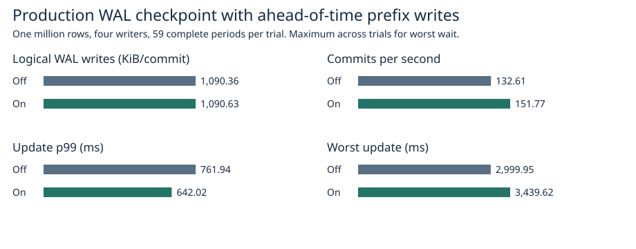
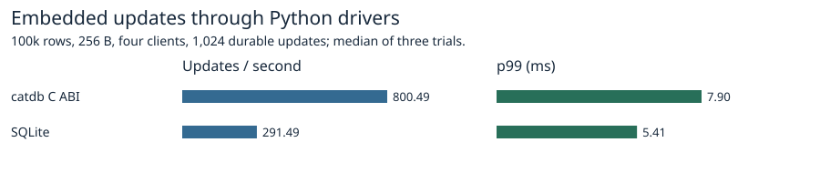
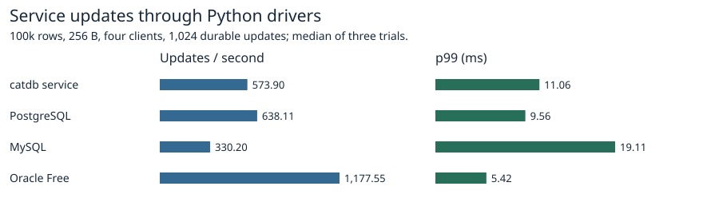

# Ahead-of-time snapshot encoding in the production WAL checkpoint

The normal Rust transaction engine with its production WAL ran in both arms. Enabling prefix preparation measured **642.02 ms** update p99 versus **761.94 ms** for ordinary checkpoints. Logical writes changed by **+0.025%**, throughput by **+14.45%** and p99 by **-15.74%**. The enabled run had a lower p99 in 2/3 matched trials and a lower maximum in 1/3. Prefix preparation remains opt-in. The worst update rose from 2,999.95 to 3,439.62 ms. The six trials do not identify the OS or device cause of an individual outlier.

| Metric | Ordinary checkpoint | Prefix prepared on a maintenance thread |
|---|---:|---:|
| Logical writes (KiB/commit) | 1,090.36 | 1,090.63 |
| Commits/s | 132.61 | 151.77 |
| Update p99 (ms) | 761.94 | 642.02 |
| Worst update in aligned window (ms) | 2,999.95 | 3,439.62 |
| Worst update over the full run (ms) | 2,999.95 | 3,439.62 |
| Foreground checkpoint (ms) | 631.33 | 496.15 |
| Prefix at handoff (MiB/checkpoint) | 0.00 | 142.18 |
| WAL suffix copied (MiB/checkpoint) | 0.00 | 0.12 |

Across the 15,104 steady-window commits, median total WAL traffic was 15.71 GiB with the ordinary checkpoint and 15.71 GiB with the prefix.

## What the comparison measures

Each trial uses one million seeded rows with 256-byte values, four concurrent writers, two CPUs, 4 GiB, no swap and a new Docker volume. Both arms use the engine's default group-commit setting and the same 16,384-operation input stream. The order alternates over three repetitions. Both arms validate the pinned old snapshot, current values and commit order, and recovery after reopening. The benchmark uses a release-mode test binary to drive the actual production file and transaction APIs. The earlier paired-page backend is absent from this comparison.

The driver starts one prefix worker at the beginning of each 256-commit period. The worker writes at most 2,048 chunks of up to 256 visited keys. At the scheduled checkpoint the driver waits for any remaining preparation, finishes the same temporary file and synchronizes it before atomic replacement. As in the previous benchmark, the driver closes writer admission while it performs the scheduled foreground checkpoint. The production checkpoint itself releases its writer lock during the snapshot scan. A caller that schedules an ordinary checkpoint independently of incoming writes can therefore see different request latency. Foreground latency includes the worker join. Prefix size is measured at handoff and includes any work completed during the join. A final uncompleted period is outside the steady-state window.

Both arms publish 63 checkpoints per run. Aligned measurement starts immediately after the fourth publication (workload commit 1,024) and ends after the 63rd (16,128), giving 15,104 commits and 59 complete periods. Throughput divides that count by wall time. End-to-end update latency includes retries and admission waits; a request belongs to the window containing its completion. Results are medians of three trial statistics except the maximum latency across all three. [Each trial](trials.csv), [all 354 intervals](intervals.csv), [raw samples, image and verification](raw/).

The trial data also report the checkpoint overlap of the actual p99 request and the p99 of requests with zero overlap. Overlap alone cannot identify a device or scheduling cause.

The byte total for each completed period equals appended WAL frames (old WAL logical end minus previous published length) plus the new snapshot and copied suffix (published length) plus the 48-byte header rewrite. Preparing a prefix writes directly into the replacement and those bytes count once. The counters describe application writes to WAL files in successful default-format checkpoints. Filesystem metadata, preallocation, device amplification and physical power failure are outside this measurement. Do not compare these absolute latencies to the earlier incremental-page experiment: the production format writes the whole snapshot each time.

## Rust API and recovery

`Database::prepare_checkpoint_prefix(max_chunks)` writes the beginning of an unpublished replacement while holding a snapshot. A single active prefix per database and the normal transaction and working-buffer limits bound resource use. Use a maintenance thread when preparation should overlap updates. Finish the handle at the publication boundary or drop it to discard the temporary file and release its snapshot. An intervening successful ordinary checkpoint makes an older prefix stale. Failed publication retains the existing uncertain-outcome handling. A terminated process can leave an unreferenced checkpoint temporary file; recovery opens the published database path.

~~~rust
let worker_db = db.clone();
let worker = std::thread::spawn(move || worker_db.prepare_checkpoint_prefix(2048));
// Application writers can continue here.
let prefix = worker.join().expect("maintenance thread panicked")?;
let info = prefix.finish()?;
~~~

Tests cover updates on both sides of the cursor, insertions, deletes, retained old values, point and range conflicts, bounded admission, buffer refusal, discard, a read-only output failure, superseded prefixes and reopening. Child exits at prefix completion, snapshot sync, suffix sync and after replacement verify that acknowledged commits remain recoverable. [Prefix tests](raw/safety.txt), [process exits](raw/crash.txt), [full library suite](raw/suite.txt), [optional features](raw/features.txt).

## Reproduction

~~~sh
docker build -f benchmarks/scaled-gate/Dockerfile -t catdb-native-prefix .
python benchmarks/scaled-gate/run_native_prefix.py --stage 1m --out raw
python benchmarks/scaled-gate/report_native_prefix.py raw report
~~~

The reporter also reads published compressed logs. Timing used the linked implementation revision. The shipping source moves the prefix routines into their own module and limits temporary-path cleanup to its owner. A subsequent on/off smoke run verifies the final build. [Final enabled smoke test](raw/smoke-on.txt), [disabled](raw/smoke-off.txt). [Timed source revision](https://github.com/dhq-boiler/catdb/tree/f09b283970eac0aef9cf78bdee1c2b60a78c55c9).

## Product reference

A separate campaign uses 100k rows, 256-byte values, four clients and 1,024 synchronous updates, three repetitions per engine. Production catdb C ABI and service callers use ordinary checkpoints. This comparison provides context; only the native million-row chart times the new Rust API. The product runner verifies complete digests after restart. [Medians](products.csv), [versions and raw data](raw/products/).

~~~sh
docker build -f benchmarks/Dockerfile -t catdb-prefix-products .
python benchmarks/run.py --image catdb-prefix-products --single-request --four-updates --rows 100000 --ops 1024 --reps 3 --out products
python benchmarks/scaled-gate/report_prewrite_products.py products report
~~~
