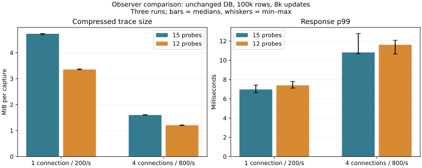

# Reducing observer work without waiving loss — 2026-11-06

**Do not adopt the reduced observer as the default.** Compressed records fell about 24–29%, but the full observer had 0/6 rejected captures and the reduced observer 2/6. Median p99 also increased in both connection conditions. This changes an experimental observer, not the production DB; existing defaults and durability remain unchanged. The small sample does not prove that removing probes caused the misses.

## Prior evidence and hypothesis

The previous storage-stage study had zero ring overruns/drops in all six captures, but three captures had missed dynamic-probe instances. Entry and return probes on the affected paths reported equal missing counts. The [kernel implementation](https://raw.githubusercontent.com/torvalds/linux/v6.18/kernel/trace/trace_kprobe.c) combines entry-probe and return-instance misses in a return probe profile. Therefore, increasing return capacity alone cannot explain away entry-probe misses. Reentry is a candidate described by the [Kprobes documentation](https://docs.kernel.org/trace/kprobes.html), not a proven cause of these particular events.

Counters are recorded before capture and after tracing stops. The strict check still rejects any cumulative miss, including setup activity; it does not subtract the baseline to waive losses. These counters do not locate the exact missed invocation, and their observation lifetime is broader than the timed client workload.

The running kernel exposes CONFIG_OPTPROBES=y, CONFIG_KPROBES_ON_FTRACE=y and CONFIG_FUNCTION_TRACER=y. This establishes available mechanisms, not which mechanism caused a particular loss. All before-capture miss counters were zero in this study, all ring-loss counters remained zero, and no return probe showed extra misses beyond its paired entry probe. The exact triggering call/reentry remains unidentified.

## Bounded preliminary comparison

Each mode ran 1,000 updates once at 1/4 connections. All four traced modes had zero reported misses in that short pilot. No difference in loss reliability was demonstrated. Full = 15 probes; capacity = 15 with maxactive 128 for returns; minimal = 12, removing unused rq_end/rq_update/rq_update_return plus duplicate block/ext4 events. Standard = existing SCSI/block/journal events without dynamic probes.

| Pilot case | Mode | Events in capture | Compressed bytes | Direct mapping gate |
|---|---|---:|---:|---|
| candidate-profile-trace-full-r1-c4-rate800-normal | full | 33268 | 221775 | True |
| candidate-profile-trace-full-r1-c1-rate200-normal | full | 99852 | 623743 | True |
| candidate-profile-trace-minimal-r1-c4-rate800-normal | minimal | 26435 | 169092 | True |
| candidate-profile-trace-minimal-r1-c1-rate200-normal | minimal | 73743 | 439853 | True |
| candidate-profile-trace-capacity-r1-c4-rate800-normal | capacity | 33218 | 219367 | True |
| candidate-profile-trace-capacity-r1-c1-rate200-normal | capacity | 99689 | 621353 | True |
| candidate-profile-trace-standard-r1-c4-rate800-normal | standard | 20932 | 156073 | False |
| candidate-profile-trace-standard-r1-c1-rate200-normal | standard | 54731 | 387996 | False |

The standard-only mode lacks the same direct request-pointer/journal-parent mapping and was not advanced to causal testing. Increasing return capacity showed no distinguishing evidence in the short pilot, and prior misses also affected entry probes; that candidate was not extended. The minimal mode preserved direct mapping and reduced record volume, so it was selected for the repeated comparison with full mode. It intentionally loses the older per-data-update diagnostics, not the stage correspondence needed by this study.

## Repeated comparison

100,000 records × 256 bytes, 1 connection at 200 offered requests/s and 4 at 800/s, 8,000 updates per case, full/minimal alternating for three repetitions. Same server image, bounded request queues and durability settings. All 96,000 main updates committed with zero rejection/operation error. This is a fixed-arrival comparison of two observers, not maximum throughput and not a repeated trace-off comparison.

| Connections | Mode | Median p99 ms | Maximum response ms | Rejected captures / 3 | Median events | Median compressed bytes |
|---:|---|---:|---:|---:|---:|---:|
| 1 | full | 6.967 | 46.353 | 0 | 793902 | 4958928 |
| 1 | minimal | 7.397 | 152.548 | 1 | 584280 | 3518482 |
| 4 | full | 10.816 | 22.507 | 0 | 254549 | 1675744 |
| 4 | minimal | 11.611 | 21.233 | 1 | 198078 | 1267046 |

| Capture | Missed probe instances by point | Baseline misses | Extra return misses over entry | Causal gate |
|---|---|---|---|---|
| candidate-profile-trace-full-r1-c4-rate800-normal | {} | {} | {'rq_update_return': 0, 'fp_return': 0, 'st_queue_return': 0, 'st_channel_return': 0} | True |
| candidate-profile-trace-full-r1-c1-rate200-normal | {} | {} | {'rq_update_return': 0, 'fp_return': 0, 'st_queue_return': 0, 'st_channel_return': 0} | True |
| candidate-profile-trace-minimal-r1-c4-rate800-normal | {} | {} | {'fp_return': 0, 'st_queue_return': 0, 'st_channel_return': 0} | True |
| candidate-profile-trace-minimal-r1-c1-rate200-normal | {} | {} | {'fp_return': 0, 'st_queue_return': 0, 'st_channel_return': 0} | True |
| candidate-profile-trace-minimal-r2-c4-rate800-normal | {'rq_free': 1, 'st_done': 1, 'st_channel': 1, 'st_channel_return': 1} | {} | {'fp_return': 0, 'st_queue_return': 0, 'st_channel_return': 0} | False |
| candidate-profile-trace-minimal-r2-c1-rate200-normal | {'fp_seq': 1, 'st_done': 1, 'st_channel': 1, 'st_channel_return': 1} | {} | {'fp_return': 0, 'st_queue_return': 0, 'st_channel_return': 0} | False |
| candidate-profile-trace-full-r2-c4-rate800-normal | {} | {} | {'rq_update_return': 0, 'fp_return': 0, 'st_queue_return': 0, 'st_channel_return': 0} | True |
| candidate-profile-trace-full-r2-c1-rate200-normal | {} | {} | {'rq_update_return': 0, 'fp_return': 0, 'st_queue_return': 0, 'st_channel_return': 0} | True |
| candidate-profile-trace-full-r3-c4-rate800-normal | {} | {} | {'rq_update_return': 0, 'fp_return': 0, 'st_queue_return': 0, 'st_channel_return': 0} | True |
| candidate-profile-trace-full-r3-c1-rate200-normal | {} | {} | {'rq_update_return': 0, 'fp_return': 0, 'st_queue_return': 0, 'st_channel_return': 0} | True |
| candidate-profile-trace-minimal-r3-c4-rate800-normal | {} | {} | {'fp_return': 0, 'st_queue_return': 0, 'st_channel_return': 0} | True |
| candidate-profile-trace-minimal-r3-c1-rate200-normal | {} | {} | {'fp_return': 0, 'st_queue_return': 0, 'st_channel_return': 0} | True |

Miss counts across different probe points are not distinct lost DB requests and must not be added as such. Rejected traces remain available but are excluded from causal interpretation. Client timing remains in the comparison even if tracing failed quality checks. Equal entry/return loss counts are consistent with a shared entry-side problem; they do not identify the exact reentry or interrupt path. No selective rerun or extended search was used.

The 152.548-ms maximum response occurred in the second 1-connection minimal run, whose trace was rejected. It cannot be causally assigned to synchronization or the observer from that incomplete trace. Full-mode maximum response was 46.353 ms for 1 connection. These unfavorable results are retained, and no maximum-wait improvement is claimed.

Record counts and compressed size cover the entire capture, not just the timed workload. Batch sizes and guest background I/O can also change event volume. Compression/export occur after timing; compressed bytes do not measure live RAM allocation or production WAL traffic. The ring remains 16 MiB/CPU (512 MiB capacity here), so a smaller exported file does not mean that reserved trace memory shrank.

## Safety, limits and remaining work

The exact probe set, zero cumulative misses, zero ring loss, cleanup, request identity/reuse, retries and complete stage matching remain required. Missing/bad counters and unmatched events are rejected. Standard-only trace success is not substituted for direct causal mapping. Host storage latency and virtual delivery remain unresolved; no database durability or default change is justified by these results alone.

The observer uses a private instance, owned registry group and 180-second deadline. It does not modify global kernel tuning. Export failure cleanup is checked; forced process/VM termination can still leave resources. Pointer anonymization remains in place. Existing Rust/service/C ABI tests verify snapshots, conflicts and process-crash recovery after measurement; physical power loss is not tested. Full-content checks follow every condition and restart.

No builds/tests/chart rendering overlapped timed runs. Small host source/document edits and completed-record reads occurred; other host/device activity was not controlled. See [reproduction](../../../benchmarks/observer-loss/README.md), [validation](validation.txt), [raw timing](results.json), [quality summary](observer-summary.json), [pilot](pilot/results.json) and [provenance](provenance.json).
